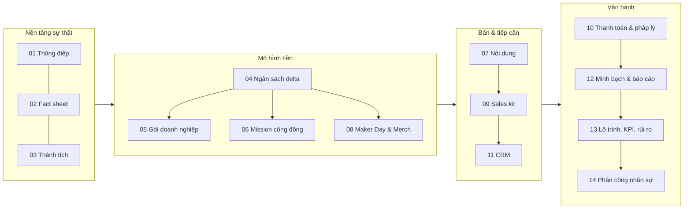

# 00 — BUILD THE NEXT ROBOT · Bộ tài liệu chiến dịch tài trợ FTC 2026–2027

> *Mỗi mảnh ghép, một bước tiến.* Robotics Sóc Sơn · THPT Sóc Sơn, Hà Nội · FTC **#39256** · mùa **BIOBUZZ™ presented by RTX** (FIRST CANOPY™)

Đây là bộ tài liệu vận hành chiến dịch. Mọi số liệu nghiên cứu nằm trong [`research/`](research/). Quyết định có tranh luận xem trong [`99-bien-ban-thao-luan.md`](99-bien-ban-thao-luan.md). Phân công nhân sự nằm tại [`14-phan-cong-nhan-su.md`](14-phan-cong-nhan-su.md).

## Số chốt

| Chỉ số | Giá trị |
|---|---:|
| Mục tiêu công khai | **33.975.000 ₫** |
| Phần cứng landed, 11 linh kiện | 30.975.000 ₫ |
| Quỹ dự phòng kỹ thuật & tỷ giá | 3.000.000 ₫ |
| Công thức | **30.975.000 + 3.000.000 = 33.975.000 ₫** |
| Đợt 1: Control Hub + Viper Slide trước 20/11/2026 | **≥ 17.546.000 ₫** |
| Đợt 2: phần còn lại trước 05/12/2026 | **16.429.000 ₫** |
| Gói tài trợ | **3M · 5M · 10M · 25M + hiện vật quy đổi 1:1** |
| Tỷ giá dùng | 25.800 ₫/USD |

Maker Day và Merch là nguồn thu tự tạo, bán vé/preorder trước, nằm ngoài mục tiêu 33.975.000 ₫.

## Mục lục

| # | File | Nội dung |
|---|---|---|
| 01 | [01-thong-diep-dinh-vi.md](01-thong-diep-dinh-vi.md) | Thông điệp, định vị, câu chuyện, đoạn giới thiệu VI/EN |
| 02 | [02-fact-sheet-mua-giai.md](02-fact-sheet-mua-giai.md) | Mùa BIOBUZZ, FTC VN, mã đội, trường, số liệu FIRST |
| 03 | [03-thanh-tich-chuan-hoa.md](03-thanh-tich-chuan-hoa.md) | Bảng thành tích duy nhất đã khóa, kèm bằng chứng |
| 04 | [04-ngan-sach-delta.md](04-ngan-sach-delta.md) | Ngân sách 11 linh kiện, dự phòng, 2 đợt giải ngân |
| 05 | [05-goi-tai-tro-doanh-nghiep.md](05-goi-tai-tro-doanh-nghiep.md) | 4 gói tài trợ, hiện vật, thứ tự tiếp cận |
| 06 | [06-mission-gay-quy-cong-dong.md](06-mission-gay-quy-cong-dong.md) | 4 mission phần cứng + quỹ dự phòng, tracker, CTA |
| 07 | [07-chuyen-linh-kien-noi-dung.md](07-chuyen-linh-kien-noi-dung.md) | Các series nội dung, lịch 8 tuần, quảng cáo |
| 08 | [08-maker-day-merch.md](08-maker-day-merch.md) | Maker Day và Merch: tự cấp vốn bằng vé/preorder |
| 09 | [09-sales-kit.md](09-sales-kit.md) | One-pager, deck, email, kịch bản gọi điện, grant |
| 10 | [10-support-thanh-toan-phap-ly.md](10-support-thanh-toan-phap-ly.md) | TT 16/2018, TT 20/2026, hợp đồng 3 bên, VietQR, NĐ 13/2023, `/support` |
| 11 | [11-crm-prospect.md](11-crm-prospect.md) | Cấu trúc CRM, 53 prospect, pipeline grant |
| 12 | [12-minh-bach-bao-cao-tac-dong.md](12-minh-bach-bao-cao-tac-dong.md) | Hành trình nhà tài trợ, sổ cái, báo cáo tác động |
| 13 | [13-lo-trinh-phan-cong-kpi-rui-ro.md](13-lo-trinh-phan-cong-kpi-rui-ro.md) | Gantt, RACI, KPI, rủi ro, checklist |
| 14 | [14-phan-cong-nhan-su.md](14-phan-cong-nhan-su.md) | Vai trò, nhiệm vụ, người phụ trách, BOM |
| 99 | [99-bien-ban-thao-luan.md](99-bien-ban-thao-luan.md) | 8 quyết định có tranh luận |

Research: [R1 mùa giải & đội](research/R1-season-team.md) · [R2 linh kiện & nhập khẩu](research/R2-parts-import.md) · [R3 vận hành, merch, sự kiện](research/R3-ops-merch-events.md) · [R4 pháp lý & thanh toán](research/R4-legal-payment.md) · [R5 nhà tài trợ & benchmark](research/R5-sponsors-benchmarks.md) · [R6 mạng xã hội & nhà tài trợ cũ](research/R6-social-sponsors.md) · [R7 bằng chứng & dữ liệu trận](research/R7-evidence.md) · [R8 thông tin trường, FTC VN, VietQR](research/R8-official-info.md)

## Trước khi công khai

- Điền tên, lớp/chức vụ, SĐT trong [14 — Phân công nhân sự](14-phan-cong-nhan-su.md).
- Gửi QR MB Bank (TRAN TUE MINH · 0962969817) và thay `[QR: sẽ gửi sau]`; cách tạo QR trong [R8 §4](research/R8-official-info.md).
- Cập nhật số follower fanpage https://www.facebook.com/roboticssocson/ từ trang quản trị (Facebook chặn đọc công khai).
- Chèn ảnh giấy khen Motions In Fire / VRC / VORC vào deck ([09](09-sales-kit.md)).
- Tạo link Google Form đặt merch ([07](07-chuyen-linh-kien-noi-dung.md)) nếu chạy merch.
- Xác nhận với Ban Giám hiệu quy trình cho doanh nghiệp cần Mẫu 01/TNDN ([10](10-support-thanh-toan-phap-ly.md)).
- Không tìm thấy nhà tài trợ cũ công khai ([R6 §2](research/R6-social-sponsors.md)); nếu CLB có danh sách nội bộ, đưa vào [11](11-crm-prospect.md) làm nhóm gia hạn đầu tiên.
- Kiểm tra checklist Go/No-Go tại [13](13-lo-trinh-phan-cong-kpi-rui-ro.md).

Nguồn gốc: [`../funderasing 2026.md`](../funderasing%202026.md) · [`../văn ftc funderasing 2026.md`](../v%C4%83n%20ftc%20funderasing%202026.md) · [`../INVENTORY - PURCHASE PLAN 2026.csv`](../INVENTORY%20-%20PURCHASE%20PLAN%202026.csv)
