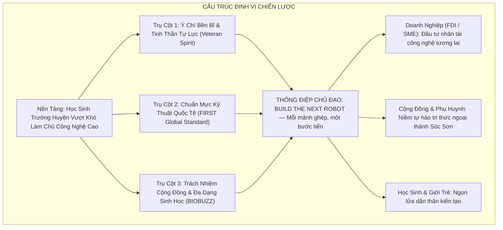

# 01 — THÔNG ĐIỆP CHIẾN DỊCH, ĐỊNH VỊ & CÂU CHUYỆN THƯƠNG HIỆU

> **Mục đích:** Tài liệu này thiết lập khung định vị chiến lược, thông điệp cốt lõi, trục tự sự (Story Arch) và bản chuẩn giới thiệu (Boilerplate) song ngữ Việt – Anh cho chiến dịch gây quỹ **"BUILD THE NEXT ROBOT — Mỗi mảnh ghép, một bước tiến"** của Robotics Sóc Sơn (FTC #39256) tại mùa giải FIRST Tech Challenge 2026–2027 (BIOBUZZ™ presented by RTX).

---



---

## 1. BỐI CẢNH VÀ ĐỊNH VỊ CHIẾN LƯỢC

### 1.1. Bối cảnh
Robotics Sóc Sơn ra đời từ niềm đam mê chế tạo của nhóm học sinh Trường THPT Sóc Sơn (ngôi trường giàu truyền thống hiếu học nằm tại vùng bán sơn địa ngoại thành phía Bắc Thủ đô Hà Nội). Không có phòng lab tiền tỷ, không có điều kiện tiếp cận linh kiện cao cấp từ sớm như các trường chuyên nội đô, đội đã từng bước tự học CAD, tự gia công phôi nhôm, lập trình vi điều khiển và kiên trì thi đấu qua từng mùa giải.

Bước vào mùa giải quốc tế **FIRST Tech Challenge 2026–2027 (BIOBUZZ™ presented by RTX)**, đội chính thức mang mã số **FTC #39256** với tư cách là một đội tuyển kỳ cựu (Veteran Team). Mục tiêu là hoàn thiện robot thi đấu tại Vòng chung kết Quốc gia và chứng minh: **Học sinh ngoại thành hoàn toàn có đủ năng lực làm chủ công nghệ đẳng cấp thế giới nếu được trao niềm tin và bệ phóng phù hợp**.

### 1.2. Tuyên ngôn định vị (Positioning Statement)
> **Đối với** các doanh nghiệp sản xuất, công nghệ tiên phong và cộng đồng phụ huynh tâm huyết với giáo dục STEM,  
> **Robotics Sóc Sơn (FTC #39256)** là đội tuyển robotics học sinh THPT công lập ngoại thành giàu bản lĩnh và tinh thần tự lực nhất,  
> **Cung cấp** cơ hội đồng hành đầu tư trực tiếp vào thế hệ kỹ sư công nghệ tương lai thông qua giải đấu quốc tế danh giá nhất toàn cầu (FIRST Tech Challenge),  
> **Khác với** các mô hình câu lạc bộ phong trào ngắn hạn,  
> **Chúng tôi** sở hữu bề dày thành tích được kiểm chứng (Top 4 VRC, Top 8 VORC, Á quân Motions In Fire), quy trình vận hành tài chính minh bạch theo pháp luật Việt Nam (Thông tư 16/2018/TT-BGDĐT và Thông tư 20/2026/TT-BTC) cùng cam kết kiến tạo tác động giáo dục lâu dài cho địa phương.

---

## 2. HỆ THỐNG THÔNG ĐIỆP CHIẾN DỊCH

### 2.1. Thông điệp chủ đạo (Primary Slogan)
> **"BUILD THE NEXT ROBOT — Mỗi mảnh ghép, một bước tiến"**  
> *(English: "BUILD THE NEXT ROBOT — Every piece, a leap forward")*

- **"BUILD THE NEXT ROBOT":** Lời kêu gọi hành động trực diện, dứt khoát. Đó là hành trình lắp ráp cỗ máy thi đấu mùa mới BIOBUZZ, nhưng sâu xa hơn là xây dựng thế hệ con người mới — thế hệ trẻ Việt Nam tự tin, làm chủ khoa học kỹ thuật và sẵn sàng hội nhập.
- **"Mỗi mảnh ghép, một bước tiến":** 
  - Về mặt kỹ thuật: Mỗi con ốc, thanh ray Viper Slide, động cơ Yellow Jacket hay bộ não Control Hub đều là một mắt xích đưa robot hoàn thiện.
  - Về mặt cộng đồng: Mỗi lượt ủng hộ 50.000đ của cựu học sinh, mỗi chiếc vé Maker Day của một em nhỏ hay mỗi khoản tài trợ 10–50 triệu của doanh nghiệp đều là một mảnh ghép niềm tin, cùng nâng bước học sinh Sóc Sơn vươn ra đấu trường quốc tế.

### 2.2. Ba trụ cột thông điệp (Three Core Pillars)

| Trụ cột | Tên gọi | Thông điệp cốt lõi | Bằng chứng kiểm chứng (Reasons to Believe) |
|:---:|---|---|---|
| **01** | **Bản lĩnh trường huyện — Khát vọng toàn cầu** | Xuất phát điểm không quyết định giới hạn. Ý chí bền bỉ và tinh thần tự lực là lợi thế cạnh tranh lớn nhất. | - Đạt **Hạng 4 toàn quốc** VRC 2023 (vượt qua 66 đội).<br>- Lọt **Top 8 toàn quốc** VORC 2024.<br>- Giành **Á quân** Motions In Fire 2025.<br>- Duy trì liên tục 3 mùa giải FTC với các mã #28762, #33518 và chính thức mang mã **#39256** mùa 2026–2027. |
| **02** | **Công nghệ chuẩn mực — Tác động bền vững** | Không chỉ chơi robot, chúng tôi làm chủ quy trình kỹ thuật chuẩn công nghiệp và cam kết phụng sự cộng đồng. | - Hệ thống điều khiển REV Control Hub, cơ cấu nâng hạ Viper Slide 4 tầng, thị giác máy tính Autonomous C920.<br>- **83%** học sinh tham gia FIRST tiếp tục học đại học khối ngành STEM, **63%** làm việc trong lĩnh vực STEM (*Nghiên cứu 10 năm Đại học Brandeis*).<br>- Tổ chức Maker Day truyền cảm hứng STEM cho hàng trăm học sinh địa phương. |
| **03** | **Trách nhiệm môi trường — Hành động vì sự sống** | Cùng FIRST giải quyết bài toán lớn của thời đại: Bảo vệ đa dạng sinh học và hệ sinh thái tự nhiên. | - Mùa giải **BIOBUZZ™ presented by RTX** mô phỏng hành vi thu thập phấn hoa và bảo vệ tổ ong mật.<br>- Ứng dụng tư duy giải thuật tự hành để lan tỏa thông điệp bảo vệ hệ sinh thái rừng Sóc Sơn và môi trường Thủ đô. |

---

## 3. TRỤC TỰ SỰ CHIẾN DỊCH (NARRATIVE ARC)

```mermaid
journey
    title HÀNH TRÌNH TỰ SỰ "TỪ XƯỞNG MỘC ĐẾN SÂN ĐẤU FTC"
    section Hồi 1: Nguồn Gốc
      Khởi đầu thiếu thốn tại trường huyện Sóc Sơn: 3
      Tự cắt nhôm, mượn máy hàn, tự học lập trình: 4
    section Hồi 2: Thử Lửa
      Tranh tài tại các giải quốc gia VRC, VORC: 6
      Khẳng định vị thế trong Top đầu toàn quốc: 7
    section Hồi 3: Điểm Nghẽn
      Bài toán mùa mới BIOBUZZ đòi hỏi linh kiện chuẩn: 3
      Thiếu hụt phần cứng delta 31 triệu đồng: 2
    section Hồi 4: Kêu Gọi
      Phát động chiến dịch "Mỗi mảnh ghép, một bước tiến": 6
      Huy động sự chung tay của Doanh nghiệp & Cộng đồng: 8
    section Hồi 5: Vươn Ra Biển Lớn
      Chế tạo cỗ máy hoàn hảo, tranh tài tại Hòa Lạc: 8
      Chinh phục Vòng chung kết Quốc gia, hướng tới FIRST Championship: 9
```

### Hồi 1: Những bước chân đầu tiên từ miền đất Sóc
Tại một ngôi trường ngoại thành Hà Nội, nơi phần lớn học sinh gắn liền với đồng ruộng và đời sống nông thôn, một nhóm học sinh đã ấp ủ giấc mơ chế tạo robot. Những ngày đầu, không có kinh phí mua kit nhập ngoại đắt đỏ, các bạn gom từng thanh nhôm phế liệu, mượn máy khoan của người thân và thức trắng đêm bên chiếc máy tính cũ để tự học từng dòng lệnh.

### Hồi 2: Ngọn lửa thử thách và những quả ngọt đầu tiên
Không cam chịu ranh giới "học sinh trường huyện", Robotics Sóc Sơn đã bước ra các đấu trường lớn và liên tiếp tạo nên bất ngờ: Top 4 Vietnam Robotics Challenge 2023, Top 8 Vietnam Open Robotics Challenge 2024, Á quân STEAMese Festival 2025. Từng thế hệ học sinh đi trước đã truyền lại cho thế hệ sau không chỉ là linh kiện, mà là một niềm tin sắt đá: *Người Sóc Sơn hoàn toàn có thể làm nên kỳ tích kỹ thuật*.

### Hồi 3: Điểm nghẽn mùa giải BIOBUZZ 2026–2027
Mùa giải quốc tế BIOBUZZ đặt ra thử thách kỹ thuật khắt khe chưa từng có: Robot phải di chuyển đa hướng 360 độ, vươn cao tháp nâng gắp phấn hoa và nhận diện vật thể tự hành bằng camera trong 30 giây đầu trận. Đội đã tái sử dụng tối đa khung gầm cũ, nhưng đang đối mặt với "điểm nghẽn sống còn": Danh mục linh kiện delta nhập khẩu chính ngạch từ Mỹ trị giá **30.975.000 VNĐ** (REV Control Hub, ray trượt Viper Slide, pin và động cơ). Nếu không có phần cứng này, cỗ máy không thể vận hành và giấc mơ thi đấu sẽ khép lại.

### Hồi 4: Lời kêu gọi — "Mỗi mảnh ghép, một bước tiến"
Để vượt qua điểm nghẽn, đội không trông chờ thụ động mà chủ động phát động chiến dịch gây quỹ. Chúng tôi chia nhỏ chiếc robot thành 4 Mission rõ ràng để cộng đồng cùng đóng góp; chúng tôi mở các lớp trải nghiệm Maker Day tự làm ra giá trị; chúng tôi mang hồ sơ minh bạch đến các doanh nghiệp để đề xuất hợp tác đầu tư nhân tài.

### Hồi 5: Khát vọng ghi danh trên đấu trường thế giới
Mỗi sự chung tay hôm nay là một mảnh ghép tiếp sức để cỗ máy hoàn thiện và lăn bánh trên sân đấu FPT Hòa Lạc vào tháng 2/2027.

---

## 4. TÀI LIỆU CHUẨN GIỚI THIỆU (BOILERPLATE)

### 4.1. Bản Tiếng Việt (Vietnamese Standard Boilerplate)
> **Về Robotics Sóc Sơn (FTC #39256):**  
> Robotics Sóc Sơn là câu lạc bộ sáng tạo kỹ thuật và nghiên cứu STEM trực thuộc Trường THPT Sóc Sơn (Hà Nội), chính thức mang mã định danh quốc tế **FTC #39256** tại giải đấu FIRST Tech Challenge. Trải qua hơn 3 năm trưởng thành từ tinh thần tự lực của học sinh trường huyện, đội đã khẳng định bản lĩnh với các thành tích xuất sắc: Hạng 4 toàn quốc Vietnam Robotics Challenge (VRC) 2023, Top 8 Vietnam Open Robotics Challenge (VORC) 2024 và Á quân Motions In Fire 2025. Tại mùa giải FTC 2026–2027 chủ đề BIOBUZZ™ presented by RTX, Robotics Sóc Sơn triển khai chiến dịch gây quỹ *"BUILD THE NEXT ROBOT — Mỗi mảnh ghép, một bước tiến"* với mục tiêu huy động **33.975.000 VNĐ** cho 11 linh kiện phần cứng cốt lõi và quỹ dự phòng kỹ thuật, đại diện cho trí tuệ tuổi trẻ Thủ đô tranh tài tại Vòng chung kết quốc gia.  
> *Thông tin liên hệ & Pháp lý:* Trường THPT Sóc Sơn, Phố Mai Đình, Thị trấn Sóc Sơn, Hà Nội. Tiếp nhận tài trợ giáo dục hợp pháp theo Thông tư 16/2018/TT-BGDĐT và Thông tư 20/2026/TT-BTC.

### 4.2. Bản Tiếng Anh (English Standard Boilerplate)
> **About Robotics Soc Son (FTC #39256):**  
> Robotics Soc Son is a student-led STEM and robotics club based at Soc Son High School in Hanoi, Vietnam, officially competing under team number **FTC #39256** in the FIRST Tech Challenge. Originating from a suburban public school, the team has achieved national milestones including 4th Place at the Vietnam Robotics Challenge (VRC) 2023, Top 8 at the Vietnam Open Robotics Challenge (VORC) 2024, and 1st Runner-up at the Motions In Fire 2025 National Festival. For the 2026–2027 FIRST season (BIOBUZZ™ presented by RTX), the team is running the sponsorship campaign *"BUILD THE NEXT ROBOT — Every piece, a leap forward"* to raise **33,975,000 VND** for 11 core hardware components and a technical contingency buffer, to compete at the Vietnam national championship.
> *Contact & Governance:* Soc Son High School, Mai Dinh, Soc Son, Hanoi, Vietnam. Legally structured under Circular 16/2018/TT-BGDDT and Circular 20/2026/TT-BTC for corporate tax deductibility.

---

## 5. THANG ĐO ĐÁNH GIÁ THÀNH CÔNG VÀ NGUYÊN TẮC PHÁT NGÔN

### 5.1. Bộ chỉ số đo lường nhận thức (Perception KPIs)
1. **Độ lan tỏa thương hiệu:** Đạt tối thiểu 20.000 lượt tiếp cận trên mạng xã hội trong suốt chiến dịch; 100% nội dung truyền thông phản ánh đúng tinh thần "Bản lĩnh — Bền bỉ — Tự lực".
2. **Sự đồng hành của Doanh nghiệp:** Thu hút tối thiểu 3–5 doanh nghiệp địa phương (KCN Nội Bài/Quang Minh) tham gia tài trợ hoặc hỗ trợ hiện vật kỹ thuật.
3. **Gắn kết cộng đồng:** Huy động 100% chỉ tiêu 4 Missions cộng đồng từ phụ huynh, cựu học sinh và người ủng hộ giáo dục.

### 5.2. Ba nguyên tắc phát ngôn bất biến (Guiding Communication Rules)
1. **Tuyệt đối trung thực về số liệu:** Không phóng đại danh hiệu (luôn dùng chính xác "Hạng 4 VRC 2023", "Top 8 VORC 2024", mã đội chính thức là #39256). Mọi khoản tiền và danh mục chi tiêu đều phải truy xuất được từ bảng BOM và hợp đồng tài trợ.
2. **Không đóng vai "nạn nhân nghèo khó":** Không truyền thông theo hướng "xin xỏ vì hoàn cảnh thiếu thốn", mà luôn thể hiện tư thế của những người trẻ giàu khát vọng, có năng lực thực thi và đang mang đến cho nhà tài trợ một cơ hội đầu tư xã hội xứng đáng.
3. **Tuân thủ đạo đức thương hiệu FIRST:** Tôn trọng văn hóa *Gracious Professionalism* (Tính chuyên nghiệp cao thượng) và *Coopertition* (Hợp tác trong cạnh tranh). Không công kích đối thủ, không quảng cáo phản cảm và luôn tri ân các bên đồng hành.

---

## NGUỒN TÀI LIỆU THAM CHIẾU
- `docs/campaign-2026-2027/research/R1-season-team.md` (Chi tiết mùa giải BIOBUZZ, lịch sử đội #28762, #33518, #39256, thành tích xác thực VRC/VORC, nghiên cứu Brandeis 10-year Study).
- `docs/campaign-2026-2027/research/R4-legal-payment.md` (Quy định TT 16/2018, TT 20/2026/TT-BTC, chuẩn mực truyền thông tài trợ trường công lập).
- `docs/campaign-2026-2027/research/R5-sponsors-benchmarks.md` (Benchmark tài trợ FTC quốc tế, mạng lưới doanh nghiệp Sóc Sơn & KCN Nội Bài).
- `docs/campaign-2026-2027/99-bien-ban-thao-luan.md` (Biên bản đồng thuận chiến lược giữa Strategist, Operator và Grower).
