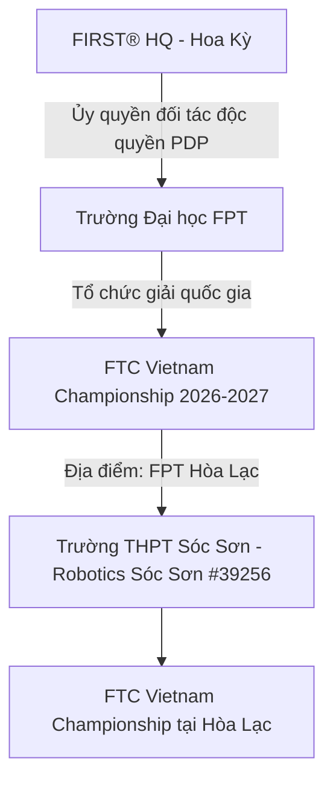
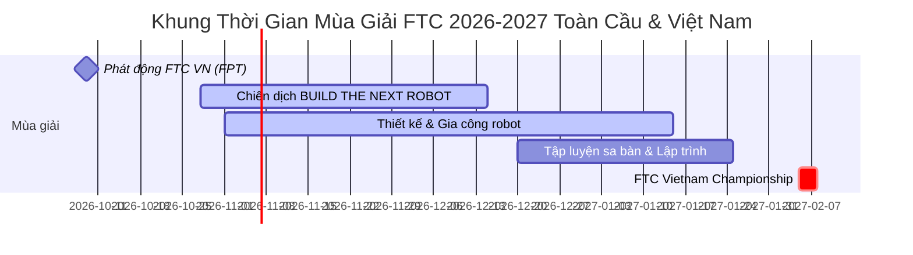
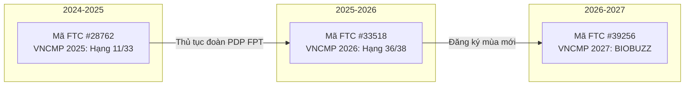
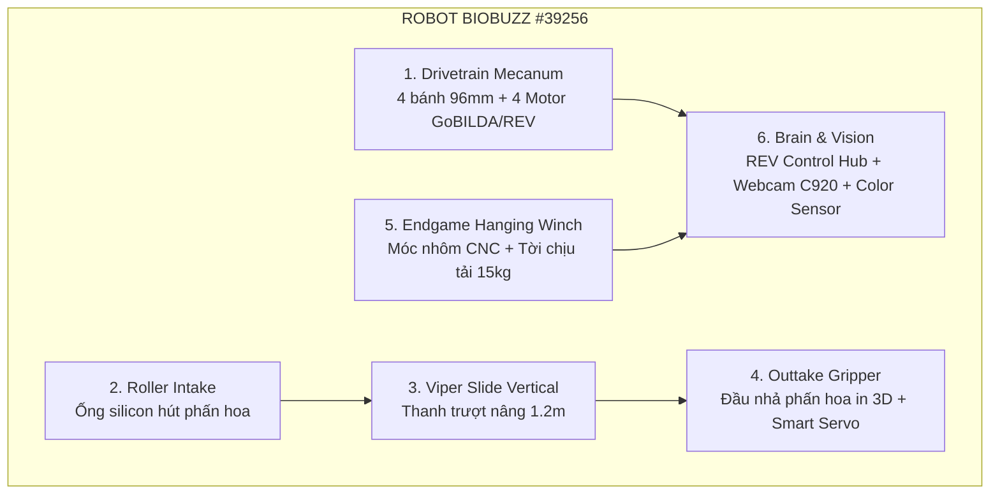

# 02 — Fact Sheet Mùa Giải & Hồ Sơ Đội Thi FTC 2026–2027

Tài liệu cung cấp hệ thống dữ kiện chuẩn hóa, khách quan và có chứng thực độc lập về mùa giải FIRST Tech Challenge (FTC) 2026–2027 chủ đề BIOBUZZ™ presented by RTX, thông số kỹ thuật giải đấu tại Việt Nam và toàn cầu, cùng hồ sơ định danh pháp lý - kỹ thuật của CLB Robotics Sóc Sơn (Trường THPT Sóc Sơn, Hà Nội). Văn bản này đóng vai trò là nguồn sự thật duy nhất (Single Source of Truth) về các thông số mùa giải phục vụ xây dựng hồ sơ tài trợ, giải trình đối tác và truyền thông chiến dịch "BUILD THE NEXT ROBOT".

---

## 1. Tổng Quan Mùa Giải FIRST Tech Challenge 2026–2027

FIRST® Tech Challenge (FTC) là giải đấu robotics quốc tế quy mô hàng đầu thế giới dành cho học sinh THCS và THPT (độ tuổi 12–18 / lớp 7–12), do tổ chức phi lợi nhuận FIRST® (Hoa Kỳ) sáng lập từ năm 1989.

### 1.1. Chủ đề và Đề bài thi đấu: BIOBUZZ™ presented by RTX
- **Mùa giải chủ đề lớn:** Thuộc chuỗi mùa giải **FIRST® CANOPY™ (2026–2027)** tôn vinh thế giới tự nhiên và các tầng sinh thái rừng.
- **Chủ đề chi tiết:** **BIOBUZZ™ presented by RTX** lấy cảm hứng từ vai trò sống còn của loài ong và các sinh vật thụ phấn trong việc duy trì chuỗi thức ăn và đa dạng sinh học toàn cầu.
- **Nhiệm vụ thi đấu trên sa bàn (Game Play):**
  - Sa bàn tiêu chuẩn có kích thước $12 \times 12\text{ feet}$ (~$3,66\text{ m} \times 3,66\text{ m}$) với tường bao tiêu chuẩn.
  - Hai liên minh đối kháng (Liên minh Đỏ vs. Liên minh Xanh, mỗi liên minh gồm 2 đội robot) thi đấu theo thể thức phối hợp 2 vs 2.
  - Robot có nhiệm vụ thu thập các vật thể phấn hoa (**Pollen**) và mật hoa (**Nectar**) phân bố trên sàn đấu hoặc từ Trạm người chơi (Human Player Station), phân loại và đưa vào cấu trúc tổ ong (**Hive Structure**) ở các tầng độ cao khác nhau.
  - Tối ưu điểm số bằng cách ghép đúng chuỗi màu sinh thái để kích hoạt hệ số nhân điểm (Multiplier).
- **Cấu trúc trận đấu (Tổng thời gian: 2 phút 30 giây):**
  1. *30 giây Tự hành (Autonomous Period):* Robot tự động 100% bằng code lập trình, sử dụng camera nhận diện tọa độ AprilTag và cảm biến màu sắc để tìm phấn hoa, ghi điểm và đưa robot về vị trí an toàn.
  2. *2 phút Điều khiển tay (Tele-operated Period):* Hai người điều khiển (Drivers) cùng một huấn luyện viên chiến thuật (Coach) dùng tay cầm điều khiển robot thực hiện các pha gắp, nâng hạ và nạp phấn hoa với tốc độ cao.
  3. *30 giây Cuối trận (Endgame):* Robot kích hoạt cơ cấu nâng toàn bộ trọng lượng thân xe (12–15 kg) để treo mình lên giàn tổ ong (Ascent Hang), đồng thời bắn tín hiệu hoàn thành nhiệm vụ để nhân hệ số điểm chung cuộc.
- **Đánh giá toàn diện (Judging Interview):** Bên cạnh điểm số trên sân, hội đồng giám khảo quốc tế chấm điểm hồ sơ kỹ thuật (Engineering Portfolio), thiết kế cơ khí 3D CAD, giải thuật lập trình, hoạt động lan tỏa cộng đồng (Outreach) và văn hóa thể thao cao thượng (*Gracious Professionalism®*).

---

## 2. Thông Số Giải Đấu FTC Vietnam 2026–2027

| Tiêu chí | Thông số chính thức & Hiện trạng | Ghi chú / Căn cứ xác thực |
|---|---|---|
| **Đơn vị tổ chức** | Trường Đại học FPT (FPT University - FPTU) | Đơn vị duy nhất được FIRST HQ ủy quyền đại diện (Program Delivery Partner - PDP) tại Việt Nam |
| **Lễ phát động** | 09/10/2026 tại Hà Nội | Công bố chính thức trên Báo Đảng Cộng sản, VietnamPlus, Báo Giáo dục & Thời đại |
| **Quy mô giải đấu** | Dự kiến ~40 đội tuyển (gồm 5–7 đội quốc tế từ Lào, Indonesia, Philippines, UAE...) | Học sinh lớp 7 đến 12 (12–18 tuổi); mỗi đội 3–15 học sinh + 1 cố vấn chuyên môn |
| **Lệ phí tham gia giải** | **0 VNĐ (Miễn phí 100%)** | FPT tài trợ toàn bộ chi phí sân đấu, bản quyền FIRST, trọng tài, cơ sở vật chất giải |
| **Địa điểm thi đấu** | Trường Đại học FPT Hà Nội (Khu CNC Hòa Lạc, Km29 Đại lộ Thăng Long, Thạch Thất, Hà Nội) | Cố định liên tiếp 3 mùa: Mùa 1 (24/02/2024), Mùa 2 (21–23/02/2025), Mùa 3 (30/01–01/02/2026) |
| **Thời gian thi đấu** | Dự kiến **cuối tháng 1 hoặc nửa cuối tháng 2/2027** `[ƯỚC TÍNH]` | Đang mở cổng đăng ký mùa giải mới (đã phát động 09/10/2026; ngày thi đấu chi tiết chờ thông báo PDP) |
| **Tổng quỹ giải thưởng** | **> 51.000.000 VNĐ** | 27 hạng mục giải thưởng (Inspire Award, Winning Alliance, Think, Innovate, Design, Connect...) |
| **FIRST Championship** | FTC Vietnam trao 02 suất (Houston, 28/04–01/05/2027), xét theo điểm Advancement; đội vô địch giành vé đi Mỹ. Mùa gần nhất: suất thuộc đội giải Nhất Inspire Award và đội trưởng Liên minh Vô địch | [R1](research/R1-season-team.md), [R8 §3](research/R8-official-info.md) |

---

## 3. Lịch trình mùa giải FTC 2026–2027

### 3.1. Lệ phí đăng ký toàn cầu (FIRST Global Team Registration)
- Lệ phí chính thức do FIRST HQ ban hành: **$350 USD/đội/mùa** (tương đương **9.030.000 VNĐ** theo tỷ giá tham chiếu 25.800 VNĐ/USD).
- *Cơ chế khu vực:* FIRST quy định mức phí này áp dụng cho Bắc Mỹ. Các đội tuyển ngoài Bắc Mỹ (trong đó có Việt Nam) đăng ký thông qua đối tác PDP quốc gia (Trường Đại học FPT). Đội Robotics Sóc Sơn được PDP cấp mã số và xác nhận hồ sơ mùa giải 2026–2027.

## 4. Hồ Sơ Định Danh CLB Robotics Sóc Sơn

### 4.1. Thông tin định danh cơ bản
- **Tên tổ chức:** CLB Robotics Sóc Sơn (Robotics Soc Son).
- **Đơn vị bảo trợ pháp lý:** Trường THPT Sóc Sơn, huyện Sóc Sơn, thành phố Hà Nội.
- **Năm thành lập:** 2023 (Khởi xướng bởi nhóm học sinh đam mê STEM, đồng sáng lập bởi Nguyễn Việt Thành - Á quân Đường lên đỉnh Olympia năm thứ 23).
- **Mã số đội thi FTC chính thức mùa giải 2026–2027:** **#39256**.
- **Trạng thái trên hệ thống FIRST toàn cầu:** Đã kích hoạt chính thức (Active) trong danh mục Vietnam Region 2026 trên *FIRST Event Web* (`ftc-events.firstinspires.org/2026/team/39256`). Tên tổ chức bảo trợ: *Soc Son High School*.

### 4.2. Lịch sử mã số đội qua các mùa giải & Giải trình kỹ thuật
Hồ sơ thi đấu của CLB ghi nhận sự thay đổi mã số qua các năm:

- **Nguyên nhân đổi mã đội số:**
  - Đây là quy trình hành chính đặc thù của Đối tác Triển khai Chương trình Địa phương (PDP FPT) tại Việt Nam: Hàng năm ban tổ chức tập hợp danh sách các trường THPT đăng ký và tạo hồ sơ đội mới theo khối danh sách mùa giải gửi lên FIRST HQ thay vì thực hiện quy trình gia hạn mã cũ kèm nộp phí $350 USD trực tiếp qua thẻ quốc tế.
  - Do đó, hệ thống FIRST tự động cấp mã số mới qua từng năm (#28762 năm 2024, #33518 năm 2025, #39256 năm 2026).
- **Tính thống nhất pháp lý và chuyên môn:**
  - Cả 3 mã số đều thuộc về một thực thể duy nhất: **CLB Robotics Sóc Sơn trực thuộc Trường THPT Sóc Sơn, Hà Nội**.
  - Đội ngũ thành viên nòng cốt, cơ sở vật chất, phòng lab nghiên cứu, giáo viên hướng dẫn và tài sản phần cứng (bộ kit REV/goBILDA) được kế thừa liên tục qua các thế hệ học sinh.

---

## 5. Thống Kê Tác Động Toàn Cầu Của FIRST (Sức Mạnh Của Phong Trào STEM)

Các số liệu được trích xuất từ **Nghiên cứu dài hạn 10 năm (FIRST Longitudinal Study - 10-Year Cumulative Report, 2013–2024)** do Trung tâm Thanh thiếu niên và Cộng đồng (CYC), Trường Chính sách & Quản lý Xã hội Heller thuộc **Đại học Brandeis (Hoa Kỳ)** thực hiện độc lập:

| Chỉ số tác động giáo dục | Thành viên FIRST | Nhóm đối chứng (Cùng điều kiện) | Ý nghĩa tác động đối với nhà tài trợ |
|---|---:|---:|---|
| **Theo học chuyên ngành STEM vào năm 4 đại học** | **83%** | 61% | Đầu tư vào đội tuyển FTC tạo nguồn nhân lực công nghệ cao chất lượng, bền vững |
| **Hiện đang làm việc trong các ngành STEM** | **63%** | 47% | Học sinh tham gia FIRST có xu hướng gắn bó trọn đời với sự nghiệp khoa học kỹ thuật |
| **Nữ sinh theo học Kỹ thuật hoặc Khoa học máy tính** | **51%** | 27% | Gấp gần 2 lần mức bình quân — đóng góp trực tiếp vào mục tiêu Bình đẳng giới & ESG của doanh nghiệp |
| **Thu nhập khởi điểm trung bình của cựu thành viên nữ** | **$62,000 USD/năm** | $43,000 USD/năm | Chênh lệch +44%, chứng minh giá trị tích lũy thực tế của kỹ năng giải quyết vấn đề kỹ thuật |
| **Kỹ năng mềm (Lãnh đạo, Thuyết trình, Làm việc nhóm)** | **95%** | Tự tin vượt trội | Đào tạo thế hệ trẻ có tư duy giải pháp và tinh thần trách nhiệm xã hội cao |

---

## 6. Sáu Cơ Cấu Kỹ Thuật Trọng Tâm Robot BIOBUZZ™

Khung thiết kế robot của Robotics Sóc Sơn cho mùa giải 2026–2027 được đồng bộ trực tiếp với danh mục mua sắm vật tư delta:

1. **Khung gầm & Truyền động đa hướng (Mecanum Drivetrain):** 4 cụm bánh Mecanum 96mm độc lập, kết hợp 2 động cơ goBILDA Yellow Jacket 435 RPM và 2 động cơ REV HD Hex Motor, cho phép robot di chuyển 360 độ linh hoạt trong không gian hẹp quanh tổ Hive.
2. **Cơ cấu nạp phấn hoa (Roller Intake):** Trục lăn ống silicon mềm tốc độ cao giúp cuốn phấn hoa vào khoang chứa trong tích tắc khi robot lướt qua sa bàn.
3. **Bộ nâng hạ tuyến tính (goBILDA Viper Slide Kit):** Cơ cấu trượt nhôm đa tầng cáp kéo, thu gọn trong giới hạn 18 inch đầu trận và vươn cao đến 1,2 mét để đặt phấn hoa lên tầng tổ cao nhất.
4. **Cụm gắp và nhả (Outtake Gripper End-Effector):** Cơ cấu ngàm gắp linh hoạt dẫn động bằng Smart Robot Servo (REV SRS) giúp nhả phấn hoa chính xác vào các ô điểm số.
5. **Cơ cấu tời đu giàn (Endgame Hanging Winch):** Cụm móc nhôm CNC và tời chịu lực bằng dây Dyneema/Kevlar giúp nhấc bổng toàn bộ khối lượng 12–15 kg của robot rời mặt sàn trong 30 giây cuối trận.
6. **Bộ não điều khiển & Thị giác máy tính (Control & Vision System):** REV Control Hub tích hợp vi xử lý Android chạy trên nền tảng FIRST SDK, camera Logitech C920 Pro HD xử lý OpenCV/AprilTag và cảm biến màu sắc REV Color Sensor v3 phân loại chuỗi sinh thái.

---

## 7. Thông Tin Liên Hệ & Kênh Tiếp Nhận Chính Thức

- **Tổ chức bảo trợ:** Trường THPT Sóc Sơn — Quốc lộ 2, xã Phù Lỗ, huyện Sóc Sơn, TP. Hà Nội · ĐT (024) 3884 1042 · c3socson@hanoiedu.vn · https://thptsocson.hanoi.edu.vn/ · Hiệu trưởng: Cô Nguyễn Thị Diệu Thanh (nguồn: [research/R8-official-info.md](research/R8-official-info.md)).
- **Phòng Lab nghiên cứu:** Phòng Thực hành STEM, Trường THPT Sóc Sơn.
- **Giáo viên phụ trách / Cố vấn CLB:** → Xem chi tiết tại `docs/campaign-2026-2027/14-phan-cong-nhan-su.md`.
- **Đại diện Ban chủ nhiệm CLB:** → Xem chi tiết tại `docs/campaign-2026-2027/14-phan-cong-nhan-su.md`.
- **Email chính thức:** `contact@roboticssocson.com`
- **Fanpage chính thức:** https://www.facebook.com/roboticssocson/ (số người theo dõi: Facebook chặn đọc công khai, CLB tự cập nhật từ trang quản trị trước khi in hồ sơ — xem [research/R6-social-sponsors.md](research/R6-social-sponsors.md)).
- **Cổng thông tin chiến dịch:** `https://roboticssocson.com/support`

---

## Nguồn

1. **Tổ chức FIRST (Hoa Kỳ):**
   - [FIRST Tech Challenge BIOBUZZ Game & Season Materials](https://www.firstinspires.org/programs/ftc/game-and-season)
   - [FIRST Cost & Registration 2026-2027 Season Pricing](https://www.firstinspires.org/programs/cost-and-registration)
   - [FIRST Policy on the Use of FIRST Trademarks and Copyrighted Materials](https://www.firstinspires.org/brand)
2. **Nghiên cứu khoa học độc lập Đại học Brandeis:**
   - [Brandeis University CYC — FIRST Longitudinal Study: 10-Year Cumulative Report (PDF)](https://www.firstinspires.org/hubfs/web/about/report/first-longitudinal-study-10-year-cumulative-report.pdf)
   - [Brandeis University CYC — FIRST Longitudinal Study 10-Year Survey Data](https://heller.brandeis.edu/cyc/first/first-longitudinal-study10year-survey-data.pdf)
3. **Cơ sở dữ liệu giải đấu FIRST Event Web & FTC Scout:**
   - [FTC Event Web: Team 39256 - Robotics Soc Son (2026)](https://ftc-events.firstinspires.org/2026/team/39256)
   - [FTC Event Web: Vietnam Region Teams (2026)](https://ftc-events.firstinspires.org/2026/region/VN)
   - [FTC Event Web: Team 33518 - Robotics Sóc Sơn (2025)](https://ftc-events.firstinspires.org/2025/team/33518)
   - [FTC Event Web: Team 28762 - Robotics Sóc Sơn (2024)](https://ftc-events.firstinspires.org/2024/team/28762)
   - [FTCScout: Team 39256 Profile](https://ftcscout.org/teams/39256)
4. **Trường Đại học FPT & Báo chí quốc gia:**
   - [Báo điện tử Đảng Cộng sản / Vietnam.vn: FPTU phát động cuộc thi robotics quốc tế FIRST Tech Challenge Vietnam 2026](https://www.vietnam.vn/en/fptu-phat-dong-cuoc-thi-robotics-quoc-te-first-tech-challenge-vietnam-2026-danh-cho-hoc-sinh-chuan-bi-som-nguon-nhan-luc-cong-nghe-chien-luoc) (09/10/2026)
   - [Báo Giáo dục & Thời đại: Học sinh Việt Nam tranh tài thi robotics, hướng tới giải vô địch thế giới tại Mỹ](https://baomoi.com/hoc-sinh-viet-nam-tranh-tai-thi-robotics-huong-toi-giai-vo-dich-the-gioi-tai-my-c56231756.epi) (09/10/2026)
   - [Trường Đại học FPT: Tổ chức FIRST Tech Challenge, tìm ra đại diện Việt Nam thi đấu robotics tại Mỹ](https://daihoc.fpt.edu.vn/tin-tuc/truong-dai-hoc-fpt-to-chuc-first-tech-challenge-tim-ra-dai-dien-viet-nam-thi-dau-robotics-tai-my/) (02/02/2026)
