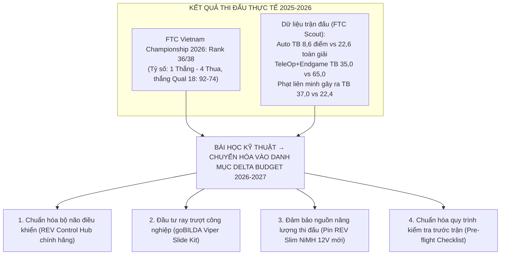
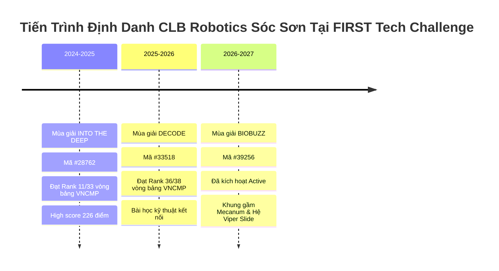
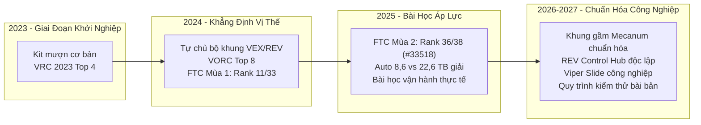

# 03 — Hồ Sơ Thành Tích Chuẩn Hóa & Bằng Chứng Xác Thực

Tài liệu thiết lập hệ thống thành tích chuẩn hóa, minh bạch và có bằng chứng đối soát độc lập của CLB Robotics Sóc Sơn (gần 5 năm hoạt động theo `docs/văn ftc funderasing 2026.md`) đến mùa giải 2026–2027. Văn bản giải quyết các sai lệch dữ liệu lịch sử ("Top 3 vs. Top 4", "Top 8 vs. Top 10/11", hiện tượng đổi mã đội FTC) và trình bày trung thực kết quả giải 2025–2026 làm cơ sở cho danh mục mua sắm delta.

---

## 1. Bảng Khóa Thành Tích Chính Thức (Locked Achievement Record)

Toàn bộ thông tin dưới đây đã được đối soát chéo với cơ sở dữ liệu quốc tế của FIRST, ban tổ chức FPT và các cơ quan báo chí chính thống:

| Năm / Mùa giải | Tên giải đấu & Đơn vị tổ chức | Định danh / Mã đội | Kết quả chuẩn hóa (Khóa) | Tình trạng mâu thuẫn cũ & Căn cứ xác thực độc lập |
|---|---|---|---|---|
| **2023** | **Vietnam Robotics Challenge (VRC 2023)** *ĐH FPT tổ chức* | Robotics Sóc Sơn | **Hạng 4 (Top 4) Toàn quốc** (Trên tổng số 66 đội THPT) | - *Giải quyết mâu thuẫn:* Bản tóm tắt cũ ghi "Top 3". Khóa **Top 4** theo [Báo Giáo dục & Thời đại, 06/10/2023](https://giaoducthoidai.vn/nam-sinh-thpt-soc-son-mang-chung-ket-olympia-ve-ha-noi-post656583.html) và [Báo Thanh Niên, 08/10/2023](https://thanhnien.vn/dang-chung-ket-duong-len-dinh-olympia-2023-giai-thuong-50000-usd-se-thuoc-ve-ai-185231007195558848.htm). |
| **2024** | **Vietnam Open Robotics Challenge (VORC 2024)** *ĐH FPT tổ chức* | **VORC24010** | **Top 8 Toàn quốc** (Vào vòng Tứ kết / Playoff) | - *Giải quyết mâu thuẫn:* Loại bỏ hoàn toàn nhầm lẫn "Top 10" hay "Top 11" (do lẫn với thứ hạng Rank 11 tại FTC). Hồ sơ gốc xác nhận mã VORC24010 đạt Top 8. |
| **2024–2025** | **FTC Vietnam Championship 2025** *Chủ đề: INTO THE DEEP* | **FTC #28762** | **Rank 11 / 33 Đội** (Tỷ số: 3 Thắng – 3 Thua, High Score: 226) | - *Căn cứ dữ liệu gốc:* Hệ thống FIRST Event Web (`2024/VNCMP`) và FTC Scout xác nhận mã #28762 đạt Rank 11/33 vòng bảng, điểm tự hành trung bình 16.0. |
| **2025** | **Motions In Fire 2025** *STEAMese Festival, 19/10/2025, ĐHBK Hà Nội* | Robotics Sóc Sơn | **Hạng 1 Vòng loại** & **Á quân (2nd Place)** | - *Căn cứ:* [Trang STEAMese Festival 2025 của STEAM for Vietnam](https://steamforvietnam.org/steamese-festival2025) (Trạm 2 — AI in Motions: Motions In Fire) + `docs/old project/Thành tích.md`. Ảnh giấy khen: CLB bổ sung khi in hồ sơ. |
| **2025–2026** | **FTC Vietnam Championship 2026** *Chủ đề: DECODE* | **FTC #33518** | **Rank 36 / 38 Đội** (Tỷ số: 1 Thắng – 4 Thua) | - *Căn cứ:* [FIRST Event Web](https://ftc-events.firstinspires.org/2025/team/33518) và FTC Scout: Rank 36/38, 1-4-0, thắng Qual 18 (92–74). Điểm yếu theo dữ liệu: xem §2.1. |
| **2026–2027** | **FTC Vietnam Championship 2027** *Chủ đề: BIOBUZZ™ presented by RTX* | **FTC #39256** | **Đang chuẩn bị** (Active trên FIRST Event Web) | - Đã kích hoạt chính thức mã số mới #39256 với tổ chức bảo trợ là Soc Son High School. Mục tiêu Top Liên minh & Giải Kỹ thuật. |

---

## 2. Giải Trình Trung Thực Về Mùa Giải FTC 2025–2026 (Rank 36/38)

Chiến dịch "BUILD THE NEXT ROBOT" không che giấu kết quả thi đấu năm 2025–2026. Thay vào đó, chúng tôi xem đây là một nghiên cứu tình huống điển hình (Case Study) về rủi ro kỹ thuật trong kỹ nghệ chế tạo robot thi đấu thực tế:

### 2.1. Phân tích nguyên nhân kỹ thuật (Technical Post-Mortem)
- **Kết quả thi đấu chính thức:** Đội đạt Rank 36 / 38 đội tại giải FTC Vietnam Championship 2026 (mã số #33518), tỷ số 1 Thắng – 4 Thua – 0 Hòa, thắng trận Qual 18 với điểm số 92–74 (Nguồn: FIRST Event Web `2025/VNCMP` và FTC Scout).
- **Điểm yếu theo dữ liệu trận đấu** (FTC Scout GraphQL + FIRST Event Web; chi tiết từng trận tại [research/R7-evidence.md](research/R7-evidence.md)):

  | Chỉ số (trung bình liên minh/trận) | #33518 (2025–26) | TB toàn giải 2025–26 | #28762 (2024–25) | TB toàn giải 2024–25 |
  |---|---:|---:|---:|---:|
  | Điểm Tự hành (Auto) | 8,60 | 22,59 | 16,00 | 10,50 |
  | Điểm Điều khiển + Endgame | 35,00 | 64,98 | 71,00 | 70,25 |
  | Điểm phạt liên minh gây ra cho đối thủ | 37,00 | 22,37 | 15,00 | 6,04 |

  Dữ liệu cho thấy: (1) điểm Auto từ cao hơn mặt bằng (mùa 2024–25) tụt xuống thấp hơn 61,9% mặt bằng (mùa 2025–26); (2) điểm TeleOp + Endgame thấp hơn 46,1%; (3) phạt dồn ở hai trận Q-29 (8 lỗi Major, 130 điểm) và Q-44 (3 lỗi Major, 45 điểm). Lưu ý: điểm phạt FTC tính cho cả liên minh 2 đội. Dữ liệu không chỉ ra nguyên nhân kỹ thuật cụ thể; mentor mùa trước có thể bổ sung khi trình bày trực tiếp.
- **Khung câu chuyện "Bài học kỹ thuật → Danh mục Delta Budget":** Thay vì che giấu thứ hạng thấp, CLB nhìn nhận thẳng thắn kết quả này như một bài học thực tế quý giá trong kỹ nghệ robot. Đội ngũ nhận thấy việc thiếu hụt linh kiện chuẩn hóa chuyên dụng là rủi ro lớn trong điều kiện thi đấu đối kháng cường độ cao. Toàn bộ danh mục đầu tư delta năm 2026–2027 (REV Control Hub, ray trượt Viper Slide, pin Slim NiMH mới 100%) xuất phát trực tiếp từ nhu cầu chuẩn hóa phần cứng để triệt tiêu các rủi ro hỏng hóc đơn lẻ.
### 2.2. Giá trị chuyển hóa đối với nhà tài trợ
- **Tính toán thực tế thay vì suy đoán:** Thất bại năm 2026 là căn cứ kỹ thuật chính xác nhất để CLB xây dựng **Danh mục mua sắm delta 2026–2027** (`docs/INVENTORY - PURCHASE PLAN 2026.csv`). Chúng tôi không xin ngân sách để "làm lại cái cũ", mà xin ngân sách để "thay thế chính xác các điểm hỏng hóc kỹ thuật đơn lẻ (Single Points of Failure)".
- **Tư duy kỹ thuật trưởng thành:** Trong triết lý STEM và công nghệ toàn cầu, việc đối diện thẳng thắn với lỗi cơ khí và giải quyết bằng thiết kế kỹ thuật chuẩn hóa (REV Control Hub chính hãng, ray trượt công nghiệp goBILDA Viper Slide) chính là minh chứng thuyết phục nhất về năng lực học hỏi và độ tin cậy của đội ngũ.

---

## 3. Lịch Sử Đổi Mã Đội FTC (#28762 → #33518 → #39256)

### 3.1. Bản chất quy trình hành chính
- **Không phải do vi phạm hay đổi tên:** Một số đối tác có thể băn khoăn lý do đội thi đổi mã số qua từng mùa giải. Cần khẳng định rõ đây là **đặc thù thủ tục của đơn vị đại diện quốc gia (PDP FPT)**:
  - FIRST HQ quy định các đội Bắc Mỹ trả phí thường niên $350 USD trên Dashboard để giữ nguyên số hiệu đội qua các năm.
  - Tại Việt Nam, để hỗ trợ 100% lệ phí cho các trường, FPT thu thập danh sách và nộp đăng ký theo diện đoàn mùa giải mới, dẫn tới việc hệ thống FIRST cấp một Team ID mới cho mỗi mùa.
- **Thực thể pháp lý và nhân sự kế thừa:**
  - Tên đơn vị trên FIRST Event Web: Luôn là **Robotics Sóc Sơn** hoặc **Robotics Soc Son**.
  - Tổ chức bảo trợ (Sponsoring Institution): **Trường THPT Sóc Sơn (Soc Son High School)**.
  - Địa bàn hoạt động: Huyện Sóc Sơn, Thành phố Hà Nội.
  - Ban cố vấn và phòng Lab nghiên cứu: Kế thừa xuyên suốt từ khóa học sinh sáng lập (2023) đến thế hệ học sinh hiện tại (2026–2027).

---

## 4. Bằng Chứng Xác Thực Độc Lập Từ Bên Thứ Ba

Hồ sơ thành tích của đội được bảo chứng bởi các nguồn dữ liệu công khai, độc lập và có uy tín cao:

### 4.1. Dữ liệu hệ thống FIRST toàn cầu & FTC Scout
1. **Hồ sơ mùa giải 2026–2027 (#39256):**
   - FIRST Event Web Team Profile: [ftc-events.firstinspires.org/2026/team/39256](https://ftc-events.firstinspires.org/2026/team/39256)
   - Danh sách đội Vietnam Region 2026: [ftc-events.firstinspires.org/2026/region/VN](https://ftc-events.firstinspires.org/2026/region/VN)
   - FTC Scout Database: [ftcscout.org/teams/39256](https://ftcscout.org/teams/39256)
2. **Dữ liệu thi đấu mùa giải 2024–2025 (#28762):**
   - Kết quả bảng xếp hạng VNCMP 2025: [ftc-events.firstinspires.org/2024/VNCMP/rankings](https://ftc-events.firstinspires.org/2024/VNCMP/rankings) (Xác thực Rank 11, RS 1.00, AUTO 16.0).
   - Chi tiết hồ sơ trận đấu: [ftcscout.org/teams/28762](https://ftcscout.org/teams/28762)
3. **Dữ liệu thi đấu mùa giải 2025–2026 (#33518):**
   - Kết quả chi tiết vòng loại: [ftc-events.firstinspires.org/2025/team/33518](https://ftc-events.firstinspires.org/2025/team/33518) và [ftcscout.org/teams/33518](https://ftcscout.org/teams/33518).

### 4.2. Báo chí chính thống và Cơ quan quản lý giáo dục
1. **Báo Giáo dục & Thời đại (Cơ quan ngôn luận của Bộ GD&ĐT):**
   - *Bài viết:* "Nam sinh THPT Sóc Sơn mang chung kết Olympia về Hà Nội" (Xuất bản ngày 06/10/2023).
   - *Nội dung xác thực:* Ghi nhận Nguyễn Việt Thành cùng đội tuyển Trường THPT Sóc Sơn đạt **Hạng 4 toàn quốc Cuộc thi Vietnam Robotics Challenge (VRC 2023)** do Trường Đại học FPT tổ chức.
   - *Liên kết:* [giaoducthoidai.vn/nam-sinh-thpt-soc-son-mang-chung-ket-olympia-ve-ha-noi-post656583.html](https://giaoducthoidai.vn/nam-sinh-thpt-soc-son-mang-chung-ket-olympia-ve-ha-noi-post656583.html)
2. **Báo Thanh Niên:**
   - *Bài viết:* "Tái hiện truyền thuyết Thánh Gióng, tiếp lửa 'nhà leo núi' Nguyễn Việt Thành" (Xuất bản ngày 08/10/2023).
   - *Nội dung xác thực:* Phản ánh phong trào sáng tạo kỹ thuật và tinh thần STEM của học sinh THPT Sóc Sơn.
   - *Liên kết:* [thanhnien.vn/tai-hien-truyen-thuyet-thanh-giong-tiep-lua-nha-leo-nui-nguyen-viet-thanh-18523100808390912.htm](https://thanhnien.vn/tai-hien-truyen-thuyet-thanh-giong-tiep-lua-nha-leo-nui-nguyen-viet-thanh-18523100808390912.htm)
3. **Kênh truyền thông chính thức VORC (FPT University):**
   - Video phóng sự truyền thông thử thách mã đội **VORC24010** đạt Top 8 Vòng chung kết đối kháng toàn quốc VORC 2024.

---

## 5. Tiến Trình Trưởng Thành Kỹ Thuật (Technical Evolution Map)

- **Từ học hỏi đến làm chủ:** Từ một CLB non trẻ phải mượn kit thi đấu năm 2023, Robotics Sóc Sơn đã từng bước tích lũy được cơ sở vật chất cơ bản (khung gầm, động cơ, máy in 3D).
- **Mục tiêu mùa giải BIOBUZZ 2026–2027:**
  - Hoàn thiện 100% việc mua sắm danh mục delta (bổ sung Control Hub chính hãng, ray trượt Viper Slide).
  - Tối ưu hóa thuật toán tự hành nhận diện AprilTag bằng EasyOpenCV, đặt mục tiêu tối thiểu **30 điểm Tự hành (Autonomous)** trong 30 giây đầu trận.
  - Lọt vào **Top 4 Liên minh mạnh nhất (Finalist/Winning Alliance)** tại FTC Vietnam Championship 2027.

---

## Nguồn

1. **Cơ sở dữ liệu giải đấu FIRST Inspires & FTC Event Web:**
   - [FTC Event Web 2026 Team 39256 Profile](https://ftc-events.firstinspires.org/2026/team/39256)
   - [FTC Event Web 2024 VNCMP Official Rankings](https://ftc-events.firstinspires.org/2024/VNCMP/rankings)
   - [FTC Event Web 2025 Team 33518 Match History](https://ftc-events.firstinspires.org/2025/team/33518)
2. **Cơ sở dữ liệu phân tích FTC Scout:**
   - [FTC Scout Team 39256 (2026 Season)](https://ftcscout.org/teams/39256)
   - [FTC Scout Team 28762 (2024 Season)](https://ftcscout.org/teams/28762)
   - [FTC Scout Team 33518 (2025 Season)](https://ftcscout.org/teams/33518)
3. **Báo chí & Tư liệu độc lập:**
   - Báo Giáo dục và Thời đại: [Nam sinh THPT Sóc Sơn mang chung kết Olympia về Hà Nội](https://giaoducthoidai.vn/nam-sinh-thpt-soc-son-mang-chung-ket-olympia-ve-ha-noi-post656583.html) (06/10/2023)
   - Báo Thanh Niên: [Tái hiện truyền thuyết Thánh Gióng, tiếp lửa 'nhà leo núi' Nguyễn Việt Thành](https://thanhnien.vn/tai-hien-truyen-thuyet-thanh-giong-tiep-lua-nha-leo-nui-nguyen-viet-thanh-18523100808390912.htm) (08/10/2023)
   - Báo cáo nghiên cứu R1: `docs/campaign-2026-2027/research/R1-season-team.md`
   - Báo cáo nghiên cứu R4: `docs/campaign-2026-2027/research/R4-legal-payment.md`
   - Kỷ yếu thành tích nội bộ: `docs/old project/Thành tích.md`
