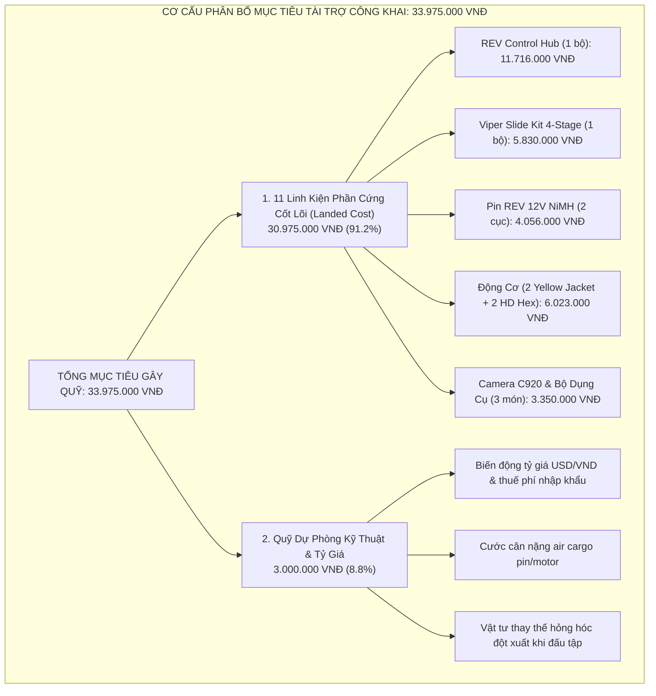
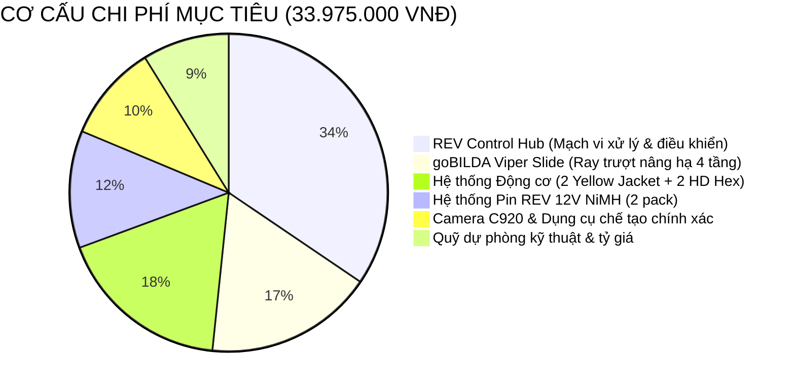

# 04 — KẾ HOẠCH TÀI CHÍNH & DỰ TOÁN NGÂN SÁCH DELTA

> **Mục đích:** Tài liệu này chuẩn hóa toàn bộ mô hình tài chính, tính toán chi phí phần cứng về tay (Landed Cost) của 11 linh kiện cốt lõi, định mức quỹ dự phòng kỹ thuật & tỷ giá, và kế hoạch giải ngân 2 đợt mua sắm cho đội tuyển Robotics Sóc Sơn (FTC #39256) tại mùa giải FIRST Tech Challenge 2026–2027.

---





---

## 1. NGUYÊN TẮC TÍNH TOÁN VÀ CÁC THAM SỐ CỐT LÕI

### 1.1. Tỷ giá ngoại tệ chuẩn hóa (Exchange Rate)
- **Tỷ giá áp dụng:** **1 USD = 25.800 VNĐ**
- **Căn cứ xác lập:**
  - Tỷ giá bán ra chính thức của Vietcombank ngày 27–28/10/2026.
  - Khi thanh toán mua hàng quốc tế (REV Robotics tại Texas, goBILDA tại Kansas) bằng thẻ thanh toán quốc tế (Visa/Mastercard), ngân hàng thương mại thu phí chuyển đổi ngoại tệ từ 2.5% đến 3.5%.
  - Mức tỷ giá 25.800 VNĐ/USD đóng vai trò lớp đệm an toàn (Safety Buffer), giúp dự toán ngân sách không bị thâm hụt trước các biến động tỷ giá và định giá tính thuế hải quan tại thời điểm mở tờ khai.

### 1.2. Hệ số chi phí về tay (Landed Cost Multiplier)
Theo Báo cáo nghiên cứu nhập khẩu `docs/campaign-2026-2027/research/R2-parts-import.md`:
$$\text{Landed Cost (VNĐ)} = [\text{Giá Web niêm yết (USD)} \times 25.800] \times \text{Multiplier}$$
Các thành phần cấu thành hệ số Multiplier bao gồm:
1. Phí thanh toán thẻ quốc tế / dịch vụ mua hộ: **+2.5% – 3.5%**
2. Cước chuyển phát nội địa Mỹ (từ Texas/Kansas về kho trung chuyển forwarder): **+2.0% – 4.0%**
3. Cước vận chuyển hàng không chuyên tuyến Mỹ – Hà Nội ($11 – $14/kg): **+6.0% – 15.0%**
4. Thuế nhập khẩu ưu đãi (MFN) theo mã HS (0% đối với mạch vi xử lý, 0%–3% đối với động cơ, 5% đối với pin): **0% – 5.0%**
5. Thuế giá trị gia tăng (VAT): **10.0%** tính trên trị giá CIF + Thuế NK.
6. Phụ thu an toàn hàng không cho pin NiMH và phí mở tờ khai hải quan: **+3.0% – 5.0%**

*Lưu ý thay đổi pháp lý quan trọng:* Kể từ ngày **18/02/2025**, **Quyết định 01/2025/QĐ-TTg** đã chính thức bãi bỏ Quyết định 78/2010/QĐ-TTg. Do đó, **không còn chính sách miễn thuế NK và VAT cho hàng hóa nhập khẩu dưới 1.000.000 VNĐ gửi qua chuyển phát nhanh**. Toàn bộ linh kiện mua lẻ từ nước ngoài đều phải kê khai nộp thuế 10% VAT và chịu phí dịch vụ hải quan. Toàn đội phải gom chung thành các đơn hàng tập trung để tiết kiệm chi phí thủ tục.

---

## 2. DỰ TOÁN CHI TIẾT 11 LINH KIỆN PHẦN CỨNG DELTA (HARDWARE LANDED COSTS)

### 2.1. Phân tích thâm hụt so với dự toán cũ trong CSV
Trong file quản lý nội bộ `docs/INVENTORY - PURCHASE PLAN 2026.csv`, danh mục 11 linh kiện và công cụ dự kiến mua có tổng dự toán ban đầu là **25.050.000 VNĐ**. Dự toán này bị **thâm hụt 5.925.000 VNĐ** (thiếu 23.6%) do các nguyên nhân:
1. *REV Control Hub:* CSV ghi 9.500.000 VNĐ (thấp hơn cả giá web gốc $375 = 9.675.000 VNĐ chưa thuế phí).
2. *Pin REV 12V Slim NiMH:* CSV ghi 1.250.000 VNĐ/cục, trong khi giá web gốc đã là $60 (1.548.000 VNĐ), cộng cước pin nặng và phụ thu an toàn thì giá về tay thực tế là 2.028.000 VNĐ/cục (lệch -38%).
3. *Ray trượt Viper Slide 4 tầng:* CSV ghi 4.800.000 VNĐ không đủ chi trả bộ kẹp đai truyền 4-Stage 336mm tải trọng cao.

### 2.2. Bảng đối chiếu chi tiết 11 linh kiện phần cứng cốt lõi (Base Hardware)

| STT | Mã linh kiện | Tên linh kiện & Thông số | SKU | SL | Giá Web USD | Đơn giá CSV (VNĐ) | Landed Cost Đơn vị (VNĐ) | Thành tiền Landed (VNĐ) | Chênh lệch thâm hụt | Nguồn cung ứng |
|:---:|:---|:---|:---:|:---:|:---:|:---:|:---:|:---:|:---:|:---|
| 1 | FTC-CTRL-01 | **REV Control Hub** (Android OS, WiFi, 4 motor ports, 6 servo ports) | REV-31-1595 | 1 | $375.00 | 9.500.000 ₫ | 11.716.000 ₫ | **11.716.000 ₫** | +2.216.000 ₫ | Nhập khẩu Mỹ (REV Robotics) |
| 2 | FTC-STR-01 | **Bộ ray trượt goBILDA Viper Slide Kit (4-Stage 336mm)** | 3210-0003-0004 | 1 | $172.49 *(FTC)* | 4.800.000 ₫ | 5.830.000 ₫ | **5.830.000 ₫** | +1.030.000 ₫ | Nhập khẩu Mỹ (goBILDA) |
| 3 | FTC-PWR-01 | **Pin REV 12V 3000mAh Slim NiMH Battery** | REV-31-1302 | 2 | $60.00 | 1.250.000 ₫ | 2.028.000 ₫ | **4.056.000 ₫** | +1.556.000 ₫ | Nhập khẩu Mỹ (REV Robotics) |
| 4 | FTC-MTR-01 | **Động cơ goBILDA 5202 Yellow Jacket (435 RPM)** | 5202-2402-0014 | 2 | $41.24 *(FTC)* | 1.150.000 ₫ | 1.372.500 ₫ | **2.745.000 ₫** | +445.000 ₫ | Nhập khẩu Mỹ (goBILDA) |
| 5 | FTC-MTR-02 | **Động cơ REV UltraPlanetary HD Hex Motor** | REV-41-1600 | 2 | $50.00 | 1.300.000 ₫ | 1.639.000 ₫ | **3.278.000 ₫** | +678.000 ₫ | Nhập khẩu Mỹ (REV Robotics) |
| 6 | FTC-SEN-01 | **Camera Logitech C920 Pro HD** (Nhận diện OpenCV) | 960-000764 | 1 | Mua tại VN | 1.850.000 ₫ | 1.850.000 ₫ | **1.850.000 ₫** | 0 ₫ | Đại lý chính hãng Hà Nội |
| 7 | FTC-TOL-01 | **Bộ cờ lê / lục giác Inch & Mét Wera** | Wera 05022086001 | 1 | Mua tại VN | 850.000 ₫ | 850.000 ₫ | **850.000 ₫** | 0 ₫ | Phân phối chính hãng VN |
| 8 | FTC-TOL-02 | **Bộ tua vít điện chính xác Wowstick 1F+** | Wowstick 1F+ | 1 | Mua tại VN | 650.000 ₫ | 650.000 ₫ | **650.000 ₫** | 0 ₫ | Sẵn kho Hà Nội |
| | **TỔNG** | **11 linh kiện & công cụ cốt lõi** | | **11** | | **25.050.000 ₫** | | **30.975.000 ₫** | **+5.925.000 ₫** | |

*Ghi chú về chiết khấu:* Đơn giá linh kiện goBILDA (động cơ Yellow Jacket và ray trượt Viper Slide) đã áp dụng mã ưu đãi **FTC Team Discount giảm 25%** dành riêng cho các đội thi FIRST Tech Challenge chính thức. Nếu không có mã giảm giá này, tổng chi phí phần cứng sẽ lên tới **33.300.000 VNĐ**.

---

## 3. QUỸ DỰ PHÒNG KỸ THUẬT & CÔNG THỨC MỤC TIÊU GÂY QUỸ

### 3.1. Quỹ dự phòng kỹ thuật & tỷ giá (Contingency Buffer)
- **Mức trích lập:** **3.000.000 VNĐ**.
- **Mục đích sử dụng:**
  1. Bù đắp chênh lệch biến động tỷ giá ngoại tệ thực tế khi mở thẻ thanh toán quốc tế và phát sinh thuế hải quan.
  2. Bù đắp phụ thu an toàn hàng không, chênh lệch cước cân nặng air cargo đối với kiện hàng pin NiMH và động cơ nặng.
  3. Mua vật tư thay thế nhanh các chi tiết cơ khí bị gãy hỏng đột xuất trong quá trình thi đấu tập (scrimmage) và hiệu chỉnh robot.

### 3.2. Công thức xác lập mục tiêu gây quỹ công khai (Target Formula)
Chiến dịch tập trung toàn bộ nguồn lực vận động vào 11 linh kiện phần cứng trọng yếu và quỹ dự phòng rủi ro kỹ thuật:

$$\text{Mục tiêu Gây quỹ Công khai} = \text{Phần cứng cốt lõi (11 món Landed)} + \text{Quỹ dự phòng kỹ thuật \& tỷ giá}$$

$$\text{Mục tiêu} = 30.975.000\text{ VNĐ} + 3.000.000\text{ VNĐ} = \mathbf{33.975.000\text{ VNĐ}}$$

*Lưu ý về hoạt động ngoài mục tiêu:* Maker Day và Merch được tự cấp vốn bằng pre-order và vé, không nằm trong mục tiêu gây quỹ 33.975.000 VNĐ.
*Fact giải đấu:* FTC Vietnam trao 02 suất dự FIRST Championship (Houston, 28/04–01/05/2027) theo điểm Advancement; mùa gần nhất 2 suất thuộc đội giải Nhất Inspire Award và đội trưởng Liên minh Vô địch (R8). Nguồn: `docs/campaign-2026-2027/research/R1-season-team.md`.

---

## 4. KẾ HOẠCH GIẢI NGÂN & TIẾN ĐỘ ĐẶT HÀNG (2 ĐỢT MUA SẮM)

Toàn bộ quá trình giải ngân mua sắm linh kiện được chia thành 2 đợt chặt chẽ theo tiến độ đóng góp quỹ thực tế:

| Đợt | Mục tiêu quỹ tích lũy | Hạn chót | Hạng mục đặt hàng | Dự toán giải ngân | Mục tiêu kỹ thuật đạt được |
|:---:|:---|:---:|:---|:---:|:---|
| **Đợt 1** | **≥ 17.546.000 VNĐ** | **20/11/2026** | • REV Control Hub (11.716.000 ₫)<br>• Viper Slide Kit 4-Stage (5.830.000 ₫) | **17.546.000 VNĐ** | Đặt trước 2 linh kiện có lead time sản xuất và ship Mỹ lâu nhất (14–18 ngày). Đảm bảo có não bộ robot để đội lập trình nạp code Autonomous và dựng khung nâng hạ trước tháng 12/2026. |
| **Đợt 2** | **33.975.000 VNĐ**<br>*(Phần còn lại: 16.429.000 ₫)* | **05/12/2026** | • 2 Pin REV 12V Slim NiMH (4.056.000 ₫)<br>• 2 Động cơ Yellow Jacket (2.745.000 ₫)<br>• 2 Động cơ REV HD Hex (3.278.000 ₫)<br>• Camera C920 & Dụng cụ VN (3.350.000 ₫)<br>• Quỹ dự phòng kỹ thuật & tỷ giá (3.000.000 ₫) | **16.429.000 VNĐ** | Hoàn tất toàn bộ hệ thống truyền động gầm, cơ cấu tay gắp, cấp nguồn điện kép và hệ thống thị giác máy tính OpenCV trước ngày 22/12/2026. |

```mermaid
gantt
    title TIẾN ĐỘ HUY ĐỘNG QUỸ & GIẢI NGÂN MUA SẮM LINH KIỆN
    dateFormat  YYYY-MM-DD
    section Gây Quỹ
    Phát động chiến dịch "BUILD THE NEXT ROBOT" :milestone, m1, 2026-11-05, 0d
    Huy động Đợt 1 (Mục tiêu ≥ 17.546.000đ)       :active, f1, 2026-11-05, 2026-11-20
    Huy động Đợt 2 (Cán mốc 33.975.000đ)          :f2, 2026-11-21, 2026-12-05
    section Mua Sắm & Vận Chuyển
    Giải ngân Đợt 1: Đặt Control Hub & Viper Slide :crit, p1, 2026-11-20, 1d
    Vận chuyển quốc tế US - Hà Nội (Đợt 1)       :ship1, 2026-11-21, 2026-12-08
    Giải ngân Đợt 2: Đặt Motor, Pin & Phụ kiện   :crit, p2, 2026-12-05, 1d
    Vận chuyển quốc tế US - Hà Nội (Đợt 2)       :ship2, 2026-12-06, 2026-12-22
    section Thi Công & Thi Đấu
    Lắp ráp khung gầm & Lập trình Autonomous     :bld, 2026-12-10, 2027-01-15
    Đấu tập Scrimmage & Hoàn thiện Portfolio     :scr, 2027-01-16, 2027-01-25
    VCK Quốc Gia FTC Vietnam tại ĐH FPT Hòa Lạc  :milestone, comp, 2027-02-15, 0d
```

---

## NGUỒN TÀI LIỆU THAM CHIẾU
- `docs/campaign-2026-2027/research/R2-parts-import.md` (Chi tiết giá web REV/goBILDA, biểu thuế hải quan, bãi bỏ QĐ 78/2010 theo QĐ 01/2025/QĐ-TTg, hệ số Landed Cost Multiplier 1.25x – 1.32x).
- `docs/campaign-2026-2027/research/R1-season-team.md` (Quy chế thi đấu FTC Vietnam, 02 suất tham dự FIRST Championship tại Houston).
- `docs/campaign-2026-2027/99-bien-ban-thao-luan.md` (Biên bản thống nhất mục tiêu chiến dịch 11 linh kiện + 3M dự phòng, tổng 33.975.000 VNĐ).
- File dữ liệu gốc: `docs/INVENTORY - PURCHASE PLAN 2026.csv`.
