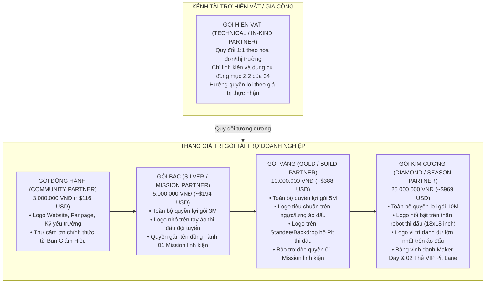
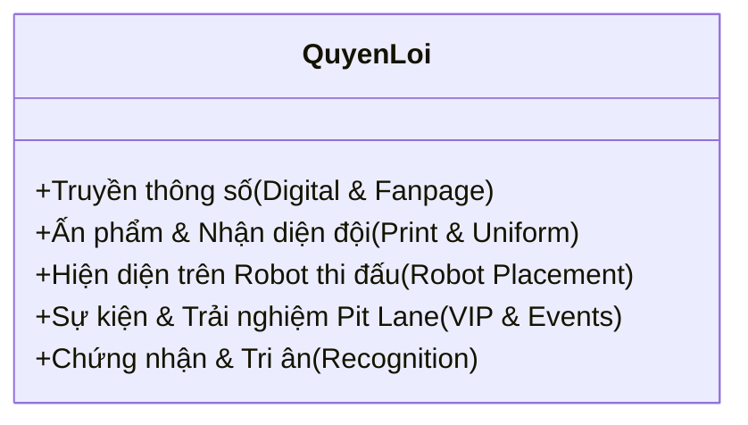
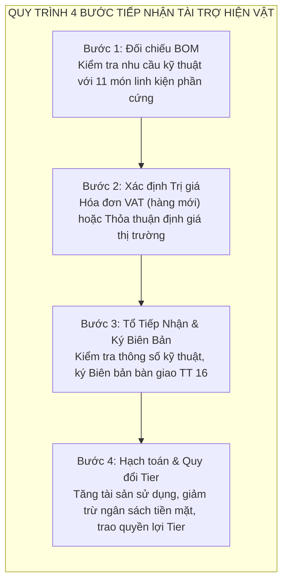
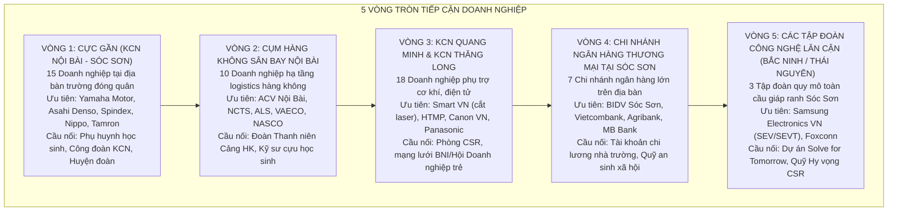

# 05 — DANH MỤC GÓI TÀI TRỢ DOANH NGHIỆP & CHÍNH SÁCH ĐỒNG HÀNH

> **Mục đích:** Tài liệu này quy định chi tiết cấu trúc các gói tài trợ doanh nghiệp, ma trận quyền lợi tri ân, nguyên tắc quy đổi tài trợ hiện vật (In-kind 1:1) và chiến lược thứ tự tiếp cận mạng lưới doanh nghiệp mục tiêu cho Robotics Sóc Sơn (FTC #39256) tại mùa giải FIRST Tech Challenge 2026–2027.

---

---

## 1. CĂN CỨ PHÁP LÝ & BẢN CHẤT TÀI TRỢ

### 1.1. Bản chất pháp lý: Tài trợ giáo dục STEM (Education Donation)
Căn cứ Thông tư 16/2018/TT-BGDĐT và Luật Giáo dục 2019:
- Trường THPT Sóc Sơn là đơn vị sự nghiệp công lập, không kinh doanh dịch vụ quảng cáo và không xuất hóa đơn giá trị gia tăng (VAT) quảng cáo thương mại.
- Mối quan hệ hợp tác giữa Nhà tài trợ và Đội tuyển được xác lập dưới hình thức **Thỏa thuận tài trợ giáo dục 3 bên** (Doanh nghiệp tài trợ — Trường THPT Sóc Sơn — CLB Robotics Sóc Sơn).
- Quyền lợi truyền thông của doanh nghiệp được định vị chuẩn mực là **"Tri ân / Ghi nhận nhà tài trợ giáo dục STEM"** (Sponsor Recognition), hoàn toàn hợp pháp và phù hợp với thuần phong mỹ tục học đường.
---

## 2. MA TRẬN QUYỀN LỢI CHI TIẾT CÁC BẬC TÀI TRỢ

### 2.1. Bảng so sánh quyền lợi đa chiều (Benefit Matrix)

| Danh mục quyền lợi | Đồng Hành (3M) | Bạc (5M) | Vàng (10M) | Kim Cương (25M) |
|:---|:---:|:---:|:---:|:---:|
| **Thư tri ân đóng dấu mộc đỏ Ban Giám Hiệu** | Có | Có | Có | Có |
| **Kỷ yếu & Báo cáo tổng kết mùa giải** | Logo nhỏ | Logo vừa | Logo chuẩn | Logo trang trọng |
| **Logo & Lời cảm ơn trên Fanpage CLB** | 01 bài cảm ơn chung | 01 bài cảm ơn riêng | 02 bài PR chuyên sâu | Chiến dịch PR riêng |
| **Bảo trợ Mission linh kiện cụ thể** | — | Đồng hành | Độc quyền 1 Mission | Độc quyền 2 Mission |
| **Logo trên Áo Polo đồng phục đội thi** | — | Tay áo (nhỏ) | Ngực/Lưng áo (chuẩn) | Lưng áo (vị trí VIP) |
| **Logo trên Standee & Backdrop Pit Lane Hòa Lạc** | — | Logo nhỏ | Logo tiêu chuẩn | Logo nổi bật |
| **Logo trên Thân Robot thi đấu (chuẩn FIRST)** | — | — | — | **Có (Vị trí nổi bật)** |
| **Bảng vinh danh tại Sự kiện Maker Day** | — | — | Tên bảng vàng | Đặt standee riêng |
| **Thẻ VIP tham quan Pit Lane tại ĐH FPT Hòa Lạc** | — | — | — | 02 Thẻ VIP |
| **Kỷ niệm chương mô hình Robot tri ân** | — | — | Kỷ niệm chương mica | Kỷ niệm chương cơ khí |

---

## 3. QUY TRÌNH BẢO CHỨNG THƯƠNG HIỆU THEO LUẬT FIRST TECH CHALLENGE

Để bảo đảm tính hợp lệ tuyệt đối của robot khi bước qua vòng kiểm tra kỹ thuật (Robot Inspection) tại giải đấu FTC Vietnam, việc gắn logo nhà tài trợ phải tuân thủ nghiêm ngặt cẩm nang thi đấu FIRST CANOPY / BIOBUZZ:
1. **Giới hạn kích thước Robot:** Kích thước robot tại thời điểm bắt đầu trận đấu không được vượt quá **18" × 18" × 18"** (tương đương 45.72 cm × 45.72 cm × 45.72 cm). Logo tài trợ gắn trên tấm ốp bảo vệ (side panels) phải nằm hoàn toàn trong giới hạn kích thước này.
2. **Bảo vệ mã số đội tuyển và nhận diện liên minh:**
   - Tuyệt đối không dán logo che khuất biển số hiệu đội thi **FTC #39256** (chữ số màu trắng hoặc tương phản, chiều cao tối thiểu 2.5 inch ≈ 6.35 cm theo luật FIRST).
   - Tuyệt đối không che khuất đèn LED trạng thái tín hiệu và vạch phân định liên minh thi đấu (đèn/vải liên minh Đỏ - Alliance Red hoặc Xanh - Alliance Blue).
3. **Tính chất phi chức năng:** Decal hoặc miếng dán logo chỉ mang tính chất nhận diện hình ảnh, không được can thiệp vào cơ chế gắp phấn hoa, không gây cản trở chuyển động của bánh xe Mecanum và không gây nguy hiểm cháy nổ/sắc nhọn trên sân đấu.
4. **Quy định cấm ngành hàng:** Cấm tuyệt đối nhận tài trợ và hiển thị logo của các sản phẩm/dịch vụ: Thuốc lá, rượu bia, đồ uống có cồn, chất kích thích, cờ bạc, cá cược, trò chơi điện tử bạo lực hoặc các nội dung chính trị - tôn giáo.
5. **Quy chuẩn thương hiệu FIRST:** Logo tài trợ không được chỉnh sửa hoặc chèn đè lên biểu trưng chính thức của FIRST Tech Challenge và RTX. Nhà tài trợ được truyền thông là "Nhà tài trợ đồng hành cùng Đội tuyển Robotics Sóc Sơn", không được tự nhận là "Nhà tài trợ toàn cầu của tổ chức FIRST".

---

## 4. QUY TRÌNH TIẾP NHẬN & ĐỊNH GIÁ TÀI TRỢ HIỆN VẬT (IN-KIND 1:1)

### 4.1. Nguyên tắc quy đổi 1:1
Căn cứ Điều 6 Thông tư 16/2018/TT-BGDĐT và quyết định thống nhất trong Biên bản 99:
- Mọi đóng góp bằng hiện vật, linh kiện công nghệ hoặc dịch vụ gia công kỹ thuật có giá trị thay thế trực tiếp cho các hạng mục trong Danh mục mua sắm 11 linh kiện phần cứng đều được **quy đổi 1:1 theo giá trị thị trường hợp pháp**.
- Nhà tài trợ hiện vật được hưởng **đầy đủ 100% quyền lợi tri ân tương đương với gói tài trợ tiền mặt cùng mức giá trị**.
- Giá trị tài trợ hiện vật được **khấu trừ trực tiếp vào số tiền mặt cần gây quỹ của chiến dịch**.

### 4.2. Bảng quy đổi các loại hiện vật mục tiêu

| Danh mục hiện vật | Căn cứ tiếp nhận | Giá trị ghi nhận | Quyền lợi |
|---|---|---|---|
| REV Control Hub, Viper Slide, pin REV, động cơ Yellow Jacket/HD Hex | Đúng thông số, số lượng còn thiếu tại mục 2.2 của 04 | Hóa đơn hoặc giá thị trường hợp pháp; không tính trùng hạng mục đã nhận | Tier theo giá trị thực nhận |
| Camera Logitech C920, bộ Wera, bộ Wowstick | Đúng danh mục mục 2.2 của 04 | Hóa đơn hoặc giá thị trường hợp pháp | Tier theo giá trị thực nhận |

Không vận động vật tư prototype, gia công khung, máy in 3D hoặc chi phí vận hành trong chiến dịch này.

### 4.3. Hồ sơ thủ tục pháp lý tiếp nhận hiện vật
1. **Đối với hiện vật mới 100% mua từ nhà cung cấp:** Doanh nghiệp gửi kèm Hóa đơn điện tử GTGT hoặc Tờ khai hải quan nhập khẩu mang tên doanh nghiệp. Giá trị tài trợ được tính theo giá ghi trên hóa đơn/tờ khai đã gồm thuế.
2. **Đối với dịch vụ gia công kỹ thuật hoặc sản phẩm tự chế tạo:** Tổ tiếp nhận tài trợ nhà trường (Hiệu trưởng, kế toán, giáo viên STEM) cùng đại diện doanh nghiệp lập **Biên bản thỏa thuận xác định giá trị tài trợ** căn cứ trên đơn giá gia công thị trường phổ biến tại Hà Nội.
3. **Biên bản giao nhận hiện vật:** Lập thành 03 bản, ghi rõ tên tài sản, số lượng, quy cách kỹ thuật, tình trạng hoạt động (test nạp điện/chạy thử) và bàn giao cho CLB quản lý sử dụng.

---

## 5. THỨ TỰ ƯU TIÊN VÀ CHIẾN LƯỢC TIẾP CẬN DOANH NGHIỆP MỤC TIÊU

Căn cứ cơ sở dữ liệu nghiên cứu thị trường `docs/campaign-2026-2027/research/R5-sponsors-benchmarks.md`, ban vận động tài trợ triển khai tiếp cận theo **nguyên tắc 5 vòng tròn đồng tâm (Concentric Approach Strategy)**: Tiếp cận từ đối tượng có liên kết địa lý và tình cảm gần gũi nhất, sau đó lan tỏa ra các tập đoàn công nghiệp lớn.

### 5.1. Bảng phân kỳ và phân bổ mục tiêu tiếp cận

| Giai đoạn tiếp cận | Nhóm mục tiêu | Số lượng doanh nghiệp | Mục tiêu gói tài trợ | Chỉ tiêu tài chính kỳ vọng | Người phụ trách chính |
|:---|:---|:---:|:---|:---:|:---|
| **Đợt 1 (28/10 – 20/11):** Nhanh & Ấm (Warm Leads) | KCN Nội Bài & Ngân hàng thương mại địa phương | 12 doanh nghiệp | 01 Gói Vàng (10M) + 01 Gói Bạc (5M) + 01 Gói Đồng Hành (3M) | **≥ 17.546.000 ₫** *(Đảm bảo ngân sách đặt hàng Đợt 1: Control Hub & Viper Slide)* | → 14 |
| **Đợt 2 (21/11 – 05/12):** Đột phá Cơ khí & Hàng không | Cụm Hàng không Nội Bài & KCN Quang Minh | 15 doanh nghiệp | 01 Gói Kim Cương (25M) hoặc các Gói Vàng/Bạc kết hợp hiện vật | **16.429.000 ₫** *(Cán mốc toàn diện 33.975.000 ₫ để hoàn tất đặt hàng Đợt 2)* | → 14 |

---

## NGUỒN TÀI LIỆU THAM CHIẾU
- `docs/campaign-2026-2027/research/R4-legal-payment.md` (Quy định vận động tài trợ giáo dục và chuẩn mực truyền thông trường học).
- `docs/campaign-2026-2027/research/R5-sponsors-benchmarks.md` (Hệ thống benchmark tài trợ quốc tế, danh bạ chi tiết 53 doanh nghiệp mục tiêu tại Sóc Sơn và lân cận).
- `docs/campaign-2026-2027/research/R1-season-team.md` (Quy chuẩn kích thước robot FIRST 18"x18"x18", quy định gắn số hiệu đội #39256).
- `docs/campaign-2026-2027/99-bien-ban-thao-luan.md` (Biên bản đồng thuận cấu trúc 4 gói tài trợ tiền mặt 3M/5M/10M/25M và cơ chế In-kind 1:1).
- `docs/campaign-2026-2027/04-ngan-sach-delta.md` (Bảng dự toán chi phí 11 linh kiện và quỹ dự phòng 33.975.000 VNĐ).
- `docs/campaign-2026-2027/14-phan-cong-nhan-su.md` (Phân công chi tiết nhân sự phụ trách các đợt tiếp cận).
