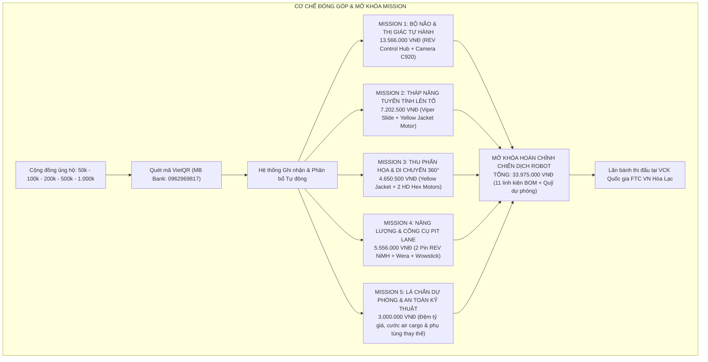
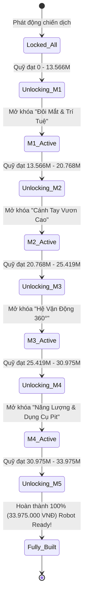

# 06 — CHIẾN LƯỢC MISSION GÂY QUỸ CỘNG ĐỒNG & BỘ THEO DÕI TIẾN ĐỘ

> **Mục đích:** Tài liệu này chi tiết hóa cơ chế gây quỹ vi mô (Micro-funding) thông qua 4 Mission linh kiện cốt lõi và 1 Mission quỹ dự phòng kỹ thuật, thiết kế giao diện theo dõi tiến độ lắp ráp robot thời gian thực (Gamified Tracker), các gói đóng góp cộng đồng linh hoạt, cơ chế quỹ đối ứng (Matching Fund) và bộ thông điệp kêu gọi hành động (Call to Action - CTA) dành cho phụ huynh, cựu học sinh và người yêu khoa học của Robotics Sóc Sơn (FTC #39256).

---

---

## 1. NGUYÊN TẮC THIẾT KẾ: "MỖI ĐÓNG GÓP — MỘT LINH KIỆN NHÌN THẤY ĐƯỢC"

Khác với các chương trình quyên góp chung chung dễ gây cảm giác mông lung, chiến dịch **"BUILD THE NEXT ROBOT"** áp dụng triệt để nguyên tắc **Hữu hình hóa mục tiêu (Tangible Crowdfunding)**:
1. **Chia nhỏ cỗ máy:** Biến chiếc robot phức tạp thành 4 cụm cơ chế chức năng sống động, gắn liền với luật chơi của mùa giải **BIOBUZZ™ presented by RTX**, cùng 1 quỹ bảo vệ an toàn kỹ thuật.
2. **Khớp số học 100%:** Tổng giá trị của 5 Mission cộng đồng khớp chính xác từng đồng với tổng mục tiêu gây quỹ công khai: **33.975.000 VNĐ** (theo `docs/campaign-2026-2027/04-ngan-sach-delta.md`).
3. **Cảm giác đồng kiến tạo (Co-creation):** Bất kỳ ai ủng hộ — dù chỉ 50.000đ hay 500.000đ — đều có thể nhìn thấy đóng góp của mình đang trực tiếp "mua" một con ốc, một mét đai truyền hay bộ não vi xử lý của robot.

---

## 2. CHI TIẾT 5 MISSION LINH KIỆN & QUỸ DỰ PHÒNG

### Mission 1 — "Bộ Não & Thị Giác Tự Hành" (Autonomous Brain & Vision)
- **Mục tiêu ngân sách:** **13.566.000 VNĐ**
- **Cụm linh kiện mua sắm:**
  - `FTC-CTRL-01`: 01 Bộ máy tính nhúng & điều khiển trung tâm **REV Control Hub** (SKU REV-31-1595) = **11.716.000 VNĐ**.
  - `FTC-SEN-01`: 01 Camera thị giác máy tính **Logitech C920 Pro HD** (SKU 960-000764) = **1.850.000 VNĐ**.
- **Ý nghĩa kỹ thuật trong game BIOBUZZ:**
  - Trong 30 giây đầu trận (Autonomous Period), học sinh không được chạm vào tay cầm điều khiển. Robot phải hoàn toàn "tự suy nghĩ" và "tự nhìn đường".
  - Control Hub đóng vai trò bộ não chạy hệ điều hành Android, nạp thuật toán OpenCV từ camera Logitech C920 để nhận diện vị trí các bông hoa mang phấn (Pollen), tự động định vị sân đấu và điều khiển robot di chuyển chính xác từng centimet.
- **Trạng thái mở khóa (Gamification Milestone):** *"Kích hoạt đôi mắt và trí tuệ nhân tạo của cỗ máy Sóc Sơn!"*

---

### Mission 2 — "Tháp Nâng Tuyến Tính Đưa Mật Lên Tổ" (Linear Viper Slide & Hive Outtake)
- **Mục tiêu ngân sách:** **7.202.500 VNĐ**
- **Cụm linh kiện mua sắm:**
  - `FTC-STR-01`: 01 Bộ ray trượt đai truyền 4 tầng **goBILDA Viper Slide Kit (4-Stage 336mm)** (SKU 3210-0003-0004) = **5.830.000 VNĐ** *(đã gồm chiết khấu 25% FTC)*.
  - `FTC-MTR-01 (1/2)`: 01 Động cơ hành tinh **goBILDA 5202 Yellow Jacket (435 RPM)** = **1.372.500 VNĐ**.
- **Ý nghĩa kỹ thuật trong game BIOBUZZ:**
  - Đỉnh cao ghi điểm của game BIOBUZZ nằm ở việc đưa mẫu vật lên các tầng cao của tháp tổ ong (Hive structure).
  - Ray trượt Viper Slide 4 tầng gia công chính xác bằng hợp kim nhôm siêu nhẹ, kết hợp cùng lực kéo mạnh mẽ từ động cơ Yellow Jacket giúp robot vươn cao từ 35cm lên tới hơn 1.2 mét chỉ trong vòng 1.5 giây mà không bị rung lắc.
- **Trạng thái mở khóa (Gamification Milestone):** *"Cánh tay thép vươn tới đỉnh tháp — Sẵn sàng chinh phục mọi độ cao!"*

---

### Mission 3 — "Cơ Cấu Thu Phấn Hoa & Di Chuyển 360°" (Roller Intake & Drive)
- **Mục tiêu ngân sách:** **4.650.500 VNĐ**
- **Cụm linh kiện mua sắm:**
  - `FTC-MTR-01 (2/2)`: 01 Động cơ **goBILDA 5202 Yellow Jacket (435 RPM)** = **1.372.500 VNĐ** (phục vụ trục cuốn intake).
  - `FTC-MTR-02`: 02 Động cơ hành tinh có hộp số tùy biến **REV UltraPlanetary HD Hex Motor** (SKU REV-41-1600) = **3.278.000 VNĐ** (1.639.000đ × 2).
- **Ý nghĩa kỹ thuật trong game BIOBUZZ:**
  - Tốc độ là yếu tố sống còn trong các trận đối kháng 2 vs 2. Cụm động cơ bánh răng hành tinh cung cấp mô-men xoắn cực đại giúp robot tăng tốc tức thì, vận hành hệ thống con lăn cao su nuốt trọn phấn hoa trên mặt sàn chỉ trong tích tắc.
- **Trạng thái mở khóa (Gamification Milestone):** *"Cỗ xe cơ động 360 độ — Quét sạch sàn đấu trong chớp mắt!"*

---

### Mission 4 — "Nguồn Năng Lượng Đấu Trường & Hộp Đồ Nghề Pit Lane" (Power & Workshop)
- **Mục tiêu ngân sách:** **5.556.000 VNĐ**
- **Cụm linh kiện mua sắm:**
  - `FTC-PWR-01`: 02 Cục pin tiêu chuẩn thi đấu **Pin REV 12V 3000mAh Slim NiMH Battery** (SKU REV-31-1302) = **4.056.000 VNĐ** (2.028.000đ × 2).
  - `FTC-TOL-01`: 01 Bộ chìa lục giác chuyên dụng hệ Inch & Mét **Wera** = **850.000 VNĐ**.
  - `FTC-TOL-02`: 01 Bộ tua vít điện chính xác cao **Wowstick 1F+** = **650.000 VNĐ**.
- **Ý nghĩa kỹ thuật trong game BIOBUZZ:**
  - Mỗi trận đấu diễn ra với cường độ xả dòng cực lớn (>15A). Đội cần tối thiểu 2 cục pin NiMH chuẩn an toàn để luân phiên sạc và thi đấu liên tục, tránh hiện tượng sụt áp khiến vi điều khiển bị khởi động lại giữa trận.
  - Bộ dụng cụ chuyên dụng chuẩn hệ Inch/Mét Wera và Wowstick giúp các kỹ thuật viên siết chặt ốc chống tuột và xử lý sự cố trong vòng 8 phút nghỉ giữa các trận đấu tại khu vực pit lane.
- **Trạng thái mở khóa (Gamification Milestone):** *"Trái tim tràn đầy năng lượng & Bộ đồ nghề bách chiến bách thắng!"*

---

### Mission 5 — "Lá Chắn Dự Phòng & An Toàn Kỹ Thuật" (Safety & Contingency Buffer)
- **Mục tiêu ngân sách:** **3.000.000 VNĐ**
- **Cấu phần bảo hộ:**
  - Quỹ đệm tỷ giá thanh toán ngoại tệ và phí chuyển phát nhanh air cargo cho các kiện hàng pin/động cơ nặng.
  - Phụ tùng thay thế dự phòng khẩn cấp tại đấu trường (dây đai, vòng bi, bu-lông chống tuột, bánh răng sơ cua).
- **Ý nghĩa kỹ thuật trong game BIOBUZZ:**
  - Bảo đảm chiến dịch không bị đứt gãy tiến độ mua sắm khi thị trường ngoại tệ biến động, đồng thời robot luôn có phụ tùng thay thế ngay lập tức nếu xảy ra va chạm gãy hỏng trong các trận đối kháng nghẹt thở.
- **Trạng thái mở khóa (Gamification Milestone):** *"Lá chắn vững vàng — Vận hành an toàn xuyên suốt mùa giải!"*

---

### Bảng tổng hợp số học khớp 100% ngân sách chiến dịch:

| Mã Mission | Tên Mission | Cấu phần linh kiện & quỹ | Mục tiêu ngân sách (VNĐ) | Tỷ trọng |
|:---:|:---|:---|:---:|:---:|
| **M1** | Bộ Não & Thị Giác Tự Hành | REV Control Hub + Camera Logitech C920 Pro HD | **13.566.000 ₫** | 39.9% |
| **M2** | Tháp Nâng Tuyến Tính Đưa Mật | Ray trượt Viper Slide 4-Stage + 1 Động cơ Yellow Jacket | **7.202.500 ₫** | 21.2% |
| **M3** | Thu Phấn Hoa & Di Chuyển 360° | 1 Động cơ Yellow Jacket + 2 Động cơ REV HD Hex | **4.650.500 ₫** | 13.7% |
| **M4** | Năng Lượng & Dụng Cụ Pit Lane | 2 Pin REV 12V NiMH + Bộ lục giác Wera + Wowstick | **5.556.000 ₫** | 16.4% |
| **M5** | Lá Chắn Dự Phòng & An Toàn Kỹ Thuật | Quỹ đệm rủi ro tỷ giá, cước air cargo & phụ tùng sơ cua | **3.000.000 ₫** | 8.8% |
| **TỔNG** | **Khóa hoàn chỉnh toàn bộ Chiến dịch** | **11 linh kiện & công cụ cốt lõi + Quỹ dự phòng** | **33.975.000 ₫** | **100.0%** |

$$\mathbf{13.566.000 + 7.202.500 + 4.650.500 + 5.556.000 + 3.000.000 = 33.975.000\ VNĐ}$$
*(Sai số: 0 VNĐ — Khớp tuyệt đối với tổng ngân sách mục tiêu trong file 04-ngan-sach-delta.md)*.

---

## 3. CÁC HẠNG MỨC ĐÓNG GÓP VI MÔ & QUY ĐỔI GIÁ TRỊ (MICRO-PACKAGES)

Dành cho học sinh, sinh viên, cựu học sinh và phụ huynh ủng hộ trực tiếp qua hệ thống quét mã VietQR:

| Mức đóng góp | Tên gói ủng hộ | Hình tượng quy đổi kỹ thuật | Quyền lợi tri ân cộng đồng |
|:---:|:---|:---|:---|
| **50.000 ₫** | **Một Mảnh Ghép (One Piece)** | Tương đương 01 vòng bi chịu lực hoặc bộ ốc chống tuột Nyloc | - Ghi danh trên "Bảng Vàng Tri Ân Online" trên Fanpage CLB. - Nhận thiệp cảm ơn kỹ thuật số (E-Certificate). |
| **100.000 ₫** | **Bánh Răng Tiếp Sức (Gear Maker)** | Tương đương 01 con trượt T-nut hoặc bánh răng truyền động | - Toàn bộ quyền lợi trên. - Nhận 01 bộ Sticker Pack vinyl chống nước chủ đề BIOBUZZ. - Tên xuất hiện trong phần credit video recap chiến dịch. |
| **200.000 ₫** | **Nguồn Xung Nhịp (Pulse Starter)** | Tương đương 01 cảm biến hành trình chạm hoặc cáp nối JST chuyên dụng | - Toàn bộ quyền lợi trên. - Nhận 01 móc khóa mica Robotics Sóc Sơn cắt laser độc bản. - Cập nhật bản tin nội bộ "Behind-the-scenes" hàng tuần. |
| **500.000 ₫** | **Trợ Lực Cơ Khí (Force Booster)** | Tương đương 01 bracket gá motor hoặc 0.5m ray trượt nhôm | - Toàn bộ quyền lợi trên. - Tặng 01 áo thun Season 01 phiên bản giới hạn. - Lời mời danh dự tham dự buổi Open Day chạy thử robot tại trường. |
| **1.000.000 ₫** | **Kỹ Sư Danh Dự (Honorary Builder)** | Tương đương bảo trợ 01 động cơ REV UltraPlanetary hoặc 0.5 cục pin | - Toàn bộ quyền lợi trên. - Khắc tên cá nhân/gia đình bằng laser lên tấm ốp bảo vệ danh dự của robot. - Nhận kỷ niệm chương mô hình bánh xe Mecanum tri ân. |

---

## 4. CƠ CHẾ QUỸ ĐỐI ỨNG (MATCHING FUND 1:1)

Để tạo động lực lan tỏa và kích thích cộng đồng đóng góp sớm, CLB áp dụng mô hình **Quỹ Đối Ứng (Challenge Match)**:
- **Cơ chế:** Vận động 01 Doanh nghiệp Gói Vàng (10.000.000đ) hoặc Ban đại diện Cựu học sinh thành đạt cam kết: *"Với mỗi 1.000đ cộng đồng đóng góp qua cổng VietQR, Nhà bảo trợ đối ứng sẽ đóng góp thêm 1.000đ tương ứng vào quỹ robot (áp dụng cho đến khi chạm mốc 10.000.000đ)"*.
- **Tác động tâm lý:** Người ủng hộ cảm nhận rõ giá trị khoản tiền của mình được **nhân đôi ngay lập tức** (ủng hộ 100k thành 200k), tạo hiệu ứng đám đông mạnh mẽ trên mạng xã hội.
- **Thời điểm kích hoạt:** Phát động ngay trong tuần lễ đầu tiên của chiến dịch (từ 05/11 đến 12/11/2026) để đẩy nhanh tốc độ đóng quỹ Đợt 1 (mục tiêu ≥ 17.546.000đ).

---

## 5. THIẾT KẾ BỘ THEO DÕI TIẾN ĐỘ THỜI GIAN THỰC (GAMIFIED PROGRESS TRACKER)

### 5.1. Mô hình hiển thị trực quan (Visual Assembly Widget)
Trên Landing page và các bài đăng định kỳ của chiến dịch, tiến độ gây quỹ không chỉ thể hiện bằng con số phần trăm khô khan, mà được minh họa bằng **mô hình 3D Wireframe cỗ máy robot**:
- Khi quỹ đạt **0% – 39.9% (0 – 13.566.000đ):** Cụm Control Hub và Camera sáng đèn, mở khóa hoạt cảnh đôi mắt robot chớp sáng quét tìm mục tiêu.
- Khi quỹ đạt **40.0% – 61.1% (13.567.000 – 20.768.500đ):** Cụm tháp nâng Viper Slide vươn lên từ thân robot, mở khóa hoạt cảnh kéo thả mật hoa lên tổ ong.
- Khi quỹ đạt **61.2% – 74.8% (20.768.501 – 25.419.000đ):** 4 bánh xe Mecanum bắt đầu quay đa hướng, mở khóa hoạt cảnh di chuyển vượt chướng ngại vật.
- Khi quỹ đạt **74.9% – 91.2% (25.419.001 – 30.975.000đ):** Lắp đặt pin nguồn và hoàn thiện bộ đồ nghề pit lane.
- Khi quỹ đạt **91.3% – 100% (30.975.001 – 33.975.000đ):** Mở khóa toàn diện quỹ dự phòng an toàn. Cỗ máy phát sáng toàn phần kèm tiếng còi báo hiệu: *"ROBOT IS READY TO COMPETE!"*.

### 5.2. Công khai minh bạch dòng tiền (Real-time Transparency)
- Kết nối mã QR tài khoản ngân hàng tiếp nhận chính thức duy nhất của chiến dịch:
  - **Chủ tài khoản:** TRAN TUE MINH
  - **Số tài khoản:** 0962969817
  - **Ngân hàng:** MB Bank (Ngân hàng TMCP Quân đội)
  - **Mã QR:** `[QR: sẽ gửi sau]`
- Bảng cập nhật biến động số dư và sao kê định kỳ được công khai trên website `https://roboticssocson.com` và Fanpage CLB (tự động ẩn 3–4 số cuối tài khoản/số điện thoại theo Nghị định 13/2023/NĐ-CP về bảo vệ dữ liệu cá nhân).

---

## 6. BỘ THÔNG ĐIỆP KÊU GỌI HÀNH ĐỘNG (TAILORED CTAs)

### 6.1. Dành cho Cựu học sinh THPT Sóc Sơn (Alumni)
> *"Các anh chị cựu học sinh thân mến,  
> Dưới mái trường Sóc Sơn năm ấy, chúng ta từng ấp ủ biết bao ước mơ. Hôm nay, các em khóa dưới đang mang màu cờ sắc áo trường huyện ra đấu trường FIRST Tech Challenge. Chỉ cần bớt một ly cà phê, góp 50k – 100k, anh chị đang trực tiếp lắp thêm một bánh răng, một thanh ray giúp cỗ máy robot Sóc Sơn tranh tài tại Vòng chung kết Quốc gia. Hãy cùng các em viết tiếp niềm tự hào Sóc Sơn!"*  
> **👉 Quét mã VietQR ủng hộ Mission ngay:**  
> **Chủ TK: TRAN TUE MINH · STK: 0962969817 · MB Bank** · `[QR: sẽ gửi sau]`

### 6.2. Dành cho Phụ huynh & Thầy cô giáo (Parents & Educators)
> *"Kính gửi quý phụ huynh và các thầy cô,  
> Giáo dục STEM không phải là lý thuyết trên trang sách, mà là giọt mồ hôi bên bàn cơ khí, là những đêm thức trắng cùng dòng lệnh lập trình của con em chúng ta. Mỗi sự tiếp sức hôm nay không chỉ giúp hoàn thiện một cỗ máy, mà là đầu tư cho bản lĩnh, tư duy giải quyết vấn đề và tương lai nghề nghiệp của các con. Hãy đồng hành cùng con tại chiến dịch BUILD THE NEXT ROBOT!"*  
> **👉 Thông tin đóng góp quỹ:**  
> **Chủ TK: TRAN TUE MINH · STK: 0962969817 · MB Bank** · `[QR: sẽ gửi sau]`

### 6.3. Dành cho Học sinh & Giới trẻ (Students & Gen Z)
> *"Này Gen Z Sóc Sơn! Ai bảo trường huyện thì không thể chế tạo robot công nghệ cao?  
> Hãy trở thành một 'Honorary Builder' ngay hôm nay bằng cách đăng ký trải nghiệm Maker Day hoặc sở hữu set sticker BIOBUZZ cực chất. Sự ủng hộ của bạn chính là nguồn năng lượng đưa robot Sóc Sơn đại náo sàn đấu FPT Hòa Lạc!"*  
> **👉 Đặt vé Maker Day & Merch Pre-order: [Link Form]**

---

## NGUỒN TÀI LIỆU THAM CHIẾU
- `docs/campaign-2026-2027/04-ngan-sach-delta.md` (Bảng dự toán chi phí phần cứng 30.975.000 VNĐ, quỹ dự phòng 3.000.000 VNĐ, tổng 33.975.000 VNĐ).
- `docs/campaign-2026-2027/research/R2-parts-import.md` (Quy cách kỹ thuật Control Hub, Viper Slide 4 tầng, Pin NiMH và động cơ goBILDA/REV).
- `docs/campaign-2026-2027/research/R1-season-team.md` (Thể thức thi đấu game BIOBUZZ, luật Autonomous 30s và endgame).
- `docs/campaign-2026-2027/99-bien-ban-thao-luan.md` (Biên bản đồng thuận khóa 4 Missions phần cứng + 1 Mission dự phòng trùng khớp 100% mục tiêu gây quỹ).
