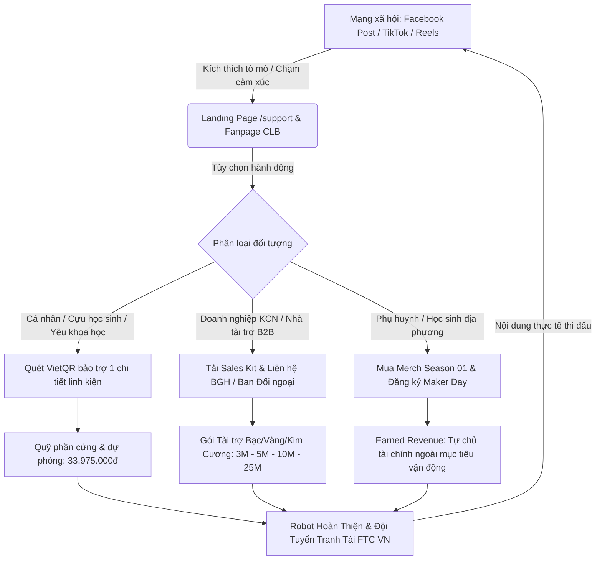
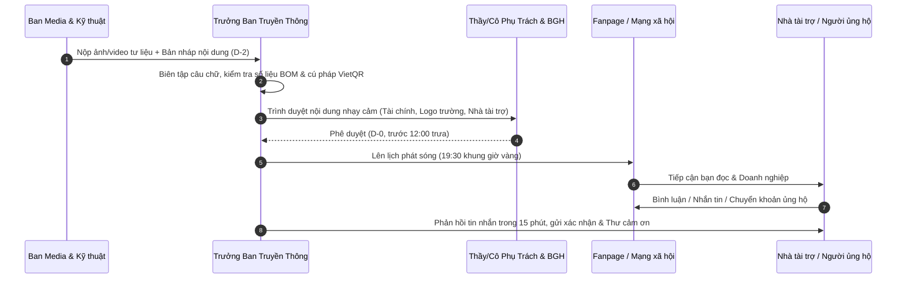

# 07 — Chuyện Linh Kiện & Kế Hoạch Nội Dung Truyền Thông

Tài liệu này xác lập chiến lược truyền thông đa kênh, 5 tuyến nội dung trọng điểm, lịch biên tập 8 tuần từ ngày phát động (05/11/2026) đến giải đấu quốc gia FTC Vietnam Championship 2027, bộ mẫu tiêu đề (hooks), bài viết mẫu (caption templates), lời kêu gọi hành động (CTA), và kế hoạch phân bổ ngân sách quảng cáo mồi (paid ad boost) cho chiến dịch "BUILD THE NEXT ROBOT — Mỗi mảnh ghép, một bước tiến" của CLB Robotics Sóc Sơn (FTC #39256).

---

## 1. Mục Tiêu Truyền Thông & Chỉ Số Đo Lường (KPIs)

Chiến dịch truyền thông đóng vai trò phễu chuyển đổi nhận thức thành đóng góp tài chính và hiện vật, chia làm 3 giai đoạn:
1. **Giai đoạn 1: Kích hoạt & Đóng quỹ Đợt 1 (05/11/2026 – 20/11/2026)** — Mục tiêu: Đạt tối thiểu 17.546.000 VNĐ để kịp đặt hàng Control Hub & Viper Slide từ Mỹ trước 20/11/2026.
2. **Giai đoạn 2: Tiến độ chế tạo & Lan tỏa cộng đồng (21/11/2026 – 05/12/2026)** — Mục tiêu: Cán mốc toàn diện 33.975.000 VNĐ (đủ 11 linh kiện BOM + Quỹ dự phòng), Preorder Merch, lấp đầy 40 suất vé Maker Day.
3. **Giai đoạn 3: Tăng tốc thi đấu & Vinh danh đối tác (06/12/2026 – VNCMP 2027)** — Mục tiêu: Hoàn thiện lắp ráp, nạp code OpenCV, vinh danh nhà tài trợ trên robot và áo đấu, tạo hiệu ứng cổ vũ cho đội tại FPT Hòa Lạc.

### Bảng KPI Truyền Thông Chiến Dịch

| Chỉ số (Metric) | Hiện trạng (Baseline) | Mục tiêu Chiến dịch (Target) | Kênh theo dõi |
|---|---|---|---|
| **Lượt theo dõi Fanpage Facebook** | ~1.200 followers | **2.500+ followers** | Meta Business Suite |
| **Lượt xem TikTok/Reels kỹ thuật** | ~500 views/video | **5.000 – 15.000 views/video viral** | TikTok Analytics |
| **Tương tác trung bình bài viết (Engagements)** | 30 – 50 reactions | **150 – 300 reactions/post chính** | Fanpage Insights |
| **Lượt truy cập trang /support & Form** | ~50 visits/tháng | **1.200+ unique clicks** | Bitly / UTM Link Tracker |
| **Đơn hàng Preorder Merch** | 0 | **≥ 30 áo thun + 50 combo phụ kiện** | Google Form |
| **Vé sự kiện Maker Day** | 0 | **40 vé bán hết (Sold out 2 ca)** | Google Form |
| **Số lượt ủng hộ vi mô (Community)** | ~5 lượt/mùa | **≥ 50 lượt quét VietQR lẻ** | Sao kê tài khoản tiếp nhận |

---

## 2. Mô Hình Phễu Truyền Thông & Vận Hành Nội Dung



---

## 3. Năm Tuyến Nội Dung Trọng Điểm (5 Content Series)

### Tuyến 1: "Đằng Sau Tấm Huy Chương" (Behind the Medals)
- **Mục đích:** Xây dựng lòng tin, sự đồng cảm và niềm tự hào địa phương; chứng minh năng lực thật và ý chí kiên cường của học sinh trường huyện Sóc Sơn.
- **Góc tiếp cận:** Câu chuyện những đêm thức trắng lập trình trong phòng thí nghiệm cũ của trường; hành trình vượt qua các đội trường chuyên để giành Á quân giải đấu *Motions In Fire* 2025; bài học sau cú trượt tại VNCMP 2026 (#33518 rank 36/38) và tinh thần phục thù với mã đội mới #39256.
- **Định dạng:** Album ảnh tư liệu chụp thực tế kèm bài viết tâm sự dài (long-form narrative) trên Facebook; video dạng phóng sự ngắn (Reels/TikTok).

### Tuyến 2: "Chuyện Linh Kiện" (Parts & Mechanics of BIOBUZZ)
- **Mục đích:** Cụ thể hóa từng đồng tài trợ thành một linh kiện cơ khí/điện tử nhìn thấy được, gắn trực tiếp với 4 Mission gây quỹ cốt lõi trong kế hoạch tài chính.
- **Góc tiếp cận:** Giải thích công nghệ bằng ngôn ngữ đại chúng dễ hiểu:
  - *Tập 1:* "Trái tim & Khối óc" — REV Control Hub và Camera Logitech C920 định vị OpenCV trong 30 giây tự hành Autonomous (Mission 1: 13.566.000 VNĐ).
  - *Tập 2:* "Chiếc thang máy 4 tầng" — Ray trượt goBILDA Viper Slide vươn cao đưa mật lên tổ (Mission 2: 7.202.500 VNĐ).
  - *Tập 3:* "Bánh xe Mecanum & Cánh quạt cuốn mẫu vật" — Hệ thống thu gom phấn hoa và động cơ HD Hex linh hoạt 360 độ (Mission 3: 4.650.500 VNĐ).
  - *Tập 4:* "Nguồn sống 12V & Chiếc chìa khóa lục giác Wera" — Pin NiMH tiêu chuẩn an toàn và dụng cụ siết ốc chống tuôn ren (Mission 4: 5.556.000 VNĐ).
  - *Tập 5:* "Lá chắn an toàn" — Quỹ dự phòng kỹ thuật & tỷ giá (Mission 5: 3.000.000 VNĐ).
- **Định dạng:** Infographic bóc tách 3D linh kiện, video cận cảnh mô phỏng cơ cấu chuyển động CAD.

### Tuyến 3: "Học Sinh Cấp 3 Làm Robotics" (Teens in Tech)
- **Mục đích:** Nhân cách hóa đội tuyển, làm nổi bật chân dung các bạn trẻ đam mê kỹ thuật, gắn với tinh thần *Gracious Professionalism* của FIRST.
- **Góc tiếp cận:**
  - Nữ sinh trường làng làm trưởng nhóm lập trình Java.
  - Cậu học sinh tự mày mò phần mềm SolidWorks thiết kế từng con ốc.
  - Phụ huynh từ e ngại con học sa sút đến trực tiếp chở con đi mua dây điện, cắt nhôm.
- **Định dạng:** Ảnh chân dung Polaroid/studio tối giản (đúng chuẩn nhận diện áo đen trong quy chuẩn DESIGN), phỏng vấn hỏi đáp nhanh (Q&A 60s).

### Tuyến 4: "Tiến Độ Chế Tạo Bot" (Build Log & Lab Diaries)
- **Mục đích:** Minh bạch tiến độ sử dụng quỹ, tạo cảm giác thôi thúc (FOMO) và cùng đồng hành theo thời gian thực (real-time progress).
- **Góc tiếp cận:** Khui hộp kiện hàng từ Mỹ (Unboxing REV/goBILDA); tiếng máy cắt nhôm tấm laser tại xưởng KCN Quang Minh; lần đầu tiên khung gầm robot chạy được vòng tròn; cú va chạm gãy thanh trượt và pha cứu hộ cơ khí trong đêm.
- **Định dạng:** Video ngắn POV dọc, time-lapse lắp ráp bàn thử nghiệm, nhật ký tuần "Tuần này Bot ăn gì?".

### Tuyến 5: "Spotlight Đối Tác & Tri Ân" (Sponsor & Supporter Spotlight)
- **Mục đích:** Trả quyền lợi tài trợ chuyên nghiệp, kích thích các doanh nghiệp khác nhập cuộc thông qua hiệu ứng chứng thực xã hội (social proof).
- **Góc tiếp cận:**
  - Chúc mừng và vinh danh doanh nghiệp đồng hành kèm thông điệp CSR của đối tác.
  - Câu chuyện kỹ sư tại KCN Nội Bài hỗ trợ gia công trục hex cho học sinh.
  - Vinh danh phụ huynh, cựu học sinh và các cá nhân đóng góp vi mô 50k, 100k, 200k.
- **Định dạng:** Banner thiết kế trang trọng mang thương hiệu đối tác, thư cảm ơn số hóa có chữ ký Ban Giám hiệu, video ngắn đại diện đội bắt tay nhà tài trợ.

---

## 4. Lịch Biên Tập Chi Tiết 8 Tuần (Editorial Calendar)

| Tuần | Mốc thời gian | Trọng tâm giai đoạn | Bài 1 (Thứ 3 — 19:30) | Bài 2 (Thứ 5 — 19:30) | Bài 3 (Chủ Nhật — 11:30 hoặc 20:00) |
|:---:|---|---|---|---|---|
| **W1** | 05/11 – 11/11/2026 | **Phát Động Chiến Dịch & Tuyên Bố Sứ Mệnh** | **Công bố chiến dịch:** "BUILD THE NEXT ROBOT" — THPT Sóc Sơn quay trở lại FTC 2026–2027 với mã đội #39256. | **Chuyện linh kiện (Ep 1):** Vì sao robot cần "Bộ não" REV Control Hub 11.7 triệu? Bóc tách Mission 1. | **Đằng sau tấm huy chương:** Từ phòng thí nghiệm trường làng đến Á quân Motions In Fire. Bắt đầu nhận ủng hộ. |
| **W2** | 12/11 – 18/11/2026 | **Công Bố Sản Phẩm Gây Quỹ & Thúc Đẩy M1** | **Ra mắt Merch Season 01:** Bộ nhận diện BioBuzz Supporter (Áo thun, Móc khóa, Sticker). Mở Pre-order. | **Chuyện linh kiện (Ep 2):** Cánh tay trượt Viper Slide 4 tầng — Vươn cao 1m2 để giải bài toán BIOBUZZ. | **Học sinh cấp 3 làm robot:** Phỏng vấn Driver chính của đội — Áp lực 2 phút 30 giây trên sàn đấu. |
| **W3** | 19/11 – 25/11/2026 | **Đóng Quỹ Đợt 1 (Mốc ≥ 17.5M)** | **Cập nhật tiến độ quỹ:** Đạt mốc đặt hàng Đợt 1! Cảm ơn các nhà hảo tâm đầu tiên. Phát lệnh đặt Control Hub & Viper Slide. | **Mở bán vé Maker Day:** "Can You Beat the Robot?" — Ngày hội trải nghiệm STEM cho học sinh Sóc Sơn. | **Spotlight Đối Tác:** Vinh danh Nhà tài trợ Bạc/Vàng đầu tiên đồng hành cùng Mission 1 & 2. |
| **W4** | 26/11 – 02/12/2026 | **Chốt Toàn Bộ Mục Tiêu (Mốc 33.975M)** | **Chuyện linh kiện (Ep 3 & 4):** Bánh Mecanum đa hướng và Pin 12V an toàn. Hoàn thành 100% BOM linh kiện. | **Nhắc hạn Pre-order Merch:** Đếm ngược 48h đóng đơn đợt 1 để gửi xưởng may in. | **Tiến độ chế tạo:** Bản vẽ CAD hoàn thiện — Những thông số kỹ thuật đầu tiên được gửi đi cắt laser. |
| **W5** | 03/12 – 09/12/2026 | **Hậu Trường Chế Tạo & Chốt Danh Sách Maker Day** | **Lab Diaries (Tập 1):** Những tấm nhôm đầu tiên về xưởng — Học sinh THPT tự tay khoan, dũa chi tiết. | **Thông báo Maker Day:** Đã lấp đầy 80% số ghế! Hé lộ các thử thách đối kháng với robot. | **Spotlight Đối tác In-kind:** Lời cảm ơn xưởng cơ khí chính xác tại KCN Nội Bài/Quang Minh tài trợ cắt laser. |
| **W6** | 10/12 – 16/12/2026 | **Tổ Chức Maker Day & Trả Hàng Merch** | **Tiến độ chế tạo:** Unboxing kiện hàng REV & goBILDA cập bến Sóc Sơn sau 14 ngày bay từ Mỹ. | **Lookbook Merch thực tế:** Các thành viên đội mặc áo đồng phục Season 01 trong phòng lab. Trả hàng đợt 1. | **Recap Sự kiện Maker Day:** Ảnh và video 40 học sinh trải nghiệm đấu robot tại THPT Sóc Sơn. |
| **W7** | 17/12 – 23/12/2026 | **Chạy Thử Nghiệm Sân & Vinh Danh Doanh Nghiệp** | **Tiến độ chế tạo (First Movement):** Video khung gầm robot di chuyển những mét đầu tiên trên sân tập. | **Công bố các gói tài trợ Vàng & Kim Cương:** Giới thiệu logo các doanh nghiệp trên thân robot thi đấu. | **Đằng sau tấm huy chương:** Lời cảm ơn từ Ban Giám hiệu THPT Sóc Sơn và Hội Phụ huynh. |
| **W8** | 24/12 – 30/12/2026 | **Tối Ưu Tự Hành & Hoàn Thành Mục Tiêu 33.975M** | **Chế độ Tự hành (Autonomous):** Camera Logitech C920 nhận diện mẫu vật BioBuzz và thuật toán PID căn góc. | **Tổng kết chặng 1 chiến dịch:** Báo cáo công khai tài chính — 100% minh bạch từng khoản chi 11 linh kiện và dự phòng. | **Sẵn sàng ra đấu trường:** Toàn đội mặc đồng phục mới chụp ảnh bên robot hoàn thiện, hướng tới VNCMP 2027. |

---

## 5. Bộ Mẫu Tiêu Đề, Bài Viết Mẫu & CTA (Hooks, Captions & CTAs)

### A. Ngân Hàng Tiêu Đề Thu Hút (Hooks Library)
- **Dành cho cộng đồng & học sinh:**
  - *"Một chiếc robot thi đấu quốc tế giá bao nhiêu? Và học sinh trường huyện lấy tiền đâu để làm?"*
  - *"Bạn có tin một chiếc camera 1.8 triệu có thể giúp robot 'nhìn' thấy vật thể trong bóng tối?"*
  - *"Đừng bảo học sinh cấp 3 chỉ biết học vẹt — đây là cỗ máy chúng mình tự thiết kế từ 4.000 dòng code!"*
- **Dành cho phụ huynh & người dân địa phương:**
  - *"Không cần trường chuyên lớp chọn, con em Sóc Sơn hoàn toàn có thể bước ra đấu trường công nghệ quốc gia!"*
  - *"Tự hào THPT Sóc Sơn: mùa FTC thứ ba liên tiếp tại giải Robotics FIRST Tech Challenge Vietnam."*
- **Dành cho doanh nghiệp & nhà tài trợ:**
  - *"Đầu tư vào kỹ sư tương lai ngay tại địa bàn doanh nghiệp bạn đóng trụ sở."*
  - *"Chỉ từ 3 triệu đồng — Thương hiệu của bạn sẽ đồng hành cùng thế hệ tài năng STEM trẻ Thủ đô trên đấu trường quốc gia."*

---

### B. Mẫu Bài Đăng 1: Kêu Gọi Ủng Hộ Mission Linh Kiện (Caption Template — Mission Funding)

```text
[MISSION 1: CÙNG ROBOTICS SÓC SƠN THẮP SÁNG "BỘ NÃO TỰ HÀNH" CỦA BIOBUZZ™] 🤖⚡

Một chiếc robot thi đấu FTC có 30 giây TỰ HÀNH hoàn toàn — không người điều khiển, không tay cầm, tự đưa ra quyết định bằng thuật toán.

Để làm được điều đó, đội tuyển #39256 THPT Sóc Sơn cần một "Bộ não" REV Control Hub và một "Mắt thần" Camera C920. Tổng kinh phí hạ cánh về Việt Nam: 13.566.000 VNĐ.

Chúng mình không có nguồn kinh phí dồi dào từ trường chuyên. Nhưng chúng mình có khát khao của những học sinh trường làng dám ước mơ lớn.

Mỗi mảnh ghép các bạn gửi gắm, dù là 50.000đ hay 500.000đ, đều trực tiếp trở thành một con chip, một cổng motor giúp robot lăn bánh.

👉 ĐỒNG HÀNH CÙNG CHÚNG MÌNH NGAY HÔM NAY:
1. Quét mã VietQR tại ảnh bài viết hoặc chuyển khoản:
   - Ngân hàng: MB Bank (Ngân hàng TMCP Quân đội)
   - Số tài khoản: 0962969817
   - Chủ tài khoản: TRAN TUE MINH
   - Mã QR: [QR: sẽ gửi sau]
   - Cú pháp: [Họ và tên] - [SĐT] - UNG HO M1
2. Theo dõi tiến độ quỹ minh bạch theo thời gian thực tại: https://roboticssocson.com/support

Mỗi lượt chia sẻ bài viết này là một bước tiến đưa học sinh Sóc Sơn đến gần hơn với ngày hội công nghệ quốc gia!

#RoboticsSocSon #FTC39256 #BuildTheNextRobot #BioBuzz #FIRSTTechChallenge #STEMVietnam
```

---

### C. Mẫu Bài Đăng 2: Mở Bán Merch Gây Quỹ (Caption Template — Merch Drop)

```text
[CHÍNH THỨC MỞ PRE-ORDER: MERCH SEASON 01 — BIOBUZZ SUPPORTER] 👕🎒

Bạn muốn khoác lên mình chiếc áo đấu mang tinh thần kỹ thuật của Robotics Sóc Sơn, hay sở hữu chiếc móc khóa mica cắt laser độc quyền?

Toàn bộ 100% lợi nhuận từ đợt mở bán Merch Season 01 sẽ được nạp trực tiếp vào quỹ vật tư chế tạo robot thi đấu FTC 2026–2027!

🔥 CÁC HẠNG MỤC MỞ BÁN ĐỢT 1:
- Áo thun BioBuzz Supporter (Cotton 100% 230gsm cao cấp, in DTF sắc nét): 189.000 VNĐ / áo
- Móc khóa Mica Acrylic in UV 2 mặt: 29.000 VNĐ / chiếc
- Sticker Pack chống nước (5 con hình linh kiện robot cực ngầu): 20.000 VNĐ / pack
💥 COMBO ĐẶC BIỆT "FULL SET SUPPORTER" (1 Áo + 1 Móc khóa + 1 Sticker pack): Chỉ 219.000 VNĐ (Tiết kiệm 19.000đ!)

⏰ Thời gian mở Pre-order: Từ 12/11 đến hết 26/11/2026.
📦 Dự kiến giao hàng: 15/12/2026 (Nhận trực tiếp tại THPT Sóc Sơn hoặc ship toàn quốc).

👉 ĐẶT HÀNG NGAY TẠI: https://forms.gle/[CẦN ĐIỀN: Link Google Form]
Chuyển khoản trực tiếp qua VietQR với nội dung: [Họ tên] - [SĐT] - MERCH
Tài khoản nhận: TRAN TUE MINH · STK: 0962969817 · MB Bank · [QR: sẽ gửi sau]

Hãy mặc chiếc áo này và trở thành mảnh ghép cùng chúng mình bước ra sân khấu lớn! 💙

#RoboticsSocSon #MerchSeason01 #BioBuzzSupporter #BuildTheNextRobot
```

---

## 6. Kế Hoạch Phân Bổ Ngân Sách Paid Ads Tối Ưu (600.000 VNĐ)

Căn cứ dữ liệu nghiên cứu thị trường R3, tổng ngân sách quảng cáo mạng xã hội được khống chế ở mức **600.000 VNĐ** do ban truyền thông tự chủ đối ứng ngoài ngân sách vận động công khai, chia làm 2 đợt chạy boost bài viết có chủ đích cao, tuyệt đối không rải ngân sách dàn trải.

### Bảng Phân Bổ Kế Hoạch Chạy Ads

| Đợt chạy | Ngân sách | Thời gian | Bài viết mục tiêu | Mục tiêu chiến dịch (Objective) | Thiết lập đối tượng (Targeting) | Kỳ vọng kết quả (Expected KPIs) |
|---|:---:|---|---|---|---|---|
| **Đợt 1** | **350.000 VNĐ** | 15/11 – 18/11/2026 (4 ngày) | Bài công bố mở bán vé sự kiện Maker Day & Pre-order Merch | Chuyển đổi tương tác tin nhắn / Lượt bấm link Form đăng ký | - Địa lý: Bán kính 15km quanh THPT Sóc Sơn.<br>- Độ tuổi: 32 – 50 (Phụ huynh có con học cấp 1, 2, 3) và 15 – 18 (Học sinh cấp 3).<br>- Sở thích: Giáo dục, STEM, Khoa học công nghệ, Hoạt động ngoại khóa. | - Tiếp cận (Reach): 12.000 – 16.000 người.<br>- Lượt nhấp link (Clicks): 180 – 250 clicks (CPC ~1.400đ).<br>- Giúp bán hết 40 vé Maker Day sớm. |
| **Đợt 2** | **250.000 VNĐ** | 18/12 – 21/12/2026 (3 ngày) | Video ngắn POV: Robot Sóc Sơn lần đầu chuyển động trên sân tập | Lượt xem video (ThruPlay) / Tăng nhận diện thương hiệu đội tuyển | - Địa lý: Huyện Sóc Sơn, Mê Linh, Đông Anh, TP. Phúc Yên.<br>- Độ tuổi: 18 – 45 (Sinh viên, kỹ sư, phụ huynh, người đi làm).<br>- Hành vi: Tương tác trang công nghệ, kỹ thuật ô tô, chế tạo máy. | - Lượt xem 3s: 15.000 – 20.000 views (CPM ~16.000đ).<br>- Thu hút 3 – 5 lời mời liên hệ hợp tác tài trợ doanh nghiệp B2B. |

---

## 7. Quy Trình Vận Hành & Phê Duyệt Bài Viết (Workflow)



---

## Nguồn Tham Chiếu
- `docs/campaign-2026-2027/research/R1-season-team.md` (Mã đội FTC #39256, lịch trình mùa giải FTC BIOBUZZ 2026–2027, thành tích đội).
- `docs/campaign-2026-2027/research/R3-ops-merch-events.md` (Benchmark chi phí sản xuất merch, giá vé workshop Maker Day, benchmark CPM/CPC Facebook/TikTok Ads).
- `docs/campaign-2026-2027/research/R5-sponsors-benchmarks.md` (Benchmark social media các CLB robotics học sinh tại Việt Nam).
- `docs/campaign-2026-2027/04-ngan-sach-delta.md` (Dự toán chi phí 11 linh kiện và quỹ dự phòng: 33.975.000 VNĐ).
- `docs/campaign-2026-2027/14-phan-cong-nhan-su.md` (Phân công nhân sự phụ trách truyền thông và điều phối nội dung).
