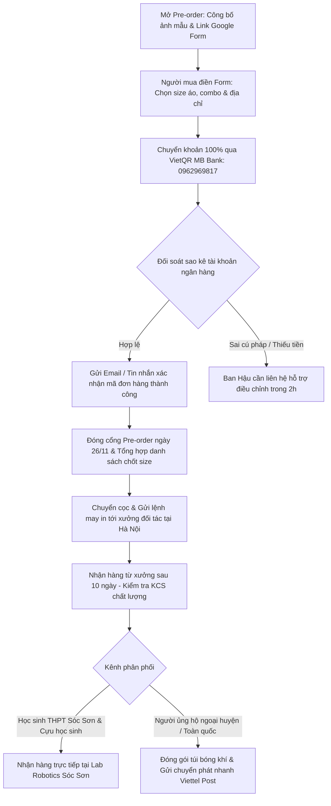

# 08 — Maker Day & Merch Gây Quỹ Season 01

Tài liệu này quy định chi tiết mô hình vận hành, cấu trúc tài chính, bảng tính hiệu quả kinh tế đơn vị (unit economics), kịch bản tổ chức (run-sheet) sự kiện trải nghiệm Maker Day "Can You Beat the Robot?", cùng cơ chế phát hành 100% Pre-order bộ sản phẩm Merch Season 01. Các hoạt động này vận hành theo cơ chế tự chủ tài chính hoàn toàn (Earned Revenue), độc lập và nằm ngoài mục tiêu gây quỹ tài trợ công khai 33.975.000 VNĐ của Robotics Sóc Sơn (FTC #39256).

---

## 1. Chiến Lược Doanh Thu Tự Tạo Độc Lập (Earned Revenue Strategy)

Để giảm thiểu sự phụ thuộc vào nguồn tài trợ và khẳng định năng lực tự chủ của học sinh THPT Sóc Sơn, CLB triển khai 2 mũi nhọn kinh tế cộng đồng tự cấp vốn:
1. **Sự kiện Maker Day "Can You Beat the Robot?":** Tạo sân chơi công nghệ trực quan cho học sinh tiểu học, THCS trên địa bàn huyện Sóc Sơn, xây dựng uy tín cộng đồng (Outreach impact) cho hồ sơ giải thưởng FIRST Impact Award.
2. **Bộ sản phẩm Merch Season 01 ("BioBuzz Supporter"):** Lan tỏa văn hóa yêu thích kỹ thuật, biến người ủng hộ thành đại sứ thương hiệu với trang phục và phụ kiện nhận diện chính thức.

### Nguyên Tắc Cốt Lõi: Tự Cấp Vốn Bằng Đặt Hàng Trước (Pre-order Self-funding)
Hoạt động này nằm ngoài mục tiêu vận động tài trợ công khai 33.975.000 VNĐ (dành cho 11 linh kiện phần cứng và quỹ dự phòng), tuân thủ nghiêm ngặt nguyên tắc tự chủ tài chính:
- **Tuyệt đối không sản xuất tồn kho (No dead inventory):** 100% sản phẩm Merch được bán theo hình thức Pre-order (đặt trước), thu tiền 100% qua VietQR trước khi gửi lệnh may/in đến xưởng.
- **Thu phí vé trước cho sự kiện:** Toàn bộ vé Maker Day được đăng ký và thanh toán trước qua tài khoản tiếp nhận chính thức, dùng chính dòng tiền thu vé sớm để mua sắm vật tư tiêu hao (bánh nước, in certificate).
- **Không bán qua sàn thương mại điện tử (Shopee/Lazada):** Cắt bỏ chi phí hoa hồng sàn (9% – 14%), loại trừ hoàn toàn rủi ro bị "bom hàng" và tồn đọng vốn thanh toán kéo dài 7 – 14 ngày.
- **Tài khoản tiếp nhận thanh toán đăng ký:**
  - **Chủ tài khoản:** TRAN TUE MINH
  - **Số tài khoản:** 0962969817
  - **Ngân hàng:** MB Bank (Ngân hàng TMCP Quân đội)
  - **Mã QR:** `[QR: sẽ gửi sau]`

---

## 2. Sự Kiện Maker Day: "Can You Beat the Robot?"

### A. Tổng Quan & Định Vị Sự Kiện
- **Tên sự kiện:** Ngày Hội Trải Nghiệm STEM Sóc Sơn: "Can You Beat the Robot?" (Bạn Có Thắng Nổi Robot?).
- **Thời gian tổ chức:** Ngày Chủ Nhật, 13/12/2026 `[ƯỚC TÍNH]` (hoặc tuần thứ 6 sau phát động chiến dịch).
- **Địa điểm:** Phòng Đa Năng / Phòng Máy Vi Tính, Trường THPT Sóc Sơn (Quốc lộ 2, xã Phù Lỗ, huyện Sóc Sơn, Hà Nội). Chi phí thuê địa điểm: **0 VNĐ** (Đoàn trường và Ban Giám hiệu bảo trợ không gian).
- **Đối tượng tham gia:** Học sinh từ lớp 3 đến lớp 9 tại các trường Tiểu học & THCS trên địa bàn huyện Sóc Sơn (và phụ huynh đi cùng).
- **Quy mô:** Khống chế chính xác **40 học sinh**, chia làm 2 ca độc lập nhằm bảo đảm chất lượng tương tác sâu:
  - *Ca sáng (Ca 1):* 08:30 – 11:00 (20 học sinh).
  - *Ca chiều (Ca 2):* 14:00 – 16:30 (20 học sinh).

---

### B. Kịch Bản Chi Tiết Từng Phút (Run-sheet 150 Phút)

| Khung thời gian | Thời lượng | Hoạt động chi tiết | Phụ trách | Thiết bị & Vật tư |
|:---:|:---:|---|---|---|
| **08:00 – 08:30** *(13:30 – 14:00)* | 30' | **Đón tiếp & Check-in:** Quét mã QR vé điện tử, phát Name-tag đeo cổ, tặng 01 Sticker Pack BioBuzz và ổn định chỗ ngồi theo 4 đội nhỏ (5 em/đội). | → 14 | Bàn đón tiếp, mã QR, Name-tag, Sticker pack |
| **08:30 – 08:45** *(14:00 – 14:15)* | 15' | **Khai mạc & Khám phá BIOBUZZ:** Trình chiếu video phóng sự ngắn về giải đấu quốc tế FIRST Tech Challenge, giới thiệu chủ đề mùa giải BIOBUZZ 2026–2027 và sứ mệnh của Robotics Sóc Sơn. | → 14 | Máy chiếu, loa mic, video clip FTC |
| **08:45 – 09:15** *(14:15 – 14:45)* | 30' | **Trạm 1: Thử Tài Điều Khiển Robot (Robot Driving Challenge):** Học sinh trực tiếp cầm tay cầm điều khiển (Gamepad) lái robot FTC trên sa bàn mini, vượt chướng ngại vật và gắp mẫu vật phấn hoa thả vào tổ mật. | → 14 | Robot FTC thực tế, sa bàn thi đấu, gamepad |
| **09:15 – 09:30** *(14:45 – 15:00)* | 15' | **Nghỉ giải lao & Tiếp sức (Tea-break):** Thưởng thức bánh ngọt, hộp sữa tươi/nước trái cây. Giao lưu cởi mở giữa phụ huynh và các kỹ sư học sinh THPT Sóc Sơn. | → 14 | Khay bánh ngọt, sữa hộp, khăn giấy |
| **09:30 – 10:15** *(15:00 – 15:45)* | 45' | **Trạm 2: Trở Thành Kỹ Sư Nhí (Hands-on Maker):** Học sinh được phát kit thực hành gồm mạch điện tử mini (Arduino Nano/Cảm biến siêu âm). Hướng dẫn đấu nối dây không cần hàn, lập trình khối lệnh kéo thả để đèn LED phát sáng và còi kêu khi có vật cản. | → 14 | 10 bộ Kit Re-use (2 em/bộ), máy tính laptop |
| **10:15 – 10:30** *(15:45 – 16:00)* | 15' | **Đấu Trường "Can You Beat the Robot?":** Trận chung kết mini giữa học sinh lái robot đối kháng với cơ chế tự hành của đội tuyển. Bầu không khí sôi động, tiếng reo hò cổ vũ. | → 14 | Sa bàn, bảng bấm giờ led |
| **10:30 – 10:45** *(16:00 – 16:15)* | 15' | **Trao Giấy Chứng Nhận & Chụp Ảnh:** Trao Giấy chứng nhận (Certificate) vinh danh "Nhà Sáng Chế Trẻ BIOBUZZ" in tên từng học sinh. Chụp ảnh tập thể cùng phụ huynh và robot. | → 14 | Bằng chứng nhận C300 bo góc, backdrop chụp ảnh |
| **10:45 – 11:00** *(16:15 – 16:30)* | 15' | **Thu dọn & Trả kit:** Thu hồi bộ kit thực hành về hòm bảo quản. Hướng dẫn phụ huynh tham quan góc gây quỹ Merch. | → 14 | Thùng nhựa bảo quản linh kiện |

---

### C. Hiệu Quả Kinh Tế Đơn Vị Của Maker Day (Unit Economics)

Áp dụng kịch bản **Tái sử dụng kit thực hành (Re-use Kit)** theo khuyến nghị tối ưu tại nghiên cứu R3. Học sinh thực hành trực tiếp trên kit chuyên dụng của CLB, sau buổi học hoàn trả lại kit và nhận quà lưu niệm mang về (Certificate + Sticker pack).

#### Bảng Chi Phí Vật Tư Tiêu Hao / 1 Học Sinh (Per Participant BOM)

| STT | Khoản mục chi phí tiêu hao | Đơn giá | Ghi chú & Nguồn chứng từ |
|:---:|---|:---:|---|
| 1 | Giấy chứng nhận (Certificate) A4 in màu giấy C300 cán màng mờ, bo 4 góc | 4.000 VNĐ | In nhanh Hà Nội (khảo sát R3) |
| 2 | Sticker Pack BioBuzz (bộ 4 sticker vinyl chống nước tặng kèm) | 4.500 VNĐ | Giá xưởng in tem nhãn theo lô 500 |
| 3 | Khấu hao & Hao mòn linh kiện kit thực hành (dây cắm testboard, pin, linh kiện dự phòng gãy hỏng) | 8.000 VNĐ | Định mức trích lập khấu hao thiết bị |
| 4 | Đồ ăn nhẹ Tea-break (01 hộp sữa tươi Vinamilk/nước cam + 01 bánh bông lan Chocopie) | 16.000 VNĐ | Mua sỉ siêu thị WinMart / đại lý Sóc Sơn |
| 5 | Tài liệu hướng dẫn thực hành in màu A4 gập đôi (Brochure STEM) | 2.500 VNĐ | Tiệm in photocopy gần cổng trường |
| | **TỔNG CHI PHÍ TIÊU HAO / 1 HỌC SINH** | **35.000 VNĐ** | `[ƯỚC TÍNH]` chuẩn xác |

#### Bảng Tính Doanh Thu, Chi Phí & Lợi Nhuận Ròng Maker Day

- **Chính sách giá vé:**
  - *Vé Tiêu Chuẩn (Standard Ticket):* **89.000 VNĐ / vé** (Đã bao gồm toàn bộ trải nghiệm, tea-break, Certificate và Sticker pack).
  - *Chính sách Early Bird (Đăng ký & chuyển khoản trong 5 ngày đầu):* **79.000 VNĐ / vé** (Ưu đãi mở bán sớm).
  - *Tỷ lệ giả định thực tế:* 20 vé Early Bird (79k) + 20 vé Standard (89k) -> Giá vé bình quân đạt **84.000 VNĐ / vé**.

| Chỉ số kinh tế | Giá trị (40 học sinh) | Công thức / Ghi chú |
|---|:---:|---|
| **Tổng doanh thu bán vé (Gross Revenue)** | **3.360.000 VNĐ** | (20 vé × 79.000đ) + (20 vé × 89.000đ) |
| **Tổng chi phí vật tư tiêu hao (Direct Cost)** | **1.400.000 VNĐ** | 40 học sinh × 35.000 VNĐ/suất |
| **Chi phí thuê địa điểm & Máy chiếu** | **0 VNĐ** | Nhà trường THPT Sóc Sơn tài trợ |
| **Chi phí nhân sự hướng dẫn** | **0 VNĐ** | Thành viên CLB tham gia tình nguyện |
| **Nước uống & Bồi dưỡng Media nội bộ** | **200.000 VNĐ** | Trích từ doanh thu bán vé |
| **LỢI NHUẬN RÒNG TỰ TẠO (NET EARNED REVENUE)** | **+1.760.000 – +1.960.000 VNĐ** | **Tự tích lũy vào quỹ hoạt động nội bộ CLB** |
| **Biên lợi nhuận ròng (Net Profit Margin)** | **~55% – 58%** | Tỷ suất sinh lời cao cho hoạt động học sinh |

---

## 3. Bộ Sản Phẩm Merch Gây Quỹ Season 01 ("BioBuzz Supporter")

### A. Danh Mục Sản Phẩm & Định Vị Thiết Kế
Toàn bộ sản phẩm được thiết kế mang bản sắc kỹ thuật công nghệ cao, tuân thủ bảng màu quy chuẩn thương hiệu: Nền đen / Xanh Navy kỹ thuật kết hợp điểm nhấn xanh dương công nghệ `#2563eb` và họa tiết vi mạch ong vàng BioBuzz.

1. **Áo thun "BioBuzz Supporter" (T-shirt Season 01):**
   - *Chất liệu:* 100% Cotton 2-Chiều 230gsm cao cấp, dày dặn, thấm hút mồ hôi, co giãn thoải mái, không xù lông.
   - *Hình in:* Mặt trước in ngực trái logo tối giản Robotics Sóc Sơn #39256; mặt sau in đồ họa 3D bóc tách cơ cấu robot BioBuzz cùng thông điệp "BUILD THE NEXT ROBOT". Kỹ thuật in DTF (Digital Transfer Film) sắc nét, bền màu qua 50 lần giặt.
2. **Móc khóa Mica Acrylic Cắt Laser (Keyring):**
   - *Chất liệu:* Nhựa mica acrylic trong suốt 2 lớp ép nhiệt, dày 3mm, in UV 2 mặt hình linh kiện robot biểu trưng (REV Control Hub hoặc chú ong cơ khí), khoen xích kim loại không gỉ.
3. **Sticker Pack Vinyl Chống Nước (5 Tem/Pack):**
   - *Chất liệu:* Decal vinyl nhựa phủ màng mờ laminate chống nước, chống trầy xước, dán mũ bảo hiểm, laptop, bình nước không phai màu. Gồm 5 hình vẽ độc quyền mang phong cách kỹ sư.
4. **Bookmark Mã QR Kỹ Thuật (Thẻ đánh dấu sách):**
   - *Chất liệu:* Giấy Couche C300 cán màng mờ, in 2 mặt có mã VietQR kết nối thẳng tới trang /support để nhận diện người ủng hộ. Dùng làm quà tặng kèm trong các combo.

---

### B. Bảng Tính Hiệu Quả Kinh Tế Đơn Vị (Merch Unit Economics)

Căn cứ báo giá xưởng gia công may in trực tiếp tại Hà Nội (nghiên cứu R3) áp dụng cho quy mô sản xuất nhỏ theo đơn đặt trước:

| STT | Tên sản phẩm | Giá vốn xưởng (COGS) | Giá bán gây quỹ (Retail Price) | Lợi nhuận ròng / Đơn vị | Tỷ suất lợi nhuận (Margin) | Số lượng cam kết (MOQ xưởng) |
|:---:|---|:---:|:---:|:---:|:---:|:---:|
| 1 | **Áo thun T-shirt Cotton 230gsm** | 105.000 VNĐ | **189.000 VNĐ** | **+84.000 VNĐ / áo** | **44.4%** | Tối thiểu 30 áo |
| 2 | **Móc khóa Mica Acrylic UV** | 9.000 VNĐ | **29.000 VNĐ** | **+20.000 VNĐ / cái** | **69.0%** | Tối thiểu 50 cái |
| 3 | **Sticker Pack (5 tem vinyl + zip)** | 5.000 VNĐ | **20.000 VNĐ** | **+15.000 VNĐ / pack** | **75.0%** | Tối thiểu 50 pack |
| 4 | **Bookmark QR C300 bo góc** | 1.000 VNĐ | *Tặng kèm combo* | — | — | Tối thiểu 100 cái |
| 5 | **Combo "Full Set Supporter"** *(1 Áo + 1 Móc khóa + 1 Sticker Pack)* | 119.000 VNĐ | **219.000 VNĐ** | **+100.000 VNĐ / set** | **45.6%** | Đóng gói túi zip |

---

### C. Dự Báo Dòng Tiền & Lợi Nhuận Mục Tiêu Đợt 1 (Pre-order Drop 1)

Quy mô mục tiêu mở bán đợt 1 (kéo dài trong 14 ngày từ 12/11 đến 26/11/2026):

| Hạng mục bán | Số lượng bán ra | Tổng doanh thu gộp | Tổng chi phí sản xuất xưởng | Lợi nhuận ròng thu về quỹ |
|---|:---:|:---:|:---:|:---:|
| Áo thun lẻ | 15 chiếc | 2.835.000 VNĐ | 1.575.000 VNĐ | +1.260.000 VNĐ |
| Combo Full Set (Áo + Khóa + Sticker) | 20 combo | 4.380.000 VNĐ | 2.380.000 VNĐ | +2.000.000 VNĐ |
| Móc khóa mica bán lẻ | 30 chiếc | 870.000 VNĐ | 270.000 VNĐ | +600.000 VNĐ |
| Sticker pack bán lẻ tại trường | 40 pack | 800.000 VNĐ | 200.000 VNĐ | +600.000 VNĐ |
| **TỔNG CỘNG ĐỢT 1** | **—** | **8.885.000 VNĐ** | **4.425.000 VNĐ** | **+4.460.000 VNĐ** |

*Ghi chú tài chính:* 
- Lợi nhuận ròng thuần từ Merch thu về thực tế dự kiến đạt từ **3.000.000 – 4.460.000 VNĐ** (tùy thuộc cơ cấu đơn hàng lẻ và combo).
- Kết hợp với lãi thuần từ Maker Day (~**1.800.000 – 2.000.000 VNĐ**), tổng nguồn thu tự tạo (Earned Revenue) mang lại từ **4.800.000 đến 6.460.000 VNĐ**. Toàn bộ khoản thu này được giữ độc lập làm nguồn kinh phí bổ trợ nội bộ của đội tuyển.

---

## 4. Quy Trình Vận Hành Pre-order & Phân Phối (Fulfillment Flow)

---

## 5. Mẫu Biểu Mẫu Đăng Ký (Google Form Specifications)

### A. Trường Dữ Liệu Form Đăng Ký Maker Day
1. **Họ và tên học sinh:** (Bắt buộc — Dùng để in Giấy chứng nhận).
2. **Năm sinh / Lớp học hiện tại:** (Dropdown: Lớp 3 đến Lớp 9).
3. **Trường đang theo học:** (Ví dụ: THCS Sóc Sơn, THCS Phù Linh, THCS Đa Phúc...).
4. **Họ và tên phụ huynh / Người bảo hộ:** (Bắt buộc).
5. **Số điện thoại liên hệ (có Zalo):** (Bắt buộc — Để gửi vé điện tử).
6. **Lựa chọn ca trải nghiệm:** (Radio button: Ca Sáng 08:30–11:00 / Ca Chiều 14:00–16:30).
7. **Lựa chọn loại vé:** (Radio button: Vé Early Bird 79.000đ / Vé Tiêu Chuẩn 89.000đ).
8. **Bằng chứng thanh toán:** (Tải lên ảnh chụp màn hình chuyển khoản VietQR: Chủ TK: TRAN TUE MINH · STK: 0962969817 · MB Bank).

---

### B. Trường Dữ Liệu Form Đặt Mua Merch Season 01
1. **Họ và tên người nhận:** (Bắt buộc).
2. **Số điện thoại & Link Facebook cá nhân:** (Bắt buộc).
3. **Phân loại người mua:** (Radio button: Học sinh THPT Sóc Sơn / Cựu học sinh / Phụ huynh / Khách ủng hộ toàn quốc).
4. **Hạng mục đặt mua:** (Checkboxes kèm chọn số lượng):
   - Combo Full Set Supporter (219.000đ) — [Chọn Size áo].
   - Áo thun BioBuzz Supporter lẻ (189.000đ) — [Chọn Size: S / M / L / XL / XXL].
   - Móc khóa Mica lẻ (29.000đ) — [Nhập số lượng].
   - Sticker Pack lẻ (20.000đ) — [Nhập số lượng].
5. **Hình thức nhận hàng:** (Radio: Nhận trực tiếp tại trường THPT Sóc Sơn [0đ ship] / Chuyển phát nhanh tận nhà [Người nhận thanh toán cước Viettel Post ~25k]).
6. **Địa chỉ nhận hàng chi tiết:** (Ghi rõ Thôn/Xã, Huyện, Tỉnh).
7. **Xác nhận chuyển khoản:** (Tải ảnh biên lai VietQR nội dung: `[Họ tên] - [SĐT] - MERCH` gửi tới MB Bank 0962969817 — TRAN TUE MINH).

---

## Nguồn Tham Chiếu
- `docs/campaign-2026-2027/research/R3-ops-merch-events.md` (Chi tiết giá vốn xưởng Hà Nội cho áo thun, móc khóa, sticker, bookmark; benchmark vé workshop STEM học sinh; chi phí vật tư 35.000đ/học sinh cho mô hình Re-use kit).
- `docs/campaign-2026-2027/04-ngan-sach-delta.md` (Kế hoạch tài chính cốt lõi 33.975.000 VNĐ; Maker Day & Merch là nguồn thu tự chủ bên ngoài ngân sách vận động).
- `docs/campaign-2026-2027/14-phan-cong-nhan-su.md` (Phân công nhân sự phụ trách sự kiện Maker Day và phát hành Merch).
