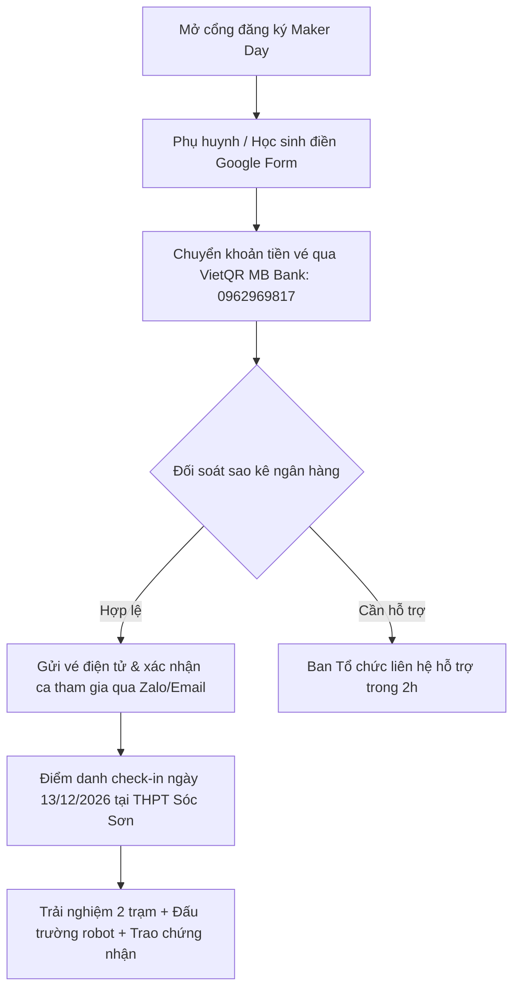

# 08 — Kế Hoạch Tổ Chức Maker Day "Can You Beat the Robot?"

Tài liệu này quy định chi tiết mô hình vận hành, cấu trúc tài chính, bảng tính hiệu quả kinh tế đơn vị (unit economics), kịch bản tổ chức (run-sheet) sự kiện trải nghiệm Maker Day "Can You Beat the Robot?". Hoạt động này vận hành theo cơ chế tự chủ tài chính hoàn toàn (Earned Revenue) bằng tiền vé tham gia, độc lập và nằm ngoài mục tiêu gây quỹ tài trợ công khai 33.975.000 VNĐ của Robotics Sóc Sơn (FTC #39256).

> **Lưu ý định hướng:** CLB không triển khai bán merch gây quỹ (đã hủy kế hoạch bán áo, móc khóa, phụ kiện; chi tiết xem Quyết định 9 tại [99-bien-ban-thao-luan.md](99-bien-ban-thao-luan.md)). Bộ sticker pack chỉ sản xuất làm quà tặng miễn phí kèm theo vé Maker Day (đã tính trong chi phí vé).

---

## 1. Chiến Lược Doanh Thu Tự Tạo Độc Lập (Earned Revenue Strategy)

Để giảm thiểu sự phụ thuộc vào nguồn tài trợ và khẳng định năng lực tự chủ của học sinh THPT Sóc Sơn, CLB triển khai mũi nhọn kinh tế cộng đồng tự cấp vốn:
- **Sự kiện Maker Day "Can You Beat the Robot?":** Tạo sân chơi công nghệ trực quan cho học sinh tiểu học, THCS trên địa bàn huyện Sóc Sơn, xây dựng uy tín cộng đồng (Outreach impact) cho hồ sơ giải thưởng FIRST Impact Award.

### Nguyên Tắc Cốt Lõi: Tự Cấp Vốn Bằng Tiền Vé
Hoạt động này nằm ngoài mục tiêu vận động tài trợ công khai 33.975.000 VNĐ (dành cho 11 linh kiện phần cứng và quỹ dự phòng), tuân thủ nghiêm ngặt nguyên tắc tự chủ tài chính:
- **Thu phí vé trước cho sự kiện:** Toàn bộ vé Maker Day được đăng ký và thanh toán trước qua tài khoản tiếp nhận chính thức, dùng chính dòng tiền thu vé sớm để mua sắm vật tư tiêu hao (bánh nước, in certificate, sticker quà tặng).
- **Không phát sinh chi phí trung gian:** Đăng ký trực tiếp qua Google Form và chuyển khoản VietQR, không qua đơn vị trung gian để tối ưu nguồn thu cho CLB.
- **Tài khoản tiếp nhận thanh toán đăng ký:**
  - **Chủ tài khoản:** TRAN TUE MINH
  - **Số tài khoản:** 0962969817
  - **Ngân hàng:** MB Bank (Ngân hàng TMCP Quân đội)
  - **Mã QR:** 

---

## 2. Sự Kiện Maker Day: "Can You Beat the Robot?"

### A. Tổng Quan & Định Vị Sự Kiện
- **Tên sự kiện:** Ngày Hội Trải Nghiệm STEM Sóc Sơn: "Can You Beat the Robot?" (Bạn Có Thắng Nổi Robot?).
- **Thời gian tổ chức:** Ngày Chủ Nhật, 13/12/2026 `[ƯỚC TÍNH]` (hoặc tuần thứ 6 sau phát động chiến dịch).
- **Địa điểm:** Phòng Đa Năng / Phòng Máy Vi Tính, Trường THPT Sóc Sơn (Quốc lộ 2, xã Phù Lỗ, huyện Sóc Sơn, Hà Nội). Chi phí thuê địa điểm: **0 VNĐ** (Đoàn trường và Ban Giám hiệu bảo trợ không gian).
- **Đối tượng tham gia:** Học sinh từ lớp 3 đến lớp 9 tại các trường Tiểu học & THCS trên địa bàn huyện Sóc Sơn (và phụ huynh đi cùng).
- **Quy mô:** Khống chế chính xác **40 học sinh**, chia làm 2 ca độc lập nhằm bảo đảm chất lượng tương tác sâu:
  - *Ca sáng (Ca 1):* 08:30 – 11:00 (20 học sinh).
  - *Ca chiều (Ca 2):* 14:00 – 16:30 (20 học sinh).

---

### B. Kịch Bản Chi Tiết Từng Phút (Run-sheet 150 Phút)

| Khung thời gian | Thời lượng | Hoạt động chi tiết | Phụ trách | Thiết bị & Vật tư |
|:---:|:---:|---|---|---|
| **08:00 – 08:30** *(13:30 – 14:00)* | 30' | **Đón tiếp & Check-in:** Quét mã QR vé điện tử, phát Name-tag đeo cổ, tặng 01 Sticker Pack BioBuzz và ổn định chỗ ngồi theo 4 đội nhỏ (5 em/đội). | → 14 | Bàn đón tiếp, mã QR, Name-tag, Sticker pack |
| **08:30 – 08:45** *(14:00 – 14:15)* | 15' | **Khai mạc & Khám phá BIOBUZZ:** Trình chiếu video phóng sự ngắn về giải đấu quốc tế FIRST Tech Challenge, giới thiệu chủ đề mùa giải BIOBUZZ 2026–2027 và sứ mệnh của Robotics Sóc Sơn. | → 14 | Máy chiếu, loa mic, video clip FTC |
| **08:45 – 09:15** *(14:15 – 14:45)* | 30' | **Trạm 1: Thử Tài Điều Khiển Robot (Robot Driving Challenge):** Học sinh trực tiếp cầm tay cầm điều khiển (Gamepad) lái robot FTC trên sa bàn mini, vượt chướng ngại vật và gắp mẫu vật phấn hoa thả vào tổ mật. | → 14 | Robot FTC thực tế, sa bàn thi đấu, gamepad |
| **09:15 – 09:30** *(14:45 – 15:00)* | 15' | **Nghỉ giải lao & Tiếp sức (Tea-break):** Thưởng thức bánh ngọt, hộp sữa tươi/nước trái cây. Giao lưu cởi mở giữa phụ huynh và các kỹ sư học sinh THPT Sóc Sơn. | → 14 | Khay bánh ngọt, sữa hộp, khăn giấy |
| **09:30 – 10:15** *(15:00 – 15:45)* | 45' | **Trạm 2: Trở Thành Kỹ Sư Nhí (Hands-on Maker):** Học sinh được phát kit thực hành gồm mạch điện tử mini (Arduino Nano/Cảm biến siêu âm). Hướng dẫn đấu nối dây không cần hàn, lập trình khối lệnh kéo thả để đèn LED phát sáng và còi kêu khi có vật cản. | → 14 | 10 bộ Kit Re-use (2 em/bộ), máy tính laptop |
| **10:15 – 10:30** *(15:45 – 16:00)* | 15' | **Đấu Trường "Can You Beat the Robot?":** Trận chung kết mini giữa học sinh lái robot đối kháng với cơ chế tự hành của đội tuyển. Bầu không khí sôi động, tiếng reo hò cổ vũ. | → 14 | Sa bàn, bảng bấm giờ led |
| **10:30 – 10:45** *(16:00 – 16:15)* | 15' | **Trao Giấy Chứng Nhận & Chụp Ảnh:** Trao Giấy chứng nhận (Certificate) vinh danh "Nhà Sáng Chế Trẻ BIOBUZZ" in tên từng học sinh. Chụp ảnh tập thể cùng phụ huynh và robot. | → 14 | Bằng chứng nhận C300 bo góc, backdrop chụp ảnh |
| **10:45 – 11:00** *(16:15 – 16:30)* | 15' | **Thu dọn & Trả kit:** Thu hồi bộ kit thực hành về hòm bảo quản. Hướng dẫn phụ huynh và học sinh giao lưu cùng các thành viên CLB. | → 14 | Thùng nhựa bảo quản linh kiện |

---

### C. Hiệu Quả Kinh Tế Đơn Vị Của Maker Day (Unit Economics)

Áp dụng kịch bản **Tái sử dụng kit thực hành (Re-use Kit)** theo khuyến nghị tối ưu tại nghiên cứu R3. Học sinh thực hành trực tiếp trên kit chuyên dụng của CLB, sau buổi học hoàn trả lại kit và nhận quà lưu niệm mang về (Certificate + Sticker pack).

#### Bảng Chi Phí Vật Tư Tiêu Hao / 1 Học Sinh (Per Participant BOM)

| STT | Khoản mục chi phí tiêu hao | Đơn giá | Ghi chú & Nguồn chứng từ |
|:---:|---|:---:|---|
| 1 | Giấy chứng nhận (Certificate) A4 in màu giấy C300 cán màng mờ, bo 4 góc | 4.000 VNĐ | In nhanh Hà Nội (khảo sát R3) |
| 2 | Sticker Pack BioBuzz (bộ 4 sticker vinyl chống nước tặng kèm) | 4.500 VNĐ | Giá xưởng in tem nhãn theo lô 500 |
| 3 | Khấu hao & Hao mòn linh kiện kit thực hành (dây cắm testboard, pin, linh kiện dự phòng gãy hỏng) | 8.000 VNĐ | Định mức trích lập khấu hao thiết bị |
| 4 | Đồ ăn nhẹ Tea-break (01 hộp sữa tươi Vinamilk/nước cam + 01 bánh bông lan Chocopie) | 16.000 VNĐ | Mua sỉ siêu thị WinMart / đại lý Sóc Sơn |
| 5 | Tài liệu hướng dẫn thực hành in màu A4 gập đôi (Brochure STEM) | 2.500 VNĐ | Tiệm in photocopy gần cổng trường |
| | **TỔNG CHI PHÍ TIÊU HAO / 1 HỌC SINH** | **35.000 VNĐ** | `[ƯỚC TÍNH]` chuẩn xác |

#### Bảng Tính Doanh Thu, Chi Phí & Lợi Nhuận Ròng Maker Day

- **Chính sách giá vé:**
  - *Vé Tiêu Chuẩn (Standard Ticket):* **89.000 VNĐ / vé** (Đã bao gồm toàn bộ trải nghiệm, tea-break, Certificate và Sticker pack).
  - *Chính sách Early Bird (Đăng ký & chuyển khoản trong 5 ngày đầu: 24/11 – 28/11/2026):* **79.000 VNĐ / vé** (Ưu đãi mở bán sớm).
  - *Tỷ lệ giả định thực tế:* 20 vé Early Bird (79k) + 20 vé Standard (89k) -> Giá vé bình quân đạt **84.000 VNĐ / vé**.

| Chỉ số kinh tế | Giá trị (40 học sinh) | Công thức / Ghi chú |
|---|:---:|---|
| **Tổng doanh thu bán vé (Gross Revenue)** | **3.360.000 VNĐ** | (20 vé × 79.000đ) + (20 vé × 89.000đ) |
| **Tổng chi phí vật tư tiêu hao (Direct Cost)** | **1.400.000 VNĐ** | 40 học sinh × 35.000 VNĐ/suất |
| **Chi phí thuê địa điểm & Máy chiếu** | **0 VNĐ** | Nhà trường THPT Sóc Sơn tài trợ |
| **Chi phí nhân sự hướng dẫn** | **0 VNĐ** | Thành viên CLB tham gia tình nguyện |
| **Nước uống & Bồi dưỡng Media nội bộ** | **200.000 VNĐ** | Trích từ doanh thu bán vé |
| **LỢI NHUẬN RÒNG TỰ TẠO (NET EARNED REVENUE)** | **+1.760.000 – +1.960.000 VNĐ** | **Tự tích lũy vào quỹ hoạt động nội bộ CLB** |
| **Biên lợi nhuận ròng (Net Profit Margin)** | **~55% – 58%** | Tỷ suất sinh lời cao cho hoạt động học sinh |

---

## 3. Quy Trình Vận Hành & Đăng Ký Maker Day

---

## 4. Đặc Tả Biểu Mẫu Đăng Ký Maker Day (Google Form Specifications)

1. **Họ và tên học sinh:** (Bắt buộc — Dùng để in Giấy chứng nhận).
2. **Năm sinh / Lớp học hiện tại:** (Dropdown: Lớp 3 đến Lớp 9).
3. **Trường đang theo học:** (Ví dụ: THCS Sóc Sơn, THCS Phù Linh, THCS Đa Phúc...).
4. **Họ và tên phụ huynh / Người bảo hộ:** (Bắt buộc).
5. **Số điện thoại liên hệ (có Zalo):** (Bắt buộc — Để gửi vé điện tử).
6. **Lựa chọn ca trải nghiệm:** (Radio button: Ca Sáng 08:30–11:00 / Ca Chiều 14:00–16:30).
7. **Lựa chọn loại vé:** (Radio button: Vé Early Bird 79.000đ / Vé Tiêu Chuẩn 89.000đ).
8. **Bằng chứng thanh toán:** (Tải lên ảnh chụp màn hình chuyển khoản VietQR: Chủ TK: TRAN TUE MINH · STK: 0962969817 · MB Bank · ).

---

## Nguồn Tham Chiếu
- `docs/campaign-2026-2027/research/R3-ops-merch-events.md` (Benchmark vé workshop STEM học sinh; chi phí vật tư 35.000đ/học sinh cho mô hình Re-use kit).
- [04-ngan-sach-delta.md](04-ngan-sach-delta.md) (Kế hoạch tài chính cốt lõi 33.975.000 VNĐ; Maker Day là nguồn thu tự chủ bên ngoài ngân sách vận động).
- [14-phan-cong-nhan-su.md](14-phan-cong-nhan-su.md) (Phân công nhân sự phụ trách sự kiện Maker Day).
- [99-bien-ban-thao-luan.md](99-bien-ban-thao-luan.md) (Biên bản đồng thuận chiến lược và các quyết định dự án).
