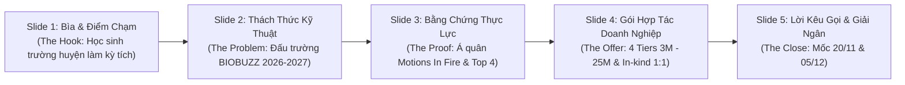
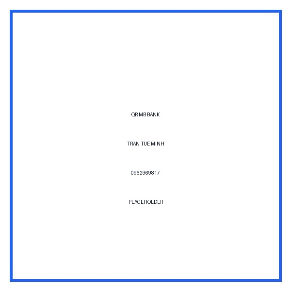

# 09 — Bộ Công Cụ Bán Hàng & Tiếp Cận Nhà Tài Trợ (Sales Kit)

Tài liệu này cung cấp toàn bộ tài nguyên truyền thông phục vụ công tác đối ngoại và vận động tài trợ B2B của CLB Robotics Sóc Sơn (FTC #39256), bao gồm: Bản tóm tắt dự án một trang (One-pager) song ngữ Việt — Anh, cấu trúc bài thuyết trình 5 slide (Pitch Deck), mẫu thư ngỏ mở đầu (Cold Email) song ngữ, chuỗi thư nhắc (Follow-up), kịch bản gọi điện thoại, quy trình họp trực tiếp, ma trận xử lý từ chối (Objection Handling) và định hướng hồ sơ ứng vốn các quỹ tài trợ quốc tế (Grants).

---

## 1. Bản Giới Thiệu Một Trang Song Ngữ (One-Pager Text)

### A. Bản Tiếng Việt (Vietnamese Version — 1 Trang Chuẩn A4)

```text
CLB ROBOTICS SÓC SƠN — TRƯỜNG THPT SÓC SƠN (HÀ NỘI)
HỒ SƠ MỜI TÀI TRỢ MÙA GIẢI FIRST TECH CHALLENGE 2026–2027

CHIẾN DỊCH: "BUILD THE NEXT ROBOT — MỖI MẢNH GHÉP, MỘT BƯỚC TIẾN"
Mã đội chính thức: FTC #39256 · Mùa giải: BIOBUZZ™ presented by RTX

1. CHÚNG TÔI LÀ AI?
Robotics Sóc Sơn là câu lạc bộ khoa học – công nghệ của Trường THPT Sóc Sơn (Hà Nội), gần 5 năm hoạt động. Không xuất phát từ trường chuyên, các thành viên tự học lập trình, thiết kế cơ khí 3D và gia công chi tiết để bước ra sân chơi công nghệ quốc gia.
Thành tích thực chứng:
- Hạng 1 vòng loại & Á quân "Motions In Fire" 2025 (STEAMese Festival — STEAM for Vietnam, ĐH Bách khoa Hà Nội, UNICEF, ĐSQ Hoa Kỳ).
- Top 4 Toàn quốc Vietnam Robotics Challenge (VRC) 2023.
- Top 8 Vietnam Open Robotics Challenge (VORC) 2024.
- Thi đấu FIRST Tech Challenge Vietnam liên tục các mùa 2024 (#28762), 2025 (#33518) và 2026–2027 (#39256).

2. BÀI TOÁN MÙA GIẢI BIOBUZZ™ 2026–2027
Chủ đề thi đấu BIOBUZZ™ đòi hỏi robot tự động hóa mô phỏng hoạt động thụ phấn và sản xuất mật của loài ong:
- 30 giây Tự hành (Autonomous): Robot định vị quang học bằng camera AI, tự nhận diện mẫu vật và di chuyển độc lập.
- 2 phút Điều khiển (TeleOp): Vận tốc cao, cánh tay nâng đa tầng đưa mẫu vật lên độ cao 1m2 với độ chính xác cơ khí tuyệt đối.
Để chế tạo cỗ máy này, đội cần nâng cấp 11 linh kiện cốt lõi tiêu chuẩn FTC quốc tế (REV Control Hub, ray trượt Viper Slide, động cơ Yellow Jacket, Pin NiMH 12V, camera và dụng cụ).

3. MỤC TIÊU TÀI CHÍNH CHIẾN DỊCH: 33.975.000 VNĐ
- 11 linh kiện phần cứng cốt lõi nhập khẩu Mỹ & nội địa (BOM Delta Landed): 30.975.000 VNĐ
- Quỹ dự phòng kỹ thuật & tỷ giá (đệm rủi ro ngoại tệ, cước air cargo, phụ tùng sơ cua): 3.000.000 VNĐ
Chi phí vận hành và vật tư chế tạo khác nằm ngoài mục tiêu vận động này.

4. CƠ CẤU GÓI TÀI TRỢ DOANH NGHIỆP:
- ĐỒNG HÀNH (Community Partner — 3.000.000 VNĐ): Logo kỷ yếu, website, fanpage, thư cảm ơn chính thức từ Ban Giám hiệu.
- BẠC (Mission Partner — 5.000.000 VNĐ): Toàn bộ quyền lợi gói 3M + Logo tay áo đấu + Quyền nhận diện bảo trợ 01 Mission linh kiện.
- VÀNG (Build Partner — 10.000.000 VNĐ): Toàn bộ gói 5M + Logo ngực/lưng áo đấu + Logo standee pit lane + Bảo trợ độc quyền 01 Mission linh kiện + Bài PR thương hiệu.
- KIM CƯƠNG (Season Partner — 25.000.000 VNĐ): Toàn bộ gói 10M + Logo vị trí nổi bật trên thân robot thi đấu + Bảng vinh danh Maker Day + 02 vé VIP pit lane.
- ĐỐI TÁC HIỆN VẬT (In-kind Partner): Quy đổi 1:1 cho linh kiện/dụng cụ đúng danh mục 11 món tại mục 2.2 của 04.

5. CĂN CỨ PHÁP LÝ & MINH BẠCH
Vận động tài trợ giáo dục dưới sự bảo trợ của Ban Giám hiệu Trường THPT Sóc Sơn. Mọi khoản đóng góp được mở sổ công khai minh bạch. Doanh nghiệp cần chứng từ kế toán: CLB chuyển Ban Giám hiệu THPT Sóc Sơn hướng dẫn.

LIÊN HỆ ĐỐI NGOẠI:
- Trưởng ban Đối ngoại: Trần Tuệ Minh · (Xem docs/campaign-2026-2027/14-phan-cong-nhan-su.md)
- Giáo viên cố vấn / Phụ trách CLB: → Xem chi tiết tại docs/campaign-2026-2027/14-phan-cong-nhan-su.md
- Trường THPT Sóc Sơn: Quốc lộ 2, xã Phù Lỗ, huyện Sóc Sơn, TP. Hà Nội · (024) 3884 1042.
- Email: contact@roboticssocson.com · Website: https://roboticssocson.com/support
```

---

### B. Bản Tiếng Anh (English Version — For FDI & International Partners)

```text
ROBOTICS SOC SON CLUB — SOC SON HIGH SCHOOL (HANOI, VIETNAM)
SPONSORSHIP PROPOSAL · FIRST TECH CHALLENGE 2026–2027

CAMPAIGN: "BUILD THE NEXT ROBOT — EVERY PIECE FORWARD"
Official Team ID: FTC #39256 · Game Season: BIOBUZZ™ presented by RTX

1. EXECUTIVE SUMMARY
Robotics Soc Son is the student science & technology club of Soc Son High School (suburban Hanoi, Vietnam), active for nearly five years. Without the resources of a specialized school, our students taught themselves programming, 3D CAD and fabrication to compete at national championships.
Verified Track Record:
- 1st in qualifiers & 1st Runner-Up, "Motions In Fire" 2025 (STEAMese Festival — STEAM for Vietnam, Hanoi University of Science and Technology, UNICEF, U.S. Embassy).
- Top 4 Nationwide, Vietnam Robotics Challenge (VRC) 2023.
- Top 8 Finalist, Vietnam Open Robotics Challenge (VORC) 2024.
- Competed in FIRST Tech Challenge Vietnam every season: 2024 (#28762), 2025 (#33518), and 2026–2027 (#39256).

2. BIOBUZZ™ 2026–2027 CHALLENGE
The BIOBUZZ™ season requires building an autonomous and driver-controlled robot simulating biological pollination:
- Autonomous (30s): Computer vision (OpenCV) via AI camera, navigating independently.
- Driver-Controlled (2 mins): High-speed intake, multi-stage precision slide lifting samples up to 1.2 meters.
Hardware required: 11 core FTC-grade components from REV Robotics and goBILDA (Control Hub, Viper Slide Kit, 5202 Yellow Jacket motors, 12V NiMH batteries, vision camera, and precision tools).

3. CAMPAIGN FINANCIAL TARGET: 33,975,000 VND (~$1,317 USD)
- Core imported FTC BOM (11 items): 30,975,000 VND (~$1,200 USD)
- Technical & FX Contingency Buffer: 3,000,000 VND (~$117 USD)
The public campaign target covers only these core hardware items and contingency; local materials and operating costs are outside this ask.

4. CORPORATE SPONSORSHIP TIERS:
- COMMUNITY PARTNER (3,000,000 VND / ~$116 USD): Logo on team website, fanpage, annual yearbook, official appreciation letter from School Board.
- SILVER / MISSION PARTNER (5,000,000 VND / ~$194 USD): All above + Logo on team jersey sleeves + Exclusive co-branding for 1 hardware mission.
- GOLD / BUILD PARTNER (10,000,000 VND / ~$388 USD): All above + Prominent jersey chest/back logo + Pit banner display + Exclusive mission sponsor + Dedicated social PR article.
- DIAMOND / SEASON PARTNER (25,000,000 VND / ~$969 USD): All above + Center-stage logo on competition robot chassis + Largest logo on jersey + Maker Day recognition plaque + 2 VIP Pit Passes.
- TECHNICAL / IN-KIND PARTNER: 1:1 value credit only for components/tools in the 11-item hardware list in document 04, section 2.2.

5. LEGAL COMPLIANCE & GOVERNANCE
Authorized under the official sponsorship and governance of Soc Son High School. All contributions are publicly disclosed and transparent. For accounting documents, the school administration provides direct guidance.

CONTACT INFORMATION:
- External Relations Lead: Tran Tue Minh · (See docs/campaign-2026-2027/14-phan-cong-nhan-su.md)
- Faculty Mentor / Advisor: → See docs/campaign-2026-2027/14-phan-cong-nhan-su.md
- Soc Son High School: Thinh Duc Street, Soc Son Town, Hanoi, Vietnam.
- Email: contact@roboticssocson.com · Website: https://roboticssocson.com/support
```

---

## 2. Cấu Trúc Trình Chiếu 5 Slide (5-Slide Pitch Deck Narrative)



### Chi Tiết Từng Slide Trong Bài Thuyết Trình:

- **Slide 1: Bìa & Thông Điệp Cốt Lõi (The Hook — Khơi gợi cảm xúc và sự tò mò)**
  - *Tiêu đề:* BUILD THE NEXT ROBOT — Mỗi mảnh ghép, một bước tiến.
  - *Hình ảnh:* Ảnh tập thể đội tuyển học sinh THPT Sóc Sơn mặc áo đen trong phòng lab, ánh mắt tự tin, bên cạnh là khung gầm robot với ánh đèn LED xanh.
  - *Nội dung chính:* Câu chuyện về một câu lạc bộ học sinh trường huyện ngoại thành Hà Nội, không chịu giới hạn bởi hoàn cảnh, kiên trì đưa ngọn cờ trí tuệ Sóc Sơn vươn ra sân chơi FIRST Tech Challenge quốc gia.
- **Slide 2: Thách Thức Kỹ Thuật Mùa Giải BIOBUZZ™ (The Problem & Challenge)**
  - *Tiêu đề:* BIOBUZZ 2026–2027: Khi Thiên Nhiên Gặp Gỡ Công Nghệ Tự Động Hóa.
  - *Nội dung chính:* Giới thiệu cơ chế thi đấu: 30s Tự hành xử lý thị giác máy tính, 2 phút TeleOp nhịp độ cao.
  - *Nhu cầu phần cứng:* Bóc tách 4 Mission cốt lõi (11 món linh kiện REV/goBILDA nhập khẩu từ Mỹ trị giá 30.975.000 VNĐ cùng Quỹ dự phòng 3.000.000 VNĐ, tổng 33.975.000 VNĐ). Thiếu những linh kiện này, robot không thể cạnh tranh về tốc độ và độ bền trước các đội mạnh.
- **Slide 3: Năng Lực Thực Chứng & Thành Tích (The Proof & Credibility)**
  - *Tiêu đề:* Chúng Tôi Đã Chứng Minh Năng Lực Bằng Kết Quả Thật.
  - *Số liệu & Hình ảnh:*
    - Á quân *Motions In Fire* 2025 (STEAMese Festival, [steamforvietnam.org/steamese-festival2025](https://steamforvietnam.org/steamese-festival2025)) — chèn ảnh giấy khen của CLB.
    - Giấy chứng nhận Top 4 Vietnam Robotics Challenge 2023, Top 8 VORC 2024.
    - Tinh thần *Gracious Professionalism* của FIRST: Tự chủ 100% về thiết kế và giải thuật điều khiển.
- **Slide 4: Cơ Hội Hợp Tác & Quyền Lợi Doanh Nghiệp (The Value Proposition & Packages)**
  - *Tiêu đề:* Đầu Tư Cho Tương Lai — Khẳng Định Trách Nhiệm Xã Hội (CSR).
  - *Nội dung chính:* Bảng so sánh trực quan quyền lợi 4 cấp độ tài trợ: Đồng Hành (3M), Bạc (5M), Vàng (10M), Kim Cương (25M) và Đối tác Hiện vật In-kind.
  - *Cam kết lợi ích:* Xuất hiện trang trọng trên thân robot, áo đấu, standee giải đấu tại FPT Hòa Lạc; bài PR truyền thông địa phương; chứng nhận tri ân chính thức từ Ban Giám hiệu Trường THPT Sóc Sơn.
- **Slide 5: Lời Kêu Gọi Hành Động & Kế Hoạch Vận Hành (The Call-to-Action & Contact)**
  - *Tiêu đề:* Hãy Là Mảnh Ghép Quyết Định Cùng Chúng Tôi Bước Ra Sân Khấu Lớn.
  - *Mốc thời gian cấp bách:* 20/11/2026 — Đạt mốc ≥ 17.546.000 VNĐ đặt Control Hub & Viper Slide; 05/12/2026 — Hoàn tất 33.975.000 VNĐ chốt đơn hàng Đợt 2.
  - *Thông tin liên hệ:* Vai trò/người phụ trách xem 14; tài khoản: **TRAN TUE MINH · 0962969817 · MB Bank** · .

---

## 3. Mẫu Thư Ngỏ Tiếp Cận Ban Đầu Song Ngữ (Cold Outreach Email)

### A. Mẫu Thư Ngỏ Tiếng Việt (80 – 140 Từ)

```text
Tiêu đề: [Thư Ngỏ] Đề xuất hợp tác tài trợ Đội tuyển Robotics THPT Sóc Sơn (FTC 2026–2027)

Kính gửi Ban Lãnh đạo và Bộ phận Đối ngoại / CSR [Tên Doanh Nghiệp],

Em là đại diện Câu lạc bộ Robotics Sóc Sơn trực thuộc Trường THPT Sóc Sơn (Hà Nội).

Tại giải đấu Robotics quốc tế FIRST Tech Challenge Vietnam 2026–2027 (mùa giải BIOBUZZ™), Robotics Sóc Sơn tham gia mùa FTC thứ ba liên tiếp, tranh tài tại ĐH FPT Hòa Lạc. Năm 2025, đội giành Á quân cuộc thi "Motions In Fire" tại STEAMese Festival 2025.

Để hoàn thiện robot thi đấu, chúng em đang triển khai chiến dịch "BUILD THE NEXT ROBOT" với mục tiêu 33.975.000 VNĐ cho 11 linh kiện điều khiển tự hành cốt lõi và quỹ dự phòng kỹ thuật.

Nhận thấy [Tên Doanh Nghiệp] luôn tiên phong trong các hoạt động đổi mới kỹ thuật và hỗ trợ giáo dục địa phương, chúng em trân trọng kính mời Quý Doanh nghiệp đồng hành bằng tài trợ tiền từ 3–25 triệu VNĐ hoặc linh kiện đúng danh mục 11 món tại mục 2.2 của 04.

Em xin phép gửi đính kèm Hồ sơ Dự án (One-Pager). Chúng em rất mong có cơ hội được trình bày trực tiếp 15 phút cùng Quý Công ty.

Kính chúc Quý Doanh nghiệp ngày càng phát triển vững mạnh!

Trân trọng,
Trần Tuệ Minh — Trưởng ban Đối ngoại
CLB Robotics Sóc Sơn · Trường THPT Sóc Sơn, Hà Nội
Website: https://roboticssocson.com/support · Email: contact@roboticssocson.com
```

---

### B. Mẫu Thư Ngỏ Tiếng Anh (80 – 140 Words)

```text
Subject: Sponsorship Opportunity: Supporting Soc Son High School Robotics at FTC Vietnam 2026–2027

Dear Management Team & CSR Committee of [Company Name],

I am writing on behalf of the Robotics Soc Son Team (#39256) from Soc Son High School, Hanoi.

Robotics Soc Son is entering its third consecutive FIRST Tech Challenge Vietnam season (2026–2027, BIOBUZZ™). In 2025, our team placed 1st in qualifiers and 1st Runner-Up at the "Motions In Fire" robotics tournament (STEAMese Festival).

To construct our competition robot, we have launched the "BUILD THE NEXT ROBOT" campaign, targeting 33,975,000 VND (~$1,317 USD) for 11 core autonomous avionics components and a technical contingency buffer.

Admiring [Company Name]’s engineering excellence and community commitment, we invite you to become an official sponsor (cash tiers starting at $116 USD, or hardware from the 11-item list in document 04, section 2.2).

Please find our 1-page Project Summary attached. We would love the opportunity for a brief 15-minute meeting to discuss how this partnership can empower young technical talents in Soc Son.

Thank you very much for your time and consideration.

Warm regards,
Tran Tue Minh — External Relations Lead
Robotics Soc Son Team · Soc Son High School, Hanoi
Website: https://roboticssocson.com/support · Email: contact@roboticssocson.com
```

---

## 4. Chuỗi Thư Nhắc & Theo Dõi (Follow-Up Email Sequence)

### Follow-Up 1: Nhắc Nhẹ (+3 Ngày Sau Thư Ngỏ)
- **Tiêu đề:** Re: [Thư Ngỏ] Đề xuất hợp tác tài trợ Đội tuyển Robotics THPT Sóc Sơn (FTC 2026–2027)
- **Nội dung:**
  > "Kính gửi Ban Lãnh đạo [Tên Doanh Nghiệp],  
  > Em xin phép gửi lời chào trân trọng từ Đội tuyển Robotics Sóc Sơn. Ba ngày trước, em đã gửi thư ngỏ giới thiệu về chiến dịch chế tạo robot thi đấu FTC 2026–2027 của đội tuyển.  
  > Hiện tại, chiến dịch đã hoàn thành đợt vận động đầu tiên với sự bảo trợ của một số đơn vị cơ khí địa phương. Chúng em rất mong muốn được lắng nghe phản hồi từ Quý Doanh nghiệp và sẵn sàng gửi thêm bản vẽ kỹ thuật chi tiết nếu Quý Công ty quan tâm đến việc hỗ trợ gia công linh kiện (In-kind).  
  > Kính chúc Quý Công ty một tuần làm việc hiệu quả!"

### Follow-Up 2: Bức Thư Chốt / Cơ Hội Cuối Cùng (+7 Ngày Sau Thư Đầu)
- **Tiêu đề:** Cập nhật hạn chốt nhận diện logo trên đồng phục & robot thi đấu FTC 2027
- **Nội dung:**
  > "Kính gửi Ban Lãnh đạo [Tên Doanh Nghiệp],  
  > Em xin phép gửi bức thư ngắn này để cập nhật tiến độ chiến dịch: Đội tuyển đang bước vào giai đoạn chốt danh sách nhà tài trợ đợt 1 trước ngày 20/11/2026 để kịp gửi maket in áo đấu đội tuyển và đặt hàng đợt 1 linh kiện Mỹ.  
  > Nếu Quý Doanh nghiệp đang có kế hoạch phân bổ ngân sách CSR quý 4 cho hoạt động giáo dục STEM tại địa bàn Sóc Sơn, chúng em xin phép được xếp lịch một cuộc gọi trao đổi nhanh 10 phút qua điện thoại hoặc trực tiếp tại văn phòng Quý Công ty.  
  > Nếu thời điểm này chưa phù hợp với ngân sách của công ty, chúng em hoàn toàn thấu hiểu và vẫn rất mong được chào đón đại diện Quý Doanh nghiệp đến tham quan sự kiện trải nghiệm Maker Day của đội vào tháng 12 tới."

---

## 5. Kịch Bản Gọi Điện Thoại & Cuộc Họp Trực Tiếp (Call & Meeting Scripts)

### A. Kịch Bản Gọi Điện Tiếp Cận (Phone Call Script — 2 Phút)
- **Mục tiêu:** Vượt qua bàn lễ tân/nhân sự để kết nối đúng người phụ trách (Trưởng phòng PR, CSR, Công đoàn hoặc Giám đốc nhà máy).
- **Lời thoại chuẩn:**
  > *"Alo, em chào anh/chị ạ. Em là đại diện CLB Robotics của Trường THPT Sóc Sơn ngay trên địa bàn huyện mình ạ.  
  > Dạ em gọi đến xin phép được kết nối với phòng Đối ngoại hoặc phòng Công đoàn/Hành chính nhân sự của công ty mình được không ạ?  
  > Dạ, trường THPT Sóc Sơn chuẩn bị đại diện cho huyện tham gia Giải vô địch Robotics quốc tế FTC Vietnam tại ĐH FPT Hòa Lạc. Nhà trường đang có công văn gửi các doanh nghiệp uy tín tại KCN Nội Bài/Quang Minh để xin phép giới thiệu dự án sáng chế của các em học sinh và mời doanh nghiệp đồng hành tài trợ hiện vật cơ khí ạ.  
  > Dạ em xin phép xin email hoặc số máy nhánh của anh/chị phụ trách mảng này để em gửi thư ngỏ chính thức kèm công văn của trường được không ạ?"*

---

### B. Khung Chương Trình Cuộc Họp Trực Tiếp 30 Phút (30-Minute Meeting Agenda)

```mermaid
timeline
    title Chương Trình Họp 30 Phút Với Doanh Nghiệp
    00:00 - 05:00 : Chào hỏi, kết nối & Trình thư giới thiệu của BGH
    05:00 - 12:00 : Trình bày Slide (Video clip giải đấu, robot thực tế, bài toán BIOBUZZ)
    12:00 - 20:00 : Đề xuất tài trợ tiền hoặc hiện vật đúng danh mục 11 món
    20:00 - 25:00 : Giải đáp thắc mắc về thỏa thuận 3 bên, tiến độ & cam kết quyền lợi
    25:00 - 30:00 : Thống nhất bước tiếp theo (Ký biên bản ghi nhớ MOU, ấn định ngày giao hàng)
```

---

## 6. Ma Trận Xử Lý Từ Chối (Objection Handling Matrix)

| Lời từ chối phổ biến của Doanh nghiệp | Phân tích tâm lý / Nguyên nhân gốc | Lập luận phản hồi chuẩn (Script xử lý) |
|---|---|---|
| **1. "Công ty không có ngân sách tài trợ tiền cho hoạt động này."** | Doanh nghiệp khó giải ngân tiền. | *"Dạ, Quý Công ty có thể tài trợ trực tiếp linh kiện hoặc dụng cụ đúng danh mục 11 món tại mục 2.2 của 04. Chúng em đối chiếu nhu cầu còn thiếu, định giá hợp lệ và ghi nhận quyền lợi theo giá trị thực nhận; không vận động vật tư hay gia công ngoài danh mục."* |
| **2. "CLB học sinh cấp 3 có đáng tin cậy không? Có xuất được hóa đơn VAT không?"** | Doanh nghiệp e ngại tính minh bạch, sợ chuyển tiền cá nhân không hợp lệ bị cơ quan thuế phạt. | *"Dạ Quý công ty hoàn toàn yên tâm ạ! CLB hoạt động dưới sự bảo trợ chính thức của Trường THPT Sóc Sơn. Nhà trường tiếp nhận tài trợ giáo dục phi thương mại và ký Thỏa thuận 3 bên đầy đủ dấu mộc đỏ. Trường hợp Doanh nghiệp cần chứng từ kế toán: CLB sẽ báo cáo Ban Giám hiệu THPT Sóc Sơn hướng dẫn chi tiết theo quy định ạ."* |
| **3. "Tài trợ cho đội robotics học sinh mang lại lợi ích gì cho công ty chúng tôi?"** | Nghi ngờ về hiệu quả truyền thông (ROI) và độ phủ thương hiệu. | *"Dạ, giải đấu FTC Vietnam được bảo trợ bởi FPT và phát sóng trên báo chí quốc gia (Báo Nhân Dân, Báo Giáo Dục & Thời Đại). Logo của Quý Công ty sẽ xuất hiện trang trọng trên thân robot thi đấu trước hàng nghìn khán giả công nghệ. Đặc biệt, tại địa bàn Sóc Sơn, đây là bằng chứng tuyệt vời nhất cho cam kết CSR an sinh xã hội vì giáo dục của doanh nghiệp, giúp nâng cao thiện cảm của người lao động và chính quyền địa phương ạ!"* |
| **4. "Thời điểm này cuối năm bận quá, hẹn sang năm nhé."** | Trì hoãn lịch sự vì chưa thấy tính cấp bách. | *"Dạ em hiểu cuối năm là cao điểm chạy chỉ tiêu sản xuất của công ty ạ. Tuy nhiên, linh kiện chuyên dụng FTC chỉ có thể đặt từ Mỹ và phải mất 14–18 ngày vận chuyển. Nếu không chốt đợt 1 trước 20/11, các em học sinh sẽ không kịp có bộ não Control Hub để nạp code Autonomous trước giải đấu tháng 1. Chúng em chỉ xin phép gửi trước bản thiết kế chi tiết để Quý Công ty xem xét trong 2 ngày thôi ạ!"* |

---

## 7. Định Hướng Hồ Sơ Ứng Vốn Các Quỹ Quốc Tế (Grant Applications)

Theo dữ liệu nghiên cứu thị trường R5, có 3 quỹ tài trợ tổ chức hoàn toàn phù hợp với hồ sơ của Robotics Sóc Sơn:

### A. Quỹ Gene Haas Foundation Grant (Hoa Kỳ)
- **Giá trị tài trợ:** **2.000 USD** (~50.900.000 VNĐ) tiền mặt cấp cho các đội thi FIRST Tech Challenge.
- **Tiêu chí cốt lõi:** Đội thi phải chứng minh có ứng dụng gia công cơ khí chính xác, máy CNC, tiện phay trong quá trình chế tạo robot.
- **Góc tiếp cận hồ sơ (Pitching Angle):** Nhấn mạnh vào việc học sinh trường huyện Sóc Sơn tự học vẽ CAD (SolidWorks/Fusion 360), hợp tác với các xưởng cơ khí KCN Nội Bài để gia công chi tiết kim loại, và khát vọng đào tạo ra thế hệ công nhân kỹ thuật cao / kỹ sư cơ khí chính xác tương lai cho nền công nghiệp Việt Nam.
- **Hạn nộp hồ sơ:** Mở cổng đăng ký thường niên từ **01/05 hàng năm** (chuẩn bị hồ sơ dự phòng cho mùa giải tiếp theo).

### B. Quỹ Đại Sứ Quán Hoa Kỳ Tại Hà Nội (U.S. Embassy PAS Small Grants)
- **Giá trị tài trợ:** **5.000 – 35.000 USD** (~127 – 890 triệu VNĐ).
- **Tiêu chí cốt lõi:** Thúc đẩy giáo dục STEM bình đẳng, trao quyền cho thanh thiếu niên vùng nông thôn/ngoại thành tiếp cận công nghệ tiêu chuẩn Mỹ (chương trình FIRST do Hoa Kỳ khởi xướng).
- **Góc tiếp cận hồ sơ (Pitching Angle):** Đề xuất dự án: *"Mở rộng cơ hội giáo dục Robotics chuẩn FIRST cho học sinh ngoại thành Hà Nội — Thu hẹp khoảng cách công nghệ giữa trường chuyên nội đô và trường huyện qua mô hình Maker Day lưu động"*.
- **Thời gian xét duyệt:** Nhận hồ sơ định kỳ theo quý qua cổng Grants.gov.

### C. Quỹ Khuyến Học Huyện Sóc Sơn & Huyện Đoàn Sóc Sơn
- **Giá trị tài trợ:** **2.000.000 – 10.000.000 VNĐ** (nguồn kinh phí an sinh xã hội địa phương).
- **Tiêu chí cốt lõi:** Khen thưởng tài năng trẻ sáng tạo kỹ thuật và hỗ trợ kinh phí tham gia giải đấu trí tuệ đại diện huyện nhà.
- **Góc tiếp cận hồ sơ (Pitching Angle):** Công văn từ Ban Giám hiệu THPT Sóc Sơn báo cáo thành tích Á quân *Motions In Fire* và đề nghị Huyện đoàn bảo trợ tinh thần cho các em học sinh.

---

## Nguồn Tham Chiếu
- `docs/campaign-2026-2027/research/R1-season-team.md` (Lịch trình giải đấu, mã đội FTC #39256, thành tích Á quân Motions In Fire).
- `docs/campaign-2026-2027/research/R4-legal-payment.md` (Thủ tục vận động tài trợ giáo dục, mẫu thỏa thuận tài trợ 3 bên).
- `docs/campaign-2026-2027/research/R5-sponsors-benchmarks.md` (Tiêu chí Quỹ Gene Haas Foundation, U.S. Embassy Grants, 53 doanh nghiệp mục tiêu).
- `docs/campaign-2026-2027/04-ngan-sach-delta.md` (Kế hoạch tài chính 11 linh kiện và quỹ dự phòng: 33.975.000 VNĐ).
- `docs/campaign-2026-2027/14-phan-cong-nhan-su.md` (Phân công chi tiết nhân sự Ban Đối ngoại và điều phối viên).
