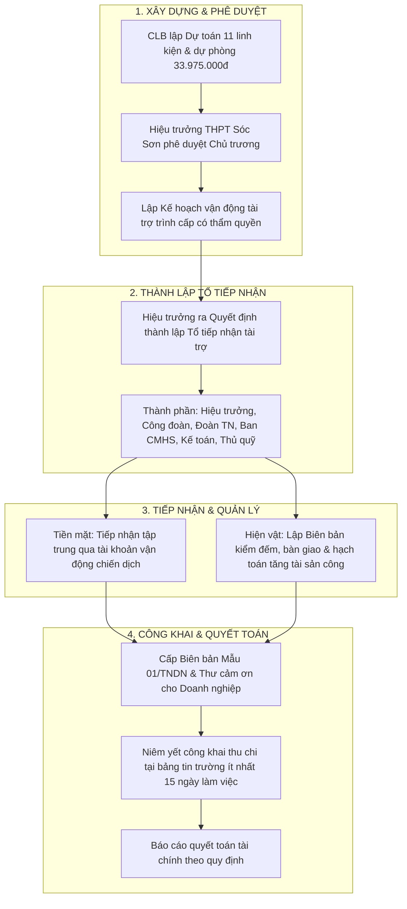
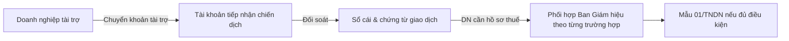
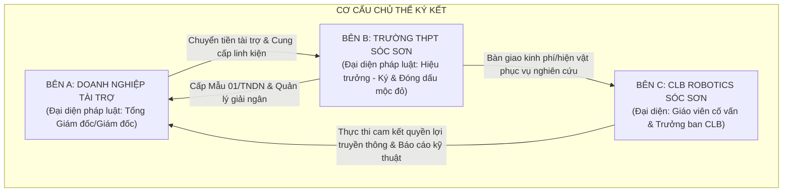
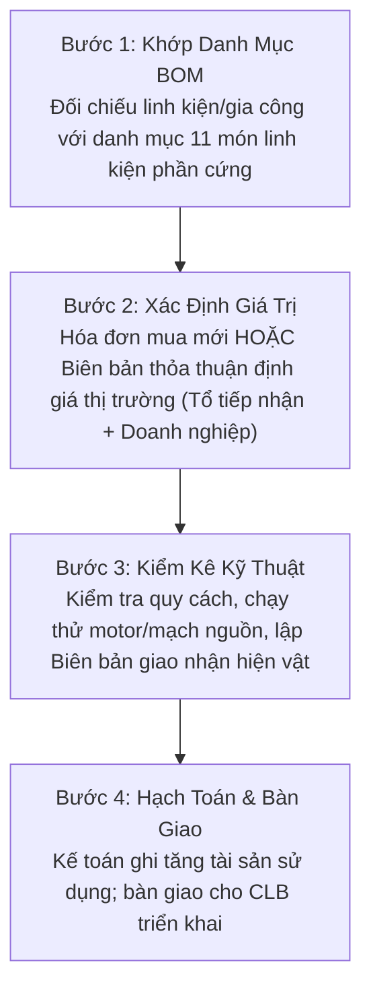
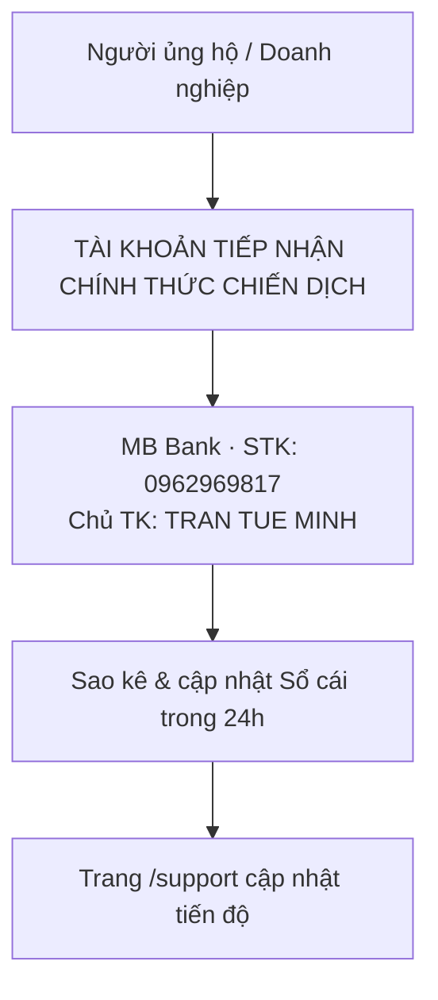
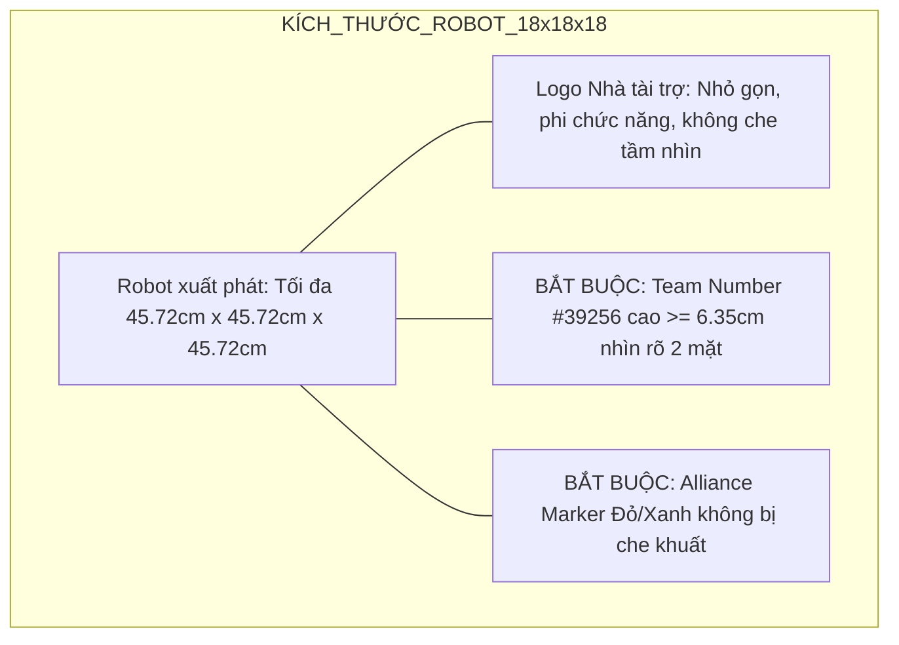
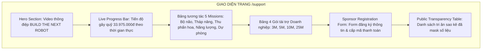

# 10 — Hướng Dẫn Pháp Lý, Cơ Chế Thanh Toán & Đặc Tả Cổng Quyên Góp /support

Tài liệu thiết lập toàn bộ hành lang pháp lý, quy trình tài chính công và phương thức vận hành kỹ thuật số cho chiến dịch "BUILD THE NEXT ROBOT" của CLB Robotics Sóc Sơn (FTC #39256). Văn bản chuẩn hóa 5 trụ cột: Quy trình tiếp nhận tài trợ giáo dục theo Thông tư 16/2018/TT-BGDĐT; Thủ tục khấu trừ 100% thuế TNDN cho doanh nghiệp theo Thông tư 20/2026/TT-BTC (Mẫu 01/TNDN); Thỏa thuận tài trợ 3 bên; Quy chuẩn thương hiệu FIRST & Bảo vệ dữ liệu cá nhân học sinh (Nghị định 13/2023/NĐ-CP); cùng Đặc tả kỹ thuật luồng tiếp nhận trực tuyến trên trang `/support`.

---

## 1. Quy Trình Tiếp Nhận Tài Trợ Giáo Dục (Thông Tư 16/2018/TT-BGDĐT)

Trường THPT Sóc Sơn là trường trung học phổ thông công lập trực thuộc Sở Giáo dục và Đào tạo Hà Nội. Mọi hoạt động vận động, tiếp nhận tài trợ tiền mặt và hiện vật phục vụ CLB Robotics Sóc Sơn bắt buộc phải tuân thủ nghiêm ngặt Thông tư số 16/2018/TT-BGDĐT.

### 1.1. Bốn nguyên tắc pháp lý cốt lõi (Điều 2 Thông tư 16/2018/TT-BGDĐT)
1. **Tự nguyện tuyệt đối:** Việc tài trợ phải bảo đảm nguyên tắc hoàn toàn tự nguyện giữa nhà tài trợ và nhà trường/CLB. Không ép buộc, không áp đặt, không biến tài trợ thành nghĩa vụ đóng góp bắt buộc.
2. **Nghiêm cấm cào bằng & ấn định mức sàn:** Không được quy định mức tài trợ bình quân, không ép buộc chỉ tiêu quyên góp cho phụ huynh hoặc bất kỳ cá nhân, tập thể nào.
3. **Phi thương mại & Không điều kiện gắn kết:** Nghiêm cấm gắn việc tiếp nhận tài trợ với bất kỳ điều kiện ưu tiên nào liên quan đến kết quả học tập, rèn luyện, xếp loại đạo đức hay quyền lợi tuyển sinh của học sinh.
4. **Tiếp nhận minh bạch, công khai:** Mọi khoản thu chi đều được vào sổ cái đối soát và công khai trên bảng tin và website.

---

## 2. Hướng Dẫn Giảm Trừ Thuế TNDN Cho Doanh Nghiệp (Thông Tư 20/2026/TT-BTC)

Đây là lợi thế cạnh tranh cốt lõi khi thuyết phục các doanh nghiệp FDI và SME tại địa bàn Hà Nội, Sóc Sơn, KCN Nội Bài và KCN Quang Minh.

### 2.1. Căn cứ pháp lý mới nhất năm 2026
- **Thông tư số 20/2026/TT-BTC** do Bộ Tài chính ban hành ngày 12/03/2026, có hiệu lực từ ngày 12/03/2026 và áp dụng xuyên suốt từ kỳ tính thuế năm 2025 trở đi.
- **Thay thế hoàn toàn:** Thông tư 20/2026/TT-BTC chính thức bãi bỏ toàn bộ Thông tư 78/2014/TT-BTC và Thông tư 96/2015/TT-BTC.
- **Quy định trừ thuế tài trợ giáo dục:** Căn cứ khoản 5 Điều 3 Thông tư 20/2026/TT-BTC, khoản chi tài trợ cho giáo dục tại các cơ sở giáo dục công lập thuộc hệ thống giáo dục quốc dân (như Trường THPT Sóc Sơn) được tính **100% vào chi phí được trừ** khi xác định thu nhập chịu thuế TNDN.

### 2.2. Hồ sơ chứng từ hợp lệ doanh nghiệp cần lưu giữ
Để được cơ quan thuế chấp thuận chi phí được trừ, doanh nghiệp chỉ cần lưu giữ bộ hồ sơ gồm đúng 02 chứng từ:
1. **Biên bản xác nhận khoản tài trợ theo Mẫu số 01/TNDN:** Ban hành kèm theo Thông tư 20/2026/TT-BTC (thay thế Mẫu 03/TNDN cũ). Biên bản ghi rõ thông tin bên tài trợ, bên tiếp nhận (Trường THPT Sóc Sơn), mục đích tài trợ (phục vụ nghiên cứu STEM chế tạo robot thi đấu FTC), giá trị tài trợ và có đầy đủ chữ ký, đóng dấu mộc đỏ của Hiệu trưởng Trường THPT Sóc Sơn và Tổng Giám đốc/Giám đốc Doanh nghiệp.
2. **Chứng từ thanh toán không dùng tiền mặt:** Giấy báo Nợ / Ủy nhiệm chi từ ngân hàng của doanh nghiệp chuyển sang tài khoản tiếp nhận theo hướng dẫn (các khoản tài trợ từ 20.000.000 VNĐ trở lên bắt buộc phải chuyển khoản ngân hàng theo Luật Thuế TNDN).

### 2.3. Bảng phân tích lợi ích kinh tế cho từng gói tài trợ

| Gói tài trợ doanh nghiệp | Giá trị đóng góp (VND) | Mức khấu trừ thuế TNDN (20%) | Chi phí thực tế của Doanh nghiệp (VND) | Hiệu quả quyền lợi nhận diện STEM |
|---|---:|---:|---:|---|
| **Đồng Hành (Community)** | 3.000.000 | **600.000** | **2.400.000** | Logo web, fanpage, kỷ yếu, thư cảm ơn BGH |
| **Bạc (Silver / Mission)** | 5.000.000 | **1.000.000** | **4.000.000** | Toàn bộ gói 3M + Logo tay áo + Đồng hành 1 Mission |
| **Vàng (Gold / Build)** | 10.000.000 | **2.000.000** | **8.000.000** | Logo ngực/lưng áo + Standee pit + PR chuyên sâu |
| **Kim Cương (Diamond)** | 25.000.000 | **5.000.000** | **20.000.000** | Logo thân robot (chuẩn FIRST) + Vinh danh Maker Day |

*(Phân định pháp lý: Nhà trường không xuất hóa đơn GTGT dịch vụ quảng cáo vì không có chức năng kinh doanh truyền thông. Khoản đóng góp là Tài trợ giáo dục phi thương mại, giúp doanh nghiệp tối ưu chi phí thuế minh bạch 100%).*

---

## 3. Cấu Trúc Hợp Đồng Thỏa Thuận Tài Trợ 3 Bên Chuẩn (Tripartite Agreement)

Do CLB học sinh không có tư cách pháp nhân theo Điều 74 Bộ luật Dân sự 2015, giải pháp chuẩn hóa pháp lý là ký kết **Thỏa thuận tài trợ giáo dục 3 bên**:

### Tám điều khoản cốt lõi trong hợp đồng:
1. **Căn cứ pháp lý:** Bộ luật Dân sự 2015, Luật Giáo dục 2019, Thông tư 16/2018/TT-BGDĐT, Thông tư 20/2026/TT-BTC của Bộ Tài chính.
2. **Mục đích tài trợ:** Tài trợ phi thương mại phục vụ công tác giáo dục STEM, hỗ trợ Đội tuyển Robotics Sóc Sơn nghiên cứu, chế tạo robot thi đấu tại giải FIRST Tech Challenge 2026–2027 (BIOBUZZ™ presented by RTX) do Đại học FPT tổ chức.
3. **Hình thức & Trị giá tài trợ:** Xác định rõ số tiền mặt (VND) hoặc danh mục vật tư hiện vật đính kèm phụ lục (chủng loại, số lượng, giá trị quy đổi theo BOM).
4. **Quyền lợi tri ân nhà tài trợ (Sponsor Recognition):** Đặt logo trên áo đấu, thân robot, standee pit lane, các kênh truyền thông số và kỷ yếu chiến dịch tương ứng với phân hạng tài trợ đã thỏa thuận.
5. **Nghĩa vụ của Bên tiếp nhận (Bên B & Bên C):**
   - Bên B phối hợp phát hành Biên bản Mẫu 01/TNDN và thư cảm ơn gửi Bên A trong vòng 10 ngày làm việc sau khi nhận đủ tiền.
   - Bên C sử dụng nguồn tài trợ đúng mục đích chế tạo robot, mở sổ theo dõi minh bạch và gửi Báo cáo tác động sau mùa giải.
6. **Sở hữu trí tuệ & Quyền thương hiệu:** Mọi thiết kế cơ khí 3D CAD, bản quyền phần mềm và quyền sở hữu robot thi đấu thuộc về Trường THPT Sóc Sơn và CLB. Bên A được quyền khai thác hình ảnh tài trợ phục vụ báo cáo CSR và truyền thông doanh nghiệp.
7. **Cam kết hoàn trả & Xử lý vi phạm:** Nếu phát hiện sử dụng kinh phí sai mục đích cam kết hoặc tự ý bỏ giải không có lý do bất khả kháng, Bên B có trách nhiệm thu hồi và hoàn trả phần kinh phí chưa sử dụng hoặc đã sử dụng sai mục đích cho Bên A.
8. **Giải quyết tranh chấp:** Ưu tiên thương lượng trên tinh thần thể thao cao thượng (*Gracious Professionalism®*). Mọi tranh chấp không giải quyết được sẽ đưa ra Tòa án nhân dân có thẩm quyền tại TP. Hà Nội.

---

## 4. Quy Trình Tiếp Nhận & Định Giá Tài Trợ Hiện Vật (In-kind)

Doanh nghiệp có thể tài trợ hiện vật thay thế trực tiếp linh kiện/dụng cụ trong danh mục 11 món tại mục 2.2 của 04:

- **Nguyên tắc quy đổi giá trị:** Quy đổi 1:1 theo giá trị thị trường hoặc hóa đơn GTGT mua hàng hợp pháp.
- **Khấu trừ trực tiếp:** Chỉ giá trị hiện vật thay thế đúng hạng mục trong danh mục 11 món được trừ vào phần tiền cần huy động; không tính trùng. Vật tư prototype và gia công khung không thuộc mục tiêu này.

---

## 5. Thiết Lập Hạ Tầng Tiếp Nhận Thanh Toán

Chiến dịch sử dụng một tài khoản tiếp nhận chính thức thống nhất cho toàn bộ các khoản đóng góp cộng đồng, phụ huynh, cựu học sinh và nhà tài trợ:

### 5.1. Thông tin tài khoản tiếp nhận chính thức của chiến dịch
- **Chủ tài khoản:** TRAN TUE MINH
- **Số tài khoản:** 0962969817
- **Ngân hàng:** MB Bank (Ngân hàng TMCP Quân đội)
- **Mã QR:** `[QR: sẽ gửi sau]`
- **Cú pháp chuyển khoản chuẩn:**
  - Ủng hộ Mission phần cứng: `BIOBUZZ [MÃ_MISSION] [HỌ_TÊN] [SĐT]` (Ví dụ: `BIOBUZZ M1 NGUYENVANA 0912345678`).
  - Ủng hộ Gói Doanh nghiệp: `BIOBUZZ [MÃ_GÓI] [TÊN_DOANH_NGHIỆP] [SĐT]` (Ví dụ: `BIOBUZZ GOLD CTYSPINDEX 0988123456`).
  - Đặt mua Merch / Vé Maker Day: `BIOBUZZ MERCH [HỌ_TÊN] [SĐT]`.

> ⚠️ **HỘP LƯU Ý PHÁP LÝ VỀ KHẤU TRỪ THUẾ TNDN DOANH NGHIỆP (Căn cứ Báo cáo R4):**  
> Căn cứ Thông tư 16/2018/TT-BGDĐT, việc tiếp nhận tài trợ cho cơ sở giáo dục công lập được kỳ vọng thực hiện qua tài khoản trường. Đồng thời, để doanh nghiệp đủ điều kiện tính khoản tài trợ vào chi phí được trừ khi xác định thuế TNDN theo Thông tư 20/2026/TT-BTC (Mẫu 01/TNDN), đơn vị thụ hưởng phải là Trường THPT Sóc Sơn. Do đó, nhà tài trợ doanh nghiệp yêu cầu chứng từ thuế sẽ được Ban Vận động báo cáo Ban Giám hiệu và hướng dẫn xử lý qua trường theo từng trường hợp; các khoản còn lại dùng tài khoản chiến dịch nêu trên.

---

## 6. Quy Chuẩn Thương Hiệu FIRST & Ràng Buộc Đặt Logo

Đội tuyển phải tuân thủ nghiêm ngặt Cẩm nang thi đấu FIRST Tech Challenge mùa giải BIOBUZZ™ (Robot Construction & Brand Rules):

1. **Khung kích thước xuất phát (Robot Sizing Box):** Robot cùng toàn bộ tấm dán decal logo nhà tài trợ phải nằm gọn hoàn toàn trong khối kích thước **18 inch × 18 inch × 18 inch** ($45.72\text{ cm} \times 45.72\text{ cm} \times 45.72\text{ cm}$) trước mỗi trận đấu.
2. **Không che khuất nhận diện trọng tài:**
   - Tuyệt đối không dán logo che khuất **Số hiệu đội thi chính thức #39256** (Team Number phải có chiều cao tối thiểu **2.5 inch / 6.35 cm**, màu tương phản sắc nét với nền).
   - Không dán đè lên vị trí gắn cờ/vạch màu liên minh (Alliance Markers).
3. **An toàn kỹ thuật & Thị giác máy tính:** Cấm sử dụng vật liệu phản quang gây lóa camera AprilTag / OpenCV của các robot đối thủ trên sân đấu. Không dùng vật liệu sắc nhọn hoặc dễ bắt lửa.
4. **Danh mục ngành nghề cấm tuyệt đối:** Cấm hoàn toàn mọi logo, tên thương hiệu, hình ảnh quảng bá thuộc các nhóm:
   - Rượu, bia, thức uống có cồn.
   - Thuốc lá, thuốc lá điện tử (vaping), chất kích thích.
   - Vũ khí quân dụng, đạn dược.
   - Cờ bạc, cá cược trực tuyến, trò chơi mang tính đỏ đen.
   - Tuyên truyền đảng phái chính trị, tôn giáo, nội dung phân biệt đối xử.
5. **Quy chuẩn danh xưng thương hiệu FIRST:**
   - Đúng chuẩn nhãn hiệu: `FIRST®`, `FIRST® Tech Challenge`, `BIOBUZZ™`, `FIRST CANOPY™`.
   - Nhà tài trợ được xưng danh: *"Nhà tài trợ đồng hành cùng Đội tuyển Robotics Sóc Sơn — FTC #39256"* (Proud Sponsor of Robotics Soc Son #39256).
   - Tuyệt đối cấm danh xưng: *"Nhà tài trợ chính thức của giải đấu FIRST"* (Official Sponsor of FIRST). Cấm ghép nối (co-branding lockup) logo nhà tài trợ lồng vào bên trong logo FIRST.

---

## 7. Bảo Vệ Dữ Liệu Cá Nhân Học Sinh & Nhà Tài Trợ (Nghị Định 13/2023/NĐ-CP)

Căn cứ Nghị định 13/2023/NĐ-CP về bảo vệ dữ liệu cá nhân và Luật Trẻ em 2016:

### 7.1. Dữ liệu học sinh dưới 16 tuổi (Lớp 10 & Người tham gia Workshop)
- **Quy tắc chữ ký kép (Dual-consent):** Bắt buộc phải có **Phiếu chấp thuận sử dụng dữ liệu và hình ảnh (Media & Data Consent Form)** có chữ ký đồng thuận của cả **học sinh VÀ cha mẹ/người giám hộ hợp pháp** trước khi đăng tải hình ảnh làm hồ sơ tài trợ hoặc xuất hiện trên truyền thông đại chúng.
- **Cam kết gỡ bỏ hình ảnh:** Khi phụ huynh hoặc học sinh yêu cầu bằng văn bản rút lại sự đồng ý, CLB có nghĩa vụ gỡ bỏ hình ảnh khỏi website và các nền tảng mạng xã hội trong vòng **72 giờ**.

### 7.2. Bảo mật dữ liệu người ủng hộ (Data Privacy for Donors)
- **Nguyên tắc thu thập tối thiểu:** Cổng tiếp nhận `/support` chỉ thu thập các thông tin tối thiểu phục vụ đối soát và xuất biên bản tài trợ.
- **Quy chuẩn hiển thị công khai (Masking Rules):** Bắt buộc ẩn 3–4 ký tự giữa của số điện thoại và số tài khoản cá nhân trên mọi bảng vinh danh hoặc sao kê công khai (Ví dụ: `Trần Văn A — 098****234 — Ủng hộ 500.000đ`).

---

## 8. Đặc Tả Kỹ Thuật Trang Web /support & Schema Form Tiếp Nhận

Giao diện trang `/support` được thiết kế theo cấu trúc hiện đại, tương thích hoàn toàn với kiến trúc hệ thống hiện có (kế thừa logic xử lý từ `/course-register-form`).

### 8.1. Cấu trúc trường dữ liệu Form (Schema Field Definitions)
Form được triển khai dạng Client-side Component với các trường xác thực nghiêm ngặt:

| Tên trường (Field Name) | Kiểu dữ liệu (Type) | Bắt buộc (Required) | Ràng buộc dữ liệu & Mô tả (Validation & Logic) |
|---|---|:---:|---|
| `donor_type` | Radio Group | Có | Lựa chọn: `Doanh nghiệp` hoặc `Cá nhân / Phụ huynh / Cựu HS` |
| `donor_name` | Text (string) | Có | Họ và tên cá nhân HOẶC Tên đầy đủ của Doanh nghiệp (tối đa 150 ký tự) |
| `tax_code` | Text (string) | Không | Mã số thuế doanh nghiệp (10 hoặc 13 số; bắt buộc nếu yêu cầu Mẫu 01/TNDN) |
| `representative_name`| Text (string) | Không | Họ tên Người đại diện theo pháp luật / Chức vụ (đối với Doanh nghiệp) |
| `phone_number` | Tel (string) | Có | Định dạng số điện thoại Việt Nam chuẩn (10 chữ số, regex `^0[3|5|7|8|9][0-9]{8}$`) |
| `email` | Email (string) | Có | Định dạng email hợp lệ để tự động gửi Thư cảm ơn & thông tin chuyển khoản |
| `tier_or_mission` | Select / Dropdown | Có | Danh sách tùy chọn: Gói Doanh nghiệp (3M, 5M, 10M, 25M) / Mission 1–5 / Hiện vật / Tự nguyện |
| `amount` | Number (VND) | Có | Số tiền đóng góp (Tối thiểu 50.000 VNĐ; tự động điền theo gói đã chọn) |
| `in_kind_detail` | Textarea | Không | Mô tả chủng loại linh kiện/gia công tài trợ (hiện ra nếu chọn Hiện vật) |
| `need_tax_deduction` | Checkbox (boolean)| Có | Tích chọn: "Doanh nghiệp có nhu cầu nhận Biên bản Mẫu 01/TNDN giảm trừ thuế" |
| `shipping_address` | Text (string) | Không | Địa chỉ nhận Kỷ yếu / Quà tri ân / Biên bản gốc gửi qua bưu điện |
| `message` | Textarea | Không | Lời chúc / Lời nhắn nhủ gửi tới các kỹ sư trẻ Robotics Sóc Sơn |
| `privacy_consent` | Checkbox (boolean)| Có | Bắt buộc tích chọn: "Tôi đồng ý với chính sách bảo mật dữ liệu theo NĐ 13/2023/NĐ-CP" |

### 8.2. Luồng xử lý kỹ thuật sau khi gửi form (Submission Flow)
1. **Bước 1: Client Validation:** Kiểm tra định dạng dữ liệu (Email, Số điện thoại, Mã số thuế).
2. **Bước 2: Hiển thị thông tin chuyển khoản:** Hệ thống hiển thị Modal thông tin tài khoản MB Bank (TRAN TUE MINH · 0962969817 · `[QR: sẽ gửi sau]`) với cú pháp đã sinh tự động. Đối với DN chọn Mẫu 01/TNDN, hiển thị thêm hướng dẫn thủ tục phối hợp qua trường.
3. **Bước 3: Webhook & Đồng bộ dữ liệu:**
   - Dữ liệu form tự động chuyển vào Google Sheets quản trị nội bộ qua webhook (phân quyền riêng tư).
   - Tự động kích hoạt email xác nhận gửi tới nhà tài trợ.
4. **Bước 4: Đối soát & Vinh danh:**
   - Kế toán/Thủ quỹ đối chiếu sao kê tài khoản ngân hàng.
   - Cập nhật thanh tiến độ (Progress Bar 33.975.000đ) trên web và ghi danh nhà tài trợ vào Bảng Tri Ân.

---

## Nguồn

1. **Văn bản quy phạm pháp luật Việt Nam:**
   - Bộ Giáo dục và Đào tạo: *Thông tư số 16/2018/TT-BGDĐT quy định về tài trợ cho các cơ sở giáo dục thuộc hệ thống giáo dục quốc dân.* [thuvienphapluat.vn/van-ban/Giao-duc/Thong-tu-16-2018-TT-BGDDT-393562.aspx](https://thuvienphapluat.vn/van-ban/Giao-duc/Thong-tu-16-2018-TT-BGDDT-quy-dinh-ve-tai-tro-cho-co-so-giao-duc-thuoc-he-thong-giao-duc-quoc-dan-393562.aspx)
   - Bộ Tài chính: *Thông tư số 20/2026/TT-BTC hướng dẫn Luật Thuế thu nhập doanh nghiệp và Mẫu 01/TNDN.* [thuvienphapluat.vn/van-ban/Doanh-nghiep/Thong-tu-20-2026-TT-BTC-672539.aspx](https://thuvienphapluat.vn/van-ban/Doanh-nghiep/Thong-tu-20-2026-TT-BTC-huong-dan-Luat-Thue-thu-nhap-doanh-nghiep-va-Nghi-dinh-320-2025-ND-CP-672539.aspx)
   - Chính phủ: *Nghị định số 13/2023/NĐ-CP về bảo vệ dữ liệu cá nhân.* [xaydungchinhsach.chinhphu.vn/toan-van-nghi-dinh-13-2023-nd-cp](https://xaydungchinhsach.chinhphu.vn/toan-van-nghi-dinh-13-2023-nd-cp-bao-ve-du-lieu-ca-nhan-119230516104357809.htm)
   - Quốc hội: *Bộ luật Dân sự 2015 (Luật số 91/2015/QH13: Điều 21, Điều 74, Điều 586).*
2. **Quy định giải đấu FIRST quốc tế:**
   - FIRST Inspires: *FIRST Tech Challenge Competition Manual (Robot Construction Rules & Sponsor Recognition Guidelines).* [ftc-resources.firstinspires.org/ftc/game/manual](https://ftc-resources.firstinspires.org/ftc/game/manual)
   - FIRST Inspires: *Policy on the Use of FIRST® Trademarks and Copyrighted Materials.* [firstinspires.org/brand](https://www.firstinspires.org/brand)
3. **Báo cáo nghiên cứu cơ sở chiến dịch:**
   - Báo cáo R4: `docs/campaign-2026-2027/research/R4-legal-payment.md`
   - Kế hoạch tài chính: `docs/campaign-2026-2027/04-ngan-sach-delta.md`
   - Biên bản thảo luận: `docs/campaign-2026-2027/99-bien-ban-thao-luan.md`
   - Phân công nhân sự: `docs/campaign-2026-2027/14-phan-cong-nhan-su.md`
