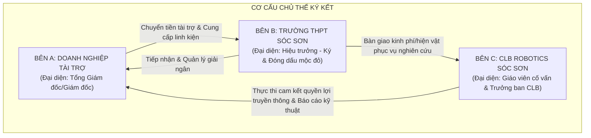
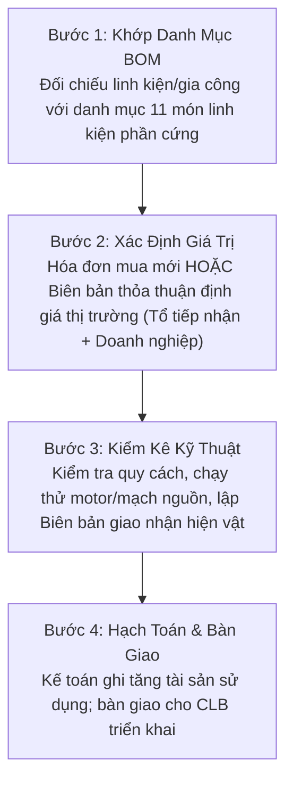
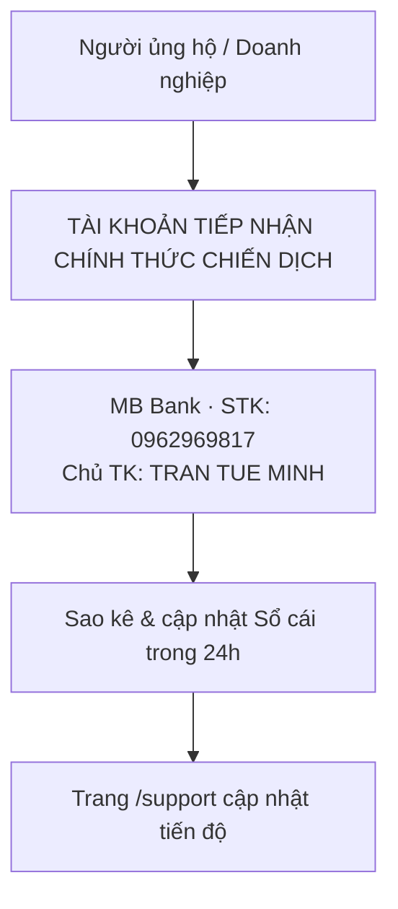
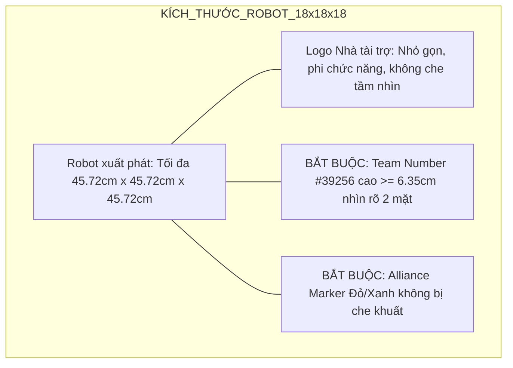
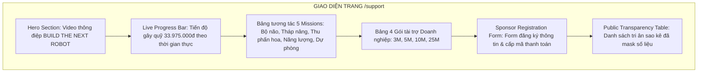

# 10 — Hướng Dẫn Pháp Lý, Cơ Chế Thanh Toán & Đặc Tả Cổng Quyên Góp /support

Tài liệu thiết lập hành lang pháp lý, quy trình tài chính và phương thức vận hành kỹ thuật số cho chiến dịch "BUILD THE NEXT ROBOT" của CLB Robotics Sóc Sơn (FTC #39256). Nội dung bao gồm: Phê duyệt của nhà trường; Thỏa thuận tài trợ 3 bên; Tiếp nhận tài trợ hiện vật; Quy chuẩn thương hiệu FIRST & Bảo vệ dữ liệu cá nhân học sinh (Nghị định 13/2023/NĐ-CP); cùng Đặc tả kỹ thuật luồng tiếp nhận trực tuyến trên trang `/support`.

---

## 1. Phê Duyệt Của Nhà Trường & Tiếp Nhận Tài Trợ
- Hoạt động vận động tài trợ của CLB Robotics Sóc Sơn được triển khai dưới sự phê duyệt chủ trương và giám sát của Trường THPT Sóc Sơn (căn cứ Thông tư 16/2018/TT-BGDĐT về tài trợ cho các cơ sở giáo dục).
- Doanh nghiệp cần chứng từ kế toán: CLB chuyển Ban Giám hiệu THPT Sóc Sơn hướng dẫn.

---

## 2. Thỏa Thuận Tài Trợ 3 Bên (Tripartite Agreement)

Do CLB học sinh không có tư cách pháp nhân độc lập, các khoản tài trợ doanh nghiệp được xác lập bằng Thỏa thuận tài trợ giáo dục 3 bên:

### Các điều khoản cốt lõi trong thỏa thuận:
- **Chủ thể:** Bên A (Doanh nghiệp tài trợ), Bên B (Trường THPT Sóc Sơn), Bên C (CLB Robotics Sóc Sơn).
- **Mục đích:** Tài trợ giáo dục phi thương mại phục vụ CLB Robotics Sóc Sơn chế tạo robot tham gia FIRST Tech Challenge (mùa giải BIOBUZZ™).
- **Hình thức & Trị giá:** Tiền mặt hoặc hiện vật quy đổi 1:1 theo danh mục 11 linh kiện phần cứng (mục 2.2 của 04).
- **Quyền lợi tri ân:** Quyền lợi truyền thông tương ứng với gói tài trợ (logo trên robot, áo đấu, standee, kỷ yếu, thư cảm ơn).
- **Trách nhiệm các bên:** Bên C sử dụng đúng mục đích và báo cáo minh bạch; Bên B giám sát tiếp nhận và giải ngân; Bên A chuyển giao kinh phí/hiện vật đúng thỏa thuận.
- **Sở hữu trí tuệ:** Quyền sở hữu robot và thiết kế thuộc về nhà trường và CLB; doanh nghiệp được dùng tư liệu hình ảnh cho hoạt động CSR.

---

## 4. Quy Trình Tiếp Nhận & Định Giá Tài Trợ Hiện Vật (In-kind)

Doanh nghiệp có thể tài trợ hiện vật thay thế trực tiếp linh kiện/dụng cụ trong danh mục 11 món tại mục 2.2 của 04:

- **Nguyên tắc quy đổi giá trị:** Quy đổi 1:1 theo giá trị thị trường hoặc hóa đơn GTGT mua hàng hợp pháp.
- **Khấu trừ trực tiếp:** Chỉ giá trị hiện vật thay thế đúng hạng mục trong danh mục 11 món được trừ vào phần tiền cần huy động; không tính trùng. Vật tư prototype và gia công khung không thuộc mục tiêu này.

---

## 5. Thiết Lập Hạ Tầng Tiếp Nhận Thanh Toán

Chiến dịch sử dụng một tài khoản tiếp nhận chính thức thống nhất cho toàn bộ các khoản đóng góp cộng đồng, phụ huynh, cựu học sinh và nhà tài trợ:

### 5.1. Thông tin tài khoản tiếp nhận chính thức của chiến dịch
- **Chủ tài khoản:** TRAN TUE MINH
- **Số tài khoản:** 0962969817
- **Ngân hàng:** MB Bank (Ngân hàng TMCP Quân đội)
- **Mã QR:** 
- **Cú pháp chuyển khoản chuẩn:**
  - Ủng hộ Mission phần cứng: `BIOBUZZ [MÃ_MISSION] [HỌ_TÊN] [SĐT]` (Ví dụ: `BIOBUZZ M1 NGUYENVANA 0912345678`).
  - Ủng hộ Gói Doanh nghiệp: `BIOBUZZ [MÃ_GÓI] [TÊN_DOANH_NGHIỆP] [SĐT]` (Ví dụ: `BIOBUZZ GOLD CTYSPINDEX 0988123456`).
  - Vé Maker Day: `BIOBUZZ MAKERDAY [HỌ_TÊN] [SĐT]`.

> **Lưu ý kế toán:** Doanh nghiệp cần chứng từ kế toán: CLB chuyển Ban Giám hiệu THPT Sóc Sơn hướng dẫn.
---

## 6. Quy Chuẩn Thương Hiệu FIRST & Ràng Buộc Đặt Logo

Đội tuyển phải tuân thủ nghiêm ngặt Cẩm nang thi đấu FIRST Tech Challenge mùa giải BIOBUZZ™ (Robot Construction & Brand Rules):

1. **Khung kích thước xuất phát (Robot Sizing Box):** Robot cùng toàn bộ tấm dán decal logo nhà tài trợ phải nằm gọn hoàn toàn trong khối kích thước **18 inch × 18 inch × 18 inch** ($45.72\text{ cm} \times 45.72\text{ cm} \times 45.72\text{ cm}$) trước mỗi trận đấu.
2. **Không che khuất nhận diện trọng tài:**
   - Tuyệt đối không dán logo che khuất **Số hiệu đội thi chính thức #39256** (Team Number phải có chiều cao tối thiểu **2.5 inch / 6.35 cm**, màu tương phản sắc nét với nền).
   - Không dán đè lên vị trí gắn cờ/vạch màu liên minh (Alliance Markers).
3. **An toàn kỹ thuật & Thị giác máy tính:** Cấm sử dụng vật liệu phản quang gây lóa camera AprilTag / OpenCV của các robot đối thủ trên sân đấu. Không dùng vật liệu sắc nhọn hoặc dễ bắt lửa.
4. **Danh mục ngành nghề cấm tuyệt đối:** Cấm hoàn toàn mọi logo, tên thương hiệu, hình ảnh quảng bá thuộc các nhóm:
   - Rượu, bia, thức uống có cồn.
   - Thuốc lá, thuốc lá điện tử (vaping), chất kích thích.
   - Vũ khí quân dụng, đạn dược.
   - Cờ bạc, cá cược trực tuyến, trò chơi mang tính đỏ đen.
   - Tuyên truyền đảng phái chính trị, tôn giáo, nội dung phân biệt đối xử.
5. **Quy chuẩn danh xưng thương hiệu FIRST:**
   - Đúng chuẩn nhãn hiệu: `FIRST®`, `FIRST® Tech Challenge`, `BIOBUZZ™`, `FIRST CANOPY™`.
   - Nhà tài trợ được xưng danh: *"Nhà tài trợ đồng hành cùng Đội tuyển Robotics Sóc Sơn — FTC #39256"* (Proud Sponsor of Robotics Soc Son #39256).
   - Tuyệt đối cấm danh xưng: *"Nhà tài trợ chính thức của giải đấu FIRST"* (Official Sponsor of FIRST). Cấm ghép nối (co-branding lockup) logo nhà tài trợ lồng vào bên trong logo FIRST.

---

## 7. Bảo Vệ Dữ Liệu Cá Nhân Học Sinh & Nhà Tài Trợ (Nghị Định 13/2023/NĐ-CP)

Căn cứ Nghị định 13/2023/NĐ-CP về bảo vệ dữ liệu cá nhân và Luật Trẻ em 2016:

### 7.1. Dữ liệu học sinh dưới 16 tuổi (Lớp 10 & Người tham gia Workshop)
- **Quy tắc chữ ký kép (Dual-consent):** Bắt buộc phải có **Phiếu chấp thuận sử dụng dữ liệu và hình ảnh (Media & Data Consent Form)** có chữ ký đồng thuận của cả **học sinh VÀ cha mẹ/người giám hộ hợp pháp** trước khi đăng tải hình ảnh làm hồ sơ tài trợ hoặc xuất hiện trên truyền thông đại chúng.
- **Cam kết gỡ bỏ hình ảnh:** Khi phụ huynh hoặc học sinh yêu cầu bằng văn bản rút lại sự đồng ý, CLB có nghĩa vụ gỡ bỏ hình ảnh khỏi website và các nền tảng mạng xã hội trong vòng **72 giờ**.

### 7.2. Bảo mật dữ liệu người ủng hộ (Data Privacy for Donors)
- **Nguyên tắc thu thập tối thiểu:** Cổng tiếp nhận `/support` chỉ thu thập các thông tin tối thiểu phục vụ đối soát và xuất biên bản tài trợ.
- **Quy chuẩn hiển thị công khai (Masking Rules):** Bắt buộc ẩn 3–4 ký tự giữa của số điện thoại và số tài khoản cá nhân trên mọi bảng vinh danh hoặc sao kê công khai (Ví dụ: `Trần Văn A — 098****234 — Ủng hộ 500.000đ`).

---

## 8. Đặc Tả Kỹ Thuật Trang Web /support & Schema Form Tiếp Nhận

Giao diện trang `/support` được thiết kế theo cấu trúc hiện đại, tương thích hoàn toàn với kiến trúc hệ thống hiện có (kế thừa logic xử lý từ `/course-register-form`).

### 8.1. Cấu trúc trường dữ liệu Form (Schema Field Definitions)
Form được triển khai dạng Client-side Component với các trường xác thực nghiêm ngặt:

| Tên trường (Field Name) | Kiểu dữ liệu (Type) | Bắt buộc (Required) | Ràng buộc dữ liệu & Mô tả (Validation & Logic) |
|---|---|:---:|---|
| `donor_type` | Radio Group | Có | Lựa chọn: `Doanh nghiệp` hoặc `Cá nhân / Phụ huynh / Cựu HS` |
| `donor_name` | Text (string) | Có | Họ và tên cá nhân HOẶC Tên đầy đủ của Doanh nghiệp (tối đa 150 ký tự) |
| `representative_name`| Text (string) | Không | Họ tên Người đại diện theo pháp luật / Chức vụ (đối với Doanh nghiệp) |
| `phone_number` | Tel (string) | Có | Định dạng số điện thoại Việt Nam chuẩn (10 chữ số, regex `^0[3|5|7|8|9][0-9]{8}$`) |
| `email` | Email (string) | Có | Định dạng email hợp lệ để tự động gửi Thư cảm ơn & thông tin chuyển khoản |
| `tier_or_mission` | Select / Dropdown | Có | Danh sách tùy chọn: Gói Doanh nghiệp (3M, 5M, 10M, 25M) / Mission 1–5 / Hiện vật / Tự nguyện |
| `amount` | Number (VND) | Có | Số tiền đóng góp (Tối thiểu 50.000 VNĐ; tự động điền theo gói đã chọn) |
| `in_kind_detail` | Textarea | Không | Mô tả chủng loại linh kiện/gia công tài trợ (hiện ra nếu chọn Hiện vật) |
| `shipping_address` | Text (string) | Không | Địa chỉ nhận Kỷ yếu / Quà tri ân / Biên bản gốc gửi qua bưu điện |
| `message` | Textarea | Không | Lời chúc / Lời nhắn nhủ gửi tới các kỹ sư trẻ Robotics Sóc Sơn |
| `privacy_consent` | Checkbox (boolean)| Có | Bắt buộc tích chọn: "Tôi đồng ý với chính sách bảo mật dữ liệu theo NĐ 13/2023/NĐ-CP" |

### 8.2. Luồng xử lý kỹ thuật sau khi gửi form (Submission Flow)
1. **Bước 1: Client Validation:** Kiểm tra định dạng dữ liệu (Email, Số điện thoại, Mã số thuế).
2. **Bước 2: Hiển thị thông tin chuyển khoản:** Hệ thống hiển thị Modal thông tin tài khoản MB Bank (TRAN TUE MINH · 0962969817 · QR: assets/placeholder.jpg) với cú pháp đã sinh tự động. Doanh nghiệp cần chứng từ kế toán: CLB chuyển Ban Giám hiệu THPT Sóc Sơn hướng dẫn.
3. **Bước 3: Webhook & Đồng bộ dữ liệu:**
   - Dữ liệu form tự động chuyển vào Google Sheets quản trị nội bộ qua webhook (phân quyền riêng tư).
   - Tự động kích hoạt email xác nhận gửi tới nhà tài trợ.
4. **Bước 4: Đối soát & Vinh danh:**
   - Kế toán/Thủ quỹ đối chiếu sao kê tài khoản ngân hàng.
   - Cập nhật thanh tiến độ (Progress Bar 33.975.000đ) trên web và ghi danh nhà tài trợ vào Bảng Tri Ân.

---

## Nguồn

1. **Văn bản quy phạm pháp luật Việt Nam:**
   - Bộ Giáo dục và Đào tạo: *Thông tư số 16/2018/TT-BGDĐT quy định về tài trợ cho các cơ sở giáo dục thuộc hệ thống giáo dục quốc dân.* [thuvienphapluat.vn/van-ban/Giao-duc/Thong-tu-16-2018-TT-BGDDT-393562.aspx](https://thuvienphapluat.vn/van-ban/Giao-duc/Thong-tu-16-2018-TT-BGDDT-quy-dinh-ve-tai-tro-cho-co-so-giao-duc-thuoc-he-thong-giao-duc-quoc-dan-393562.aspx)
   - Chính phủ: *Nghị định số 13/2023/NĐ-CP về bảo vệ dữ liệu cá nhân.* [xaydungchinhsach.chinhphu.vn/toan-van-nghi-dinh-13-2023-nd-cp](https://xaydungchinhsach.chinhphu.vn/toan-van-nghi-dinh-13-2023-nd-cp-bao-ve-du-lieu-ca-nhan-119230516104357809.htm)
   - Quốc hội: *Bộ luật Dân sự 2015 (Luật số 91/2015/QH13: Điều 21, Điều 74, Điều 586).*
2. **Quy định giải đấu FIRST quốc tế:**
   - FIRST Inspires: *FIRST Tech Challenge Competition Manual (Robot Construction Rules & Sponsor Recognition Guidelines).* [ftc-resources.firstinspires.org/ftc/game/manual](https://ftc-resources.firstinspires.org/ftc/game/manual)
   - FIRST Inspires: *Policy on the Use of FIRST® Trademarks and Copyrighted Materials.* [firstinspires.org/brand](https://www.firstinspires.org/brand)
3. **Báo cáo nghiên cứu cơ sở chiến dịch:**
   - Báo cáo R4: `docs/campaign-2026-2027/research/R4-legal-payment.md`
   - Kế hoạch tài chính: `docs/campaign-2026-2027/04-ngan-sach-delta.md`
   - Biên bản thảo luận: `docs/campaign-2026-2027/99-bien-ban-thao-luan.md`
   - Phân công nhân sự: `docs/campaign-2026-2027/14-phan-cong-nhan-su.md`
