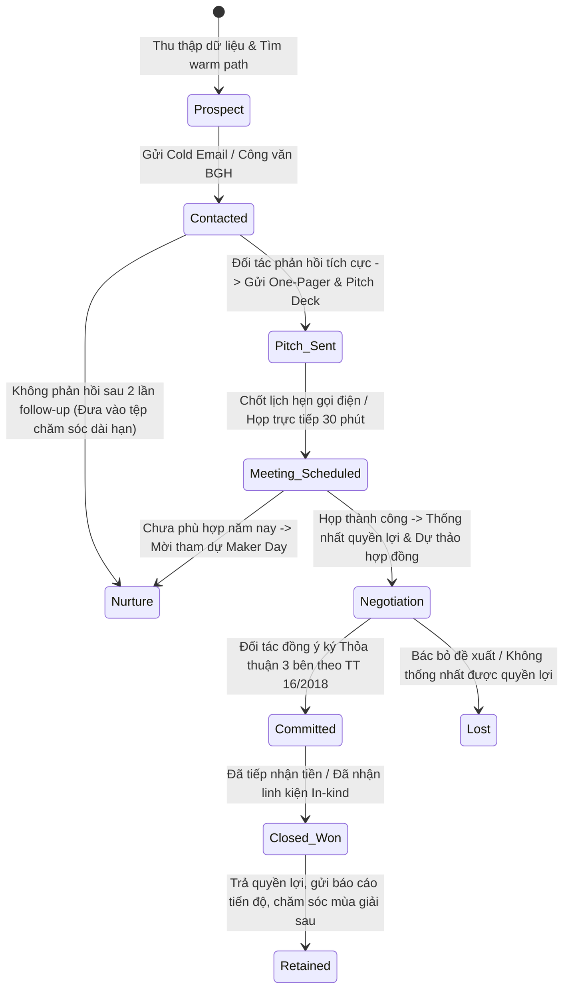

# 11 — Hệ Thống Quản Lý Tiếp Cận Nhà Tài Trợ & Pipeline Mục Tiêu (CRM & Pipeline)

Tài liệu này xác lập cấu trúc dữ liệu quản lý quan hệ nhà tài trợ (CRM Schema), quy chuẩn 8 trạng thái đường ống tiếp cận (Sales Pipeline), danh mục chi tiết 53 doanh nghiệp mục tiêu được khảo sát thực tế tại Sóc Sơn và Bắc Hà Nội, cùng đường ống theo dõi các quỹ tài trợ tổ chức (Grants Pipeline) nhằm hỗ trợ hoàn thành mục tiêu tài chính công khai 33.975.000 VNĐ cho chiến dịch "BUILD THE NEXT ROBOT" của CLB Robotics Sóc Sơn (FTC #39256).

---

## 1. Cấu Trúc Dữ Liệu CRM (CRM Schema Specifications)

Hệ thống quản lý được thiết lập trên bảng tính Google Sheets liên kết với Telegram Bot thông báo tự động, bao gồm 12 trường dữ liệu bắt buộc:

| STT | Tên trường dữ liệu | Kiểu dữ liệu | Mô tả & Quy chuẩn giá trị |
|:---:|---|:---:|---|
| 1 | `prospect_id` | Text (Mã) | Mã định danh duy nhất: `CORP-01` đến `CORP-53` hoặc `GRANT-01` đến `GRANT-05`. |
| 2 | `company_name` | Text | Tên pháp nhân đầy đủ của doanh nghiệp / tổ chức. |
| 3 | `industry` | Text | Ngành nghề: Cơ khí chính xác, Hàng không, Điện tử, Ngân hàng, v.v. |
| 4 | `zone_cluster` | Dropdown | Cụm địa bàn: KCN Nội Bài / Cụm Hàng Không / KCN Quang Minh / KCN Thăng Long / Ngân hàng Sóc Sơn / FDI lân cận. |
| 5 | `website_url` | URL | Địa chỉ website chính thức hoặc hồ sơ cổng thông tin doanh nghiệp. |
| 6 | `contact_channel` | Text | Email, số điện thoại văn phòng, phòng ban phụ trách (PR, HR, CSR, Công đoàn). |
| 7 | `warm_path` | Text | Kênh kết nối ấm: Cựu học sinh, Phụ huynh làm việc tại xưởng, BGH giới thiệu, Công văn trường. |
| 8 | `proposed_tier` | Dropdown | Gói đề xuất: Đồng Hành (3M) / Bạc (5M) / Vàng (10M) / Kim Cương (25M) / In-kind. |
| 9 | `specific_ask` | Text | Số tiền cho 11 món và dự phòng, hoặc hiện vật đúng danh mục mục 2.2 của 04. |
| 10 | `pipeline_status` | Dropdown | 1 trong 8 trạng thái chu chuyển trong phễu. |
| 11 | `owner` | Dropdown | Thành viên phụ trách chính: `-> 14`. |
| 12 | `next_action_date` | Date | Ngày ấn định thực hiện bước tiếp theo (gọi lại, gửi mẫu, đi họp). |

---

## 2. Máy Trạng Thái CRM & Quy Trình Chuyển Đổi (Pipeline Lifecycle)

### Định Nghĩa 8 Trạng Thái Pipeline:
1. **Prospect (Tiềm năng):** Đã xác định thông tin doanh nghiệp, lý do phù hợp và kênh tiếp cận ấm, chưa liên hệ.
2. **Contacted (Đã liên hệ):** Đã gửi thư ngỏ ban đầu hoặc gọi điện tiếp cận bàn nhân sự/công đoàn.
3. **Pitch Sent (Đã gửi hồ sơ):** Doanh nghiệp quan tâm, đã chuyển One-Pager song ngữ và bộ Pitch Deck 5 slide.
4. **Meeting Scheduled (Đã xếp lịch họp):** Đã ấn định lịch hẹn họp trực tiếp tại văn phòng doanh nghiệp hoặc gọi Zoom.
5. **Negotiation (Đang thương thảo):** Đang thống nhất mức tài trợ, vị trí đặt logo, danh mục In-kind và điều khoản biên bản.
6. **Committed (Đã cam kết):** Doanh nghiệp xác nhận tài trợ chính thức bằng văn bản/email, chờ làm thủ tục chuyển khoản hoặc giao linh kiện.
7. **Closed Won (Thành công):** Kinh phí đã được tiếp nhận, hoặc hiện vật đã được bàn giao nghiệm thu tại lab.
8. **Nurture / Closed Lost (Chăm sóc / Tạm dừng):** Từ chối tài trợ mùa giải hiện tại; lưu thông tin để gửi thư mời tham quan Maker Day và tiếp cận lại vào mùa giải sau.

---

## 3. Danh Mục 53 Doanh Nghiệp Mục Tiêu Tại Sóc Sơn & Bắc Hà Nội

Căn cứ dữ liệu nghiên cứu thị trường R5, 53 doanh nghiệp được lập danh mục theo 6 nhóm chiến lược:

### Nhóm 1: Doanh Nghiệp KCN Nội Bài (Đóng ngay tại Huyện Sóc Sơn — 15 Doanh Nghiệp)

| STT | Tên Doanh Nghiệp | Lĩnh Vực | Website / URL | Gói Đề Xuất | Yêu Cầu Cụ Thể (Ask) | Kênh Tiếp Cận Ấm (Warm Path) | Trạng Thái Ban Đầu | Phụ Trách |
|:---:|---|---|---|:---:|---|---|:---:|:---:|
| 1 | **Công ty TNHH Yamaha Motor Việt Nam** | Chế tạo xe máy & động cơ | [yamaha-motor.com.vn](https://yamaha-motor.com.vn/) | **Kim Cương (25M)** | 25.000.000 VNĐ hoặc bộ Wera/Wowstick đúng BOM | Cựu HS & Phụ huynh làm việc tại nhà máy; gửi qua Công đoàn cơ sở | Prospect | `-> 14` |
| 2 | **Công ty TNHH Asahi Denso Việt Nam** | Cơ điện tử, công tắc ô tô xe máy | [nbiz.com.vn/asahi-denso](https://nbiz.com.vn/products/cong-ty-tnhh-ashahi-deno-viet-nam) | **Vàng (10M)** | 10.000.000 VNĐ cho linh kiện trong mục 2.2 của 04 | Nhân viên địa phương Sóc Sơn; thư ngỏ nhấn mạnh chủ đề mechatronics | Prospect | `-> 14` |
| 3 | **Công ty TNHH Nippo Mechatronics Việt Nam** | Cơ điện tử, linh kiện nhựa chính xác | [nippo-c.co.jp](http://www.nippo-c.co.jp/) | **Vàng (10M)** | 10.000.000 VNĐ cho linh kiện trong mục 2.2 của 04 | Bài toán đào tạo học sinh THPT Sóc Sơn thành kỹ sư cơ điện tử tương lai | Prospect | `-> 14` |
| 4 | **Công ty TNHH Công Nghiệp Spindex Hà Nội** | Gia công cơ khí chính xác, tiện CNC | [spindex.com](http://www.spindex.com/) | **Bạc (5M)** | 5.000.000 VNĐ cho linh kiện trong mục 2.2 của 04 | Gửi trực tiếp bản vẽ CAD/STEP cho phòng kỹ thuật xưởng | Prospect | `-> 14` |
| 5 | **Công ty TNHH Tamron Optical (Việt Nam)** | Quang học, ống kính & camera | [tamron.com](https://www.tamron.com/) | **Vàng (10M)** | 10.000.000 VNĐ hoặc Webcam Logitech C920 đúng BOM | Gắn kết với bài toán Autonomous Vision nhận diện target mùa BIOBUZZ | Prospect | `-> 14` |
| 6 | **Công ty TNHH Honest Việt Nam** | Động cơ vi sai, micro motor, cuộn cảm | [nbiz.com.vn/honest](https://nbiz.com.vn/products/cong-ty-tnhh-honest-viet-nam) | **Bạc (5M)** | 5.000.000 VNĐ tài trợ riêng cho Mission 3 (Động cơ) | Giới thiệu mô hình robot FTC sử dụng động cơ DC planetary | Prospect | `-> 14` |
| 7 | **Công ty TNHH Fukoku Việt Nam** | Cao su kỹ thuật, giảm chấn | [fukoku-rubber.co.jp](https://www.fukoku-rubber.co.jp/) | **Đồng Hành (3M)** | 3.000.000 VNĐ cho linh kiện trong mục 2.2 của 04 | Kết nối qua Công đoàn KCN Nội Bài; phụ huynh là công nhân viên Fukoku | Prospect | `-> 14` |
| 8 | **Công ty TNHH Việt Nam Nippon Steel Pipe** | Ống thép kết cấu công nghiệp | [nipponsteel.com](https://www.nipponsteel.com/) | **Vàng (10M)** | 10.000.000 VNĐ (Build Partner) | Đề xuất dự án nâng cao năng lực ứng dụng vật liệu kỹ thuật trường học | Prospect | `-> 14` |
| 9 | **Công ty TNHH Toyoda Giken Việt Nam** | Dập vuốt kim khí chính xác | [nbiz.com.vn/toyoda-giken](https://nbiz.com.vn/products/cong-ty-tnhh-toyoda-giken-viet-nam) | **Bạc (5M)** | 5.000.000 VNĐ cho linh kiện trong mục 2.2 của 04 | Tiếp cận trực tiếp bộ phận HR tại cổng KCN Nội Bài | Prospect | `-> 14` |
| 10 | **Công ty TNHH Mitsui Kinzoku Việt Nam** | Cơ cấu khóa cơ khí chính xác ô tô | [mitsui-kinzoku.co.jp](https://www.mitsui-kinzoku.co.jp/) | **Vàng (10M)** | 10.000.000 VNĐ tài trợ cho Mission 2 (Ray trượt) | Kết nối qua Hội Doanh nghiệp Nhật Bản (JCCI) hoặc bộ phận tuyển dụng | Prospect | `-> 14` |
| 11 | **Công ty TNHH Tenma (Hà Nội) Việt Nam** | Ép đúc nhựa kỹ thuật cao | [tenmacorp.co.jp](https://www.tenmacorp.co.jp/) | **Bạc (5M)** | 5.000.000 VNĐ cho linh kiện trong mục 2.2 của 04 | Cựu học sinh THPT Sóc Sơn phụ trách kỹ thuật vận hành máy ép | Prospect | `-> 14` |
| 12 | **Công ty TNHH Iki Cast Việt Nam** | Đúc kim loại áp lực cao, hợp kim nhôm | [nbiz.com.vn/iki-cast](https://nbiz.com.vn/products/cong-ty-tnhh-iki-cast-viet-nam) | **Bạc (5M)** | 5.000.000 VNĐ (Mission Partner) | Thư ngỏ có xác nhận của Ban Giám hiệu THPT Sóc Sơn | Prospect | `-> 14` |
| 13 | **Công ty TNHH 3 Points Aviation Việt Nam** | Bảo dưỡng & cơ khí thiết bị hàng không | [3pointsaviation.com](https://3pointsaviation.com/) | **Vàng (10M)** | 10.000.000 VNĐ cho linh kiện trong mục 2.2 của 04 | Mời kỹ sư trưởng làm Cố vấn danh dự của Robotics Sóc Sơn | Prospect | `-> 14` |
| 14 | **Công ty Cổ phần United Motor Việt Nam** | Sản xuất, lắp ráp xe máy | [nbiz.com.vn/united-motor](https://nbiz.com.vn/products/cong-ty-cp-united-motor-viet-nam) | **Vàng (10M)** | 10.000.000 VNĐ (Build Partner) | Gặp trực tiếp lãnh đạo qua kênh quan hệ chính quyền huyện Sóc Sơn | Prospect | `-> 14` |
| 15 | **Công ty TNHH Phát Triển Nội Bài (NBIZ)** | Quản lý hạ tầng toàn bộ KCN Nội Bài | [nbiz.com.vn](https://nbiz.com.vn/) | **Vàng (10M)** | 10.000.000 VNĐ + Cầu nối giới thiệu tới các doanh nghiệp FDI | Công văn trường THPT Sóc Sơn gửi Ban Giám đốc NBIZ bảo trợ thanh thiếu niên | Prospect | `-> 14` |

---

### Nhóm 2: Cụm Doanh Nghiệp Hàng Không Sân Bay Nội Bài (10 Doanh Nghiệp)

| STT | Tên Doanh Nghiệp | Lĩnh Vực | Website / URL | Gói Đề Xuất | Yêu Cầu Cụ Thể (Ask) | Kênh Tiếp Cận Ấm (Warm Path) | Trạng Thái Ban Đầu | Phụ Trách |
|:---:|---|---|---|:---:|---|---|:---:|:---:|
| 16 | **TCT Cảng Hàng Không VN (ACV) - Cảng HKQT Nội Bài** | Quản lý khai thác cảng hàng không | [vietnamairport.vn/noibaiairport](https://vietnamairport.vn/noibaiairport/) | **Kim Cương (25M)** | 25.000.000 VNĐ (Season Partner) | Đoàn Thanh niên Cảng HKQT Nội Bài ký phối hợp cùng Đoàn trường | Prospect | `-> 14` |
| 17 | **Công ty CP Dịch vụ Hàng hóa Nội Bài (NCTS)** | Xử lý hàng hóa hàng không quốc tế | [ncts.com.vn](https://www.ncts.com.vn/) | **Kim Cương (25M)** | 20.000.000 – 25.000.000 VNĐ | Ban Truyền thông NCTS; nhấn mạnh tài trợ cho trường học nơi đóng trụ sở | Prospect | `-> 14` |
| 18 | **Công ty TNHH MTV Ga Hàng hóa ALS (ALS Cargo)** | Ga hàng hóa hàng không, kho tự động | [als.com.vn](https://als.com.vn/) | **Vàng (10M)** | 10.000.000 VNĐ hoặc In-kind hỗ trợ cước bay linh kiện Mỹ | Đề xuất hợp tác truyền thông gắn với chuỗi cung ứng thông minh của ALS | Prospect | `-> 14` |
| 19 | **Công ty CP Phục vụ Mặt đất Hà Nội (HGS)** | Dịch vụ sân đỗ, thiết bị cơ giới | [hgs.com.vn](https://hgs.com.vn/) | **Vàng (10M)** | 10.000.000 VNĐ (Build Partner) | Đoàn thanh niên HGS có truyền thống thiện nguyện tại địa bàn Sóc Sơn | Prospect | `-> 14` |
| 20 | **Công ty TNHH MTV Kỹ thuật Máy bay (VAECO)** | Bảo dưỡng, sửa chữa tàu bay | [vaeco.com.vn](https://vaeco.com.vn/) | **Vàng (10M)** | 10.000.000 VNĐ cho linh kiện trong mục 2.2 của 04 | Mời đại diện VAECO dự Maker Day; phụ huynh là kỹ sư VAECO | Prospect | `-> 14` |
| 21 | **Công ty CP Dịch vụ HK Sân bay Nội Bài (NASCO)** | Dịch vụ thương mại, xe vận tải | [nasco.com.vn](https://nasco.com.vn/) | **In-kind kỹ thuật** | In-kind dụng cụ, thiết bị kỹ thuật phục vụ BOM | Đổi quyền lợi gắn logo NASCO trên áo đồng phục và video giải đấu | Prospect | `-> 14` |
| 22 | **Công ty TNHH MTV Nhiên liệu Hàng không (Skypec)** | Nhiên liệu bay Jet A-1 | [skypec.com.vn](https://skypec.com.vn/) | **Vàng (10M)** | 10.000.000 – 15.000.000 VNĐ | Thư ngỏ gửi Ban Nữ công / Đoàn Thanh niên Skypec ủng hộ tài năng trẻ | Prospect | `-> 14` |
| 23 | **Đoàn bay 919 – Tổng công ty Hàng không Việt Nam** | Khai thác bay thương mại | [vietnamairlines.com](https://www.vietnamairlines.com/) | **Kim Cương (25M)** | 20.000.000 – 25.000.000 VNĐ | Kênh chương trình "VNA Cares" đồng hành cùng thế hệ trẻ Việt Nam | Prospect | `-> 14` |
| 24 | **Công ty CP Hàng không Vietjet (Vietjet Air Nội Bài)** | Vận tải hàng không tư nhân | [vietjetair.com](https://www.vietjetair.com/) | **Kim Cương (25M)** | 15.000.000 – 25.000.000 VNĐ | Gửi thư ngỏ tới Ban Truyền thông Vietjet đề xuất đồng hành cùng Gen Z | Prospect | `-> 14` |
| 25 | **Công ty CP Hàng không Tre Việt (Bamboo Airways)** | Vận tải hàng không | [bambooairways.com](https://www.bambooairways.com/) | **Vàng (10M)** | 10.000.000 VNĐ | Bộ phận PR/CSR Bamboo Airways tại văn phòng Nội Bài | Prospect | `-> 14` |

---

### Nhóm 3: Doanh Nghiệp KCN Quang Minh (Mê Linh — Giáp Ranh Sóc Sơn — 10 Doanh Nghiệp)

| STT | Tên Doanh Nghiệp | Lĩnh Vực | Website / URL | Gói Đề Xuất | Yêu Cầu Cụ Thể (Ask) | Kênh Tiếp Cận Ấm (Warm Path) | Trạng Thái Ban Đầu | Phụ Trách |
|:---:|---|---|---|:---:|---|---|:---:|:---:|
| 26 | **Công ty CP Cơ khí chính xác Smart Việt Nam** | Cắt laser CNC Fiber, chấn kim loại tấm | [smartpm.com.vn](https://smartpm.com.vn/) | **In-kind linh kiện BOM** | Linh kiện đúng danh mục mục 2.2 của 04; định giá theo hạng mục thay thế | Mang trực tiếp bản vẽ CAD/DXF đến văn phòng xưởng tại KCN Quang Minh | Prospect | `-> 14` |
| 27 | **Công ty CP HTMP Việt Nam** | Khuôn mẫu chính xác và ép nhựa | [htmp.com.vn](https://htmp.com.vn/) | **Bạc (5M)** | 5.000.000 VNĐ cho linh kiện trong mục 2.2 của 04 | Giới thiệu dự án robot trường huyện công lập, đề nghị bảo trợ tay nghề | Prospect | `-> 14` |
| 28 | **Công ty CP Cơ khí chính xác Hưng Phát** | Gia công phay tiện CNC, đồ gá jig | [idpvn.com/hung-phat](https://idpvn.com/cong-ty/cong-ty-co-phan-co-khi-chinh-xac-hung-phat/) | **In-kind linh kiện BOM** | Linh kiện đúng danh mục mục 2.2 của 04; định giá theo hạng mục thay thế | Gặp trực tiếp quản đốc phân xưởng tại Lô 29B KCN Quang Minh | Prospect | `-> 14` |
| 29 | **Công ty TNHH Cơ khí chính xác Hanotech** | Cơ khí chính xác & nhiệt luyện | [hanotech.com.vn](https://hanotech.com.vn/) | **Đồng Hành (3M)** | 3.000.000 VNĐ cho linh kiện trong mục 2.2 của 04 | Mời học sinh tham quan xưởng nhiệt luyện phục vụ trải nghiệm công nghệ | Prospect | `-> 14` |
| 30 | **Công ty CP Thông minh MK (MK Smart - MK Group)** | Thẻ chip thông minh, thiết bị IoT | [mksmart.com.vn](https://mksmart.com.vn/) | **Kim Cương (25M)** | 15.000.000 – 25.000.000 VNĐ tài trợ cho Mission 1 (Bộ não) | Tiếp cận qua Ban Nhân sự / R&D của MK Group tại Lô 40 KCN Quang Minh | Prospect | `-> 14` |
| 31 | **Công ty CP Eurowindow** | Cửa nhôm, vách kính kỹ thuật cao | [eurowindow.biz](https://eurowindow.biz/) | **Vàng (10M)** | 10.000.000 – 15.000.000 VNĐ (Build Partner) | Đề xuất tài trợ CSR qua Quỹ Vì Trẻ Thơ hoặc phòng Thương hiệu Eurowindow | Prospect | `-> 14` |
| 32 | **Công ty TNHH Muto Hà Nội (Muto Technology)** | Linh kiện khuôn mẫu nhựa chính xác | [muto.co.jp](https://muto.co.jp/) | **Bạc (5M)** | 5.000.000 VNĐ cho linh kiện trong mục 2.2 của 04 | Gửi thư ngỏ song ngữ Nhật - Việt tới Ban Giám đốc Muto Hà Nội | Prospect | `-> 14` |
| 33 | **Công ty TNHH Channel Well Technology VN (CWT)** | Nguồn điện công nghiệp, adapter | [cwt.com.tw](https://www.cwt.com.tw/) | **In-kind linh kiện BOM** | Pin REV Slim NiMH đúng danh mục mục 2.2 của 04 | Tiếp cận qua phòng kiểm định an toàn điện / phần cứng | Prospect | `-> 14` |
| 34 | **Công ty TNHH Chế tạo Động cơ Zongshen VN** | Động cơ đốt trong, mô tơ công nghiệp | [zongshenmotor.vn](https://zongshenmotor.vn/) | **In-kind dụng cụ BOM** | Bộ Wera hoặc Wowstick đúng danh mục mục 2.2 của 04 | Gặp trực tiếp bộ phận đối ngoại tại KCN Quang Minh | Prospect | `-> 14` |
| 35 | **Công ty TNHH Daiichi Kinzoku Việt Nam** | Dập kim loại tấm kỹ thuật Nhật Bản | [idpvn.com/daiichi](https://idpvn.com/cong-ty/cong-ty-tnhh-daiichi-kinzoku-viet-nam/) | **Bạc (5M)** | 5.000.000 VNĐ cho linh kiện trong mục 2.2 của 04 | Gửi portfolio thành tích Á quân Motions In Fire và thư BGH | Prospect | `-> 14` |

---

### Nhóm 4: Doanh Nghiệp KCN Thăng Long & Bắc Hà Nội (8 Doanh Nghiệp)

| STT | Tên Doanh Nghiệp | Lĩnh Vực | Website / URL | Gói Đề Xuất | Yêu Cầu Cụ Thể (Ask) | Kênh Tiếp Cận Ấm (Warm Path) | Trạng Thái Ban Đầu | Phụ Trách |
|:---:|---|---|---|:---:|---|---|:---:|:---:|
| 36 | **Công ty TNHH Canon Việt Nam** | Máy in, thiết bị quang học chính xác | [canon.com.vn](https://canon.com.vn/) | **Kim Cương (25M)** | 25.000.000 VNĐ cho linh kiện trong mục 2.2 của 04 | Học bổng CSR "Canon Chắp cánh ước mơ", kết nối qua cựu HS trường | Prospect | `-> 14` |
| 37 | **Công ty TNHH Panasonic Việt Nam** | Điện tử, pin, tự động hóa | [panasonic.com/vn](https://panasonic.com/vn/corporate/sustainability.html) | **Kim Cương (25M)** | 25.000.000 VNĐ cho linh kiện trong mục 2.2 của 04 | Phòng Trách nhiệm Xã hội Tập đoàn Panasonic Việt Nam tại Đông Anh | Prospect | `-> 14` |
| 38 | **Công ty TNHH Denso Việt Nam (DMVN)** | Tự động hóa, cánh tay robot công nghiệp | [denso.com/vn](https://www.denso.com/vn/) | **Kim Cương (25M)** | 25.000.000 VNĐ cho linh kiện trong mục 2.2 của 04 | Trung tâm Đào tạo Kỹ thuật Denso tại Đông Anh (đơn vị huấn luyện tay nghề) | Prospect | `-> 14` |
| 39 | **Công ty TNHH Sumitomo Bakelite Việt Nam** | Vật liệu bán dẫn, bảng mạch vi điện tử | [sumibe.co.jp](https://www.sumibe.co.jp/) | **Vàng (10M)** | 10.000.000 VNĐ (Build Partner) | Phòng Nhân sự / Đối ngoại của Sumitomo Bakelite KCN Thăng Long | Prospect | `-> 14` |
| 40 | **Công ty TNHH TOTO Việt Nam** | Thiết bị vệ sinh, công nghệ vật liệu | [vn.toto.com](https://vn.toto.com/ve-toto/trach-nhiem-xa-hoi) | **Vàng (10M)** | 10.000.000 – 15.000.000 VNĐ | Nộp hồ sơ xét duyệt tài trợ hoạt động ngoại khóa qua Quỹ Khuyến học TOTO | Prospect | `-> 14` |
| 41 | **Công ty TNHH Phụ tùng Showa VN (Hitachi)** | Giảm xóc, hệ thống lái ô tô xe máy | [hitachiastemo.com](https://www.hitachiastemo.com/) | **Vàng (10M)** | 10.000.000 VNĐ | Kết nối qua các kỹ sư cựu học sinh THPT Sóc Sơn | Prospect | `-> 14` |
| 42 | **Công ty TNHH Enkei Việt Nam** | Đúc và gia công mâm nhôm hợp kim ô tô | [enkei.com](http://www.enkei.com/) | **Bạc (5M)** | 5.000.000 – 10.000.000 VNĐ | Gửi thư ngỏ giới thiệu robot di chuyển bánh xe đa hướng Mecanum | Prospect | `-> 14` |
| 43 | **Công ty TNHH Meme 3D** | Thiết bị in 3D công nghiệp & giải pháp FDM | [meme3d.com](https://meme3d.com) | **In-kind linh kiện BOM** | Linh kiện đúng danh mục mục 2.2 của 04; không vận động máy in hay vật tư in 3D | Tiền lệ Meme 3D tài trợ 02 máy Bambu Lab A1 cho đội FTC 26749 aDudu | Prospect | `-> 14` |

---

### Nhóm 5: Tập Đoàn Công Nghệ Lân Cận (Bắc Ninh & Thái Nguyên — 3 Tập Đoàn)

| STT | Tên Doanh Nghiệp | Lĩnh Vực | Website / URL | Gói Đề Xuất | Yêu Cầu Cụ Thể (Ask) | Kênh Tiếp Cận Ấm (Warm Path) | Trạng Thái Ban Đầu | Phụ Trách |
|:---:|---|---|---|:---:|---|---|:---:|:---:|
| 44 | **Samsung Electronics VN (SEV Yên Phong)** | Smartphone, thiết bị thông minh | [samsung.com/vn](https://www.samsung.com/vn/aboutsamsung/sustainability/corporate-citizenship/) | **Kim Cương (25M)** | 25.000.000 VNĐ hoặc hỗ trợ hiện vật phù hợp | Nộp ý tưởng Solve for Tomorrow; liên hệ qua cựu HS làm việc tại KCN Yên Phong | Prospect | `-> 14` |
| 45 | **Samsung Electronics VN Thái Nguyên (SEVT)** | Bảng mạch, điện tử bán dẫn | [samsung.com/vn](https://www.samsung.com/vn/) | **Kim Cương (25M)** | 20.000.000 – 25.000.000 VNĐ | Bộ phận CSR SEVT Phổ Yên (địa bàn giáp ranh phía bắc Sóc Sơn qua QL3) | Prospect | `-> 14` |
| 46 | **Tập đoàn Foxconn Việt Nam (Quang Châu / Kế Sơn)** | Bản mạch vi điện tử, cơ khí chính xác | [foxconn.com.vn](https://foxconn.com.vn) | **Kim Cương (25M)** | 15.000.000 – 25.000.000 VNĐ | Đề xuất qua chương trình liên kết đào tạo hướng nghiệp kỹ thuật Foxconn | Prospect | `-> 14` |

---

### Nhóm 6: Chi Nhánh Ngân Hàng Thương Mại Tại Huyện Sóc Sơn (7 Chi Nhánh)

| STT | Tên Doanh Nghiệp | Lĩnh Vực | Website / URL | Gói Đề Xuất | Yêu Cầu Cụ Thể (Ask) | Kênh Tiếp Cận Ấm (Warm Path) | Trạng Thái Ban Đầu | Phụ Trách |
|:---:|---|---|---|:---:|---|---|:---:|:---:|
| 47 | **BIDV – Chi nhánh Sóc Sơn** | Ngân hàng TMCP nhà nước | [bidv.com.vn](https://bidv.com.vn/) | **Kim Cương (25M)** | 15.000.000 – 25.000.000 VNĐ | Tiền lệ BIDV tài trợ đội FTC ThunderClaw; trường THPT Sóc Sơn trả lương qua BIDV | Prospect | `-> 14` |
| 48 | **Vietcombank – Chi nhánh Sóc Sơn** | Ngân hàng số & doanh nghiệp | [vietcombank.com.vn](https://vietcombank.com.vn/) | **Vàng (10M)** | 15.000.000 VNĐ (Build Partner) | Thư ngỏ từ Hiệu trưởng THPT Sóc Sơn gửi Ban Giám đốc Vietcombank Sóc Sơn | Prospect | `-> 14` |
| 49 | **Agribank – Chi nhánh Huyện Sóc Sơn** | Ngân hàng nông nghiệp & địa phương | [agribank.com.vn](https://agribank.com.vn/) | **Vàng (10M)** | 10.000.000 VNĐ | Hội Khuyến học huyện Sóc Sơn và Công đoàn ngành Giáo dục huyện | Prospect | `-> 14` |
| 50 | **VietinBank – PGD Sóc Sơn (CN Đông Anh)** | Ngân hàng công thương | [vietinbank.vn](https://vietinbank.vn/) | **Vàng (10M)** | 10.000.000 VNĐ | Quỹ An sinh xã hội VietinBank ưu tiên tài trợ phòng máy tính, phòng STEM | Prospect | `-> 14` |
| 51 | **MB Bank – PGD Sóc Sơn** | Ngân hàng số quân đội | [mbbank.com.vn](https://mbbank.com.vn/) | **Vàng (10M)** | 10.000.000 VNĐ | Đề xuất hoạt động hỗ trợ STEM/CSR tại địa bàn Sóc Sơn | Prospect | `-> 14` |
| 52 | **Techcombank – PGD Sóc Sơn** | Ngân hàng TMCP tư nhân | [techcombank.com](https://techcombank.com/) | **Vàng (10M)** | 10.000.000 VNĐ | Phụ huynh học sinh có tài khoản Priority / Doanh nghiệp tại Techcombank | Prospect | `-> 14` |
| 53 | **LPBank – Chi nhánh Sóc Sơn** | Ngân hàng bưu điện | [lpbank.com.vn](https://lpbank.com.vn/) | **Bạc (5M)** | 5.000.000 – 10.000.000 VNĐ | Đề xuất qua kênh khuyến học truyền thống của Tập đoàn Him Lam / LPBank | Prospect | `-> 14` |

---

## 4. Đường Ống Theo Dõi Các Quỹ Tài Trợ Quốc Tế & Nhà Nước (Grants Pipeline)

| Mã Quỹ | Tên Tổ Chức Tài Trợ | Giá Trị Tài Trợ | Hạn Nộp Hồ Sơ | Yêu Cầu Cốt Lõi | Góc Tiếp Cận Hồ Sơ (Pitching Angle) | Trạng Thái Pipeline | Phụ Trách |
|:---:|---|:---:|:---:|---|---|:---:|:---:|
| `GRANT-01` | **Gene Haas Foundation Grant** (Mỹ) | **2.000 USD** (~50.9M VNĐ) | **01/05 hàng năm** (Chuẩn bị hồ sơ từ T1/2027) | Đội thi FTC có ứng dụng gia công cơ khí chính xác, máy CNC tiện phay. | Báo cáo ứng dụng gia công chi tiết kim loại robot tại các xưởng KCN Nội Bài; đào tạo kỹ sư tương lai. | Chuẩn bị hồ sơ | `-> 14` |
| `GRANT-02` | **U.S. Embassy Hanoi PAS Small Grants** | **5.000 – 35.000 USD** (~127M – 890M VNĐ) | Mở định kỳ theo quý qua Grants.gov | Thúc đẩy bình đẳng giáo dục STEM, hỗ trợ thanh thiếu niên vùng ven tiếp cận chuẩn Mỹ. | Dự án: "Phổ cập Robotics chuẩn FIRST cho học sinh ngoại thành Hà Nội qua mô hình Maker Day". | Hoàn thiện Concept | `-> 14` |
| `GRANT-03` | **Quỹ Khuyến Học & Huyện Đoàn Sóc Sơn** | **2.000.000 – 10.000.000 VNĐ** | **15/11/2026 – 30/11/2026** | Khen thưởng tài năng trẻ sáng tạo kỹ thuật và hỗ trợ kinh phí thi đấu cấp quốc gia. | Công văn BGH THPT Sóc Sơn báo cáo thành tích Á quân Motions In Fire. | Đã gửi công văn | `-> 14` |
| `GRANT-04` | **FIRST STEM Equity Community Grant** | **1.000 – 5.000 USD** | Tháng 8 – Tháng 10 hàng năm | Hỗ trợ các đội tuyển mới và đội tuyển thuộc khu vực khó khăn thiếu thốn thiết bị. | Đội tuyển trường huyện vượt khó, tự lực cánh sinh chế tạo robot theo tinh thần FIRST. | Theo dõi mùa 2027 | `-> 14` |
| `GRANT-05` | **Chương Trình CSR Boeing Vietnam** | **3.000 – 10.000 USD** | Định kỳ Q1 hàng năm | Đào tạo nguồn nhân lực hàng không & STEM cho thế hệ trẻ Việt Nam. | Gắn kết vị trí gần Sân bay Nội Bài và ước mơ trở thành kỹ sư hàng không của học sinh Sóc Sơn. | Đang tiếp cận | `-> 14` |

---

## 5. Quy Trình Vận Hành & Báo Cáo Hàng Tuần Của Ban Đối Ngoại

1. **Họp giao ban định kỳ (Thứ Hai 17:00 hàng tuần):** Đánh giá tỷ lệ chuyển đổi trên phễu CRM và phân bổ chỉ tiêu gọi điện/gửi thư ngỏ mới.
2. **Cập nhật dữ liệu thời gian thực:** Mọi tương tác phải được thành viên phụ trách ghi nhật ký vào CRM trong vòng **2 giờ** kể từ khi phát sinh.
3. **Quy tắc leo thang:** Nếu doanh nghiệp đề xuất gói từ 10.000.000 VNĐ trở lên hoặc yêu cầu ký Thỏa thuận 3 bên, thành viên phụ trách báo cáo Trưởng ban Đối ngoại và Giáo viên cố vấn.

---

## Nguồn Tham Chiếu
- `docs/campaign-2026-2027/research/R1-season-team.md` (Thông tin đội FTC #39256, trường THPT Sóc Sơn, thành tích giải đấu).
- `docs/campaign-2026-2027/research/R4-legal-payment.md` (Thủ tục thỏa thuận tài trợ 3 bên, tiếp nhận tài trợ theo TT 16/2018).
- `docs/campaign-2026-2027/research/R5-sponsors-benchmarks.md` (Danh mục doanh nghiệp mục tiêu và tiêu chí các quỹ).
- `docs/campaign-2026-2027/04-ngan-sach-delta.md` (Ngân sách 11 linh kiện + dự phòng: 33.975.000 VNĐ).
- `docs/campaign-2026-2027/14-phan-cong-nhan-su.md` (Danh sách vai trò và phụ trách từng CRM wave).
