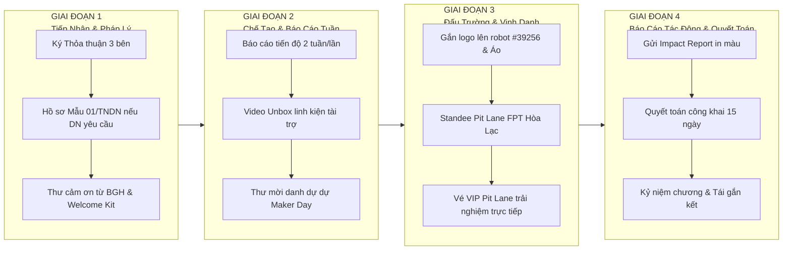
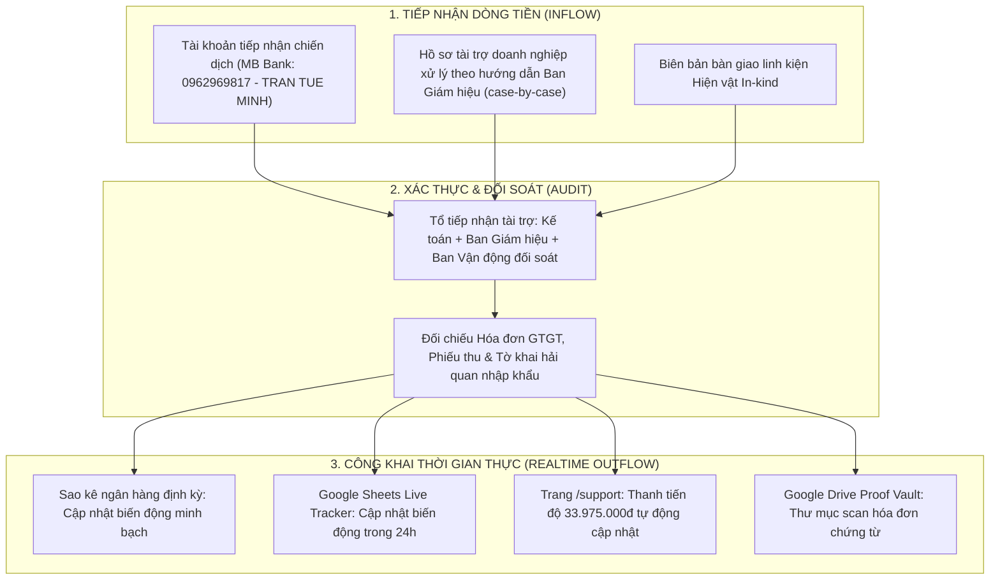
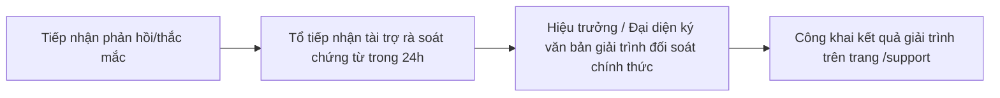

# 12 — Cơ Chế Minh Bạch Tài Chính, Hành Trình Đối Tác & Khung Báo Cáo Tác Động

Tài liệu quy định toàn bộ tiêu chuẩn minh bạch tài chính, quy trình đồng hành cùng đối tác (Sponsor Journey), kiến trúc sổ cái thu chi công khai (Public Ledger) và biểu mẫu chuẩn của Báo cáo tác động (Impact Report) cho chiến dịch "BUILD THE NEXT ROBOT" của CLB Robotics Sóc Sơn (FTC #39256). Mục tiêu cốt lõi là bảo đảm mọi đồng tài trợ đều được giải trình có trách nhiệm, biến trách nhiệm giải trình thành tài sản uy tín dài hạn của nhà trường và câu lạc bộ.

---

## 1. Hành Trình Đồng Hành Của Nhà Tài Trợ (Sponsor Journey)

Chúng tôi không xem mối quan hệ tài trợ là giao dịch một chiều "xin - cho", mà thiết kế một hành trình trải nghiệm chuyên nghiệp qua 4 giai đoạn rõ ràng:

### Bảng cam kết tiếp xúc đối tác theo từng giai đoạn:

| Giai đoạn | Thời điểm thực hiện | Hành động cụ thể của Đội tuyển & Nhà trường | Ấn phẩm / Sản phẩm bàn giao cho Đối tác |
|---|---|---|---|
| **Giai đoạn 1: Onboarding & Pháp lý** | Trong 48h sau khi nhận chuyển khoản | - Gửi thư điện tử xác nhận tài trợ chính thức. - Ký Thỏa thuận 3 bên (nếu doanh nghiệp yêu cầu). - Phối hợp kế toán trường phát hành Biên bản Mẫu 01/TNDN (cho DN chuyển qua trường). | - Bản scan & bản gốc Mẫu 01/TNDN có dấu đỏ. - Thư cảm ơn chính thức từ Hiệu trưởng. - Welcome Kit số (ảnh đại diện đối tác, banner đồng hành). |
| **Giai đoạn 2: Chế tạo & Cập nhật tiến độ** | Định kỳ 14 ngày/lần (15/11 – 15/01) | - Gửi email Bản tin Kỹ thuật (Technical Newsletter). - Đăng tải video unbox linh kiện kèm tag thương hiệu. - Mời đại diện doanh nghiệp tham dự ngày hội Maker Day. | - Video thực tế cụm cơ cấu có gắn linh kiện tài trợ. - Thư mời tham quan phòng Lab STEM tại THPT Sóc Sơn. - 02 vé VIP tham dự Maker Day "Can You Beat the Robot?". |
| **Giai đoạn 3: Giải đấu & Tỏa sáng** | Tuần thi đấu VNCMP (Cuối T1 – T2/2027 `[ƯỚC TÍNH]`) | - Hoàn thiện dán decal logo chuẩn FIRST lên thân robot. - Bố trí standee và ấn phẩm nhận diện tại Pit Lane Hòa Lạc. - Đón tiếp đại diện đối tác đến thăm gian pit. | - Ảnh chụp độ phân giải cao của robot thi đấu trên sân. - Thẻ VIP Pit Pass tham quan hậu trường giải đấu. - Livestream trận đấu có tag tên thương hiệu đối tác. |
| **Giai đoạn 4: Hậu mùa giải & Tác động** | Trong vòng 20 ngày sau khi bế mạc giải | - Tổ chức lễ tổng kết mùa giải tại Trường THPT Sóc Sơn. - Trao kỷ niệm chương tri ân đối tác. - Bàn giao Báo cáo tác động và Quyết toán tài chính. | - **Cuốn Báo cáo Tác động (Impact Report)** in màu trang trọng. - Kỷ niệm chương chế tác từ nhôm CNC và mica cao cấp. - Giấy chứng nhận đồng hành giáo dục STEM từ nhà trường. |

---

## 2. Kiến Trúc Sổ Cái Thu Chi Công Khai (Public Ledger)

Nhằm xóa bỏ hoàn toàn nghi ngại về việc quản lý tài chính học sinh, chiến dịch thiết lập cơ chế **Sổ cái tài chính đa tầng (Multi-tier Transparency Architecture)**:

### 2.1. Cấu trúc trường dữ liệu của Bảng theo dõi công khai (Live Public Tracker)
Bảng tính Google Sheets được nhúng công khai (chế độ View Only) trên website `/support` với các cột chuẩn hóa:

| Cột (Field) | Định dạng (Format) | Quy chuẩn hiển thị & Bảo mật (Nghị định 13/2023/NĐ-CP) |
|---|---|---|
| **Ngày ghi nhận** | `DD/MM/YYYY` | Ngày ngân hàng báo Có hoặc ngày ký biên bản giao nhận hiện vật |
| **Mã chứng từ / Hash** | `String` | 4 chữ số cuối mã giao dịch ngân hàng hoặc số phiếu thu/biên bản |
| **Bên tài trợ** | `String` | Tên Doanh nghiệp HOẶC Họ tên cá nhân đã che (Ví dụ: `Nguyễn V** A`) |
| **Kênh tiếp nhận** | `Dropdown` | `TK Tiếp nhận MB Bank (0962969817)` / `Hiện vật In-kind`; hồ sơ thuế doanh nghiệp xử lý qua trường theo từng trường hợp |
| **Hạng mục chỉ định** | `Dropdown` | Gói tài trợ (Đồng hành/Bạc/Vàng/Kim cương) hoặc Mission (M1/M2/M3/M4/M5) / Chung |
| **Số tiền / Định giá** | `Number (VND)` | Số tiền thực nhận ghi có (hoặc giá trị định giá hiện vật theo BOM) |
| **Hạng mục chi xuất** | `String` | Chi tiết nội dung chi (Ví dụ: Mua REV Control Hub, Cước vận chuyển Mỹ) |
| **Trạng thái giải ngân** | `Badge` | `Đã tiếp nhận` / `Đã giải ngân Đợt 1` / `Đã giải ngân Đợt 2` / `Đã nghiệm thu lưu kho` |
| **Bằng chứng hóa đơn** | `Hyperlink` | Liên kết đến file scan Hóa đơn GTGT / UNC ngân hàng (đã che STK) |

### 2.2. Quy chế bảo đảm dữ liệu minh bạch
- **Cập nhật trong 24 giờ:** Mọi giao dịch phát sinh (tiền vào hoặc thanh toán đơn hàng linh kiện) phải được kế toán CLB cập nhật vào bảng tính công khai trong vòng không quá 24 giờ kể từ thời điểm phát sinh.
- **Thư mục chứng từ mở (Proof Vault):** Toàn bộ hóa đơn mua hàng nội địa (camera C920, dụng cụ Wera/Wowstick), tờ khai hải quan và hóa đơn cước vận chuyển quốc tế từ forwarder Mỹ được số hóa dưới dạng PDF/ảnh scan và lưu trữ tại thư mục Google Drive công khai để bất kỳ ai cũng có thể kiểm chứng.
- **Niêm yết truyền thống:** Kết thúc chiến dịch, bản in sao kê tài chính có xác nhận của Kế toán và Hiệu trưởng được niêm yết tại Bảng tin Trường THPT Sóc Sơn liên tục trong **15 ngày làm việc** theo đúng quy định tại Điều 8 Thông tư 16/2018/TT-BGDĐT.

---

## 3. Khung Báo Cáo Tác Động Mùa Giải Chuẩn (Impact Report Template)

Cuốn Báo cáo Tác động (Impact Report) là sản phẩm chuyển giao quan trọng nhất thể hiện năng lực chuyên nghiệp của CLB Robotics Sóc Sơn. Tài liệu được thiết kế dưới dạng ấn phẩm in ấn khổ A4 ngang, trang bìa cứng, in màu toàn bộ và gửi tới từng đối tác tài trợ sau mùa giải:

```mermaid
graph TD
    subgraph IMPACT_REPORT_STRUCTURE["CẤU TRÚC CUỐN BÁO CÁO TÁC ĐỘNG (16 TRANG)"]
        P1["Trang 1: Trang bìa trang trọng & Logo đối tác"]
        P2["Trang 2-3: Thư cảm ơn từ BGH & Chủ nhiệm CLB"]
        P3["Trang 4-5: Hồ sơ Robot BIOBUZZ #39256 & Thành tích giải đấu"]
        P4["Trang 6-7: Tác động giáo dục học sinh (STEM Impact Metrics)"]
        P5["Trang 8-9: Tác động cộng đồng & Lan tỏa (Maker Day & Outreach)"]
        P6["Trang 10-11: Quyết toán tài chính minh bạch (Financial Audit)"]
        P7["Trang 12-14: Bằng chứng quyền lợi truyền thông (Media & PR Proofs)"]
        P8["Trang 15-16: Thông điệp tương lai & Thư mời đồng hành mùa sau"]
    end
    P1 --> P2 --> P3 --> P4 --> P5 --> P6 --> P7 --> P8
```

### 3.1. Khung nội dung chi tiết từng phần của Báo cáo:

#### Phần I: Lời Mở Đầu & Thư Tri Ân
- Thư cảm ơn chính thức do Hiệu trưởng Trường THPT Sóc Sơn ký tên, đóng dấu mộc đỏ.
- Lời tri ân tâm huyết từ Đội trưởng CLB đại diện cho thế hệ kỹ sư trẻ được hưởng lợi từ nguồn tài trợ.

#### Phần II: Báo Cáo Kết Quả Thi Đấu & Kỹ Thuật (FTC Vietnam Championship 2027)
- **Thống số giải đấu:** Xếp hạng vòng bảng (Rankings), tỷ số các trận đối kháng (Thắng - Thua), điểm số Tự hành cao nhất, điểm số Cuối trận (Endgame).
- **Hạng mục giải thưởng đạt được:** Bản sao chứng nhận các giải thưởng (Giải Kỹ thuật Innovate/Design/Control, hoặc vị trí trong Liên minh Vòng chung kết).
- **Phân tích cơ cấu kỹ thuật thực tế:** Đánh giá hiệu năng hoạt động của cụm ray trượt Viper Slide, cụm nạp phấn hoa và độ ổn định của REV Control Hub trong 2 ngày thi đấu căng thẳng tại FPT Hòa Lạc.

#### Phần III: Số Liệu Đo Lường Tác Động Giáo Dục (Student STEM Metrics)
Báo cáo cung cấp các chỉ số đo lường cụ thể về sự phát triển của học sinh:
- **Tổng số giờ nghiên cứu & thực hành STEM tại Lab:** Đạt `[CẦN ĐIỀN: tổng số giờ thực tế tại Lab]` nghiên cứu ngoài giờ học.
- **Quy mô thành viên thụ hưởng trực tiếp:** `[CẦN ĐIỀN: số lượng thành viên đội tuyển chính thức]` cùng các thành viên CLB học sinh THPT Sóc Sơn.
- **Tỷ lệ nữ sinh tham gia kỹ thuật (Gender Balance):** `[CẦN ĐIỀN: tỷ lệ nữ sinh thực tế trong đội]`.
- **Kỹ năng nghề nghiệp tích lũy:** Rèn luyện kỹ năng thiết kế CAD 3D, lập trình Java trên FIRST Tech Challenge SDK, kỹ năng quản lý dự án và thuyết trình kỹ thuật.

#### Phần IV: Tác Động Lan Tỏa Cộng Đồng (Community Outreach)
- **Ngày hội STEM Maker Day "Can You Beat the Robot?":**
  - Số lượng học sinh tham gia: 40 học sinh THCS và THPT trên địa bàn huyện Sóc Sơn.
  - Tỷ lệ hài lòng của học sinh và phụ huynh: `[CẦN ĐIỀN: Khảo sát sau sự kiện, mục tiêu >= 90%]`.
  - Hoạt động tự chủ, tạo hiệu ứng lan tỏa STEM địa phương.
- **Chiến dịch truyền thông số:** Tổng lượt tiếp cận (Reach), lượt tương tác (Engagement) trên Fanpage và các phóng sự báo chí truyền thông ghi nhận về đội.

#### Phần V: Quyết Toán Tài Chính Minh Bạch (Financial Statement)
Bảng cân đối chi tiết toàn bộ các khoản thực chi của chiến dịch cho 11 linh kiện phần cứng cốt lõi và quỹ dự phòng kỹ thuật (khớp chuẩn hóa với kế hoạch tài chính tại `04-ngan-sach-delta.md`):

| STT | Hạng mục chi phí phần cứng & dự phòng | Dự toán duyệt (VND) | Thực chi quyết toán (VND) | Chênh lệch (VND) | Ghi chú & Chứng từ đối soát |
|:---:|---|---:|---:|---:|---|
| 1 | **REV Control Hub** (SKU REV-31-1595, SL: 1) | 11.716.000 | `[CẦN ĐIỀN: Thực tế]` | `[± ...]` | Hóa đơn REV Robotics Mỹ |
| 2 | **Viper Slide Kit 4-Stage** (SL: 1) | 5.830.000 | `[CẦN ĐIỀN: Thực tế]` | `[± ...]` | Hóa đơn goBILDA |
| 3 | **Pin REV 12V Slim NiMH** (SL: 2) | 4.056.000 | `[CẦN ĐIỀN: Thực tế]` | `[± ...]` | Hóa đơn REV Robotics & cước air cargo |
| 4 | **Động cơ goBILDA 5202 Yellow Jacket 435 RPM** (SL: 2) | 2.745.000 | `[CẦN ĐIỀN: Thực tế]` | `[± ...]` | Hóa đơn goBILDA Mỹ |
| 5 | **Động cơ REV UltraPlanetary HD Hex Motor** (SL: 2) | 3.278.000 | `[CẦN ĐIỀN: Thực tế]` | `[± ...]` | Hóa đơn REV Robotics Mỹ |
| 6 | **Camera Logitech C920 Pro HD** (SL: 1) | 1.850.000 | `[CẦN ĐIỀN: Thực tế]` | `[± ...]` | Hóa đơn đại lý chính hãng VN |
| 7 | **Bộ chìa lục giác Inch & Mét Wera** (SL: 1) | 850.000 | `[CẦN ĐIỀN: Thực tế]` | `[± ...]` | Hóa đơn nhà phân phối Wera VN |
| 8 | **Bộ tua vít điện chính xác Wowstick 1F+** (SL: 1) | 650.000 | `[CẦN ĐIỀN: Thực tế]` | `[± ...]` | Hóa đơn đơn vị cung ứng Hà Nội |
| 9 | **Quỹ dự phòng kỹ thuật & tỷ giá** | 3.000.000 | `[CẦN ĐIỀN: Thực tế]` | `[± ...]` | Nhật ký chi tỷ giá, cước pin/motor, thay thế hỏng hóc |
| | **TỔNG CỘNG QUYẾT TOÁN** | **33.975.000** | `[CẦN ĐIỀN]` | `[± ...]` | **Khớp 100% với Sổ cái công khai** |

*(Ghi chú: Nếu có kết dư ngân sách sau khi mua sắm và giải đấu, toàn bộ số dư sẽ được bảo lưu tại quỹ hoạt động STEM của nhà trường để duy trì phòng Lab cho thế hệ học sinh khóa sau theo đúng Điều 7 Thông tư 16/2018/TT-BGDĐT).*

#### Phần VI: Album Bằng Chứng Thực Thi Quyền Lợi (Proof of Execution)
- Ảnh chụp chi tiết thân robot mang logo nhà tài trợ (chụp cự ly gần và toàn cảnh trên sân thi đấu).
- Ảnh chụp đội tuyển mặc áo đồng phục mang logo đối tác khi nhận giải hoặc phỏng vấn kỹ thuật.
- Ảnh chụp gian hàng Pit Lane, backdrop và standee có logo đối tác tại Trường ĐH FPT Hòa Lạc.
- Ảnh chụp màn hình các bài viết truyền thông, video unbox và các phóng sự báo chí có nhắc tên đối tác.

---

## 4. Quy Trình Tiếp Nhận Khiếu Nại & Xử Lý Khủng Hoảng Minh Bạch

- **Đầu mối tiếp nhận khiếu nại:** Đại diện Ban Giám hiệu Trường THPT Sóc Sơn (Hiệu trưởng / Kế toán trưởng) và Giáo viên phụ trách CLB.
- **Thời hạn giải quyết:** Mọi yêu cầu đối soát số liệu hoặc thắc mắc từ đối tác/cộng đồng được phản hồi bằng văn bản chính thức kèm trích lục sao kê ngân hàng trong vòng **48 giờ làm việc**.
- **Cam kết hoàn tiền:** Trường hợp phát hiện có hành vi tư lợi hoặc chi sai mục đích cam kết mà không được sự đồng thuận của nhà tài trợ, nhà trường cam kết thu hồi và hoàn trả lại 100% số tiền vi phạm cho đối tác.

---

## Nguồn

1. **Bộ Giáo dục và Đào tạo:** *Thông tư số 16/2018/TT-BGDĐT ngày 03/08/2018 (Điều 6: Tiếp nhận tài trợ; Điều 8: Công khai, báo cáo quyết toán tài trợ).* [thuvienphapluat.vn/van-ban/Giao-duc/Thong-tu-16-2018-TT-BGDDT-393562.aspx](https://thuvienphapluat.vn/van-ban/Giao-duc/Thong-tu-16-2018-TT-BGDDT-quy-dinh-ve-tai-tro-cho-co-so-giao-duc-thuoc-he-thong-giao-duc-quoc-dan-393562.aspx)
2. **Bộ Tài chính:** *Thông tư số 20/2026/TT-BTC ngày 12/03/2026 (Điều 3: Chi phí được trừ khi xác định thu nhập chịu thuế TNDN).*
3. **Chính phủ:** *Nghị định số 13/2023/NĐ-CP về bảo vệ dữ liệu cá nhân (Quy chuẩn ẩn danh hóa và che thông tin).*
4. **Báo cáo nghiên cứu cơ sở:**
   - Báo cáo R4: `docs/campaign-2026-2027/research/R4-legal-payment.md`
   - Kế hoạch tài chính: `docs/campaign-2026-2027/04-ngan-sach-delta.md`
   - Biên bản thảo luận: `docs/campaign-2026-2027/99-bien-ban-thao-luan.md`
   - Phân công nhân sự: `docs/campaign-2026-2027/14-phan-cong-nhan-su.md`
