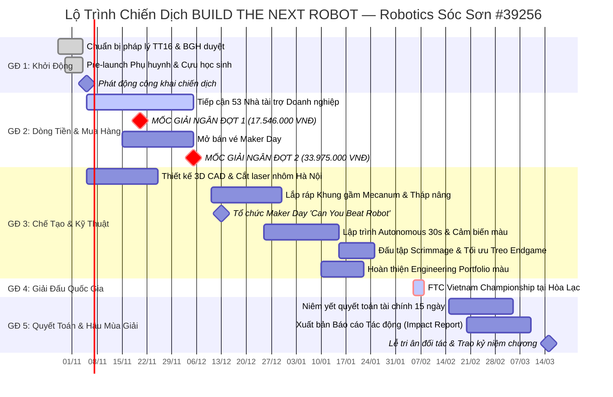
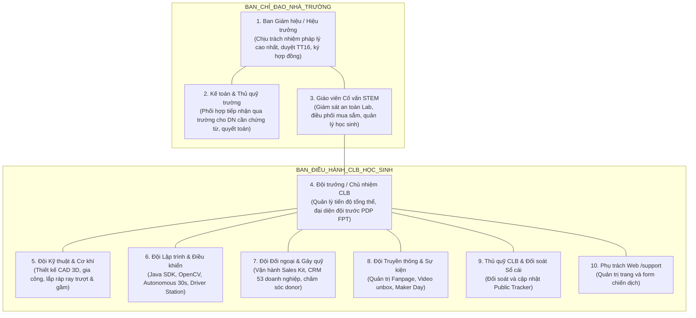
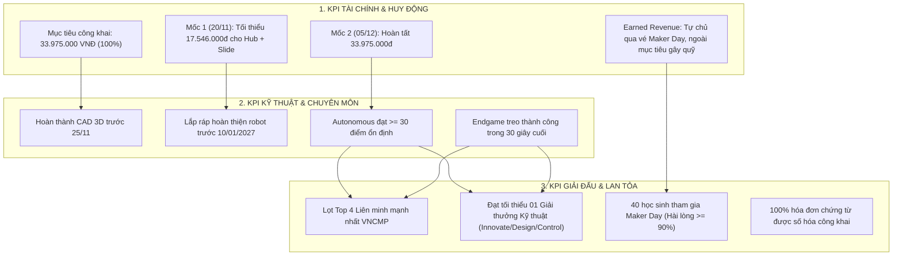
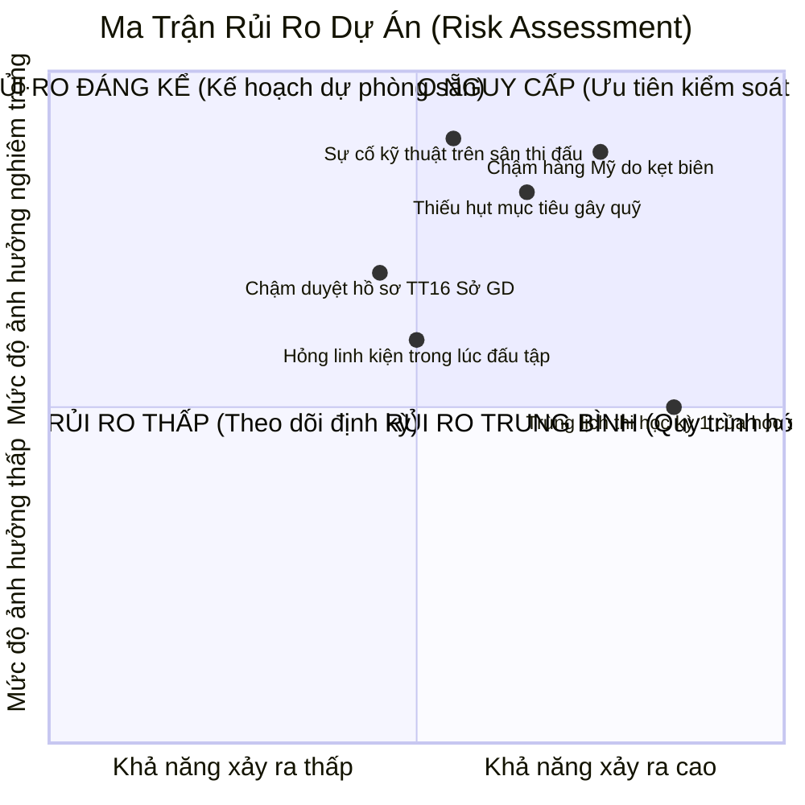
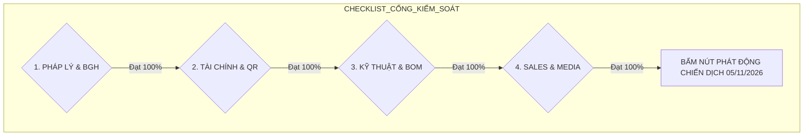

# 13 — Lộ Trình Triển Khai, Phân Công Trách Nhiệm, Chỉ Số KPI & Quản Trị Rủi Ro

Tài liệu thiết lập kế hoạch tác chiến chi tiết từ ngày phát động chiến dịch (28/10/2026) xuyên suốt quá trình chế tạo, thi đấu tại Vòng chung kết FTC Vietnam Championship (cuối tháng 1 – tháng 2/2027 `[ƯỚC TÍNH]`) cho đến giai đoạn quyết toán sau mùa giải (tháng 3/2027). Văn bản tích hợp ma trận phân công trách nhiệm RACI, hệ thống chỉ số đo lường hiệu suất (KPI) bám sát mục tiêu tài chính đã duyệt, ma trận quản trị rủi ro và bảng kiểm tra sẵn sàng phát động (Pre-launch Checklist).
Fact quy chế: FTC Vietnam trao 02 suất dự FIRST Championship (Houston, 28/04–01/05/2027) theo điểm Advancement; mùa gần nhất 2 suất thuộc đội giải Nhất Inspire Award và đội trưởng Liên minh Vô địch (R8). Nguồn: `docs/campaign-2026-2027/research/R1-season-team.md`.

---

## 1. Lộ Trình Tác Chiến Toàn Diện (Dated Roadmap & Gantt Chart)

Lộ trình được cấu trúc thành 5 giai đoạn chiến lược bảo đảm vừa giải quyết bài toán dòng tiền, vừa làm chủ tiến độ kỹ thuật chế tạo:

### Bảng mốc thời gian chi tiết (Key Milestones):

| Mốc thời gian | Tên sự kiện / Giai đoạn | Mục tiêu cốt lõi & Đầu ra bắt buộc (Deliverables) | Đơn vị chủ trì |
|---|---|---|---|
| **28/10 – 04/11/2026** | **Chuẩn bị pháp lý nội bộ** | - BGH phê duyệt chủ trương; gửi văn bản Kế hoạch vận động tài trợ lên Sở GD&ĐT Hà Nội theo TT 16/2018. - Thu thập 100% Phiếu chấp thuận dữ liệu (Consent Form) từ phụ huynh. - Kích hoạt hạ tầng web `/support` và tài khoản tiếp nhận. | Hiệu trưởng, Cố vấn CLB |
| **05/11/2026** | **Chính thức phát động** | - Phát hành bài truyền thông phát động trên Fanpage kèm video thông điệp "BUILD THE NEXT ROBOT". - Gửi đồng loạt Email mở đầu (Sales Kit) tới 53 doanh nghiệp mục tiêu. | Trưởng ban Truyền thông, Trưởng ban Đối ngoại |
| **20/11/2026** | **MỐC GIẢI NGÂN ĐỢT 1** | - Tích lũy tối thiểu **17.546.000 VNĐ**. - Đặt hàng ngay: 01 REV Control Hub (11.716.000đ) và 01 Ray trượt goBILDA Viper Slide (5.830.000đ). | Trưởng ban Kỹ thuật, Thủ quỹ |
| **05/12/2026** | **MỐC GIẢI NGÂN ĐỢT 2** | - Cán tổng mục tiêu **33.975.000 VNĐ** (bao gồm 11 linh kiện phần cứng 30.975.000đ và dự phòng 3.000.000đ). - Đặt phần còn lại: 2 Motor Yellow Jacket, 2 Motor HD Hex, 2 Pin REV NiMH, camera & dụng cụ. | Trưởng ban Kỹ thuật, Thủ quỹ |
| **13/12/2026** | **Sự kiện Maker Day Sóc Sơn** | - Tổ chức workshop "Can You Beat the Robot?" cho 40 học sinh. - Hoạt động tự cấp vốn bằng tiền vé trả trước, nằm ngoài mục tiêu 33.975.000đ. | Trưởng ban Sự kiện, Trưởng ban Truyền thông |
| **10/01/2027** | **Linh kiện về xưởng & Lắp ráp hoàn thiện** | - Toàn bộ linh kiện Mỹ cập bến Lab THPT Sóc Sơn. - Hoàn thiện lắp ráp khung xe cơ khí, thử nghiệm cơ cấu nạp phấn hoa và tời kéo Endgame. | Toàn bộ Đội Kỹ thuật |
| **20/01/2027** | **Đấu tập & Khóa hồ sơ Portfolio** | - Tham gia đấu tập Scrimmage với các đội bạn khu vực Hà Nội (GreenAms, FPT). - Tối ưu thuật toán Autonomous đạt ngưỡng >= 30 điểm. - Hoàn thiện in ấn cuốn Engineering Portfolio nộp ban giám khảo. | Đội Lập trình, Đội Thuyết trình |
| **Cuối T1 – T2/2027 `[ƯỚC TÍNH]`** | **FTC Vietnam Championship (VNCMP)** | - Tham gia thi đấu chính thức tại Trường ĐH FPT Hòa Lạc. - Đón tiếp nhà tài trợ tại Pit Lane. - Mục tiêu: Top 4 Liên minh & Đạt Giải thưởng Kỹ thuật. | Toàn đội tuyển |
| **15/02 – 15/03/2027** | **Quyết toán & Báo cáo tác động** | - Niêm yết công khai báo cáo thu chi tại trường 15 ngày làm việc. - In ấn và gửi Báo cáo Tác động (Impact Report) kèm Kỷ niệm chương tới tất cả nhà tài trợ. | Kế toán trường, Ban Đối ngoại |

---

## 2. Ma Trận Phân Công Trách Nhiệm (RACI Matrix & Organization)

Cơ cấu phân quyền bảo đảm trách nhiệm giải trình rõ ràng giữa Ban Giám hiệu nhà trường, Giáo viên cố vấn và Ban điều hành học sinh. Danh sách người đảm nhiệm được cập nhật tại `docs/campaign-2026-2027/14-phan-cong-nhan-su.md`.

### Bảng phân quyền chi tiết (RACI Definitions: R - Thực hiện, A - Chịu trách nhiệm, C - Tham vấn, I - Nhận thông tin):

| Hạng mục công việc trọng tâm | Hiệu trưởng THPT Sóc Sơn | Giáo viên Cố vấn STEM | Đội trưởng CLB | Đội Kỹ thuật (Mech/Code) | Đội Đối ngoại (Fundraising) | Đội Media & Sự kiện | Kế toán Nhà trường |
|---|:---:|:---:|:---:|:---:|:---:|:---:|:---:|
| Phê duyệt Kế hoạch vận động & Báo cáo Sở GD&ĐT | **A** | R | C | I | C | I | C |
| Ký kết Thỏa thuận tài trợ 3 bên & Hướng dẫn chứng từ | **A** | C | C | I | R | I | R |
| Tiếp nhận dòng tiền qua tài khoản MB Bank & sổ cái | I | C | I | I | C | I | **A / R** |
| Tiếp cận 53 doanh nghiệp & Vận hành CRM | I | C | A | I | **R** | C | I |
| Đặt hàng linh kiện Mỹ (goBILDA / REV qua forwarder) | I | **A** | C | **R** | C | I | C |
| Chế tạo cơ khí & Lập trình robot BIOBUZZ | I | C | A | **R** | I | C | I |
| Tổ chức sự kiện Maker Day | I | C | A | C | C | **R** | I |
| Cập nhật Sổ cái công khai (Live Public Tracker) | I | C | A | I | C | **R** | C |
| Vận hành thi đấu tại FTC Vietnam Championship | I | **A** | **R** | **R** | C | C | I |
| Lập Báo cáo Tác động & Niêm yết quyết toán tài chính | C | C | A | C | **R** | R | **A** |

### Nhân sự cụ thể
Chi tiết vai trò, công việc và tên người phụ trách theo dõi tại `docs/campaign-2026-2027/14-phan-cong-nhan-su.md`.

---

## 3. Hệ Thống Chỉ Số Hiệu Suất Cốt Lõi (Key Performance Indicators — KPIs)

### Bảng mục tiêu KPI định lượng:

| Lĩnh vực | Chỉ số KPI định lượng | Mục tiêu tối thiểu (Threshold) | Mục tiêu kỳ vọng (Target) |
|---|---|:---:|:---:|
| **Tài chính** | Tổng quỹ tiền mặt huy động cho mục tiêu công khai | 17.546.000 VNĐ | **33.975.000 VNĐ** |
| **Doanh nghiệp** | Số doanh nghiệp tài trợ chính thức | 3 doanh nghiệp | 5–7 doanh nghiệp |
| **In-kind** | Giá trị tài trợ hiện vật quy đổi vào 11 linh kiện BOM | Tùy nhu cầu BOM | Theo mức hiện vật thay thế hạng mục BOM |
| **Earned Rev** | Maker Day | Tự cấp vốn bằng tiền vé | Hoạt động ngoài mục tiêu 33.975.000đ |
| **Kỹ thuật** | Điểm tự hành (Autonomous 30s) | >= 20 điểm | >= 30 điểm |
| **Giải đấu** | Xếp hạng vòng bảng VNCMP | Top 15 / 40 đội | **Top 8 / 40 đội** |
| **Giải thưởng** | Giải thưởng chính thức từ FIRST PDP | Không | Đạt 01 Giải Kỹ thuật |
| **Minh bạch** | Thời gian cập nhật sổ cái public | Dưới 48 giờ | **Dưới 24 giờ** |

---

## 4. Ma Trận Quản Trị Rủi Ro & Kế Hoạch Ứng Phó (Risk Matrix)

### Bảng kế hoạch hành động ứng phó 6 rủi ro trọng yếu:

| Mã | Rủi ro nhận diện | Khả năng / Tác động | Biện pháp phòng ngừa chủ động (Mitigation) | Kế hoạch dự phòng khẩn cấp khi xảy ra sự cố (Contingency Plan) |
|---|---|:---:|---|---|
| **R1** | **Chậm hàng nhập khẩu Mỹ (goBILDA / REV) do cao điểm cuối năm** | Cao / Nghiêm trọng | - Tách đợt đặt hàng: Đặt Control Hub và Viper Slide ngay ngày **20/11/2026**. - Chọn gói chuyển phát nhanh hàng không Priority (10–14 ngày). | - Liên hệ mượn tạm Control Hub từ các đội bạn kỳ cựu (GreenAms, FRITS) để nạp code thử nghiệm trước. - Gia công tạm khung trượt nhôm mô phỏng để test cơ cấu nạp. |
| **R2** | **Không đạt mục tiêu gây quỹ 33.975.000 VNĐ** | Trung bình / Nghiêm trọng | - Đa dạng hóa 4 gói tài trợ tiền mặt (3M, 5M, 10M, 25M). - Tập trung tiếp cận doanh nghiệp, cựu học sinh và phụ huynh; Maker Day chỉ tự cấp vốn ngoài mục tiêu. | - Ưu tiên đặt hàng theo trình tự 2 đợt đã duyệt; tiếp nhận hiện vật thay thế trực tiếp linh kiện trong BOM. |
| **R3** | **Sự cố kỹ thuật trên sân thi đấu** | Trung bình / Nghiêm trọng | - Chuẩn hóa toàn diện phần cứng theo danh mục Delta BOM: REV Control Hub chính hãng, ray trượt công nghiệp goBILDA Viper Slide, 2 bộ pin REV Slim NiMH 12V mới. - Theo dữ liệu mùa 2025–26 ([03 §2.1](03-thanh-tich-chuan-hoa.md)): ưu tiên chương trình Auto (camera C920 + AprilTag) và luyện lái tránh lỗi Major — hai điểm mất nhiều nhất. | - Xây dựng quy trình kiểm tra trước trận (Pre-flight Inspection Checklist) bắt buộc trước mỗi lượt đấu. - Chuẩn bị sẵn bộ linh kiện sơ cua và dụng cụ thay thế nhanh tại Pit Lane. |
| **R4** | **Thủ tục phê duyệt TT 16/2018 tại Sở GD&ĐT Hà Nội bị kéo dài** | Trung bình / Đáng kể | - Hoàn thiện hồ sơ Kế hoạch vận động trình Sở ngay trong tuần cuối tháng 10/2026. - BGH trực tiếp liên hệ phòng Kế hoạch - Tài chính của Sở để giải trình ý nghĩa STEM. | - Thông báo Ban Giám hiệu và doanh nghiệp, chỉ tiếp nhận theo hướng dẫn pháp lý được phê duyệt; sẵn sàng điều chỉnh thời điểm tiếp nhận. |
| **R5** | **Xung đột thời gian: Mùa thi Học kỳ 1 của học sinh (Tháng 12/2026)** | Rất cao / Trung bình | - Lập thời khóa biểu trực Lab linh hoạt theo ca. - Ưu tiên học sinh khối 12 ôn thi; giao trọng trách thi công thực hành cho học sinh khối 10 và 11. | - Dành riêng 2 tuần cao điểm thi học kỳ chỉ bảo dưỡng máy móc nhẹ nhàng, không phát sinh hạng mục thiết kế mới. Đẩy mạnh tiến độ trước và sau kỳ thi. |
| **R6** | **Rủi ro rò rỉ dữ liệu hoặc xâm phạm hình ảnh trẻ em (Nghị định 13/2023)** | Thấp / Đáng kể | - Bắt buộc ký Phiếu chấp thuận kép (Consent Form) từ phụ huynh đối với học sinh dưới 16 tuổi trước khi quay chụp tư liệu. | - Thiết lập quy trình phản ứng nhanh: Khi có yêu cầu rút lại sự đồng ý, bộ phận Media gỡ bỏ hình ảnh trên mọi nền tảng số trong vòng **24 giờ** (nhanh hơn mức quy định 72 giờ). |

---

## 5. Bảng Kiểm Tra Sẵn Sàng Phát Động (Pre-Launch Checklist)

Trước khi bấm nút chính thức công bố chiến dịch vào ngày **05/11/2026**, Ban Chỉ đạo bắt buộc phải hoàn thành và tích chọn 100% các hạng mục sau:

### Danh mục 20 điểm kiểm tra bắt buộc (Go / No-Go Criteria):

#### Nhóm 1: Pháp lý & Tổ chức nội bộ
- [ ] **01.** Ban Giám hiệu Trường THPT Sóc Sơn ký phê duyệt Chủ trương tham gia mùa giải FTC BIOBUZZ™ 2026–2027.
- [ ] **02.** Tờ trình Kế hoạch vận động tài trợ theo Điều 5 Thông tư 16/2018/TT-BGDĐT đã hoàn tất và nộp báo cáo Sở GD&ĐT Hà Nội.
- [ ] **03.** Quyết định thành lập Tổ tiếp nhận tài trợ do Hiệu trưởng làm Tổ trưởng đã được ban hành bằng văn bản.
- [ ] **04.** 100% thành viên đội tuyển và học sinh dưới 16 tuổi tham gia đã nộp Phiếu chấp thuận dữ liệu (Consent Form) có chữ ký phụ huynh.
- [ ] **05.** Mẫu Thỏa thuận tài trợ 3 bên (Doanh nghiệp - Nhà trường - CLB) đã được kiểm duyệt nội dung pháp lý.

#### Nhóm 2: Tài chính & Kênh tiếp nhận
- [ ] **06.** Đã sẵn sàng hướng dẫn trường hợp doanh nghiệp yêu cầu chuyển khoản qua trường để nhận chứng từ kế toán.
- [ ] **07.** Đã cấu hình mã thanh toán VietQR với cú pháp chuẩn: `BIOBUZZ [MÃ_GÓI] [TÊN_DONOR] [SĐT]`.
- [ ] **08.** Tài khoản tiếp nhận chiến dịch đã sẵn sàng: Chủ TK TRAN TUE MINH · STK 0962969817 · MB Bank · QR: assets/placeholder.jpg.
- [ ] **09.** Bảng tính Google Sheets Public Tracker đã thiết lập chế độ bảo mật tự động che (mask) số điện thoại/số tài khoản.
- [ ] **10.** Quy trình tiếp nhận qua trường cho doanh nghiệp cần chứng từ kế toán đã được thống nhất với bộ phận kế toán trường.

#### Nhóm 3: Kỹ thuật & Chuỗi cung ứng
- [ ] **11.** Danh mục mua sắm delta 11 món (BOM 30.975.000 VNĐ) đã được rà soát tồn kho tại Lab và đối soát mã sản phẩm trên goBILDA & REV.
- [ ] **12.** Đã đăng ký và kích hoạt tài khoản giảm giá FTC Team Discount 25% trên cổng goBILDA.
- [ ] **13.** Đã chốt hợp đồng nguyên tắc với đơn vị vận chuyển hàng không forwarder Mỹ - Hà Nội (bao thuế trọn gói).
- [ ] **14.** Đã liên hệ và nhận báo giá phôi nhôm 5052, cắt laser kim loại từ xưởng gia công cơ khí tại Hà Nội.
- [ ] **15.** Đã khóa số hiệu đội thi chính thức mùa giải 2026–2027 là **FTC #39256** trên FIRST Event Web.

#### Nhóm 4: Bán hàng, Truyền thông & Công cụ số
- [ ] **16.** Trang web quyên góp `https://roboticssocson.com/support` đã hoàn thành kiểm thử giao diện trên máy tính và điện thoại, tích hợp form đăng ký chuẩn.
- [ ] **17.** Bộ Sales Kit hoàn chỉnh (One-pager song ngữ, Pitch Deck 5 slide, Mẫu Email, Kịch bản gọi điện) đã sẵn sàng gửi đi.
- [ ] **18.** Bảng danh sách CRM 53 doanh nghiệp mục tiêu đã phân bổ người phụ trách theo `docs/campaign-2026-2027/14-phan-cong-nhan-su.md` và có thông tin liên hệ xác thực.
- [ ] **19.** Kịch bản video phát động "BUILD THE NEXT ROBOT" và bài viết mở màn Fanpage đã được duyệt nội dung.
- [ ] **20.** Biểu mẫu đăng ký sự kiện Maker Day đã cấu hình xong luồng thu tiền vé tự động.

---

## Nguồn

1. **Bộ Giáo dục và Đào tạo:** *Thông tư số 16/2018/TT-BGDĐT ngày 03/08/2018 quy định về tài trợ cho các cơ sở giáo dục thuộc hệ thống giáo dục quốc dân.*
3. **FIRST Inspires:** *FIRST Tech Challenge Season Timeline & Event Manual 2026–2027.*
4. **Báo cáo nghiên cứu cơ sở:**
   - Báo cáo R1: `docs/campaign-2026-2027/research/R1-season-team.md`
   - Báo cáo R2: `docs/campaign-2026-2027/research/R2-parts-import.md`
   - Báo cáo R4: `docs/campaign-2026-2027/research/R4-legal-payment.md`
   - Báo cáo R5: `docs/campaign-2026-2027/research/R5-sponsors-benchmarks.md`
   - Biên bản thảo luận: `docs/campaign-2026-2027/99-bien-ban-thao-luan.md`
   - Phân công nhân sự: `docs/campaign-2026-2027/14-phan-cong-nhan-su.md`
