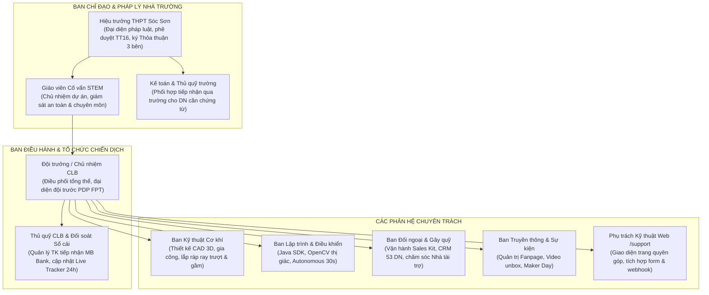

# 14 - Phân công nhân sự

> **Mục đích:** Tài liệu này chuẩn hóa toàn bộ sơ đồ tổ chức, danh mục vai trò trách nhiệm, đầu mối điều phối từng phân hệ và bảng phân công nhân sự chi tiết cho chiến dịch "BUILD THE NEXT ROBOT" của CLB Robotics Sóc Sơn (FTC #39256) tại mùa giải FIRST Tech Challenge 2026–2027.
>
> **Lưu ý nhân sự:** Tạm điền Trần Tuệ Minh; thay khi phân công chính thức.

---

---

## BẢNG PHÂN CÔNG NHÂN SỰ CHI TIẾT

| Vai trò | Việc cụ thể | File liên quan | Họ tên | Lớp/Chức vụ | SĐT |
|---|---|---|---|---|---|
| **LÃNH ĐẠO & PHÁP LÝ NHÀ TRƯỜNG** | | | | | |
| Người ký thỏa thuận tài trợ / Ban Giám hiệu | Ký duyệt chủ trương, ký thỏa thuận 3 bên, chịu trách nhiệm pháp lý cao nhất theo TT 16/2018 | `10`, `12`, `13` | Nguyễn Thị Diệu Thanh | Hiệu trưởng | (024) 3884 1042 (trường) |
| Giáo viên Cố vấn STEM / Chủ nhiệm dự án | Điều phối chuyên môn, đại diện liên lạc với PDP FPT, giám sát an toàn phòng Lab | `02`, `09`, `10`, `13` | Trần Tuệ Minh | Giáo viên | |
| Kế toán / Thủ quỹ nhà trường | Hướng dẫn thủ tục tiếp nhận qua tài khoản trường cho DN cần chứng từ kế toán | `10`, `12`, `13` | Trần Tuệ Minh | Kế toán trường | |
| **BAN ĐIỀU HÀNH & TÀI CHÍNH CLB** | | | | | |
| Đội trưởng CLB (Team Captain) | Quản lý tiến độ tổng thể, phân công công việc, đại diện học sinh phát biểu | `02`, `09`, `13` | Trần Tuệ Minh | Học sinh | |
| Thủ quỹ CLB & Đối soát Sổ cái | Quản lý tài khoản tiếp nhận MB Bank (0962969817, chủ TK Trần Tuệ Minh), đối chiếu sao kê, cập nhật Public Tracker trong 24h | `04`, `06`, `10`, `12` | Trần Tuệ Minh | Học sinh | |
| **CHUYÊN MÔN KỸ THUẬT & VẬN HÀNH ROBOT** | | | | | |
| Trưởng ban Kỹ thuật Cơ khí | Chủ trì thiết kế 3D CAD, gia công tấm đáy nhôm, lắp ráp cơ cấu tháp nâng và tay gắp | `02`, `04`, `06`, `13` | Trần Tuệ Minh | Học sinh | |
| Trưởng ban Lập trình & Điều khiển | Lập trình Java SDK, xử lý hình ảnh OpenCV cho camera C920 trong 30s Autonomous, Driver Station | `02`, `04`, `06`, `13` | Trần Tuệ Minh | Học sinh | |
| Kỹ thuật Điện & Cấp nguồn | Lắp đặt mạng điện, cảm biến, đấu nối pin REV NiMH an toàn, kiểm tra sụt áp | `04`, `06` | Trần Tuệ Minh | Học sinh | |
| **ĐỐI NGOẠI, CRM & TIẾP CẬN NHÀ TÀI TRỢ** | | | | | |
| Trưởng ban Đối ngoại & Gây quỹ | Quản trị quy trình tiếp cận nhà tài trợ B2B, quản lý Sales Kit và điều phối phễu CRM | `05`, `09`, `11`, `13` | Trần Tuệ Minh | Học sinh | |
| Phụ trách CRM Đợt 1 (Warm Leads) | Tiếp cận doanh nghiệp KCN Nội Bài và chi nhánh ngân hàng địa phương trước 20/11 | `05`, `11` | Trần Tuệ Minh | Học sinh | |
| Phụ trách CRM Đợt 2 (Cơ khí & Hàng không) | Tiếp cận doanh nghiệp cụm Hàng không Nội Bài và KCN Quang Minh trước 05/12 | `05`, `11` | Trần Tuệ Minh | Học sinh | |
| Phụ trách Hồ sơ Quỹ Quốc tế & Nhà nước | Chuẩn bị hồ sơ ứng vốn Quỹ Gene Haas, U.S. Embassy Small Grants, Quỹ Khuyến học | `09`, `11` | Trần Tuệ Minh | Học sinh | |
| **TRUYỀN THÔNG, SỰ KIỆN & CÔNG CỤ SỐ** | | | | | |
| Trưởng ban Truyền thông & Sự kiện | Quản trị Fanpage, điều phối lịch biên tập 8 tuần, phê duyệt nội dung bài đăng | `07`, `13` | Trần Tuệ Minh | Học sinh | |
| Phụ trách Biên tập & Bài viết (Copywriter) | Viết bài 5 tuyến nội dung chiến dịch | `07` | Trần Tuệ Minh | Học sinh | |
| Phụ trách Media, Nhiếp ảnh & Video | Quay dựng video POV, phóng sự unbox, chụp ảnh tư liệu Lab | `07` | Trần Tuệ Minh | Học sinh | |
| Phụ trách Đội Thuyết trình / Engineering Portfolio | Chuẩn bị hồ sơ kỹ thuật, thuyết trình trước giám khảo và phối hợp đón tiếp đối tác tại Pit | `09`, `13` | Trần Tuệ Minh | Học sinh | |
| Phụ trách Sự kiện Maker Day | Lên kịch bản, quản lý vé, chuẩn bị kit và điều phối các trạm | `08`, `13` | Trần Tuệ Minh | Học sinh | |
| Phụ trách Kỹ thuật Web /support | Quản trị trang `/support`, cấu hình form và tích hợp webhook | `02`, `10` | Trần Tuệ Minh | Học sinh | |
| **NGƯỜI PHỤ TRÁCH TỪNG LINH KIỆN TRONG BOM (THEO CSV)** | | | | | |
| REV Control Hub (`FTC-CTRL-01`) | Đặt hàng REV Robotics Mỹ, nghiệm thu kỹ thuật và nạp hệ điều hành | `04`, `06` | Nguyễn Minh | Trưởng nhóm | |
| Bộ ray trượt Viper Slide Kit 4-Stage (`FTC-STR-01`) | Đặt hàng goBILDA Mỹ, lắp ráp cụm trượt tháp nâng | `04`, `06` | Lê Hoàng | Trưởng cơ khí | |
| Pin REV 12V 3000mAh Slim NiMH (`FTC-PWR-01`) | Đặt hàng REV Robotics Mỹ, kiểm tra dung lượng và an toàn xả dòng | `04`, `06` | Nguyễn Minh | Trưởng nhóm | |
| Động cơ goBILDA 5202 Yellow Jacket (`FTC-MTR-01`) | Đặt hàng goBILDA Mỹ, lắp ráp cụm truyền động và cơ cấu intake | `04`, `06` | Lê Hoàng | Trưởng cơ khí | |
| Động cơ REV UltraPlanetary HD Hex (`FTC-MTR-02`) | Đặt hàng REV Robotics Mỹ, lắp hộp số và kiểm tra mô-men xoắn | `04`, `06` | Lê Hoàng | Trưởng cơ khí | |
| Camera Logitech C920 Pro HD (`FTC-SEN-01`) | Mua đại lý Hà Nội, tích hợp thuật toán OpenCV/AprilTag | `04`, `06` | Phạm Tuấn | Lập trình | |
| Bộ chìa lục giác Inch & Mét Wera (`FTC-TOL-02`) | Mua nhà phân phối VN, quản lý sử dụng tại bàn cơ khí | `04`, `06` | Lê Hoàng | Trưởng cơ khí | |
| Bộ tua vít điện chính xác Wowstick 1F+ (`FTC-TOL-01`) | Mua sẵn kho Hà Nội, bảo quản tại hộp đồ nghề pit lane | `04`, `06` | Lê Hoàng | Trưởng cơ khí | |
| REV Expansion Hub (`FTC-CTRL-02`) | Quản lý dự phòng linh kiện điện, cấu hình kết nối mở rộng cổng motor | `CSV` | Trần Bảo | Kỹ thuật điện | |
| REV Smart Robot Servo SRS (`FTC-SRV-01`) | Quản lý và lập trình servo | `CSV` | Phạm Tuấn | Lập trình | |
| Bánh xe Mecanum 96mm goBILDA (`FTC-WHL-01`) | Bảo dưỡng và cân chỉnh bộ bánh xe hiện có | `CSV` | Lê Hoàng | Trưởng cơ khí | |
| Cảm biến màu REV Color Sensor v3 (`FTC-SEN-02`) | Cân chỉnh nhận diện màu trên sa bàn | `CSV` | Phạm Tuấn | Lập trình | |
| Kìm bấm cos & tuốt dây đa năng (`FTC-TOL-03`) | Bảo quản và sử dụng gia công đầu nối dây điện JST | `CSV` | Trần Bảo | Kỹ thuật điện | |
| Đồng hồ vạn năng Victor True RMS (`FTC-TOL-04`) | Đo kiểm điện áp, dòng xả và thông mạch | `CSV` | Trần Bảo | Kỹ thuật điện | |

---

## NGUỒN TÀI LIỆU THAM CHIẾU
- `docs/INVENTORY - PURCHASE PLAN 2026.csv` (Danh sách phân công người phụ trách linh kiện gốc: Nguyễn Minh, Lê Hoàng, Phạm Tuấn, Trần Bảo).
- `docs/campaign-2026-2027/02-fact-sheet-mua-giai.md` (Hồ sơ đội tuyển FTC #39256).
- `docs/campaign-2026-2027/04-ngan-sach-delta.md` (Bảng dự toán 11 linh kiện và quỹ dự phòng: 33.975.000 VNĐ).
- `docs/campaign-2026-2027/11-crm-prospect.md` (Đầu mối phụ trách các phân kỳ tiếp cận nhà tài trợ).
- `docs/campaign-2026-2027/13-lo-trinh-phan-cong-kpi-rui-ro.md` (Ma trận phân công trách nhiệm RACI).
