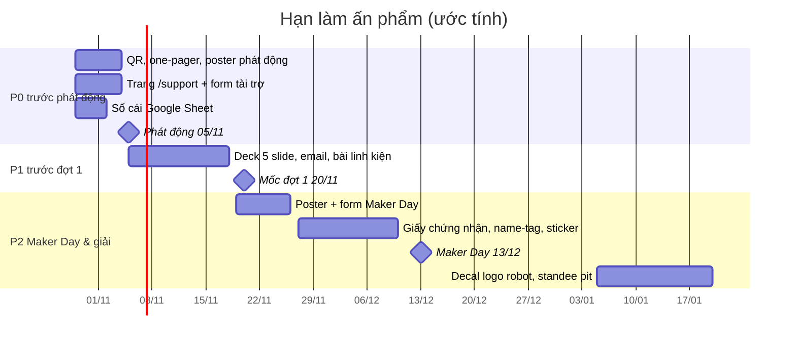

# 15 — Danh sách việc cần làm (ấn phẩm, web, form)

Danh sách mọi thứ cần thiết kế, dựng hoặc soạn để chạy chiến dịch, xếp theo hạn. Mỗi dòng ghi rõ nội dung lấy từ file nào. Người phụ trách tạm thời là Trần Tuệ Minh; khi phân công chính thức thì đổi ở [14](14-phan-cong-nhan-su.md). Ký hiệu ưu tiên: **P0** phải có trước khi phát động (05/11/2026), **P1** cần trước mốc đợt 1 (20/11/2026), **P2** làm khi có thời gian hoặc dùng cho Maker Day và giải đấu.

## 1. Thanh toán & minh bạch

| # | Ưu tiên | Việc | Định dạng | Nội dung lấy từ | Xong |
|---|:---:|---|---|---|:---:|
| 1 | P0 | Ảnh QR MB Bank thật (TRAN TUE MINH · 0962969817) thay cho `assets/placeholder.jpg`, giữ nguyên tên file để mọi link tự cập nhật | JPG 600×600 | Cách tạo: [R8 §4](research/R8-official-info.md) | ☐ |
| 2 | P0 | Sổ cái công khai: Google Sheet chỉ cho xem, gồm các cột Ngày · Người ủng hộ (che tên) · Số tiền · Mission · Đã chi · Chứng từ | Google Sheet | [12 §2.1](12-minh-bach-bao-cao-tac-dong.md) | ☐ |
| 3 | P0 | Thư mục Google Drive công khai chứa hóa đơn mua linh kiện (che số tài khoản) | Drive | [12 §2.2](12-minh-bach-bao-cao-tac-dong.md) | ☐ |
| 4 | P1 | Ảnh "thanh tiến độ quỹ" để cập nhật mỗi tuần, dạng 4 mission + dự phòng / 33.975.000 | PNG 1080×1350 (Facebook) | [06](06-mission-gay-quy-cong-dong.md) | ☐ |

## 2. Web

| # | Ưu tiên | Việc | Định dạng | Nội dung lấy từ | Xong |
|---|:---:|---|---|---|:---:|
| 5 | P0 | Trang `/support` trên roboticssocson.com gồm: thanh tiến độ, 4 mission, QR, 4 gói tài trợ, form, link sổ cái | Route Next.js | [10 §8](10-support-thanh-toan-phap-ly.md), [06](06-mission-gay-quy-cong-dong.md), [05](05-goi-tai-tro-doanh-nghiep.md) | ☐ |
| 6 | P0 | Form "Đăng ký tài trợ doanh nghiệp" (họ tên, công ty, chức vụ, SĐT/email, loại hỗ trợ, mức, lời nhắn), làm theo mẫu `/course-register-form` | Form trên web | [10 §8](10-support-thanh-toan-phap-ly.md) | ☐ |
| 7 | P1 | Link mạng xã hội rút gọn có UTM (fanpage → `/support`) để đếm lượt bấm | bit.ly / UTM | [07](07-chuyen-linh-kien-noi-dung.md) | ☐ |
| 8 | P2 | Mục "Cảm ơn nhà tài trợ" (logo) trên `/support`, cập nhật khi có nhà tài trợ | Section web | [05](05-goi-tai-tro-doanh-nghiep.md) | ☐ |

## 3. Bán hàng cho doanh nghiệp

| # | Ưu tiên | Việc | Định dạng | Nội dung lấy từ | Xong |
|---|:---:|---|---|---|:---:|
| 9 | P0 | One-pager tài trợ, bản tiếng Việt | PDF A4, 1 trang | [09 §1](09-sales-kit.md) | ☐ |
| 10 | P1 | One-pager tài trợ, bản tiếng Anh (cho doanh nghiệp FDI) | PDF A4 | [09 §2](09-sales-kit.md) | ☐ |
| 11 | P1 | Deck thuyết trình 5 slide: về đội → bài toán BIOBUZZ → thành tích → gói tài trợ → lời kêu gọi | Google Slides / PPTX 16:9 | [09 §3](09-sales-kit.md), ảnh giấy khen từ [03](03-thanh-tich-chuan-hoa.md) | ☐ |
| 12 | P1 | Mẫu email mở đầu + email nhắc lại sau 4–7 ngày, có chữ ký Trần Tuệ Minh | Gmail template | [09 §4–5](09-sales-kit.md) | ☐ |
| 13 | P1 | Bảng CRM: chép 53 doanh nghiệp vào Google Sheet, mỗi dòng gồm trạng thái + ngày liên hệ | Google Sheet | [11](11-crm-prospect.md) | ☐ |
| 14 | P1 | Thư ngỏ có chữ ký của trường, gửi doanh nghiệp lớn và ngân hàng (nhờ Ban Giám hiệu ký) | PDF A4 | [09](09-sales-kit.md), [14](14-phan-cong-nhan-su.md) | ☐ |
| 15 | P2 | Thư cảm ơn nhà tài trợ + giấy chứng nhận đồng hành | PDF A4 | [12 §1](12-minh-bach-bao-cao-tac-dong.md) | ☐ |

## 4. Mạng xã hội (fanpage 860 follower)

Spec chi tiết từng ấn phẩm (bố cục, chữ trên ảnh, kịch bản video, caption): **[social/00-README.md](social/00-README.md)**.

| # | Ưu tiên | Việc | Định dạng | Nội dung lấy từ | Xong |
|---|:---:|---|---|---|:---:|
| 16 | P0 | Poster phát động "BUILD THE NEXT ROBOT": mục tiêu 33.975.000 ₫ + QR | PNG 1080×1350 | [01](01-thong-diep-dinh-vi.md), [06](06-mission-gay-quy-cong-dong.md) | ☐ |
| 17 | P0 | Bài phát động (caption) đăng ngày 05/11 | Text | [07 mẫu bài 1](07-chuyen-linh-kien-noi-dung.md) | ☐ |
| 18 | P1 | Ảnh bìa fanpage theo chiến dịch | 1640×624 | [01](01-thong-diep-dinh-vi.md) | ☐ |
| 19 | P1 | Series "Chuyện linh kiện": 4 poster, mỗi mission 1 cái, gồm ảnh linh kiện + giá + QR | Carousel 1080×1350 | [06](06-mission-gay-quy-cong-dong.md), [07](07-chuyen-linh-kien-noi-dung.md) | ☐ |
| 20 | P1 | Video ngắn 30–45 giây giới thiệu đội và robot cũ (Reels) | MP4 9:16 | [07](07-chuyen-linh-kien-noi-dung.md) | ☐ |
| 21 | P1 | Poster "Đằng sau tấm huy chương" (VRC Top 4, VORC Top 8, Á quân Motions In Fire) | PNG 1080×1350 | [03](03-thanh-tich-chuan-hoa.md) | ☐ |
| 22 | P2 | Mẫu poster "Cảm ơn nhà tài trợ" có chừa chỗ để chèn logo | PNG 1080×1080 | [05](05-goi-tai-tro-doanh-nghiep.md) | ☐ |
| 23 | P2 | Video mở hộp linh kiện khi hàng Mỹ về | MP4 9:16 | [07](07-chuyen-linh-kien-noi-dung.md) | ☐ |

## 5. Maker Day (Chủ nhật 13/12/2026, 40 học sinh)

| # | Ưu tiên | Việc | Định dạng | Nội dung lấy từ | Xong |
|---|:---:|---|---|---|:---:|
| 24 | P2 | Google Form đăng ký Maker Day: thông tin học sinh, phụ huynh, ca, ảnh chuyển khoản, ô đồng ý cho chụp ảnh | Google Form | [08 §5](08-maker-day.md) | ☐ |
| 25 | P2 | Poster mở đăng ký Maker Day (giá 79k/89k, 2 ca, QR form) | PNG 1080×1350 + bản in A3 dán ở trường | [08](08-maker-day.md) | ☐ |
| 26 | P2 | Giấy chứng nhận "Nhà Sáng Chế Trẻ BIOBUZZ", in tên từng em | A4 ngang, giấy C300 | [08 §2](08-maker-day.md) | ☐ |
| 27 | P2 | Name-tag đeo cổ (40 cái) | 9×5,5 cm | [08 §2](08-maker-day.md) | ☐ |
| 28 | P2 | Sticker pack tặng kèm (4 hình), chỉ để tặng, không bán | Vinyl die-cut | [08](08-maker-day.md) | ☐ |
| 29 | P2 | Tờ hướng dẫn thực hành A4 gập đôi (lắp mạch Arduino, khối lệnh) | PDF A4 | [08 §2](08-maker-day.md) | ☐ |
| 30 | P2 | Phiếu đồng ý cho chụp ảnh / dùng dữ liệu (học sinh dưới 16 tuổi) | PDF A4 | [10 §7](10-support-thanh-toan-phap-ly.md) | ☐ |
| 31 | P2 | Backdrop chụp ảnh 2×3 m (nếu đủ ngân sách) | In bạt | [R3](research/R3-ops-merch-events.md) | ☐ |

## 6. Giải đấu (dự kiến cuối T1 – T2/2027)

| # | Ưu tiên | Việc | Định dạng | Nội dung lấy từ | Xong |
|---|:---:|---|---|---|:---:|
| 32 | P2 | Decal logo nhà tài trợ dán robot. Robot phải nằm gọn trong khối 18″, không che số #39256 | Decal | [10 §6](10-support-thanh-toan-phap-ly.md) | ☐ |
| 33 | P2 | Biển số đội #39256, chữ cao ≥ 6,35 cm, dán 2 mặt robot | Decal | [10 §6](10-support-thanh-toan-phap-ly.md) | ☐ |
| 34 | P2 | Standee khu pit: đội + nhà tài trợ | Standee cuốn 80×200 cm | [R3](research/R3-ops-merch-events.md) | ☐ |
| 35 | P2 | Engineering Portfolio (hồ sơ kỹ thuật nộp ban giám khảo) | PDF/in A4 | [13](13-lo-trinh-phan-cong-kpi-rui-ro.md) | ☐ |

## 7. Sau mùa giải

| # | Ưu tiên | Việc | Định dạng | Nội dung lấy từ | Xong |
|---|:---:|---|---|---|:---:|
| 36 | P2 | Báo cáo tác động gửi nhà tài trợ: đã nhận bao nhiêu, chi vào đâu, kết quả thi, ảnh | PDF 4–6 trang | [12 §3](12-minh-bach-bao-cao-tac-dong.md) | ☐ |
| 37 | P2 | Poster tổng kết + cảm ơn | PNG 1080×1350 | [12](12-minh-bach-bao-cao-tac-dong.md) | ☐ |

## Cần có trước khi thiết kế

- Logo Robotics Sóc Sơn bản vector (SVG/AI). Kiểm tra trong `public/Logo/` của website.
- Màu thương hiệu: xanh `#2563eb`, nền trắng, viền xám thép (theo `DESIGN.md` của website).
- Ảnh đội và ảnh robot cũ (dùng ảnh nền đen, giống bộ ảnh thành viên trên web).
- Ảnh giấy khen VRC 2023, VORC 2024, Motions In Fire 2025.

## Nguồn

- Nội dung chi tiết từng ấn phẩm: các file 01–14 trong thư mục này (link ở từng dòng).
- Kích thước và giá in: [research/R3-ops-merch-events.md](research/R3-ops-merch-events.md).
- Quy định decal và logo trên robot: [research/R4-legal-payment.md](research/R4-legal-payment.md).
