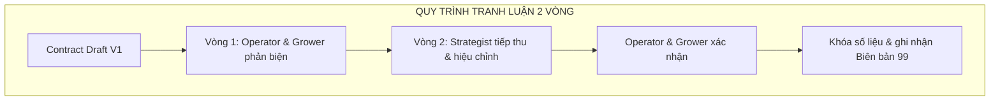

# 99 — BIÊN BẢN THẢO LUẬN & ĐỒNG THUẬN QUYẾT ĐỊNH CHIẾN DỊCH (DEBATE LOG)

> **Mục đích:** Ghi nhận các quyết định có sự bất đồng hoặc cần phản biện đa chiều giữa ba thành viên Ban Chiến dịch (Strategist - Operator - Grower) trước khi khóa số liệu và triển khai bộ tài liệu.
> **Thời gian:** Ngày 28/10/2026
> **Thành phần:** Strategist (định vị & tích hợp), Operator (pháp lý & minh bạch), Grower (truyền thông & gây quỹ).

---

---

## TỔNG HỢP CÁC QUYẾT ĐỊNH TRANH LUẬN CỐT LÕI

| STT | Vấn đề | Quyết định tại thời điểm ghi nhận | Trạng thái sau quyết định chủ dự án 28/10/2026 |
|:---:|---|---|---|
| **01** | Cơ cấu gói tài trợ & SME | Cơ cấu ban đầu đã bị **thay thế hoàn toàn bởi Quyết định 8** | Chỉ còn 3M, 5M, 10M, 25M + hiện vật |
| **02** | Vốn mồi Maker Day & Merch | Loại vốn mồi khỏi quỹ tài trợ; hoạt động dùng Pre-order và bán vé trước | **Giữ nguyên nguyên tắc:** Earned Revenue nằm ngoài mục tiêu 33.975.000 ₫ |
| **03** | Pháp lý quyền lợi tài trợ & FIRST | Ký Thỏa thuận 3 bên; dùng quyền lợi tri ân STEM; logo tuân thủ FIRST | Còn hiệu lực; doanh nghiệp cần hồ sơ thuế xử lý qua trường theo 10 |
| **04** | Tiến độ gom đơn linh kiện Mỹ | Giải ngân 2 đợt; đợt 1 mua Hub + Slide, đợt 2 mua phần còn lại | **Cập nhật bởi Quyết định 8:** Đợt 1 ≥ 17.546.000 ₫; Đợt 2 hoàn tất 33.975.000 ₫ trước 05/12/2026 |
| **05** | Mã định danh đội | Khóa chính thức FTC #39256 cho mùa 2026–2027 | Còn hiệu lực |
| **06** | Định giá tài trợ hiện vật | Quy đổi 1:1 theo giá thị trường/hóa đơn, trừ vào hạng mục được thay thế | Còn hiệu lực |
| **07** | FIRST Championship | Quyết định ban đầu tách giải đấu khỏi mục tiêu | Phần nội dung cũ không còn hiệu lực; chỉ giữ fact giải đấu bên dưới |
| **08** | Thu hẹp mục tiêu chiến dịch | — | **Quyết định chủ dự án 28/10/2026:** Chỉ vận động 11 linh kiện landed cost 30.975.000 ₫ + quỹ dự phòng 3.000.000 ₫; mục tiêu công khai **33.975.000 ₫**. |

---

## CHI TIẾT CÁC QUYẾT ĐỊNH CÒN HIỆU LỰC

### Quyết định 1: Gói tài trợ doanh nghiệp
- Gói tiền mặt công khai: **Đồng Hành 3.000.000 ₫**, **Bạc 5.000.000 ₫**, **Vàng 10.000.000 ₫**, **Kim Cương 25.000.000 ₫**.
- Gói hiện vật kỹ thuật quy đổi 1:1 theo hóa đơn hoặc giá thị trường hợp pháp.
- Cơ cấu gói ban đầu bị **superseded** bởi Quyết định 8.

### Quyết định 2: Maker Day & Merch — phần còn hiệu lực
- Không đưa vốn mồi Maker Day/Merch vào mục tiêu vận động.
- Merch bán bằng Pre-order; Maker Day thu vé trước. Doanh thu tự tạo nằm ngoài mục tiêu **33.975.000 ₫** và tự cấp vốn cho chính hoạt động đó.
- Phần mục tiêu ngân sách trong Quyết định 2 cũ được **thay thế bởi Quyết định 8**; chỉ giữ nguyên cơ chế tự cấp vốn nêu trên.

### Quyết định 3: Pháp lý quyền lợi tài trợ
- Dùng Thỏa thuận tài trợ 3 bên (Doanh nghiệp - Trường THPT Sóc Sơn - CLB Robotics Sóc Sơn).
- Dùng cụm từ **"Quyền lợi tri ân nhà tài trợ giáo dục STEM"**.
- Logo trên robot tuân thủ cẩm nang FIRST Tech Challenge BIOBUZZ™.

### Quyết định 4: Tiến độ mua linh kiện — phần cập nhật
- **Đợt 1:** đạt tối thiểu **17.546.000 ₫** trước 20/11/2026, đặt REV Control Hub và goBILDA Viper Slide.
- **Đợt 2:** giải ngân phần còn lại **16.429.000 ₫**, hoàn tất mục tiêu 33.975.000 ₫ trước 05/12/2026, đặt motor, pin, camera, dụng cụ và giữ dự phòng.
- Mốc cũ trong biên bản bị **superseded** bởi các con số trên.

### Quyết định 5: Mã đội FTC #39256
- Khóa mã số đội mùa 2026–2027 là **FTC #39256**.
- Mã cũ chỉ xuất hiện trong bảng thành tích lịch sử.

### Quyết định 6: Hiện vật / Gia công
- Hiện vật thay thế hạng mục BOM được quy đổi 1:1 theo hóa đơn hoặc giá thị trường.
- Hồ sơ giao nhận, định giá và hạch toán thực hiện theo quy trình nhà trường.

### Quyết định 7: Houston — phần còn hiệu lực
- Theo quy chế FTC Vietnam, giải trao 02 suất tham dự FIRST Championship tại Houston (28/04–01/05/2027); đội vô địch giành vé đi Mỹ.
- Nguồn: `docs/campaign-2026-2027/research/R1-season-team.md`.
- Phần nội dung cũ không còn hiệu lực theo Quyết định 8.

### Quyết định 8: Thu hẹp mục tiêu về 11 linh kiện + 3M (quyết định chủ dự án 28/10/2026)
- **11 linh kiện phần cứng landed:** **30.975.000 ₫**.
- **Quỹ dự phòng kỹ thuật & tỷ giá:** **3.000.000 ₫**; mục đích: tỷ giá, cước pin/motor, thay thế hỏng hóc.
- **Công thức:** `30.975.000 + 3.000.000 = 33.975.000 ₫`.
- **Mục tiêu công khai:** **33.975.000 ₫**, không gồm vật tư prototype, chi phí vận hành, nguồn thu Maker Day/Merch hoặc chi phí Championship.

---

## KIỂM TRA SỐ HỌC TOÀN DIỆN

### 1. Bảng cân đối phần cứng
- REV Control Hub: 11.716.000 ₫
- Pin REV 12V Slim NiMH (2 cục): 4.056.000 ₫
- Ray trượt Viper Slide Kit 4-Stage: 5.830.000 ₫
- Động cơ goBILDA 5202 (2 cái): 2.745.000 ₫
- Động cơ REV UltraPlanetary HD Hex (2 cái): 3.278.000 ₫
- Camera Logitech C920 Pro HD: 1.850.000 ₫
- Bộ lục giác Wera: 850.000 ₫
- Bộ tua vít điện Wowstick: 650.000 ₫

$$11.716.000 + 4.056.000 + 5.830.000 + 2.745.000 + 3.278.000 + 1.850.000 + 850.000 + 650.000 = \mathbf{30.975.000\ VNĐ}$$

### 2. Bảng cân đối Missions và dự phòng
- Mission 1: 13.566.000 ₫
- Mission 2: 7.202.500 ₫
- Mission 3: 4.650.500 ₫
- Mission 4: 5.556.000 ₫
- Quỹ dự phòng: 3.000.000 ₫

$$13.566.000 + 7.202.500 + 4.650.500 + 5.556.000 + 3.000.000 = \mathbf{33.975.000\ VNĐ}$$

---

*Biên bản cập nhật theo Quyết định 8; phần bị thay thế trong quyết định 1, 2, 4 và 7 không còn là cơ sở vận hành. Các vai trò cập nhật tại `docs/campaign-2026-2027/14-phan-cong-nhan-su.md`.*
