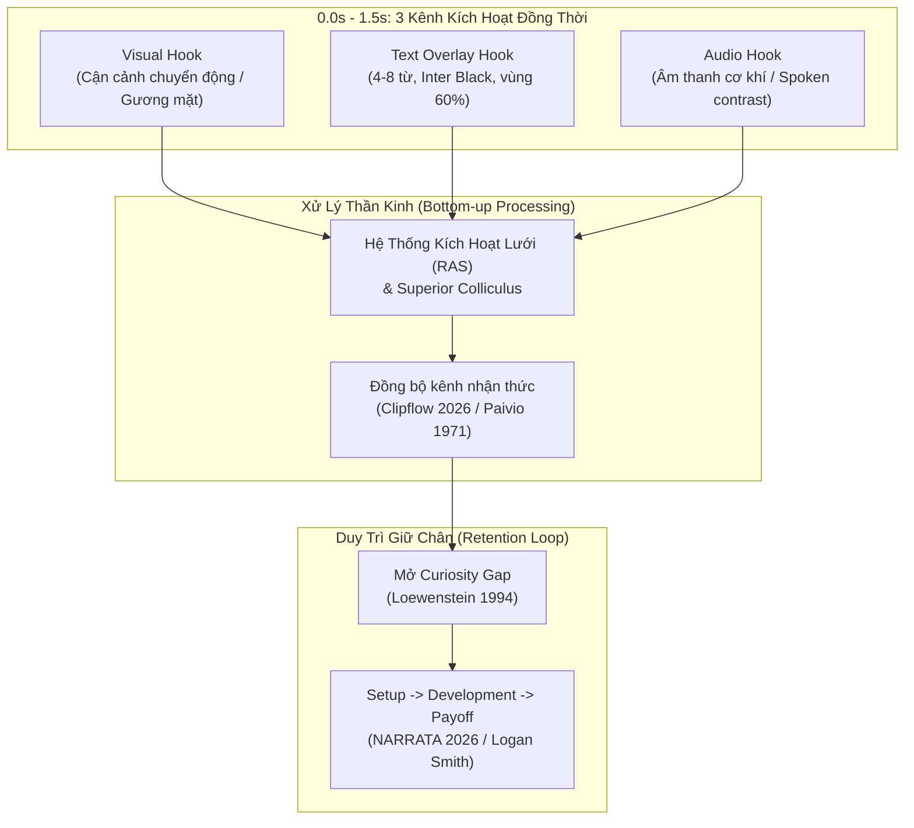
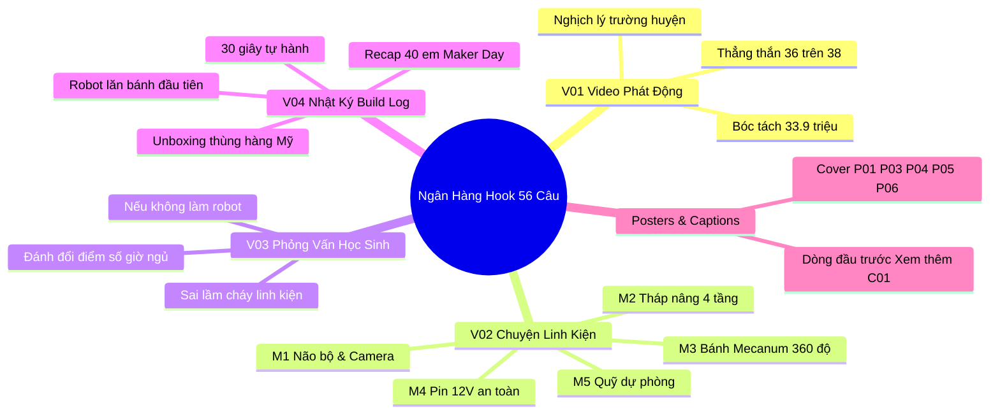
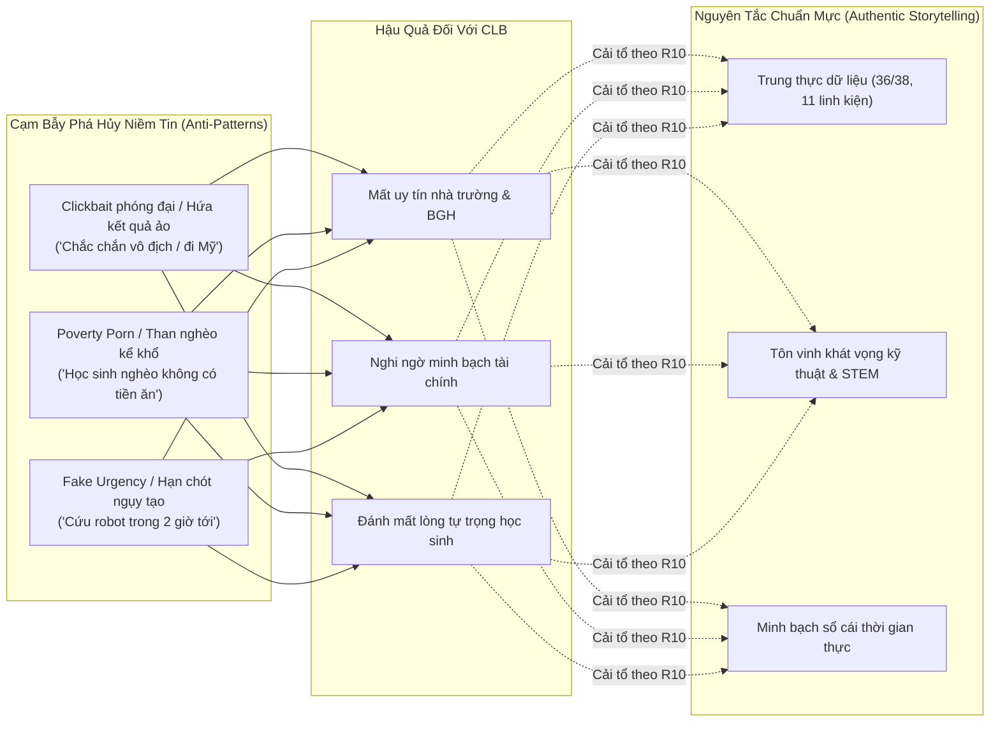
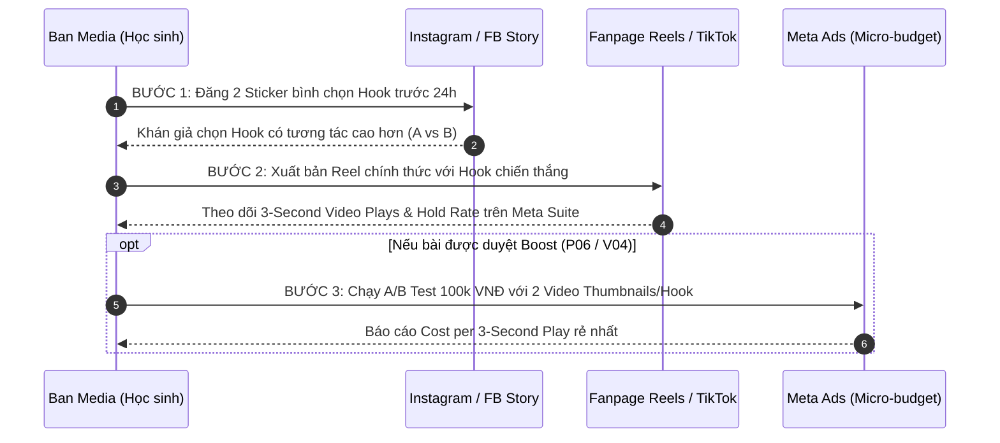

# R10 — Nghiên Cứu Nghệ Thuật Mở Đầu 3 Giây & Câu Hook Truyền Thông (Hook Research)

Tài liệu nghiên cứu chuyên sâu về câu hook (3 giây đầu của Reels/TikTok/Shorts, dòng chữ đầu tiên trước nút "Xem thêm" trên Facebook Feed, và tiêu đề ảnh bìa carousel) phục vụ chiến dịch gây quỹ **"BUILD THE NEXT ROBOT — Mỗi mảnh ghép, một bước tiến"** của CLB Robotics Sóc Sơn (FTC #39256, Trường THPT Sóc Sơn, Hà Nội) cho mùa giải **FIRST Tech Challenge BIOBUZZ™ 2026–2027**.

Nghiên cứu được thực hiện ngày 28/10/2026 thông qua công cụ `agent-reach` (Exa AI, YouTube `yt-dlp` phụ đề có mốc thời gian, Jina Reader, Meta Business Help Center và tài liệu tâm lý học hành vi).

---

## 1. Bản Chất Khoa Học Của "3 Giây Đầu Tiên" (The Science of the First 3 Seconds)

### 1.1. Nền kinh tế lướt chạm (The Swipe Economy) & Cơ chế thần kinh chú ý
Trên các nền tảng video ngắn dọc (Facebook Reels, TikTok, YouTube Shorts), hành vi mặc định của người dùng là **lướt qua (swipe away)**. Theo nghiên cứu thực nghiệm của **Achmad Ridha (03/06/2026)** về các yếu tố thị giác kích hoạt chú ý trên video ngắn (*International Journal of Innovative Research*, doi: 10.71305/ijir.v2i2.1606):
- Não bộ người xem đưa ra quyết định "tiếp tục xem hay lướt tiếp" chỉ trong **1,5 đến 2 giây đầu tiên**.
- Quá trình này được kích hoạt bởi cơ chế chú ý hướng đáy (**bottom-up attentional capture**) tại Hệ thống Kích hoạt Lưới (*Reticular Activating System - RAS*) và gò đồi trên (*Superior Colliculus*) trước khi vỏ não kịp tham gia xử lý nhận thức bậc cao (**top-down cognitive processing**).
- 4 yếu tố thị giác kích hoạt bản năng mạnh nhất gồm: (1) Chuyển động động lực học và cắt cảnh nhanh, (2) Khuôn mặt người nhìn thẳng vào camera, (3) Tương phản màu sắc sắc nét, và (4) Chữ nổi bật (text overlay) ở trung tâm vùng nhìn.

Theo **Kompozy Guide (17/08/2026)** về hook video ngắn, các thuật toán phân phối nội dung (Meta Graph/TikTok For You) sử dụng tỷ lệ giữ chân ở mốc 3 giây làm **bộ lọc ban đầu (initial gatekeeper)**. Nếu video có tỷ lệ người dùng thoát đột ngột (drop-off cliff) ở giây 1–3, hệ thống sẽ tự động hạ mức phân phối đến các tệp người xem mới; ngược lại, đường cong giữ chân bằng phẳng qua 3 giây đầu sẽ mở rộng tệp tiếp cận tự nhiên.

### 1.2. Thuyết Khoảng Trống Thông Tin (Information Gap Theory)
Nền tảng tâm lý học cốt lõi của hook tò mò bắt nguồn từ công trình kinh điển của giáo sư **George F. Loewenstein (1994)** — *"The Psychology of Curiosity: A Review and Reinterpretation"* (*Psychological Bulletin*, Vol. 116, No. 1, 75-98, doi: 10.1037/0033-2909.116.1.75):
- Sự tò mò nảy sinh khi cá nhân nhận thức được một **khoảng trống (gap)** giữa điều mình *đã biết* (thực tại hiện tại) và điều mình *muốn biết* (kết quả/bí mật tiềm ẩn).
- Cảm giác thiếu hụt thông tin tạo ra trạng thái bứt rứt nhận thức tương tự như cơn đói sinh học, thôi thúc người xem phải tiếp tục theo dõi để "đóng khoảng trống".
- Tuy nhiên, Loewenstein nhấn mạnh: Để khoảng trống thông tin tạo ra tò mò thực sự, người xem phải được cung cấp **đủ ngữ cảnh ban đầu (baseline context)**. Nếu khoảng trống quá mơ hồ hoặc không liên quan, người xem sẽ rơi vào trạng thái thờ ơ (indifference).

Theo nghiên cứu phân tích 1.238 video hàng đầu của **Ames Create**:
- 28% video có hiệu suất giữ chân cao nhất mở đầu bằng **Curiosity Gap** (Khoảng trống tò mò).
- 18% mở đầu bằng **Pattern Interrupt** (Phá vỡ khuôn mẫu thị giác/âm thanh).
- 17% mở đầu bằng **Bold Claim** (Tuyên bố táo bạo/trái ngược trực giác).
- 12% mở đầu bằng **Relatable Callout** (Gọi tên vấn đề quen thuộc).
- 10% mở đầu bằng **High Stakes** (Tình thế đánh đổi cao / rủi ro lớn).
- Chỉ 1% mở đầu bằng câu hỏi thông thường chung chung.

### 1.3. Ngưỡng cắt "Xem thêm" (See More Fold) trên Facebook Feed
Đối với bài viết chữ và carousel (P01–P06, C01), "3 giây đầu" tương ứng với **1–2 dòng đầu tiên trước khi bài viết bị ẩn sau nút "... Xem thêm"**:
- Theo dữ liệu đo lường giao diện di động của **TypeCount (2026)** và **PostTruncate (2026)**, phiên bản Facebook Mobile App chỉ hiển thị từ **150 đến 200 ký tự đầu tiên** (khoảng 2 dòng trên màn hình điện thoại 6.1–6.7 inch) trước khi xuất hiện liên kết `... Xem thêm`.
- Người dùng lướt News Feed với tốc độ trung bình 1,7 giây/bài viết. Nếu dòng mở đầu không chứa được: (1) một sự thật gây sửng sốt, (2) một con số cụ thể, hoặc (3) câu hỏi nghịch lý, họ sẽ không bao giờ bấm vào "Xem thêm" hay xem các slide tiếp theo của carousel.

---

## 2. Bằng Chứng Từ Các Nhà Sáng Tạo & Chiến Lược Gia Hàng Đầu (YouTube Transcripts)

Dưới đây là 6 tài liệu giải mã hook từ các nhà sáng tạo nội dung và chiến lược gia video ngắn có sức ảnh hưởng toàn cầu, được trích xuất trực tiếp từ phụ đề video chính thức kèm mốc thời gian (timestamps):

### 2.1. Kallaway — "Give me 15 mins, and I'll make your hooks impossible to skip"
*(Kênh: Kallaway | 1.120.894 lượt xem | ID: `2byPP_9F0-Q`)*

- **`[00:00:54]` Hai tiêu chí sống còn của một hook:** Phải đồng thời đạt được **Topic Clarity** (Sự rõ ràng về chủ đề) và **On-Target Curiosity** (Sự tò mò trúng đích). Nếu người xem không hiểu video nói về cái gì chỉ trong 1 câu, họ sẽ lướt ngay lập tức.
- **`[00:01:24]` Bốn sai lầm chí mạng (Four Horsemen Hook Mistakes):**
  1. *Vagueness / Thiếu ngữ cảnh `[00:02:20]`:* Ví dụ "Bạn sẽ không tin vào điều này đâu..." — người xem không đủ thông tin để định giá xem có đáng bỏ thời gian hay không.
  2. *Confusion / Mất khả năng hiểu `[00:04:11]`:* Dùng thuật ngữ quá phức tạp, hình ảnh và câu nói không khớp khiến não bộ bị quá tải nhận thức.
  3. *Thiếu khoảng trống tò mò `[00:11:05]`:* Chủ đề rõ ràng nhưng không tạo ra lý do buộc phải ở lại.
  4. *Đóng vòng lặp quá sớm:* Trả lời ngay câu hỏi ở giây thứ 4 khiến người xem không còn lý do xem tiếp.
- **`[00:11:33]` Khái niệm Vòng lặp tò mò (Curiosity Loop):** Mở câu hỏi/tình thế ở hook -> cung cấp một phần ngữ cảnh -> mở câu hỏi tiếp theo -> lặp lại liên tục cho đến kết bài.
- **`[00:13:03]` Kỹ thuật tạo tương phản bằng ngôn từ:** Xây dựng khoảng cách giữa thực tại A (điều quen thuộc/thất bại) và khả năng B (kết quả bất ngờ). Khoảng cách A-B càng lớn thì độ tò mò càng cao.

### 2.2. Kallaway — "I Studied 100 Viral Hooks, These 6 Will Make You Go Viral"
*(Kênh: Kallaway | 328.417 lượt xem | ID: `xnOe8aA9Pmw`)*

- **`[00:00:04]` Quy tắc 80/20 của video ngắn:** 80% thành công của video nằm ở 3 giây đầu tiên. Mọi video viral đều thuộc về 1 trong 6 cấu trúc định dạng hook tương phản:
  1. *The Prophet (`[00:01:30]`):* Đặt thực tại đối kháng với tương lai.
  2. *The Experimenter (`[00:02:29]`):* Người thử nghiệm — đặt ra một câu hỏi kỹ thuật/thực tế và tự tay kiểm chứng ("Liệu cơ cấu này có hoạt động không?").
  3. *The Teacher (`[00:04:56]`):* Người đúc kết — mổ xẻ thất bại hoặc bài học thành công cụ thể.
  4. *The Magician (`[00:05:54]`):* Phá vỡ khuôn mẫu thị giác ngay khung hình đầu tiên để chặn đứng ngón tay lướt (scroll stopper).
  5. *The Explorer / Revealer (`[00:08:20]`):* Người khám phá — hé lộ linh kiện/bí mật ẩn giấu mà khán giả chưa từng thấy.
  6. *The Contrarian (`[00:09:12]`):* Người đi ngược đám đông — trực tiếp phản bác một quan niệm sai lầm phổ biến.
- **`[00:13:30]` Bản đồ nhiệt tiềm thức (Subconscious Heatmap):** Cơ chế tiếp nhận của não bộ là **Visual -> Audio -> Visual confirmation** (Bánh kẹp Thị giác – Thính giác – Thị giác). Mắt quét hình ảnh đầu tiên, tai tiếp nhận âm thanh, rồi mắt lập tức quay lại tìm kiếm sự xác nhận bằng hình ảnh trên màn hình. Hình ảnh là thứ quyết định chặn lướt, không phải lời nói.

### 2.3. heyDominik — "I Studied 1,000 Hooks, Here’s How to ACTUALLY Go Viral"
*(Kênh: heyDominik | 831.466 lượt xem | ID: `Xqy9L-88wcw`)*

- **`[00:01:24]` Nguyên tắc Open Loops:** Mở các vòng lặp câu chuyện và giữ cho chúng mở càng lâu càng tốt; khi vừa đóng một vòng lặp thì phải gối đầu ngay một vòng lặp mới.
- **`[00:05:49]` Phân tầng thị giác của chữ trên màn hình (Typography Hierarchy):** Đừng viết một khối chữ đều nhau; phải phân cấp kích thước chữ và độ đậm (Font weight) — từ khóa quan trọng nhất phải to gấp đôi, dùng màu sắc nổi bật để não bộ đọc lướt trong 0,3 giây.
- **`[00:15:04]` Vì sao hook bị chấm 3/10:** Hầu hết hook thất bại vì hoàn toàn không có kích hoạt cảm xúc (zero emotional trigger) và không có khoảng trống tò mò.
- **`[00:17:06] - [00:17:35]` Ghép lớp hook:** Kết hợp đồng thời hành động của cơ thể (visual hook) với một dòng chữ đặt câu hỏi gây cấn (text hook) để nhân đôi hiệu ứng níu giữ.

### 2.4. Logan Smith — "How to get retention SO HIGH your shorts always go viral"
*(Kênh: LOGAN SMITH | 363.849 lượt xem | ID: `IPW-MF8Kp0I`)*

- **`[00:01:53]` Bản chất của hook:** Mở đầu của video ngắn phải cô đọng nhất và dễ hiểu nhất có thể, loại bỏ 100% các câu chào hỏi rườm rà.
- **`[00:02:30]` Sức mạnh của Text Overlay khi tắt tiếng:** Phần lớn người dùng lướt video khi đang tắt âm thanh; một dòng chữ đặt đúng trọng tâm kích thích người xem bật tiếng hoặc đọc hết video.
- **`[00:04:39]` Thiết lập cốt truyện lập tức (Instant Plot Setup):** Đưa ra xung đột/thử thách ngay câu đầu tiên (ví dụ: thử thách giới hạn ngân sách, giới hạn thời gian).
- **`[00:05:45]` Nguyên tắc Hoàn trả kỳ vọng (The Payoff Obligation):** Nếu mở hook quá hoành tráng nhưng kết thúc hụt hẫng hoặc không giải quyết được vấn đề đặt ra ở đầu, người xem sẽ cảm thấy bị lừa dối, không bao giờ quay lại và huỷ hoại uy tín lâu dài của kênh.

### 2.5. Natasha Pierre — "DOUBLE Your Engagement on Instagram, Reels, & TikTok With These 3 Video Hooks"
*(Kênh: Natasha Pierre | Shine With Natasha | ID: `uXq6vVPNc4Y`)*

- **`[00:00:34]` Khái niệm The Hook Trifecta (Bộ ba Hook đồng bộ):** Một hook hoàn chỉnh không phải là một yếu tố đơn lẻ mà là sự phối hợp của 3 thành phần:
  1. *Spoken Hook (`[00:01:09]`):* Lời nói trực tiếp hoặc voiceover ngắn gọn, giải thích lý do vì sao khán giả nên quan tâm.
  2. *Text Overlay Hook (`[00:01:45]`):* Dòng chữ chạy trên màn hình củng cố hoặc tóm tắt ý chính của lời nói, giúp người xem tắt âm thanh vẫn nắm bắt được thông điệp.
  3. *Visual Hook (`[00:02:20]`):* Hành động chuyển động vật lý, thay đổi góc máy, cầm nắm đạo cụ, cử chỉ tay dứt khoát.
- **`[00:04:31]` Quy tắc tinh gọn câu từ (The Trimming Rule):** Trước khi bấm quay, luôn tự hỏi: *"Có thể nói câu này bằng ít từ hơn không? Người xem có kịp đọc hết dòng chữ này trong 2 giây đầu không?"*

### 2.6. Paddy Galloway — "How MrBeast Made YouTube’s Greatest Video (Genius Strategy)"
*(Kênh: Paddy Galloway | 552.939 lượt xem | ID: `L4rXidEr248`)*

- **`[00:01:01]` Công thức đặt cược cao (High Stakes Formula):** Video mở đầu bằng việc công bố ngay lập tức phần thưởng hoặc rủi ro lớn nhất, giải thích thể lệ trong vòng dưới 15 giây đầu tiên mà không để thời gian chết.
- **`[00:02:06]` Đường cong nhịp độ (Pacing & The Retention Curve):** Người xem thường bắt đầu bỏ đi ngay khi có cảm giác câu chuyện bị chùng xuống; do đó các mốc thử thách hành động phải xuất hiện liên tiếp (MrBeast đưa thử thách đầu tiên vào ngay giây thứ 17).
- **`[00:02:38]` Đồ thị năng lượng (The Energy Graph):** Tránh "bẫy dồn sức đầu video" (front-load trap) — hook rất hào hứng nhưng các giây tiếp theo tụt năng lượng; phải duy trì năng lượng đều đặn bằng các chuyển động máy và nhịp cắt cảnh.

---

## 3. Hệ Phân Loại Hook Đa Giác Quan (The Multi-Sensory Hook Taxonomy)

Một hook đạt chuẩn trong chiến dịch *BUILD THE NEXT ROBOT* phải là sự hợp lực của 4 thành phần thị giác, văn bản, lời nói và âm thanh. Nếu 4 yếu tố này "đá nhau", não bộ người xem sẽ bị nhiễu loạn nhận thức và lướt qua ngay lập tức (**Clipflow, 27/02/2026**).

| Thành phần | Cơ chế tiếp nhận & Thần kinh | Nguyên tắc thực thi chuẩn (Do) | Lỗi sai nghiêm trọng (Don't) | Áp dụng cho Robotics Sóc Sơn |
|---|---|---|---|---|
| **1. Visual Hook (Thị giác)** | Chặn ngón tay lướt qua cơ chế phản xạ vận động đáy não (*bottom-up salience*). Xử lý nhanh hơn ngôn ngữ 60.000 lần. | Cận cảnh chuyển động cơ khí sắc nét; máy quay lia nhanh; biểu cảm mặt người tập trung cao độ; bàn tay đang siết ốc, cắm dây. | Cảnh quay tĩnh; lia logo trường lê thê; màn hình đen; học sinh đứng xếp hàng nhìn máy ảnh chào cờ. | Giây 0–2 của V01: Cận cảnh tay cầm cờ-lê siết bu-lông vào khung nhôm; tia sáng phản chiếu kim loại. |
| **2. Text Overlay (Chữ màn hình)** | Thuyết Mã hóa Kép (*Dual Coding Theory*, Paivio 1971): Não bộ ghi nhớ tốt nhất khi hình ảnh và chữ viết bổ trợ cho nhau. Đọc lướt khi tắt tiếng. | 4 đến 8 từ; font Inter Black (900); màu trắng viền đen hoặc thẻ nền đậm; đặt ở vùng 60% chiều cao màn hình (tránh UI app). | Đoạn văn dài dòng; chữ bé li ti dưới góc đáy (bị caption app che); font chữ uốn lượn khó đọc; đổi màu liên tục. | Chữ lớn giữa màn hình: **"HỌC SINH TRƯỜNG HUYỆN LÀM ROBOT QUỐC TẾ?"** hoặc **"BỘ NÃO 11,7 TRIỆU CÓ GÌ?"**. |
| **3. Spoken Hook (Lời thoại)** | Vòng lặp ngữ âm (*Phonological loop*) lưu giữ thông điệp âm thanh; kích hoạt sự đồng cảm qua ngữ điệu chân thực của con người. | Giọng nói tự tin, nhịp điệu dứt khoát, đi thẳng vào câu hỏi hoặc nghịch lý; loại bỏ 100% từ đệm ("ừm", "ờ", "xin chào"). | "Xin chào thầy cô và các bạn, hôm nay nhóm em xin phép được giới thiệu..."; giọng đọc đều đều ru ngủ; đọc như trả bài. | Thành viên nói thẳng camera: *"Mùa trước tụi mình xếp 36 trên 38. Mùa này tụi mình làm lại từ đầu."* |
| **4. Audio Hook (Thiết kế âm thanh)** | Phản xạ giật mình âm thanh (*Acoustic startle reflex*) và kích thích dopamine qua tiết tấu dồn dập. | Tiếng cơ khí chân thực: tiếng tít của mạch điện tử, tiếng vặn ren "cạch cạch", tiếng động cơ rít lên; nhạc nền drop nhịp nhanh. | Nhạc nền nhẹ nhàng buồn ngủ; âm lượng nhạc to át tiếng người nói; dùng bài hát vi phạm bản quyền bị mute video. | Cắt nhạc nền ở đúng giây thứ 2, chỉ để lại tiếng "tít... rè rè" khi robot cấp điện lần đầu. |

---

## 4. Phân Tích Thực Tế Các Case Study Robotics & STEM (FIRST / FTC / FRC)

Nghiên cứu các video ngắn đạt hiệu quả cao trong cộng đồng FIRST Robotics toàn cầu và các dự án gây quỹ STEM học sinh cung cấp những khuôn mẫu thực tế:

### 4.1. Case Study 1: FRC Team 4907 Thunderstamps — "Jumping Robot"
- **Nguồn:** YouTube Shorts / Video phân tích trận đấu (Ontario District, ID: `84ANrciG940`, 35.030 lượt xem).
- **Phân tích 3 giây đầu:** Video mở đầu bằng cận cảnh một cỗ máy thép nặng 50kg đang đứng yên, đột ngột nén piston và **bật nhảy cao 1,5 mét** lên không trung để bám vào giàn treo.
- **Cơ chế hook:** *Visual Pattern Interrupt cực đoan* — Phá vỡ định luật trực giác về trọng lượng và chuyển động của máy móc. Khán giả không cần hiểu luật chơi FRC vẫn phải dừng lại vì sự kỳ vĩ của chuyển động cơ khí.
- **Bài học cho Robotics Sóc Sơn:** Trong video V02-M2 (Tháp nâng Viper Slide), mở đầu bằng cảnh quay tốc độ cao (slow-motion 60fps) khi tháp nâng từ trạng thái xếp gọn 45cm bắn thẳng lên nóc nhà trong 0,5 giây.

### 4.2. Case Study 2: FTC Team 11047 Screw It & dr.player — "Robot in 1 Day Reveal"
- **Nguồn:** YouTube Shorts (Chủ đề INTO THE DEEP & DECODE, ID: `HKu4uYuqVcA`, 53.899 lượt xem).
- **Phân tích 3 giây đầu:** Không có lời giới thiệu. Giây 0–1: Robot lao nhanh về phía trước, cơ cấu intake cao su cuốn phăng mẫu vật vào bụng trong tiếng va đập giòn giã "thóp-thóp". Giây 2: Text overlay nhấp nháy: "Ri1D: 24 Hours Build".
- **Cơ chế hook:** *Middle of the action (Ném người xem vào giữa hành động)* kết hợp âm thanh cơ khí sắc gọn.
- **Bài học cho Robotics Sóc Sơn:** Video V04 (Build log) không mở đầu bằng cảnh học sinh ngồi họp bàn vẽ, mà mở đầu bằng cảnh mũi khoan xuyên qua tấm nhôm tóe phoi hoặc bánh xe Mecanum bắt đầu quay tít trên sàn gạch.

### 4.3. Case Study 3: FUN Robotics Network — "A301 Driven FTC Robot Cooks FRC Robot"
- **Nguồn:** YouTube Shorts (`aof8XjB2ujY`, FUN Member Showcase).
- **Phân tích 3 giây đầu:** Đặt hai cỗ máy cạnh nhau: một robot FTC nhỏ bé và một robot FRC khổng lồ. Chữ trên màn hình: *"Can a 40lb FTC robot outrun a 120lb FRC beast?"*. Giây 1,5: Robot nhỏ phóng vụt đi như tên bắn.
- **Cơ chế hook:** *The David vs Goliath Contrast (Tương phản kẻ yếu thắng kẻ mạnh)*.
- **Bài học cho Robotics Sóc Sơn:** Khai thác góc nhìn "Học sinh trường huyện vs Trường chuyên thành phố" hoặc "Đội xếp hạng 36/38 vs Khát vọng bước ra đấu trường quốc tế BIOBUZZ".

### 4.4. Hướng dẫn quay dựng của LearnFRC (2026) về Video Đội Tuyển
Theo cẩm nang chính thức của **LearnFRC (2026)** (*Videography & Editing, FRC Outreach*):
- Không dùng thiết bị quay rung lắc; khi quay cận cảnh linh kiện phải có điểm tựa hoặc gimbal.
- Tốc độ khung hình: 24–30 fps cho người nói chuyện, nhưng bắt buộc quay 60 fps đối với các chi tiết cơ khí chuyển động nhanh để dựng slow-motion.
- Thu âm phỏng vấn bắt buộc dùng micro cài áo (lapel mic); tiếng ồn môi trường phòng lab sẽ triệt tiêu khả năng nghe của người xem trong 3 giây đầu.
- **Quy định pháp lý nghiêm ngặt:** Toàn bộ học sinh xuất hiện trên video (đặc biệt dưới 18 tuổi) phải có phiếu chấp thuận của phụ huynh (*Media Consent Release*), khớp chính xác với Quy chuẩn §7 trong tài liệu `10-support-thanh-toan-phap-ly.md` của chiến dịch.

---

## 5. Ngân Hàng Hook Tiếng Việt Toàn Diện (56 Câu Hook Cho Chiến Dịch)

Toàn bộ các câu hook dưới đây được thiết kế riêng cho chiến dịch **BUILD THE NEXT ROBOT**, tuân thủ nghiêm ngặt các sự thật chuẩn hóa từ `03-thanh-tich-chuan-hoa.md` và `00-README.md` (tổng ngân sách 33.975.000 ₫, mốc 1 17.546.000 ₫ trước 20/11, mốc 2 trước 05/12, thứ hạng 36/38, Top 4 VRC, Top 8 VORC, Á quân Motions In Fire, 11 linh kiện, Maker Day 79k/89k).

### 5.1. Nhóm V01 — Video Phát Động Chiến Dịch (05/11 · Reels 45s)
*Khung hình: Cận cảnh tay vặn ốc, cắt nhanh sang robot chạy.*
1. **[Nghịch lý trường huyện]:** "Học sinh trường huyện Sóc Sơn thì lấy đâu ra tiền làm robot thi đấu quốc tế?"
2. **[Đối diện thất bại]:** "Mùa trước tụi mình xếp hạng 36 trên 38. Mùa này, tụi mình quyết định làm lại từ con số 0."
3. **[Con số giật mình]:** "Một chiếc robot thi đấu FIRST Tech Challenge chuẩn quốc tế có giá bao nhiêu tiền?"
4. **[Hành trình 4 năm]:** "4 năm, 5 giải đấu, và đây là lý do học sinh Sóc Sơn chưa từng từ bỏ giấc mơ robot."
5. **[Mục tiêu cụ thể]:** "33.975.000 đồng để đưa một cỗ máy từ bản vẽ ra sàn đấu quốc gia — tụi mình đã bắt đầu như thế nào?"
6. **[Kêu gọi hành động]:** "Tụi mình không có kinh phí trường chuyên, nhưng tụi mình có 11 mảnh ghép này."

### 5.2. Nhóm V02 — Reels "Chuyện Linh Kiện" (5 Missions × 30s)

#### Mission 1 (M1) — Bộ Não REV Control Hub & Mắt Thần Camera C920 (13.566.000 ₫)
7. **[Tự hành 30s]:** "30 giây đầu trận đấu, không một ai được chạm vào tay cầm. Vậy robot nghĩ bằng gì?"
8. **[Bóc tách linh kiện]:** "Đây là chiếc hộp nhựa đen giá 11,7 triệu: Bộ não điều khiển toàn bộ thuật toán của robot."
9. **[Thị giác máy tính]:** "Làm sao một chiếc camera gắn trên robot phân biệt được phấn hoa thật và chướng ngại vật?"
10. **[Lỗi mùa trước]:** "Mùa trước điểm tự hành của tụi mình chỉ đạt 8,6 điểm. Đây là linh kiện duy nhất có thể sửa sai lầm đó."

#### Mission 2 (M2) — Tháp Nâng goBILDA Viper Slide 4 Tầng (7.202.500 ₫)
11. **[Quy tắc kích thước]:** "Robot xuất phát chỉ được cao 45 cm, nhưng phải vươn tới tận nóc tổ ong 1 mét 2?"
12. **[Thử nghiệm cơ khí]:** "Chiếc ray trượt thu gọn 4 tầng này hoạt động y hệt một chiếc thang máy mini."
13. **[Đếm ngược mốc 1]:** "Còn đúng 3 ngày trước mốc 20/11 để kịp gom đủ 17.546.000 đồng đặt hàng từ Mỹ."
14. **[Vấn đề kỹ thuật]:** "Tại sao dùng nhôm thường tự chế lại khiến robot kẹt cứng giữa trận đấu năm ngoái?"

#### Mission 3 (M3) — Di Chuyển 360° & Thu Phấn Hoa (4.650.500 ₫)
15. **[Chuyển động lạ]:** "Bạn đã bao giờ thấy một cỗ máy nặng 15 kg di chuyển ngang như con cua chưa?"
16. **[Cơ chế bánh xe]:** "Nhìn kỹ những con lăn đặt nghiêng 45 độ này: Đây là bí mật giúp robot đi chuyển 360 độ."
17. **[Áp lực thời gian]:** "2 phút 30 giây trên sân đấu: Robot nhanh hơn 1 giây, cơ hội gom phấn hoa tăng gấp đôi."
18. **[Sức mạnh động cơ]:** "Tại sao khung gầm robot này phải gắn tới 4 động cơ độc lập thay vì chỉ 2 bánh?"

#### Mission 4 (M4) — Pin Chuẩn Thi Đấu & Bộ Dụng Cụ Sửa Nhanh (5.556.000 ₫)
19. **[Tình huống hiểm nghèo]:** "Chuyện gì sẽ xảy ra nếu robot đột ngột sập nguồn khi trận đấu chỉ còn 10 giây?"
20. **[Tiêu chuẩn an toàn]:** "Tại sao giải quốc tế cấm dùng ắc quy xe máy và bắt buộc phải dùng cục pin 12V này?"
21. **[Tốc độ pit-stop]:** "Đúng 3 phút giữa hai hiệp đấu: Làm sao để siết chặt 20 con ốc bị lỏng mà không trờn ren?"
22. **[Dụng cụ chuyên dụng]:** "Tua vít 50 nghìn ngoài chợ và bộ lục giác Wera chuyên dụng khác nhau chỗ nào?"

#### Mission 5 (M5) — Quỹ Dự Phòng Kỹ Thuật & Tỷ Giá (3.000.000 ₫)
23. **[Rủi ro thi đấu]:** "Robot gãy trục cơ khí đúng 15 phút trước giờ vào sân thi đấu chính thức."
24. **[Biến động nhập khẩu]:** "Mua linh kiện từ Mỹ về Việt Nam: Tỷ giá đô la và thuế nhập khẩu đội lên bao nhiêu?"
25. **[Minh bạch tài chính]:** "Tụi mình giữ 3 triệu quỹ dự phòng để làm gì? Từng hào lẻ đều có hóa đơn công khai."
26. **[Đếm ngược mốc 2]:** "Còn 48 giờ cuối cùng để chốt trọn vẹn 33.975.000 đồng cho 11 linh kiện robot."

### 5.3. Nhóm V03 — Phỏng Vấn Học Sinh Làm Robot (3 Video × 30–45s)

#### Chủ đề 1: Đánh đổi (CN 15/11)
27. **[Áp lực thi cử]:** "Học sinh lớp 11 làm robot đến 10 giờ đêm: Bạn đã phải đánh đổi những gì?"
28. **[Gia đình & đam mê]:** "Bố mẹ từng bảo: 'Học không lo học, suốt ngày cắm mặt vào mấy con ốc vô bổ'."
29. **[Thời gian biểu]:** "Ngủ 4 tiếng một ngày và những đêm ngủ quên trên bàn lab bên cạnh mỏ hàn."

#### Chủ đề 2: Sai lầm nhớ đời (CN 06/12)
30. **[Tai nạn phòng lab]:** "Khoảnh khắc kinh hoàng nhất: Cắm nhầm cực pin và nhìn khói bốc lên từ bảng mạch 10 triệu."
31. **[Thất bại thi đấu]:** "Cú trượt dài ở giải năm ngoái: Robot đứng bất động giữa sân và cả đội chết lặng."
32. **[Bài học cơ khí]:** "Thiết kế trên máy tính thì hoàn hảo, nhưng lắp vào thực tế thì gãy vụn ngay lần chạy thử."

#### Chủ đề 3: Nếu không làm robot (T5 24/12)
33. **[Thực tế cuộc sống]:** "Nếu không tham gia câu lạc bộ robot, giờ này bạn nghĩ mình đang làm gì?"
34. **[Học sinh trường huyện]:** "Một học sinh trường huyện ngoại thành có cơ hội chạm tay vào công nghệ quốc tế không?"
35. **[Tương lai kỹ sư]:** "Những con ốc rỉ sét ở phòng thí nghiệm đã dạy tụi mình ước mơ trở thành kỹ sư như thế nào."

### 5.4. Nhóm V04 — Nhật Ký Chế Tạo / Build Log (4 Video × 20–45s)

#### Unboxing hàng từ Mỹ (T5 10/12)
36. **[Khui hộp linh kiện]:** "Kiện hàng bay nửa vòng trái đất từ Mỹ về đến Sóc Sơn sau 18 ngày chờ đợi!"
37. **[Cảm giác chạm đồ thật]:** "Cảm giác tận tay bóc seal bộ não Control Hub trị giá 11,7 triệu đồng do cộng đồng ủng hộ."
38. **[Trách nhiệm từng đồng]:** "Mỗi con ốc trong chiếc thùng này được mua bằng sự tin tưởng của 50 nhà hảo tâm."

#### Recap Maker Day (T3 15/12)
39. **[Không khí sự kiện]:** "Tiếng reo hò làm rung chuyển phòng đa năng: Khi các em nhỏ tiểu học lần đầu lái robot đối kháng!"
40. **[Thử thách đối kháng]:** "Liệu một học sinh lớp 5 có thể đánh bại được robot tự hành của các anh chị cấp 3?"
41. **[Tác động cộng đồng]:** "40 nhà sáng chế nhí và một ngày Chủ nhật không điện thoại, không trò chơi điện tử."

#### Robot lăn bánh đầu tiên (CN 20/12)
42. **[Khoảnh khắc vỡ òa]:** "Sau 45 ngày trên bản vẽ, khung gầm robot BIOBUZZ đã chính thức lăn những mét đầu tiên!"
43. **[Nghi ngờ kỹ thuật]:** "Liệu 4 bánh xe Mecanum tự chế có chịu nổi tải trọng 15 kg khi tăng tốc đột ngột?"
44. **[Âm thanh cơ khí]:** "Lắng nghe tiếng động cơ HD Hex gầm lên: Cỗ máy của học sinh Sóc Sơn đã sẵn sàng."

#### Robot tự hành 30 giây (T3 29/12)
45. **[Bài kiểm tra khắc nghiệt]:** "Bấm giờ đúng 30 giây: Robot phải tự tìm đường và thả phấn hoa mà không có bất kỳ ai điều khiển."
46. **[Khoảnh khắc nín thở]:** "Một centimet lệch góc quay là toàn bộ chương trình tự hành bị hủy hoại hoàn toàn."
47. **[Phục thù 36/38]:** "Khắc phục triệt để thất bại năm ngoái: Đây là 30 giây tự hành chính xác tuyệt đối của #39256."

### 5.5. Nhóm Posters — Tiêu Đề Ảnh Bìa Carousel & Feed (P01–P06)
*Quy chuẩn: Dưới 10 từ, font Inter Black 120–140px, tương phản mạnh trên nền trắng viền xám thép.*
48. **[P01 Phát động 05/11]:** "BUILD THE NEXT ROBOT: 11 LINH KIỆN ĐỂ ROBOT RA SÂN"
49. **[P03 Chuyện linh kiện]:** "30 GIÂY TỰ HÀNH: ROBOT NGHĨ BẰNG GÌ?"
50. **[P04 Tiến độ quỹ tuần]:** "TIẾN ĐỘ QUỸ TUẦN N: ĐÃ ĐẠT X% MỤC TIÊU"
51. **[P05 Thành tích 08/11]:** "4 NĂM · 5 GIẢI ĐẤU · 1 LẦN THẤT BẠI ĐỂ LÀM LẠI"
52. **[P06 Maker Day 24/11]:** "CAN YOU BEAT THE ROBOT? THỬ TÀI ĐẤU ROBOT THẬT"

### 5.6. Nhóm Captions C01 — Dòng Đầu Tiên Trước Nút "Xem Thêm" (Mobile Facebook Feed)
*Quy chuẩn: Dưới 120 ký tự, ngắt dòng dứt khoát trước khi bị cắt bởi giao diện mobile.*
53. **[C01 #phat-dong]:** "Một cỗ máy thi đấu quốc tế giá 33.975.000 ₫ và hành trình làm lại của những học sinh xếp hạng 36/38."
54. **[C01 #huy-chuong]:** "Top 4 toàn quốc 2023, Á quân 2025, nhưng mùa giải vừa rồi tụi mình trượt xuống hạng 36/38. Tụi mình không giấu điều đó."
55. **[C01 #chuyen-linh-kien]:** "Để robot tự chạy 30 giây không người lái, tụi mình cần chiếc hộp 11,7 triệu này. Tiền đi đâu, chi gì có sổ cái công khai."
56. **[C01 #tien-do]:** "Đã có X đồng vào tài khoản minh bạch. Còn đúng 1 ngày trước mốc đặt hàng linh kiện đợt 1 từ Mỹ!"

---

## 6. Cạm Bẫy Cần Tránh Khi Viết Hook Trong Gây Quỹ Học Sinh (Anti-Patterns)

Gây quỹ cho học sinh và câu lạc bộ STEM có tính chất hoàn toàn khác với bán hàng thương mại. Người ủng hộ trao tiền dựa trên **niềm tin, sự tôn trọng và tính minh bạch**.

Theo bộ quy chuẩn đạo đức trong video gây quỹ của **DZI / VENRO Guidelines (2018)** và nghiên cứu của **Nonprofit Quarterly (Jim Schaffer)**: *"Charities cannot game trust. Lying kills donor retention."* (Các tổ chức từ thiện không thể đem lòng tin ra làm trò chơi. Nói dối sẽ tiêu diệt lòng trung thành của người ủng hộ). Dưới đây là 5 cạm bẫy đội truyền thông tuyệt đối không được vi phạm:

### 6.1. Bẫy Than Nghèo Kể Khổ (Poverty Porn / Deficit Framing)
- **Biểu hiện:** Dựng cảnh học sinh co ro trong phòng tối, quần áo lấm lem, nhạc nền bi thảm, lời bình kêu gọi lòng thương hại kiểu "Xin cứu lấy những ước mơ nghèo khó của học sinh ngoại thành".
- **Hậu quả:** Tước đoạt phẩm giá của học sinh; biến một dự án nghiên cứu khoa học công nghệ cao thành hoạt động xin bố thí; khiến phụ huynh và nhà trường phản ứng gay gắt.
- **Cách sửa đúng:** Tập trung vào **năng lực và sự kiên trì** — Học sinh THPT Sóc Sơn tự mày mò thiết kế CAD, tự code Java, tự cắt nhôm cơ khí. Tinh thần là mời cộng đồng **"Đồng hành cùng sáng tạo"**, không phải "Xin cứu trợ".

### 6.2. Bẫy Khẩn Cấp Giả Tạo (Fake Urgency)
- **Biểu hiện:** Đăng bài giật gân: *"Khẩn cấp! Chỉ còn 2 tiếng nữa nếu không có tiền robot sẽ bị giải tán vĩnh viễn!"*.
- **Hậu quả:** Khi người xem phát hiện ngày mai đội vẫn hoạt động bình thường, uy tín của fanpage bị xóa sổ hoàn toàn. Người ta sẽ mặc định mọi thông báo sau này đều là dàn dựng.
- **Cách sửa đúng:** Giải thích lý do kỹ thuật và logistics thật sự: *"Mốc 20/11 là hạn chót đặt hàng để linh kiện từ Mỹ kịp cập bến sau 14–21 ngày, phục vụ cho giải đấu tháng 1/2027"*. Tính cấp bách đến từ chu kỳ vận chuyển thực tế, không phải áp lực bịa đặt.

### 6.3. Bẫy Hứa Hẹn Ảo / Cam Kết Kết Quả Thi Đấu (Over-promising)
- **Biểu hiện:** *"Hãy ủng hộ để đưa học sinh Sóc Sơn chắc chắn vô địch quốc gia và bay đi thi đấu tại Houston Mỹ!"*.
- **Hậu quả:** Vi phạm trực tiếp điều cấm kỵ trong tài liệu `C02-tra-loi-binh-luan.md` ("Không bao giờ hứa hẹn kết quả thi"). Trong thi đấu thể thao đối kháng như FIRST, không ai có thể bảo đảm 100% chiến thắng. Khi không đạt giải, người ủng hộ sẽ cảm thấy bị lừa dối.
- **Cách sửa đúng:** Cam kết vào **quá trình và sự minh bạch**: Cam kết 100% linh kiện được lắp ráp đúng kỹ thuật, cam kết công khai từng đồng trên sổ cái, cam kết thi đấu hết mình với tinh thần *Gracious Professionalism*.

### 6.4. Bẫy Kêu Gọi Chung Chung Thiếu Số Liệu (Vague Financial Ask)
- **Biểu hiện:** *"Mỗi người bớt một ly trà sữa ủng hộ câu lạc bộ nhé!"* mà không nói rõ cần bao nhiêu tiền, tiền dùng vào món gì, chuyển vào đâu.
- **Hậu quả:** Người xem nghi ngờ tiền bị tiêu xài cá nhân, không rõ mục đích.
- **Cách sửa đúng:** Gắn chặt với con số định lượng chuẩn hóa: 11 linh kiện, mục tiêu 33.975.000 ₫, mốc 1 17.546.000 ₫, số tài khoản MB Bank 0962969817 TRAN TUE MINH và đường link tra cứu sổ cái `roboticssocson.com/support`.

---

## 7. Phương Pháp Thử Nghiệm A/B Khả Thi Cho Fanpage 860 Followers

### 7.1. Thách thức mẫu nhỏ & Các chỉ số chuẩn từ Meta
Fanpage của CLB hiện có **860 người theo dõi**, lượt tiếp cận tự nhiên (organic reach) dao động từ 150 đến 400 người mỗi bài. Với kích thước mẫu này, việc chạy thử nghiệm A/B thống kê mẫu lớn là bất khả thi. Tuy nhiên, đội ngũ hoàn toàn có thể đo lường định lượng hiệu quả của câu hook thông qua các trường dữ liệu chuẩn được định nghĩa trong tài liệu chính thức của **Meta Business Help Center**:

1. **3-Second Video Plays** (*Nguồn: Meta Help Center #743427195703387*):
   - Số lần video được phát trong ít nhất 3 giây (hoặc gần như toàn bộ độ dài nếu video ngắn hơn 3 giây). Không tính thời gian xem lại (replays) trong cùng một lượt hiển thị.
   - Đây là chỉ số trực tiếp nhất để đánh giá xem hook thị giác và văn bản có chặn được ngón tay người xem hay không.
2. **Video Average Play Time** (*Nguồn: Meta Help Center #1794520550789165*):
   - Thời gian xem trung bình của video, tính bằng tổng thời lượng phát chia cho tổng số lượt phát.
   - Phản ánh việc hook có giữ chân được người xem đi vào phần thân nội dung hay chỉ là giật tít rồi bỏ rơi.
3. **Hold Rate (Tỷ lệ giữ chân 3 giây đầu)**:
   $$\text{Hold Rate (\%)} = \left( \frac{\text{3-Second Video Plays}}{\text{Total Impressions (hoặc Reach)}} \right) \times 100$$
   - Mục tiêu của chiến dịch: Đạt Hold Rate từ **35% đến 50%** đối với video kỹ thuật (mức trung bình ngành của video thông thường chỉ đạt 15–25%).

### 7.2. Quy trình thử nghiệm A/B 3 bước cho học sinh

#### Bước 1: Pre-test bằng Story Polls (Trước giờ đăng 24h)
- Dùng tính năng Bình chọn (Sticker Poll) trên Facebook/Instagram Story của fanpage và trang cá nhân thành viên:
  - Slide 1: Đặt câu hỏi Hook A (Ví dụ: *"Bạn có tin robot 45cm vươn được 1m2?"*).
  - Slide 2: Đặt câu hỏi Hook B (Ví dụ: *"Tại sao mùa trước tụi mình xếp hạng 36/38?"*).
- Đếm tỷ lệ bấm tương tác của 100–200 người xem Story đầu tiên để chọn góc tiếp cận gây tò mò nhất trước khi dựng video chính thức.

#### Bước 2: Thử nghiệm so sánh theo thời gian (Time-Staggered Split Test trên Reels)
- Chiến dịch có 5 tập "Chuyện linh kiện" (V02) đăng vào các ngày Thứ 3 và Thứ 5 cố định lúc 19:30:
  - **Tập M1 & M3:** Áp dụng định dạng **The Revealer / Kỹ thuật thực tế** (Mở đầu cận cảnh linh kiện + câu hỏi chức năng).
  - **Tập M2 & M4:** Áp dụng định dạng **The Contrarian / Storytelling thất bại** (Mở đầu bằng mặt người nói về cú ngã mùa trước).
- Sau 48 giờ kể từ khi đăng, vào *Meta Business Suite > Nội dung > Bài viết & Reels*, xuất bảng số liệu:
  - So sánh `Hold Rate 3s` của hai nhóm định dạng.
  - Định dạng nào có Hold Rate cao hơn sẽ được áp dụng cho toàn bộ chuỗi video Build Log (V04) trong tháng 12.

#### Bước 3: Thử nghiệm Micro-Boost có kiểm soát (Paid Ad Split Test)
- Theo kế hoạch tại `07-chuyen-linh-kien-noi-dung.md` §6, chiến dịch có ngân sách quảng cáo mồi 600.000 ₫ (P06 Maker Day 350.000 ₫ và V04 Robot chạy lần đầu 250.000 ₫):
  - Khi chạy chiến dịch V04 (250.000 ₫ trong 3 ngày), tạo 2 nhóm quảng cáo (Ad Set A và Ad Set B), mỗi nhóm 50.000 ₫ trong 24 giờ đầu.
  - **Biến thể A:** Giây 0–3 mở đầu bằng cảnh robot phóng đi kèm âm thanh bánh xe.
  - **Biến thể B:** Giây 0–3 mở đầu bằng học sinh cầm linh kiện nói câu thách thức.
  - Sau 24h, chọn biến thể có **Chi phí trên mỗi lượt phát video 3 giây (Cost per 3-Second Video Play)** thấp nhất để dồn 150.000 ₫ còn lại.

---

## 8. Áp Dụng Cho Robotics Sóc Sơn (Bảng Ánh Xạ Chỉnh Sửa)

Dưới đây là các chỉnh sửa hành động cụ thể (Actionable Edits) được ánh xạ trực tiếp vào từng file trong thư mục `docs/campaign-2026-2027/social/` nhằm áp dụng kết quả nghiên cứu:

| Tên file hiện tại | Vị trí dòng / Giây | Nội dung cũ trong tài liệu | Đề xuất chỉnh sửa cụ thể theo R10 | Cơ sở lý thuyết & Nguồn |
|---|---|---|---|---|
| `videos/V01-gioi-thieu.md` | Giây 0–3 | Cận cảnh tay vặn ốc: *"Học sinh trường huyện làm robot thi đấu quốc tế?"* | **Bộ ba Hook đồng bộ:** - *Hình:* Cận cảnh tay siết bu-lông vào khung gầm phát ra tiếng "cạch". - *Chữ (Inter Black 120px):* **"36/38 ĐẾN ĐẤU TRƯỜNG QUỐC TẾ?"** - *Lời:* "Mùa trước tụi mình xếp hạng 36 trên 38. Mùa này tụi mình làm lại." | *Kallaway `[00:13:03]` & Clipflow 2026:* Tạo tương phản cực độ giữa thất bại và khát vọng; kết hợp Visual-Text-Spoken. |
| `videos/V02-chuyen-linh-kien.md` | Giây 0–3 (M1) | Hook: *"Robot này phải tự lái 30 giây mà không ai cầm tay cầm."* | Đổi thành: **"30 GIÂY KHÔNG TAY CẦM: ROBOT NGHĨ BẰNG GÌ?"** (Text overlay chiếm 50% màn hình, cắt sang cảnh camera Logitech C920 nhấp nháy đèn xanh). | *Loewenstein 1994 & Ames Create (28% Curiosity Gap):* Đặt câu hỏi kích thích khoảng trống thông tin. |
| `videos/V02-chuyen-linh-kien.md` | Giây 0–3 (M2) | Hook: *"Robot phải vừa một cái hộp 45 cm, nhưng phải với tới tận nóc tổ ong."* | Bổ sung động tác vật lý: Thành viên cầm thước đo đúng khối 45cm, bấm nút để ray Viper Slide phóng vọt lên cao kèm hiệu ứng âm thanh whoosh dứt khoát. | *Ridha 2026 & Inceptly 2025:* Visual Pattern Interrupt kích hoạt cơ chế phản xạ vận động của não bộ. |
| `videos/V03-hoc-sinh-lam-robot.md` | Giây 0–3 (Cả 3 video) | Hiện câu hỏi trên màn hình rồi bắt đầu phỏng vấn. | **Bỏ hoàn toàn đoạn đệm:** Mở đầu video bằng một câu trả lời gây sốc nhất (Out-of-context snippet) 1,5 giây: *"Tụi mình từng làm cháy con chip 10 triệu trong đêm..."* rồi mới hiện tiêu đề câu hỏi chính. | *Logan Smith `[00:04:39]` & heyDominik `[00:01:24]`:* Mở open loop ngay lập tức trước khi giới thiệu câu hỏi. |
| `videos/V04-build-log.md` | Giây 0–3 (#2 Mở hộp) | Thùng hàng có tem DHL/FedEx: *"Hàng từ Mỹ đã về"* | Quay cận cảnh dao rọc giấy rạch dứt khoát băng keo thùng hàng (âm thanh rách sắc bén), nhấc Control Hub bọc trong bóng khí lên sát ống kính máy ảnh. | *Digitelia 2026 & LearnFRC 2026:* Âm thanh ASMR và cận cảnh vật thể tạo kích thích thính giác và thị giác tức thì. |
| `posters/P01-phat-dong.md` | Chữ trên ảnh (Dòng 2) | Dòng 2: *"11 linh kiện để robot Sóc Sơn ra sân"* | Nâng cấp thành tiêu đề tương phản: **"11 LINH KIỆN ĐỂ HỌC SINH SÓC SƠN BƯỚC RA ĐẤU TRƯỜNG QUỐC GIA"** (Cỡ chữ Inter Black, số 11 màu Tech Blue). | *Kallaway xnOe8aA9Pmw:* Định dạng The Explorer / Tôn vinh tính chuyên nghiệp của dự án. |
| `posters/P05-thanh-tich.md` | Ảnh 1 (Bìa) | Chữ trên ảnh: *"4 năm. 5 giải. 3 mã đội."* | Giữ nguyên câu chữ vì đã đạt chuẩn cô đọng, nhưng bổ sung quy chuẩn phân tầng chữ: Số **4, 5, 3** phóng to 160px màu xanh `#2563eb`, chữ "năm / giải / mã đội" để 48px màu xám `#64748b`. | *heyDominik `[00:05:49]`:* Phân cấp kích thước font chữ giúp não bộ quét dữ liệu trong 0,3 giây. |
| `captions/C01-ngan-hang-caption.md` | Mục `#phat-dong` (Dòng 1) | `BUILD THE NEXT ROBOT 🤖 Mỗi mảnh ghép, một bước tiến.` | Viết lại dòng 1–2 trước nút "Xem thêm": **"33.975.000 ₫ và hành trình phục thù của đội robot trường huyện xếp hạng 36/38."** (Xuống dòng 2 lần trước khi vào thân bài). | *TypeCount 2026 & PostTruncate 2026:* Đưa toàn bộ xung đột cốt lõi vào dưới 120 ký tự đầu tiên của màn hình di động. |
| `captions/C02-tra-loi-binh-luan.md` | Mẫu 3 (Nghi ngờ) | Trả lời giải thích tiền dùng cho 11 linh kiện. | Giữ nguyên nguyên tắc trung thực, bổ sung đường dẫn trực tiếp tới hình ảnh chụp hóa đơn mua hàng thực tế từ Mỹ trên website để củng cố cam kết ở hook. | *DZI/VENRO Guidelines & Nonprofit Quarterly:* Hoàn trả trọn vẹn kỳ vọng (Payoff) để bảo toàn uy tín. |

---

## 9. Nguồn Tham Khảo & Bằng Chứng Xác Thực (References)

### 9.1. Nghiên cứu khoa học & Lý thuyết tâm lý học hành vi
1. **Loewenstein, George F. (1994).** *"The Psychology of Curiosity: A Review and Reinterpretation."* *Psychological Bulletin*, Vol. 116, No. 1, 75–98. DOI: [10.1037/0033-2909.116.1.75](https://doi.org/10.1037/0033-2909.116.1.75) (Truy cập 28/10/2026 qua Exa).
2. **Ridha, Achmad (03/06/2026).** *"Stopping The Scroll: Visual Triggers Of User Attention In Short-Video Advertising."* *International Journal of Innovative Research*, Vol. 2, No. 2. DOI: [10.71305/ijir.v2i2.1606](https://doi.org/10.71305/ijir.v2i2.1606) (Truy cập 28/10/2026 qua Exa).
3. **Paivio, Allan (1971).** *"Imagery and Verbal Processes."* New York: Holt, Rinehart and Winston. (Thuyết Mã hóa Kép - Dual Coding Theory).
4. **Berlyne, D. E. (1960).** *"Conflict, Arousal, and Curiosity."* McGraw-Hill. (Cơ sở sinh lý học về kích thích chú ý và phản xạ định hướng).

### 9.2. Tài liệu chính thức từ Meta & Nền tảng (Platform Documentation)
5. **Meta Business Help Center.** *"3-Second Video Plays: How It's Calculated and Measured."* URL: [https://www.facebook.com/business/help/743427195703387](https://www.facebook.com/business/help/743427195703387) (Đọc qua Jina Reader ngày 28/10/2026).
6. **Meta Business Help Center.** *"Video Average Play Time: Definition and Calculations."* URL: [https://www.facebook.com/business/help/1794520550789165](https://www.facebook.com/business/help/1794520550789165) (Đọc qua Jina Reader ngày 28/10/2026).
7. **Meta Business Help Center.** *"How to View Facebook Reels Insights in Meta Business Suite."* URL: [https://www.facebook.com/business/help/549418100178088](https://www.facebook.com/business/help/549418100178088) (Truy cập 28/10/2026 qua Exa).
8. **Facebook for Creators (24/02/2026).** *"4 Key Insights to Monitor on Reels: 3-Second Views, Audience Retention, Average Views per Viewer."* URL: [https://www.facebook.com/FacebookforCreators/posts/1484736623016762/](https://www.facebook.com/FacebookforCreators/posts/1484736623016762/) (Truy cập 28/10/2026 qua Exa).

### 9.3. Báo cáo & Khảo sát chuyên ngành về Hook & Video ngắn (2025–2026)
9. **Ames Create (2026).** *"Video Hooks That Work: What 1,239 Top Videos Open With."* Phân tích 1.238 video từ 18 nhà sáng tạo nội dung hàng đầu. URL: [https://amescreate.com/video-hooks](https://amescreate.com/video-hooks) (Truy cập 28/10/2026 qua Exa).
10. **NARRATA Studio (21/08/2026).** *"How to Use Curiosity Gaps and Open Loops in YouTube Videos."* Cấu trúc Setup – Development – Payoff. URL: [https://narrata.studio/resources/guides/curiosity-gaps-open-loops-youtube](https://narrata.studio/resources/guides/curiosity-gaps-open-loops-youtube) (Truy cập 28/10/2026 qua Exa).
11. **Inceptly Video Performance Agency (22/03/2025).** *"Pattern Interrupts: Simple Video Tricks That Stop the Scroll (The 3-2-1 Method)."* URL: [https://inceptly.com/simple-video-tricks-that-stop-the-scroll/](https://inceptly.com/simple-video-tricks-that-stop-the-scroll/) (Truy cập 28/10/2026 qua Exa).
12. **Digitelia Marketing Agency (10/01/2026).** *"Anatomy of a Viral Video Hook: 12 Templates That Work."* Mô hình 4 lớp hook. URL: [https://digitelia.co/blog/anatomy-of-viral-video-hook/](https://digitelia.co/blog/anatomy-of-viral-video-hook/) (Truy cập 28/10/2026 qua Exa).
13. **Clipflow (27/02/2026).** *"Why Every Short-Form Video Needs Three Hooks, Not One (The Alignment Framework)."* URL: [https://www.clipflow.co/blog/three-hooks-short-form-video](https://www.clipflow.co/blog/three-hooks-short-form-video) (Truy cập 28/10/2026 qua Exa).
14. **Kompozy Guide (17/08/2026).** *"Short-form video hooks: the complete guide to the first three seconds."* URL: [https://kompozy.io/guides/short-form-video-hooks](https://kompozy.io/guides/short-form-video-hooks) (Truy cập 28/10/2026 qua Exa).
15. **TypeCount (2026).** *"Facebook Post Character Limit 2026: Mobile Fold and Truncation Thresholds."* URL: [https://typecount.com/blog/facebook-post-character-limit-2026](https://typecount.com/blog/facebook-post-character-limit-2026) (Fallback web_search ngày 28/10/2026).
16. **PostTruncate (2026).** *"Facebook Post Character Limits by Device: Mobile Feed Preview Guide."* URL: [https://posttruncate.com/en/blog/facebook-post-character-limits-by-device-type](https://posttruncate.com/en/blog/facebook-post-character-limits-by-device-type) (Fallback web_search ngày 28/10/2026).

### 9.4. Chuẩn mực đạo đức gây quỹ & Video phi lợi nhuận
17. **VENRO & DZI (2018).** *"Ethics in Fundraising Videos: Guidelines on the Use of Images and Human Dignity in Public Appeals."* Bonn/Berlin. URL: [https://venro.org/fileadmin/user_upload/Dateien/Daten/Publikationen/Handbuch/Ethics_in_Fundraising_Videos_2018.pdf](https://venro.org/fileadmin/user_upload/Dateien/Daten/Publikationen/Handbuch/Ethics_in_Fundraising_Videos_2018.pdf) (Truy cập 28/10/2026 qua Exa).
18. **Schaffer, Jim (19/08/2016).** *"OMG! You Won't Believe What this Clickbait Headline Generator Can Accomplish for Your Charity."* *Nonprofit Quarterly*. URL: [https://nonprofitquarterly.org/omg-you-wont-believe-what-this-clickbait-headline-generator-can-accomplish-for-your-charity/](https://nonprofitquarterly.org/omg-you-wont-believe-what-this-clickbait-headline-generator-can-accomplish-for-your-charity/) (Truy cập 28/10/2026 qua Exa).
19. **Wenimate (23/09/2025).** *"Achieve Crowdfunding Success with Video Storytelling: Building Trust and Transparency."* URL: [https://wenimate.com/blog/crowdfunding-video-storytelling/](https://wenimate.com/blog/crowdfunding-video-storytelling/) (Truy cập 28/10/2026 qua Exa).
20. **CharityComms (16/05/2023).** *"How to create an authentic charity video based on real-life stories."* URL: [https://www.charitycomms.org.uk/how-to-create-an-authentic-charity-video-based-on-real-life-stories](https://www.charitycomms.org.uk/how-to-create-an-authentic-charity-video-based-on-real-life-stories) (Truy cập 28/10/2026 qua Exa).

### 9.5. Tài liệu STEM & Video đội thi FIRST Robotics
21. **LearnFRC (2026).** *"Videography & Editing, FRC Outreach: Plan, shoot, and edit team videos."* URL: [https://learnfrc.com/guides/media-outreach/content-creation/videography-editing](https://learnfrc.com/guides/media-outreach/content-creation/videography-editing) (Truy cập 28/10/2026 qua Exa).
22. **FIRST Inspires & Team 8033 Highlander Robotics (2024).** *"FIRST Impact Award Official Submission."* URL: [https://info.firstinspires.org/hubfs/web/program/frc/awards/fia-essays/2024/8033.pdf](https://info.firstinspires.org/hubfs/web/program/frc/awards/fia-essays/2024/8033.pdf) (Truy cập 28/10/2026 qua Exa).
23. **FTC 23513 I.N.T. Robotics (15/09/2025).** *"Open Alliance Build Thread (2025–2026 Season): Subsystems & Rapid Prototyping."* Chief Delphi. URL: [https://www.chiefdelphi.com/t/ftc-23513-i-n-t-robotics-open-alliance-build-thread-2025-2026-season/506299](https://www.chiefdelphi.com/t/ftc-23513-i-n-t-robotics-open-alliance-build-thread-2025-2026-season/506299) (Truy cập 28/10/2026 qua Exa).

### 9.6. Video bài học & Phụ đề YouTube chính thức (Transcripts cited with timestamps)
24. **Kallaway (2024).** *"Give me 15 mins, and I'll make your hooks impossible to skip."* 1.120.894 lượt xem. YouTube ID: `2byPP_9F0-Q`. Trích đoạn timestamps: `[00:00:54]`, `[00:01:24]`, `[00:02:20]`, `[00:04:11]`, `[00:11:05]`, `[00:11:33]`, `[00:13:03]`.
25. **Kallaway (2024).** *"I Studied 100 Viral Hooks, These 6 Will Make You Go Viral."* 328.417 lượt xem. YouTube ID: `xnOe8aA9Pmw`. Trích đoạn timestamps: `[00:00:04]`, `[00:01:30]`, `[00:02:29]`, `[00:04:56]`, `[00:05:54]`, `[00:08:20]`, `[00:09:12]`, `[00:11:59]`, `[00:13:30]`.
26. **heyDominik (2024).** *"I Studied 1,000 Hooks, Here’s How to ACTUALLY Go Viral."* 831.466 lượt xem. YouTube ID: `Xqy9L-88wcw`. Trích đoạn timestamps: `[00:01:24]`, `[00:03:29]`, `[00:05:49]`, `[00:15:04]`, `[00:17:06]`, `[00:17:35]`.
27. **Logan Smith (2024).** *"How to get retention SO HIGH your shorts always go viral."* 363.849 lượt xem. YouTube ID: `IPW-MF8Kp0I`. Trích đoạn timestamps: `[00:01:53]`, `[00:02:30]`, `[00:04:39]`, `[00:05:45]`, `[00:09:50]`.
28. **Natasha Pierre | Shine With Natasha (2024).** *"DOUBLE Your Engagement on Instagram, Reels, & TikTok With These 3 Video Hooks."* YouTube ID: `uXq6vVPNc4Y`. Trích đoạn timestamps: `[00:00:34]`, `[00:01:09]`, `[00:01:45]`, `[00:02:20]`, `[00:04:31]`.
29. **Paddy Galloway (2023).** *"How MrBeast Made YouTube’s Greatest Video (Genius Strategy)."* 552.939 lượt xem. YouTube ID: `L4rXidEr248`. Trích đoạn timestamps: `[00:01:01]`, `[00:02:06]`, `[00:02:38]`.

### 9.7. Tài liệu nội bộ chiến dịch Robotics Sóc Sơn
30. `docs/campaign-2026-2027/00-README.md` (Tổng quan chiến dịch & mục tiêu 33.975.000 ₫).
31. `docs/campaign-2026-2027/01-thong-diep-dinh-vi.md` (Thông điệp cốt lõi & chân dung đối tượng).
32. `docs/campaign-2026-2027/03-thanh-tich-chuan-hoa.md` (Hồ sơ thành tích chuẩn hóa & giải trình 36/38).
33. `docs/campaign-2026-2027/07-chuyen-linh-kien-noi-dung.md` (5 tuyến nội dung & kế hoạch ads).
34. `docs/campaign-2026-2027/08-maker-day.md` (Kế hoạch sự kiện trải nghiệm Maker Day).
35. `docs/campaign-2026-2027/social/` (Hệ thống kịch bản V01–V04, poster P01–P08, caption C01–C02).
