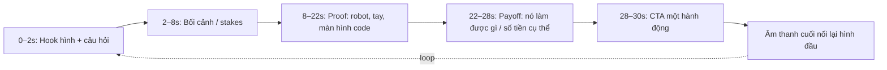

# R11 — Reels craft & platform (2025–2026)

**Phạm vi:** Facebook Reels/Page, Instagram Reels, TikTok; dựng CapCut trên điện thoại; quay robot; nội dung gây quỹ Robotics Sóc Sơn #39256.  
**Ngày chốt nghiên cứu:** 28/10/2026.  
**Quy ước:** `Meta chính thức` = Help Center/Newsroom của Meta; `TikTok chính thức` = TikTok for Business/Commercial Music Library; `CapCut chính thức` = điều khoản CapCut. Mỗi quy tắc có URL và ngày xuất bản/cập nhật nếu nguồn công bố; `28/10/2026` là ngày truy cập. Nội dung không tìm thấy quy định công khai được đánh dấu **[CHƯA XÁC MINH]**, không biến thành “luật”.

## 1. Kết luận ngắn

- Xuất master **1080×1920, 9:16, không watermark ứng dụng**, giữ mặt/người/robot và chữ trong vùng trung tâm. Đăng file sạch riêng lên Facebook và TikTok; không tải file đã có logo TikTok sang Facebook.
- Facebook đã đổi tab Videos thành Reels (06/2025) và nói video đăng Facebook có thể là **bất kỳ độ dài hoặc hướng khung**. Đây không phải lý do để làm video dài: V01 45 giây, V02 30 giây, V03 30–45 giây, V04 15–60 giây phù hợp hơn với câu chuyện ngắn.
- Facebook ưu tiên nội dung quay/tạo bởi Page; re-upload, ghép clip hoặc thêm viền/caption/tốc độ vào nội dung người khác là giá trị thấp và có thể bị giảm phân phối/không được đề xuất. Nội dung đội tự quay là lợi thế; ảnh sản phẩm hãng cần ghi nguồn và không được giả là ảnh đội.
- Nhạc CapCut tab **Music/Sounds** mặc định chỉ cho mục đích cá nhân, phi thương mại. CapCut **Commercial Sounds** chỉ cho CapCut/TikTok/TikTok for Business; dùng cùng file đó trên Facebook cần quyền riêng. Với Page và bài có khả năng boost: dùng Meta Sound Collection, original audio, hoặc track có giấy phép lưu được.
- Không coi “gây quỹ cho đội học sinh” tự động là Social Issues Ad. Khi boost, Ads Manager vẫn có thể yêu cầu xác minh/giấy tờ; nút Donate của Meta dành cho tổ chức đủ điều kiện. Facebook fundraising tools hiện mô tả PayPal Giving Fund ở Mỹ/Anh/Canada/Úc, không thấy Việt Nam trong nguồn đã đọc: dùng chuyển khoản/website công khai, kiểm tra trong tài khoản trước khi hứa có Facebook fundraiser.

## 2. Bảng thông số nền tảng và hành vi phân phối

| Nền tảng / hạng mục | Quy tắc hoặc khuyến nghị có thể dùng | Vùng UI / caption / hashtag | Originality, watermark, recommendation | Metric cần đọc | Nguồn chính thức + ngày |
|---|---|---|---|---|---|
| **Facebook Reels — file** | Từ 06/2025, tab Videos đổi tên thành Reels; Meta nói video Facebook có thể **mọi độ dài, mọi hướng**. Cho chiến dịch vẫn dùng 9:16 1080×1920 để tận dụng màn hình dọc. | Chữ/QR không đặt sát đỉnh/đáy/phải; vùng UI thay đổi theo máy và placement, nên dùng safe-area thực hành ở §3. Giới hạn caption “hiện trước khi bấm xem thêm”: **[CHƯA XÁC MINH]**. | Meta (03/2026): quay/tạo trực tiếp bởi chủ Page/Profile là original; nội dung bên thứ ba chỉ được xem là original khi có hiện diện và thông tin/phân tích/cải thiện cốt truyện đáng kể. Re-upload, ghép clip, thêm viền, caption hoặc đổi tốc độ vào nội dung người khác là unoriginal, có thể bị giảm phân phối/không được đề xuất/demonetize nếu lặp lại. Meta khuyên tránh watermark bên thứ ba. | Reels/Page Insights có thể thay đổi theo tài khoản; đo tối thiểu plays/views, watch time, average watch time, completion/retention nếu hiển thị, shares, saves, comments, follows, link/QR clicks. Định nghĩa chi tiết Facebook Page cho tài khoản này: **[CHƯA XÁC MINH]**. | [Use Sound Collection for reels on Facebook](https://www.facebook.com/business/help/880459498798521), cập nhật/đọc 28/10/2026; [Rewarding Original Creators](https://about.fb.com/news/2026/03/rewarding-original-creators-on-facebook/), 13/03/2026; [Combatendo conteúdo não original](https://about.fb.com/br/news/2025/07/combatendo-conteudo-nao-original-para-proteger-e-elevar-criadores-no-facebook/), 14/07/2025. |
| **Facebook Reels — caption/hashtag** | Caption không có giới hạn hiển thị công khai được xác nhận trong nguồn đã đọc. Viết 1–2 dòng đầu đủ nghĩa, sau đó thông tin chuyển khoản/link; không nhồi đoạn dài trước hook. | Meta Newsroom (07/2025) báo cáo caption không link, ít viết hoa và **tối đa 5 hashtag** có hiệu suất tốt hơn; đây là quan sát/khuyến nghị, không phải giới hạn bắt buộc. | Dùng video đội tự quay; cùng video có thể đăng trên Page/Profile của chính đội. Không dùng watermark TikTok. | Theo dõi reach/recommendation status, views/watch time, shares và follows; xem Professional Dashboard nếu có “issues impacting content”. | [Meta Newsroom 2025](https://about.fb.com/br/news/2025/07/combatendo-conteudo-nao-original-para-proteger-e-elevar-criadores-no-facebook/), 14/07/2025. |
| **Facebook Page post / Feed** | Ảnh carousel 1080×1350 phù hợp mobile; đây là lựa chọn sản xuất của đội, không phải giới hạn bắt buộc. Video Feed có placement riêng; chiều dài placement thay đổi. | Đặt QR, số tài khoản và chữ nhỏ cách viền; carousel phải đọc được không cần zoom. Caption “trước truncation”: **[CHƯA XÁC MINH]**; đặt CTA/link ở đầu nếu hành động quan trọng. | Page nên ưu tiên tài liệu tự tạo. Ảnh sản phẩm REV/goBILDA chỉ là tài liệu bên thứ ba; ghi nguồn, không thêm watermark của nguồn vào video rồi re-upload như nội dung tự quay. | Reach, post clicks/link clicks, reactions/comments/shares, saves; cách tính theo Page Insights tài khoản: **[CHƯA XÁC MINH]**. | [Meta originality guidance](https://about.fb.com/news/2026/03/rewarding-original-creators-on-facebook/), 13/03/2026; [Aspect ratios by placements](https://www.facebook.com/business/help/682655495435254), ngày cập nhật **[CHƯA XÁC MINH]**, truy cập 28/10/2026. |
| **Instagram Reels — organic** | 9:16 fullscreen là format nên dùng. Instagram organic length/caption max và vùng safe-zone chính xác: **[CHƯA XÁC MINH]** trong các trang công khai đã đọc; không ghi “90 giây” cho organic. | Dùng vùng giữa; không đặt CTA/QR phía dưới nơi caption/profile controls chồng lên. Caption hiển thị trước truncation: **[CHƯA XÁC MINH]**. Hashtag: giữ liên quan, không copy cả bộ Facebook nếu làm caption dài. | Không có kết luận đủ nguồn về IG recommendation eligibility cho tài khoản này. Không dùng watermark TikTok/ứng dụng khác; đây là thực hành an toàn, quy định phạt cụ thể **[CHƯA XÁC MINH]**. | Meta định nghĩa: **Views** = số lần reel bắt đầu phát hoặc phát lại; **Watch time** = tổng thời gian phát gồm replay; **Viewers** = tài khoản duy nhất đã thấy reel ít nhất một lần (ước tính); **Average watch time** = watch time chia initial views; **Follows** = tài khoản follow do xem reel. | [View insights on Instagram reels](https://www.facebook.com/business/help/202865988324236), trang hiện hiển thị ©2026, truy cập 28/10/2026; [Best practices for Instagram video ads](https://www.facebook.com/business/help/188534925073536), truy cập 28/10/2026. |
| **Instagram Reels — boost/ad** | Creative ad tối đa **15 phút**, nên fullscreen vertical; Reel đủ điều kiện boost phải **≤90 giây, 9:16**. Đã share sang Facebook thì không boost được theo trang eligibility. | Giữ key text/logo trong Reels safe zone; không dùng face/camera effects, GIF, product tags, interactive sticker/third-party filter cho boost theo trang eligibility. | Không dùng licensed music cho Instagram Reels ad/boost; dùng original audio hoặc royalty-free như Sound Collection. | Ads Manager/Instagram Insights tách organic và boosted; không gộp hai nhóm khi báo cáo. | [Create Instagram Reels Ads](https://www.facebook.com/business/help/4023434621109377), truy cập 28/10/2026; [Boost an Instagram Reel](https://www.facebook.com/business/help/1612862053363658), truy cập 28/10/2026. |
| **TikTok organic/creative** | TikTok for Business khuyến nghị creative **9:16 fullscreen**, sound-on, “short and sweet”, tập trung; không nêu một độ dài bắt buộc trong nguồn. V01–V04 nằm trong vùng short-form hợp lý. | TikTok yêu cầu ở safe zone để text không bị che bởi nút và caption; CTA phải khả dụng bằng nút/đích đến, chữ “Swipe Up” có thể bị hiểu như lướt video. Caption nên punchy và có hashtag. Caption truncation/giới hạn ký tự chính xác: **[CHƯA XÁC MINH]**. | Nguồn TikTok đã đọc khuyên uniqueness, không chỉ copy creative nền tảng khác. Quy tắc phạt cụ thể với watermark/repost trên organic TikTok: **[CHƯA XÁC MINH]**; dùng file master sạch là biện pháp giảm rủi ro. | Theo dõi views, average watch time/completion/retention, traffic source, shares, saves/comments/follows; tên và định nghĩa trong TikTok Analytics của tài khoản: **[CHƯA XÁC MINH]**. | [TikTok Creative Solutions: ultimate how-to guide](https://www.tiktok.com/business/en-US/blog/tiktok-creative-ultimate-guide), truy cập 28/10/2026. |
| **TikTok business/boost** | Ads creative 9:16; test bản native riêng, không bê nguyên caption/CTA Facebook. | Chừa vùng nút/caption; phụ đề ngắn, tương phản; không đặt QR quá nhỏ. | Doanh nghiệp **không được dùng general music library cho commercial usage**; dùng Commercial Music Library (CML) cho organic commercial content, ads, branded content. Original sound của người khác cần tự xin quyền. | Đọc organic và paid tách biệt; không dùng view làm donation conversion. | [Commercial Music Library](https://ads.us.tiktok.com/resources/help/article/commercial-music-library), cập nhật 07/2025; [TikTok Creative Solutions](https://www.tiktok.com/business/en-US/blog/tiktok-creative-ultimate-guide), truy cập 28/10/2026. |
| **Watermark/repost cross-platform** | Xuất một master sạch, upload native từng nền tảng. Chỉ giữ logo Robotics Sóc Sơn nhỏ, cố định, không che safe zone. | Không để TikTok UI, username, watermark động trong bản Facebook/Instagram. | Meta có chính sách rõ: watermark/low-value edits không biến nội dung người khác thành original. TikTok penalty cụ thể cho watermark của nền tảng khác chưa được xác minh từ nguồn chính thức đã đọc: **[CHƯA XÁC MINH]**. | So sánh retention và shares theo từng nền tảng; không coi cùng một view count là cùng định nghĩa. | Meta 13/03/2026 và 14/07/2025; TikTok guide ở trên; truy cập 28/10/2026. |

## 3. Safe zone thực hành cho 1080×1920

Không có con số pixel duy nhất được Meta/TikTok công bố cho mọi máy, nút và placement. Dùng **safe-area bảo thủ** sau khi preview native:

```text
1080 × 1920
┌────────────────────────────┐  0–180: tránh tiêu đề quan trọng
│       vùng tránh            │
│                            │
│   ┌────────────────────┐   │
│   │  VÙNG NỘI DUNG     │   │  x ≈ 90–930; y ≈ 220–1540
│   │  mặt / robot / chữ  │   │
│   │  hook + payoff      │   │
│   └────────────────────┘   │
│       tránh caption/UI     │  1540–1830: tránh QR, CTA, phụ đề cuối
└────────────────────────────┘  1830–1920: tránh hoàn toàn
```

- Giữ mặt, robot, số tiền, QR trong vùng giữa; QR có khoảng trắng và test quét ở màn hình điện thoại.
- Subtitle từng dòng 1–2 hàng, đặt thấp vừa đủ nhưng **trên** vùng caption/UI; xuất bản thử “private/unlisted” hoặc preview trong từng app.
- V01 hiện subtitle “giữa cao 60%”: không sai safe zone, nhưng chữ giữa khuôn mặt sẽ che biểu cảm. Đặt subtitle khoảng y=1250–1450, nhân vật lệch 1/3 khung.
- P01/P03/P04 thiết kế 4:5 1080×1350: không tái dùng nguyên ảnh vào Reels; tạo crop 9:16 riêng, không đặt QR ở đáy.

## 4. Nhạc, Page và quảng cáo gây quỹ

### 4.1 Nhạc

- **Meta Sound Collection:** Meta mô tả gần 16.000 bài/hiệu ứng rights-cleared, tải miễn phí để dùng trên Facebook; audio gắn nhãn “Royalty-free”, giúp tránh mute/demonetize do copyright. Dùng cho bản Facebook/Page và các bản có khả năng boost. [Meta Help, truy cập 28/10/2026](https://www.facebook.com/business/help/880459498798521).
- **Meta licensed music:** có thể dùng trong một số reel organic theo quyền của Meta, nhưng không mặc nhiên dùng được trong quảng cáo. Instagram Reels ads/boost yêu cầu original audio hoặc royalty-free Sound Collection. [Meta Help, truy cập 28/10/2026](https://www.facebook.com/business/help/4023434621109377).
- **CapCut Music/Sounds:** điều khoản 22/01/2026 nói Sounds dành cho video cá nhân, phi thương mại; không dùng để quảng bá brand/business nếu chưa có quyền riêng. [CapCut Materials License Agreement, 22/01/2026](https://www.capcut.com/clause/material-license-agreement).
- **CapCut Commercial Sounds:** cho commercial user trong CapCut, TikTok và TikTok for Business; dùng ngoài các nền tảng đó cần xin quyền/giấy phép riêng. Vì vậy không dùng Commercial Sound của CapCut cho cùng file đăng Facebook trừ khi có license bao phủ Facebook. [CapCut Materials License Agreement, 22/01/2026](https://www.capcut.com/clause/material-license-agreement).
- **TikTok CML:** TikTok nói CML là thư viện pre-cleared cho doanh nghiệp; general music library không dành cho commercial usage. Track TikTok CML không tự cấp quyền cho Facebook/Instagram. [TikTok CML, cập nhật 07/2025](https://ads.us.tiktok.com/resources/help/article/commercial-music-library).

**Workflow an toàn:** dựng hình/voice/subtitle trong CapCut → không gắn track chưa rõ quyền → xuất master sạch → bản FB thêm Sound Collection trong Meta Business Suite hoặc track đã cấp phép → bản TikTok thêm CML/original audio trong TikTok → lưu screenshot/license/track ID trong Drive `raw/rights/`.

### 4.2 Boost và nội dung xin tiền

- Meta có Special Ad Category cho **social issues, elections, politics**; quảng cáo vấn đề xã hội yêu cầu authorization và “Paid for by” disclaimer ở nơi áp dụng. Meta mô tả social issues là vấn đề gây tranh luận, có thể ảnh hưởng dư luận/chính sách; một chiến dịch mua linh kiện robot học sinh **không tự động** thuộc nhóm này. [Meta Help](https://www.facebook.com/business/help/214754279118974), [Meta Help](https://www.facebook.com/business/help/167836590566506), truy cập 28/10/2026.
- Nếu ad có nút **Donate Now**, Meta yêu cầu tổ chức từ thiện đăng ký đủ điều kiện; tài khoản cá nhân chuyển khoản cho đội không nên gắn nhãn nonprofit/charity khi chưa có tư cách đó. [Meta Help](https://vi-vn.facebook.com/business/help/621765098354751), truy cập 28/10/2026.
- Boost P06 Maker Day và V04 robot chạy là lựa chọn ít rủi ro hơn boost bài nêu STK. Tuy nhiên P06 bán vé 79.000/89.000 ₫ và V04 có QR/“còn thiếu”: vẫn phải kiểm tra Ads Manager policy, quyền nhạc, landing page, thông tin người nhận và khai báo đúng mục tiêu. Không hứa “được duyệt”.
- Nếu nội dung bị phân loại social issue hoặc yêu cầu authorization, dừng boost, chụp lý do từ Ads Manager, dùng organic post/website thay thế; không né bằng cách đổi từ “quyên góp” thành từ gây hiểu lầm.

### 4.3 Facebook fundraiser tại Việt Nam

Meta Help nêu fundraising tools phụ thuộc country/region; phần PayPal Giving Fund được nêu rõ cho nonprofit tại **Mỹ, Anh, Canada, Úc**. Nguồn không liệt kê Việt Nam trong phần đã đọc; chưa có bằng chứng công khai rằng Page Robotics Sóc Sơn ở Việt Nam được bật Facebook fundraiser. **[CHƯA XÁC MINH — cần kiểm tra trong Page Professional Dashboard/Meta Business Suite bằng tài khoản thật]**. [Meta Eligibility](https://www.facebook.com/help/1251484118194936), [Countries/Nonprofits](https://www.facebook.com/help/1640008462980459), truy cập 28/10/2026.

## 5. Editing craft cho học sinh

### 5.1 Retention structure



- **Hook:** chuyển động thật trong frame đầu (ốc đang siết, robot lao vào mục tiêu), chữ ≤ một ý; không mở bằng logo tĩnh.
- **Pacing:** cắt khi hành động hoặc ý đổi; cảnh cận 0,5–1,5 giây, cảnh giải thích 2–4 giây, phỏng vấn 3–6 giây mỗi nhịp. Đây là quy tắc dựng thực hành, không phải benchmark platform. Cắt bỏ pause, “ừm”, tay che lens và cảnh lặp.
- **On-screen text:** một câu 6–10 từ/lần, tương phản cao, tối đa 2 dòng; thuật ngữ giải thích bằng ví dụ đời thường; số tiền hiển thị cùng đơn vị `₫`; không đặt mọi thông tin vào một frame.
- **Subtitles:** chép đúng lời nói, chia theo nhịp, kiểm tra dấu tiếng Việt; đừng đặt subtitle giữa mặt. Luôn xem bản không tiếng để kiểm tra hiểu được câu chuyện.
- **Payoff:** phải trả lời đúng hook: robot tự chạy, slide vươn, bánh đi ngang, hoặc sổ cái ghi khoản chi. CTA sau payoff, không chèn QR từ giây 0.
- **Loop:** kết bằng chuyển động/âm thanh có thể nối frame đầu (tay đặt tua vít → frame đầu tay vặn ốc; robot tiến vào → cắt về robot lùi khỏi cùng đường). Không loop giả nếu làm mất thông tin/quyền riêng tư.

### 5.2 CapCut trên điện thoại

1. Tạo project 9:16; import bản gốc; tắt auto-enhance làm đổi màu kim loại.
2. Chọn hook trước, đặt marker ở beat/hành động; cắt phần thừa trước khi thêm effect.
3. Lồng voice-over hoặc phỏng vấn; giảm music xuống dưới voice; dùng noise reduction nhẹ, nghe lại bằng loa điện thoại.
4. Auto captions → sửa toàn bộ tên `BIOBUZZ`, `Control Hub`, `Viper Slide`, số tiền và dấu tiếng Việt; chọn font Inter Bold/white + shadow/outline vừa đủ.
5. Đặt caption/QR trong safe zone, thêm logo Robotics Sóc Sơn nhỏ cố định; không dùng template có watermark CapCut/TikTok.
6. Export 1080p, 30fps (slow-motion quay 60/120fps rồi conform 30fps), H.264 MP4; giữ file project và master không nhạc.
7. Upload native từng app, thêm nhạc đúng license ở bước cuối; preview trên điện thoại thứ hai; lưu `platform`, ngày, track/license và phiên bản caption.

### 5.3 Quay robot bằng điện thoại

- **Ánh sáng:** quay gần cửa sổ hoặc đèn lớn lệch 45°; khóa exposure/focus, tránh đèn trần nhấp nháy và nền sáng làm cháy chi tiết. Lau lens trước mỗi buổi.
- **Macro/detail:** quay 2–3 góc cận ốc, encoder, bánh, dây; giữ điện thoại 10–20 cm nếu camera cho phép, không zoom số; đặt một vật chuẩn để thấy kích thước.
- **Slow motion:** quay 60/120fps đủ sáng cho va chạm, slide vươn, bánh Mecanum; không dùng slow-mo cho toàn video vì làm mất nhịp. Không cố tình phá linh kiện.
- **POV/mount:** gắn điện thoại chắc bằng kẹp/strap, dây bảo hiểm; test rung và vùng nhìn; không đặt điện thoại vào vùng robot có thể kẹp/đâm; quay một take POV ngắn, rồi quay wide để người xem hiểu không gian.
- **Âm thanh:** phỏng vấn cách mic 50 cm khi không có lav; quay room tone 5 giây; tiếng motor có thể là payoff nhưng không để át lời.
- **An toàn/quyền:** xin đồng ý phụ huynh cho học sinh dưới 16 tuổi; Maker Day chỉ dùng mặt người có phiếu, người chưa đồng ý phải crop/blur như V04 đã nêu.

## 6. Đối chiếu bộ kit hiện tại — vi phạm / dùng thiếu và bản sửa

### V01 — `social/videos/V01-gioi-thieu.md`

- **Đang dùng tốt:** 1080×1920, hook 0–3s có chuyển động, subtitle, CapCut, voice/robot thật, 45s nằm trong short-form.
- **Vi phạm/rủi ro:** dòng 5 nói “nhạc ... thư viện bản quyền miễn phí của CapCut” nhưng không phân biệt `Music/Sounds` với `Commercial Sounds`; CapCut Music mặc định chỉ phi thương mại. **Sửa:** dựng không nhạc; thêm Meta Sound Collection cho bản FB, TikTok CML/original cho bản TikTok; không dùng cùng track CapCut sang FB nếu chưa có license. [CapCut 22/01/2026; Meta/TikTok ở §4].
- **Dùng thiếu:** subtitle “giữa cao 60%” có thể che mặt; CTA/QR/STK chiếm 8 giây cuối, chưa có payoff robot trước khi xin tiền. **Sửa timeline:** 0–2 hook; 2–7 câu hỏi + robot; 7–15 thành tích; 15–25 comeback + cảnh tự hành; 25–34 11 linh kiện/mốc; 34–41 payoff robot cũ chạy; 41–45 CTA một hành động. Đưa subtitle xuống safe zone.
- **Dùng thiếu:** đăng FB rồi “đăng lại TikTok” dễ dùng file có metadata/watermark nếu tải từ app. **Sửa:** upload cùng master sạch, caption native từng nền tảng.

### V02 — `social/videos/V02-chuyen-linh-kien.md`

- **Đang dùng tốt:** 30s, hook 0–3, công dụng, số tiền, CTA; M1–M5 có câu chuyện rõ.
- **Dùng thiếu:** giây 27–30 vừa QR vừa `BIOBUZZ Mx HOTEN SDT`, quá nhiều chữ/QR ở vùng TikTok bottom UI; payoff chưa luôn là cảnh robot thật (M1 dùng laptop, M2 dùng selfie stick). **Sửa:** 22–26 cho thấy hành động robot; 26–30 chỉ CTA/QR; chữ QR trong vùng giữa và dùng landing page dễ nhớ.
- **Rủi ro originality:** “ảnh sản phẩm” nếu lấy từ REV/goBILDA rồi ghép lại không phải footage đội; Meta coi low-value edits/re-upload là unoriginal khi nội dung thuộc người khác. **Sửa:** ưu tiên quay đồ đội đang có; nếu chưa có hàng ghi “Linh kiện minh họa”, nguồn ở caption/slide, thêm voice giải thích giá trị mới.
- **Rủi ro nhạc:** áp dụng cùng sửa V01; tạo bản Facebook/TikTok riêng.
- **M5:** sổ Google Sheet phải che tên/STK; không quay dữ liệu cá nhân trong lúc zoom.

### V03 — `social/videos/V03-hoc-sinh-lam-robot.md`

- **Đang dùng tốt:** 30–45s, con người thật, không QR, câu hỏi cảm xúc, đồng ý phụ huynh.
- **Dùng thiếu:** mỗi người 10s liên tục dễ mất nhịp; “không đưa kịch bản trước” có thể tạo câu trả lời dài/không an toàn. **Sửa:** gửi chủ đề trước, không ép câu chữ; xin đồng ý dùng câu trả lời; cắt 2–4s mỗi người, xen B-roll tay/robot sau mỗi câu.
- **Dùng thiếu:** cuối chỉ `Robotics Sóc Sơn #39256 · BUILD THE NEXT ROBOT`, chưa có payoff hình ảnh/CTA rõ. **Sửa:** 2s cuối: robot chạy + “Theo dõi build log — không cần chuyển khoản”; giữ CTA ngoài vùng UI.
- **Rủi ro:** dòng “link /support” không phải URL tappable trên mọi placement. **Sửa:** dùng link trong caption/bio hoặc nút native; không đặt chữ “Swipe Up” trên TikTok.

### V04 — `social/videos/V04-build-log.md`

- **Đang dùng tốt:** chỉ đăng sau khi sự việc xảy ra; điều kiện thực tế; consent Maker Day; các độ dài ngắn; có B-roll đa dạng.
- **Vi phạm/rủi ro:** mẫu unboxing ghi “Mua bằng 17.546.000 ₫ của X người ủng hộ” và “Còn thiếu Y ₫ · QR” trong 30s; nếu số chưa chốt hoặc tiền/đơn hàng chưa đối soát sẽ làm mất trust. **Sửa:** lấy số từ sổ đã nhận thật; chèn ngày snapshot; CTA một dòng cuối, QR không chạm đáy UI.
- **Dùng thiếu:** #3 recap 45–60s chưa có hook/payoff/loop; #1–#5 chưa ghi shot list/cut points. **Sửa:** mở bằng khoảnh khắc điểm; 3 trạm = 3 beat; kết bằng robot/tiếng motor nối frame đầu; mỗi clip có bản 9:16 sạch.
- **Rủi ro:** thùng DHL/FedEx, địa chỉ, nhãn vận chuyển hoặc mặt học sinh có thể lộ dữ liệu. **Sửa:** blur tracking/địa chỉ trước upload; quay nhãn đã che.
- **Boost:** V04 robot chạy được boost nhưng vẫn kiểm tra nhạc, QR/landing page và Ads Manager; không coi “không phải bài xin tiền” là tự động được duyệt.

### P01 — `social/posters/P01-phat-dong.md`

- **Dùng tốt:** tách 4:5 feed và 9:16 story, hierarchy rõ, QR test, kiểm tra STK.
- **Dùng thiếu:** 9:16 story giữ nguyên mọi khối nhưng chữ STK/QR ở đáy; bản crop cho Reels chưa có. **Sửa:** tạo crop riêng: hook/đội/số tiền ở safe zone giữa; CTA link native; không dùng poster tĩnh làm “Reel” dài nếu không có motion/voice.
- **Rủi ro:** placeholder QR và thông tin tài khoản là trust/safety critical. Chỉ đăng sau checklist đã có; không boost khi website/support chưa hiển thị cùng thông tin.

### P02 — `social/posters/P02-anh-bia-avatar.md`

- **Dùng tốt:** vùng an toàn cover, không QR cover.
- **Dùng thiếu:** không có phiên bản 9:16 cho Story/Reels; caption cover không có CTA rõ. **Sửa:** giữ P02 là cover/avatar; nếu biến thành video, quay pan/zoom đội 5–7s rồi hook “FTC #39256 bắt đầu từ đâu?”.
- **Rủi ro:** ảnh thành viên/người ủng hộ đổi avatar cần consent; không tự động coi frame là quyền sử dụng ad.

### P03 — `social/posters/P03-chuyen-linh-kien.md`

- **Dùng tốt:** carousel 1080×1350, hook → giải thích → lý do → giá → CTA; QR slide cuối.
- **Dùng thiếu:** cùng nội dung text-heavy nếu đăng thành Reels sẽ không giữ attention; QR 320px có thể nhỏ khi crop. **Sửa:** mỗi P03 tạo companion V02: một linh kiện thật, một hành động robot, một con số; QR ở frame cuối safe zone; caption chỉ tóm tắt 1–2 ý rồi link.
- **Rủi ro:** ảnh sản phẩm hãng cần source; không xóa watermark/credit rồi re-upload như footage original.
- **Sửa facts trước đăng:** M3 nói “trận 2 phút 30 giây”, M2 “18 inch/45,7 cm”, giá/thuế phải khớp tài liệu thi đấu và hóa đơn; phần platform không xác nhận các facts này.

### P04 — `social/posters/P04-tien-do-quy.md`

- **Dùng tốt:** chỉ ghi tiền thật vào tài khoản, có báo cáo Đã nhận/Đã chi/Còn lại, biến thể đạt mốc bỏ QR.
- **Dùng thiếu:** infographic tĩnh có quá nhiều thanh/đơn vị; trên mobile chữ nhỏ và QR ở đáy dễ bị UI che. **Sửa:** phiên bản Reel 8–12s: số đã nhận → một thanh tiến độ → khoản chi/mission → CTA/link; một frame chỉ một số.
- **Rủi ro:** “N người”, số dư, tên người ủng hộ là dữ liệu cá nhân/tài chính. Chỉ dùng số đã đối soát; che tên; không quay màn hình Sheet có STK.
- **Quảng cáo:** không boost P04 mặc định; nếu boost, kiểm tra policy gây quỹ/landing page và khai báo chính xác.

### P05 — `social/posters/P05-thanh-tich.md`

- **Dùng tốt:** carousel kể chuyện comeback, không QR trên ảnh, có nguồn nhỏ.
- **Dùng thiếu:** mỗi slide có nhiều chữ/số; thiếu video proof trong Reels. **Sửa:** companion 15–25s: huy chương/ảnh → một câu thành tích → hạng 36/38 → cảnh lab hiện tại → CTA theo dõi, không xin tiền ngay frame đầu.
- **Rủi ro:** thành tích/đội code phải khớp nguồn chuẩn hóa; không dùng ảnh giải có quyền không rõ. Gắn source trong caption/slide cuối.

### P06 — `social/posters/P06-maker-day.md`

- **Dùng tốt:** 1080×1350, thông tin event/giá/ca/chỗ; boost địa phương có mục tiêu.
- **Vi phạm/rủi ro:** QR form “chưa tạo” trong brief; không đăng/boost trước khi form, consent phụ huynh và payment flow hoạt động. **Sửa:** tạo/kiểm tra form, test QR bằng 2 máy; landing page nói rõ vé không tính vào quỹ 33.975.000 ₫.
- **Dùng thiếu:** bản tĩnh nhiều chữ; TikTok/Reels cần demo robot 3–5s + ngày/ca/đối tượng + một CTA đăng ký. Không đặt QR ở vùng bottom.
- **Quảng cáo:** nội dung bán vé không phải Donate; vẫn kiểm tra music, audience 15 km, age/children privacy, policy trước boost. Không dùng “Donate Now” nếu không phải nonprofit đủ điều kiện.

### P07 — `social/posters/P07-cam-on.md`

- **Dùng tốt:** che tên, chỉ ghi tổng tuần, duyệt logo/tên doanh nghiệp.
- **Dùng thiếu:** poster cảm ơn không có proof động. **Sửa:** Reel 10–15s: tiền/mission → tay lắp đúng linh kiện → lời cảm ơn; CTA theo dõi hoặc link báo cáo, không nhồi STK nếu không cần.
- **Rủi ro:** tên/ảnh/logo/số tiền doanh nghiệp cần consent bằng văn bản; không tag người chưa đồng ý; không để QR/CTA dưới vùng TikTok UI.

### P08 — `social/posters/P08-thanh-vien.md`

- **Dùng tốt:** ảnh nền đen theo brand, không QR, consent dưới 16 tuổi.
- **Dùng thiếu:** carousel 3–4 chân dung dễ thành slideshow tĩnh; dòng lớp/role không nên nằm sát đáy. **Sửa:** mỗi thành viên 2–3s: portrait → tay làm nhiệm vụ → một câu voice; caption native, CTA “theo dõi”.
- **Rủi ro:** `src/data/team.ts` là nguồn dữ liệu nội bộ, không tự đoán lớp; xin duyệt câu trích trước đăng; không target/boost theo cách lộ dữ liệu trẻ em.

### `social/02-lich-dang.md`

- **Dùng tốt:** lịch 3 bài/tuần, có điều kiện sự kiện thật, giới hạn 2 bài có QR/tuần, chọn P06/V04 cho boost.
- **Dùng thiếu:** lịch nói “đăng Reels Facebook, sau đó đăng lại TikTok” nhưng không quy định master sạch, audio license, native caption, safe zone, preview và đo lường từng platform. **Sửa dòng 24 và mọi V02/V03/V04:** “upload file master sạch riêng; thêm audio native đúng license; không cross-post watermark; caption/CTA native”.
- **Rủi ro:** lịch P06 ngày 24/11 nhưng form trong P06 chưa tạo; lịch V04 unboxing phụ thuộc hàng thật nên cần giữ điều kiện “chỉ khi đã đối soát”.
- **Dùng thiếu:** 19:30/11:30 là lịch nội bộ, chưa có bằng chứng là giờ tối ưu. Theo dõi 2–3 tuần bằng views, average watch time, shares, follows và QR/link clicks; không tuyên bố giờ đăng tốt nhất khi chưa có Page/Account Insights.
- **Boost:** câu “Không boost bài xin tiền” là thận trọng, nhưng không thay thế policy check. P06 có bán vé; V04 vẫn có QR; kiểm tra từng creative, music rights và landing page trước gửi review.

## 7. Bảng kiểm xuất bản

- [ ] File 1080×1920, 9:16; không TikTok/CapCut watermark; logo đội nằm trong vùng giữa.
- [ ] Hook có chuyển động/ý cụ thể trong 0–2s; payoff chứng minh hook; CTA chỉ một hành động.
- [ ] Chữ/subtitle không che mặt/robot; đọc được khi tắt tiếng; không nằm vùng UI/caption.
- [ ] Số tiền, STK, QR, tên người nhận, URL và ngày snapshot đã kiểm tra hai người; QR quét từ hai điện thoại.
- [ ] Chỉ dùng footage/ảnh có quyền; người dưới 16 tuổi/Maker Day có consent; blur địa chỉ/Sheet/nhãn vận chuyển.
- [ ] Nhạc có track ID/license: Meta Sound Collection cho FB/ads; TikTok CML/original cho TikTok; không dùng CapCut Music mặc định cho nội dung quảng bá Page.
- [ ] Upload native mỗi nền tảng; preview sau upload; lưu URL, ngày, phiên bản caption và screenshot rights.
- [ ] Sau 24–48h và 7 ngày, ghi views, watch time/average watch time, completion nếu có, shares, saves, comments, follows, link/QR clicks; tách organic/boosted.

## Áp dụng cho Robotics Sóc Sơn

1. **V01 giây 0–3:** giữ tay vặn ốc nhưng thay hook thành chữ 1 dòng; đưa subtitle xuống vùng y≈1250–1450; thay nhạc CapCut bằng hai bản audio: Meta Sound Collection cho FB, TikTok CML/original cho TikTok.
2. **V02 giây 22–30:** cho payoff robot/linh kiện thật ở 22–26; QR + `BIOBUZZ Mx` một mình ở 26–30; tạo master sạch; P03 nguồn ảnh phải nằm caption/slide.
3. **V03:** cắt mỗi câu trả lời 2–4s, xen B-roll robot; link `/support` thành link trong caption/bio/nút native; thêm consent review trước đăng.
4. **V04:** blur vận đơn/địa chỉ/Sheet; số “X người”, “Y ₫” lấy từ snapshot sổ cái; thêm hook/payoff/loop; chỉ boost sau kiểm tra nhạc, QR và landing page.
5. **P01:** giữ 4:5 và Story riêng; tạo crop 9:16 không đặt QR/STK dưới đáy; chỉ đăng QR thật, không `placeholder`.
6. **P02:** giữ làm cover/avatar; không kéo nguyên cover vào Reel; nếu làm Reel, quay pan/zoom 5–7s và xin consent ảnh.
7. **P03:** giữ carousel 1080×1350; companion V02 dùng footage đội tự quay, text ít; kiểm tra facts giá, thuế, luật thi đấu trước đăng.
8. **P04:** tạo Reel tiến độ 8–12s từ số tiền đã đối soát; không lộ tên/STK/Sheet; bỏ QR ở bản “đã đủ”; không boost mặc định.
9. **P05:** tạo Reel comeback 15–25s từ ảnh/footage có quyền; nguồn thành tích trong caption; CTA theo dõi, không mở đầu bằng xin tiền.
10. **P06:** tạo Google Form trước 24/11, test QR hai máy, thêm consent phụ huynh; Reel demo robot + 1 CTA đăng ký; kiểm tra Ads Manager trước boost 350.000 ₫.
11. **P07:** Reel cảm ơn 10–15s dùng tổng tuần/mission + tay lắp; duyệt tên/logo/số tiền doanh nghiệp; không công khai người chưa đồng ý.
12. **P08:** portrait → nhiệm vụ → câu nói 2–3s/người; giữ chữ lớp/role trong safe zone; không target/boost để lộ dữ liệu học sinh.
13. **`02-lich-dang.md` dòng 24 và các dòng V02/V03/V04:** đổi “đăng lại TikTok” thành “upload master sạch riêng; audio native theo license; caption/CTA/safe-zone native; ghi Insights sau 24–48h/7 ngày”; thêm bước policy check trước hai boost.

## Nguồn

1. Meta, “Use Sound Collection for reels on Facebook”, https://www.facebook.com/business/help/880459498798521 — nội dung hiển thị 2026, truy cập 28/10/2026.
2. Meta, “Rewarding Original Creators on Facebook”, https://about.fb.com/news/2026/03/rewarding-original-creators-on-facebook/ — 13/03/2026, truy cập 28/10/2026.
3. Meta, “Combatendo conteúdo não original…”, https://about.fb.com/br/news/2025/07/combatendo-conteudo-nao-original-para-proteger-e-elevar-criadores-no-facebook/ — 14/07/2025, truy cập 28/10/2026.
4. Meta, “View insights on your Instagram reels”, https://www.facebook.com/business/help/202865988324236 — trang ©2026, truy cập 28/10/2026.
5. Meta, “Create Instagram Reels Ads”, https://www.facebook.com/business/help/4023434621109377 — truy cập 28/10/2026.
6. Meta, “Boost an Instagram Reel”, https://www.facebook.com/business/help/1612862053363658 — truy cập 28/10/2026.
7. Meta, “Aspect Ratios Supported by Placements”, https://www.facebook.com/business/help/682655495435254 — truy cập 28/10/2026.
8. Meta, “About social issues”, https://www.facebook.com/business/help/214754279118974 — truy cập 28/10/2026.
9. Meta, “About ads about social issues, elections or politics”, https://www.facebook.com/business/help/167836590566506 — truy cập 28/10/2026.
10. Meta, “Cách thêm nút kêu gọi hành động…”, https://vi-vn.facebook.com/business/help/621765098354751 — truy cập 28/10/2026.
11. Meta, “Eligibility requirements for Meta's fundraising tools”, https://www.facebook.com/help/1251484118194936 — truy cập 28/10/2026.
12. Meta, “Nonprofits and Charities”, https://www.facebook.com/help/1640008462980459 — truy cập 28/10/2026.
13. TikTok for Business, “Creative Solutions: The ultimate how-to guide”, https://www.tiktok.com/business/en-US/blog/tiktok-creative-ultimate-guide — truy cập 28/10/2026.
14. TikTok for Business, “About the Commercial Music Library”, https://ads.us.tiktok.com/resources/help/article/commercial-music-library — cập nhật 07/2025, truy cập 28/10/2026.
15. CapCut, “CapCut Materials License Agreement”, https://www.capcut.com/clause/material-license-agreement — 22/01/2026, truy cập 28/10/2026.
16. TED/YouTube, Jenny Hoyos, “The Secret to Telling a Great Story — in Less Than 60 Seconds”, https://www.youtube.com/watch?v=ZmNpeXTj2c4 — video được tìm qua YouTube `yt-dlp`; transcript auto-caption đã được yêu cầu 28/10/2026; dùng như tham khảo craft, không dùng làm quy tắc platform.

**Giới hạn cần kiểm tra lại trong tài khoản thật:** caption truncation/character limits của từng app; organic Instagram/TikTok duration và recommendation eligibility theo quốc gia/tài khoản; pixel safe-zone động; TikTok penalty định lượng cho watermark/repost; Facebook fundraiser availability tại Việt Nam; Page/Reels Insights definitions cụ thể ngoài Instagram; policy outcome của từng boost.