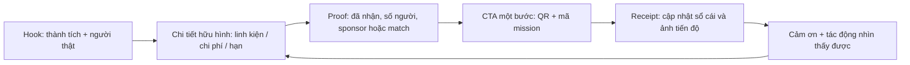

# R12 — Case gây quỹ robotics/STEM và nội dung chuyển đổi

**Ngày tra cứu:** 28/10/2026. **Phạm vi:** các trang gây quỹ công khai, báo trường và nghiên cứu học thuật; ưu tiên GoFundMe, FIRST và nguồn gốc. Số tiền/kết quả là ảnh chụp tại ngày tra cứu, có thể thay đổi. `[CHƯA XÁC MINH]` nghĩa là trang không công bố đủ dữ liệu để suy ra hiệu quả từng bài đăng. Không suy ra quan hệ nhân quả từ một chiến dịch đơn lẻ.

## 1. Tóm tắt điều hành

- Bài kêu gọi mạnh nhất không nói “hãy giúp đội robot” chung chung. Bài nói **ai** (học sinh/đội cụ thể), **đạt gì**, **thiếu gì**, **mỗi khoản mua gì**, **hạn nào**, rồi đưa CTA một bước.
- Mốc tiến độ cần vừa đủ gần để người xem thấy đóng góp có tác dụng. Kuppuswamy & Bayus tìm thấy hỗ trợ tăng khi dự án gần mục tiêu và gần hạn; cập nhật cuối kỳ cũng thường tăng ở dự án đạt mục tiêu.
- Social proof nên là dữ liệu đã nhận thật: số người, số tiền, mission đã mở khóa, ảnh hàng về. Không dùng tên/số tiền cá nhân khi chưa có đồng ý.
- Matching gift có ích nhất khi nói rõ người đối ứng, tỷ lệ, trần và hạn. Không hứa “nhân đôi” nếu chưa có cam kết bằng văn bản.
- “$X mua Y” làm khoản đóng góp hữu hình hơn, nhưng không được bịa quy đổi (ví dụ 50.000 ₫ không chắc mua được một con ốc). Với Robotics Sóc Sơn, dùng “góp vào M1/M2” và liệt kê giá linh kiện thật.
- Cảm ơn và cập nhật sau khi nhận tiền bảo vệ niềm tin; không nên biến mọi bài thành CTA xin tiền. Cảm ơn phải kèm đầu ra: biên nhận/sổ cái, ảnh mở hộp, test linh kiện, hoặc kết quả Maker Day.



## 2. 15 case công khai

| # | Đội/nhóm, nơi | Họ đăng/nói gì; hook | CTA và kết quả công khai | Bài học áp dụng |
|---:|---|---|---|---|
| 1 | **FTC 4410 Lightning**, Massachusetts, Mỹ | “Help ... go to Worlds”; nhấn hạng 2 Inspire Award và suất World Championship; liệt kê registration, travel, lodging, pit materials. | Kêu gọi donate/share. Trang ghi **$6,856/$6,800, 49 donors** (12/03/2025). [GoFundMe](https://www.gofundme.com/f/help-take-raahils-robotics-team-to-the-world-championship) (tra cứu 28/10/2026). | Thành tích cụ thể + danh sách chi phí + mục tiêu nhỏ, gần đích. |
| 2 | **FTC TeraBridges 18603**, Upper St Clair, Mỹ | “Một trong 4 đội FTC Pennsylvania, duy nhất Western PA”; 13 học sinh + 3 coach, khoảng $1,500/người; “more than just robots” và outreach 3.000 người. | Kêu gọi share/donate; công bố Beitler Warehousing **match đến $10,000**. **$14,095/$25,000, 114 donors**; cập nhật sau mùa: Top 57/8.800+, Top 8 division, First Place Connect Award. [GoFundMe](https://www.gofundme.com/f/help-get-a-usc-robotics-team-to-the-world-championship) (13/03/2025; cập nhật 24/05/2025). | Match có người, trần; outcome update biến donation thành câu chuyện hoàn tất. |
| 3 | **FTC 9974 T.H.O.R**, Iowa, Mỹ | “Community-based, không nhận tiền trường”; đội 7 người; kể suất Worlds và mục tiêu registration/travel/lodging/parts. | Donate/share. **$3,480/$15,000, 42 donors** (trang không ghi ngày truy cập cụ thể). [GoFundMe](https://www.gofundme.com/f/help-ftc-team-9974-thor-pay-for-worlds) (tra cứu 28/10/2026). | Nêu rào cản công bằng (“100% funding”) và danh sách chi tiêu cụ thể. |
| 4 | **FRC 10063 SCRAP Robotics**, Weymouth, Mỹ | “Re-founded in 2023”; kể đội student-led, học CAD/fabrication/software trong 6 tuần; đăng breakdown: district $4k, Worlds $6k, hotels, transport. | Donate trước hạn đăng ký; **$5,700/$15,000, 38 donors** (23/03/2026). [GoFundMe](https://www.gofundme.com/f/scrap-to-success-send-weymouth-robotics-to-the-next-step) (tra cứu 28/10/2026). | Bảng chi phí và lý do deadline làm CTA có tính khẩn cấp nhưng kiểm chứng được. |
| 5 | **FTC RoboScout Squad**, Montana, Mỹ | Đội FTC toàn nữ; hook “represent Montana”; liệt kê airfare, luggage, lodging, food, registration, parts, booth và NASA; nói rõ 9 tuần/32.000 USD. | Donate/share; có email riêng cho khoản >$249 và receipt thuế; **$24,735/$28,000, 61 donors**. [GoFundMe](https://www.gofundme.com/f/roboscoutsquad2026) (tra cứu 28/10/2026). | Identifiable beneficiaries + mục tiêu thời gian + đường dẫn tài trợ lớn riêng. |
| 6 | **FRC 3182 Athena’s Warriors 4-H**, Connecticut, Mỹ | 4-H nonprofit, học sinh high-school; “qualified for Worlds”, ước tính trip $25k; giải thích đội tự vận hành và outreach từ 2010. | Donate để bù chi phí; **$10,801/$20,000, 70 donors**. [GoFundMe](https://www.gofundme.com/f/frc-team-3182) (trang có update 2025; tra cứu 28/10/2026). | Lịch sử phục vụ cộng đồng giúp lời kêu gọi không chỉ xoay quanh robot. |
| 7 | **FRC 484 Roboforce**, Pennsylvania, Mỹ | Nêu suất Worlds lần 2, 24 học sinh, travel khoảng $1,500/người; ảnh hưởng trực tiếp tới học sinh có nguy cơ không đi được. | Donate/sponsor/in-kind; update ghi **7 học sinh được đi nhờ quỹ**, phần còn lại được trợ giá; đội xếp 23/78 division. Trang hiển thị **$21,660/$48,400, 271 donors**. [GoFundMe](https://www.gofundme.com/f/frc-team-484) (11/04/2023; tra cứu 28/10/2026). | Cập nhật “tiền đã mở cơ hội cho ai” mạnh hơn chỉ báo phần trăm. |
| 8 | **FRC 5587 Titan Robotics**, Virginia, Mỹ | Kể từ 20 học sinh đến chương trình 8 năm, hai blue banners và Chairman’s Award; nhấn không thu phí thành viên để robotics mở cho mọi người. | Donate cho transport/accommodation/meals; **$11,806/$20,000**. [GoFundMe](https://www.gofundme.com/f/titan-robotics-worlds-fund) (chiến dịch 2022; tra cứu 28/10/2026). | Liên kết donation với access/equity và thành tích cộng đồng. |
| 9 | **VEX Thistle Robotics**, James Gillespie’s High School, Scotland | 16–17 tuổi, vô địch quốc gia, THINK Award; “đội trường công Scotland duy nhất”; chia nhỏ £6,650 flights, £1,400 registration, £4,000 accommodation, robot case, visa, parts. | “Help us reach our goal”; **£8,065/£14,000, 102 donors** (08/03/2026). [GoFundMe](https://www.gofundme.com/f/send-thistle-robotics-to-the-vex-robotics-world-championship) (tra cứu 28/10/2026). | Hook địa phương (“represent Scotland”) + itemized ask + CTA trước ngày thi. |
| 10 | **VEX Cal High 1516X Grizzly Overdrive**, California, Mỹ | Tám học sinh tự vận hành, không mentoring kỹ thuật; Design Award và lần đầu trường vào Worlds; kể parts xuống cấp (motor, battery, pneumatic). | Donate cho $1,800 registration + parts/tools/travel; **$3,805/$4,500, 44 donors** (10/03/2026). [GoFundMe](https://www.gofundme.com/f/help-studentrun-cal-high-robotics-team-to-vex-world-champs) (tra cứu 28/10/2026). | “Student-run” và failure cụ thể tạo tính xác thực; nói chính xác tiền mua gì. |
| 11 | **VEX Rusty Cogs**, St Joseph’s Middle School, Anh | Sáu học sinh Year 8, một nữ/năm nam; thắng nhiều hạng mục và vào national finals; cần transport/accommodation cho 6 học sinh + 2 staff. | Donate/share; **£2,080/£2,000, 65 donors** (14/02/2025). [GoFundMe](https://www.gofundme.com/f/our-y8-vex-robotics-team-to-represent-st-josephs-mid) (tra cứu 28/10/2026). | Nêu số người hưởng lợi và mốc thi gần; kết quả vượt mục tiêu là social proof. |
| 12 | **Parallax Robotics**, Title I Edison High School, New Jersey, Mỹ | Đội VEX mới thành lập; “innovation can come from anywhere”; giải thích trường ít nguồn lực, parts/registration/travel. | Donate dù nhỏ; **$2,065/$5,000, 51 donors** (05/10/2025). [GoFundMe](https://www.gofundme.com/f/support-parallax-robotics-title-i-school-stem-team) (tra cứu 28/10/2026). | Framing access và trường Title I giúp người xem hiểu vì sao cần cộng đồng. |
| 13 | **Norman Advanced Robotics**, Oklahoma, Mỹ | Giáo viên nghỉ hưu kể đội autonomous do học sinh làm chủ, lịch sử 3 World Championships và alumni; ngân sách $10k–20k, trường cấp $600. | Donate cho registration/equipment/travel; **$11,850/$20,000, 40 donors** (12/05/2024). [GoFundMe](https://www.gofundme.com/f/help-fund-Normans-future) (tra cứu 28/10/2026). | Người bảo chứng có uy tín + lịch sử dài + con số trường cấp làm rõ gap. |
| 14 | **Advanced Robotics at UW (ARUW)**, University of Washington, Mỹ | Student-run 70+ thành viên; build robot RoboMaster và nêu giải quốc tế năm trước; nhấn kỹ năng học được và sponsor hiện có. | Donate; **$2,365/$25,000, 23 donors**. [GoFundMe](https://www.gofundme.com/f/support-aruw/team) (tra cứu 28/10/2026). | Social proof bằng thành tích/sponsor, nhưng mục tiêu lớn cần thêm các mốc nhỏ hơn. |
| 15 | **Berkeley High Team Berkelium**, California, Mỹ | Báo trường ghi đội hết funding một tuần trước Worlds, cần $20k cho 21 học sinh + 4 chaperones; GoFundMe và lan truyền cộng đồng. | Tạo GoFundMe; **gần $30,000 trong 3 ngày**, dùng cho $5k registration, travel, food, housing, robot truck và scholarships. [Berkeley High Jacket](https://berkeleyhighjacket.com/2023/news/bhs-robotics-takes-seventh-place-at-international-competition/) (05/05/2023). | Deadline + khoản thiếu rõ + tin báo địa phương có thể tạo đợt lan truyền; không nên đợi đến tuần cuối. |

**Cách đọc bảng:** Đây là kết quả của trang chiến dịch, không phải attribution cho một caption/video cụ thể. Với case không có post history hoặc analytics, cột “họ đăng” chỉ mô tả nội dung trang gây quỹ; hiệu quả từng hook là `[CHƯA XÁC MINH]`.

## 3. Nghiên cứu về điều gì làm người ta đóng góp

| Cơ chế | Bằng chứng | Quy tắc nội dung cho đội |
|---|---|---|
| **Identifiable-victim / single-beneficiary** | Small, Loewenstein & Slovic, “Sympathy and Callousness” (2007), *Organizational Behavior and Human Decision Processes*: field experiments cho thấy người nhận diện được thường tạo thiện cảm hơn người nhận thống kê; việc bắt người đọc tính toán có thể làm giảm tổng cho đi. [ERIC record](https://eric.ed.gov/?id=EJ797044), [bản PDF](https://www.cmu.edu/dietrich/sds/docs/loewenstein/SympathyCallous.pdf). | Cho thấy một học sinh/nhóm nhỏ đang làm một việc thật, nhưng xin phép trước khi lộ mặt/tên. Không dùng ảnh trẻ em như “nạn nhân”; mô tả năng lực, mục tiêu và quyền chủ động. |
| **Tangibility / specificity** | Cryder & Loewenstein, “The Critical Link Between Tangibility and Generosity” (chương tổng quan; các thí nghiệm Cryder, Loewenstein & Scheines 2009): mô tả cụ thể cách tiền được dùng làm khoản đóng góp gần như cao hơn mô tả chung; cảm nhận “mình tạo ra tác động” là cơ chế trung gian. [CMU PDF](https://www.cmu.edu/dietrich/sds/docs/loewenstein/CriticalLinkTangibilityGenerosity.pdf). | P03 nói “REV Control Hub 11.716.000 ₫ chạy chương trình tự hành”, không chỉ “ủng hộ robot”. Giữ giá/thuế/ship có nguồn; không hứa một khoản nhỏ mua trọn món nếu không đúng. |
| **Goal-gradient / progress proximity** | Kuppuswamy & Bayus, “Does my contribution to your crowdfunding project matter?” (2017), *Journal of Business Venturing*: dữ liệu Kickstarter cho thấy hỗ trợ tăng khi gần mục tiêu; hiệu ứng mạnh hơn gần deadline, mục tiêu nhỏ hoặc ít hỗ trợ sớm; sau khi đạt mục tiêu, đóng góp giảm. [RePEc](https://ideas.repec.org/a/eee/jbvent/v32y2017i1p72-89.html), [working paper](https://funginstitute.berkeley.edu/wp-content/uploads/2013/11/Crowdfunding_Creative_Ideas.pdf). | P04 hiển thị số tiền còn thiếu tới **mốc kế tiếp**, không chỉ 36% tổng; dùng countdown 72h/24h trước 20/11 và 05/12. Khi đạt mốc, chuyển sang “đã mở khóa” + bằng chứng mua hàng + next mission. |
| **Social proof / social information** | Shang & Croson, “A Field Experiment in Charitable Contribution” (2009), *Economic Journal*: thông tin mức đóng góp xã hội phù hợp làm đóng góp tăng 12% ($13), tới 29% ($25,33) ở donor mới trong điều kiện hiệu quả nhất; mức quá cực đoan có thể mất tác dụng. [DOI](https://doi.org/10.1111/j.1468-0297.2009.02267.x), [Oxford](https://academic.oup.com/ej/article-abstract/119/540/1422/5089584). | P04/C01 ghi “N người đã ủng hộ tuần này”, “M1 đã đủ”, ảnh sponsor đã duyệt. Dùng số thật, không dựng bình luận/đếm người. Không đưa con số quá lớn khiến 50k của học sinh thấy vô nghĩa. |
| **Matching gift / lead donor** | Huck & Rasul, “Matched Fundraising: Evidence from a Natural Field Experiment” (2011), IZA DP 5267: match làm tổng tiền (kể cả phần match) tăng nhưng có thể lấn át tiền donor; khi lead gift được công bố, tổng donation trong thiết kế của họ được tối đa hóa bằng việc nói rõ có lead gift. [IZA PDF](https://docs.iza.org/dp5267.pdf). | Chỉ bật 1:1 sau khi có văn bản: “doanh nghiệp X đối ứng 1.000 ₫/1.000 ₫, trần 10.000.000 ₫, đến ngày…”. Cập nhật riêng “đã match bao nhiêu”, không tính tiền hứa là tiền đã nhận. |
| **Crowdfunding dynamics / deadline updates** | Kuppuswamy & Bayus (2013/2017) phân tích panel Kickstarter: social information có thể tạo diffusion of responsibility; hiệu ứng giảm gần deadline và updates cuối kỳ thường đi cùng dự án đạt mục tiêu. [Working paper PDF](https://funginstitute.berkeley.edu/wp-content/uploads/2013/11/Crowdfunding_Creative_Ideas.pdf). | Mỗi update cuối tuần phải có thay đổi thật: số dư, mission, ảnh hóa đơn/hàng; trước hạn dùng CTA ngắn “còn X ₫ để đặt…”, không spam cùng một poster. |
| **Thank-you và retention** | Li et al., “Donor Retention in Online Crowdfunding Communities: A Case Study of DonorsChoose.org” (2016): chỉ 26% donor lần đầu quay lại lần hai trong dữ liệu; thank-you gửi trong 24 giờ liên quan với return cao hơn ở donor được giới thiệu bởi giáo viên. [PMC](https://pmc.ncbi.nlm.nih.gov/articles/PMC4827627/). Nghiên cứu dữ liệu khác trên crowdfunding giáo dục cũng thấy thank-you feedback làm giảm attrition. [PMC](https://pmc.ncbi.nlm.nih.gov/articles/PMC7575442/). | P07 trong 24–48h sau khi đối soát: cảm ơn, số tiền đã nhận, mission, ảnh/clip đầu ra. Cảm ơn không thay thế receipt; cho phép ẩn tên. |
| **GivingTuesday / repeat giving** | Blackbaud Institute, “GivingTuesday Special Report” (2024 data): donor chỉ cho vào GivingTuesday có repeat-gift rate 65%, cao hơn mức 52% toàn bộ donor trong dataset; đây là tương quan của dataset Blackbaud, không phải bảo đảm cho Robotics Sóc Sơn. [Report](https://institute.blackbaud.com/resources/givingtuesday-special-report). | Có thể tạo “ngày cao điểm” trong nhóm alumni/phụ huynh, nhưng đo theo mã mission và số tiền đã vào tài khoản; không gọi đó là hiệu quả Facebook nếu không có analytics. |
| **FIRST guidance** | FIRST Fundraising Toolkit hướng dẫn tuần tự budget → resource mapping → the ask → thank-you; có sponsor packet, crowdfunding with teams, alternative fundraising và thank-you examples. [Toolkit](https://www.firstinspires.org/resources/library/fundraising-toolkit). FIRST FRC Fundraising Guide nói chi phí thường gồm registration, hardware, tools, travel; khuyến khích đội lập kế hoạch theo nguồn lực riêng và fiscal sponsor. [PDF](https://www.firstinspires.org/hubfs/web/program/frc/resources/fundraising-guide.pdf?hsLang=en). | Dùng một budget công khai, sponsor packet ngắn, CTA riêng cho cá nhân/doanh nghiệp, rồi có chu kỳ cảm ơn–cập nhật–mời đồng hành. Không sao chép khẳng định “FIRST bảo trợ” nếu không có căn cứ. |

## 4. Đề xuất chuyển thành nội dung

### 4.1 P03 — “Chuyện linh kiện”

1. **Ảnh 1:** thêm nhãn người hưởng lợi cụ thể: “7 học sinh Sóc Sơn cần đôi mắt cho 30 giây tự hành” (chỉ dùng số đội thật; không gắn một học sinh nếu chưa đồng ý), sau hook kỹ thuật.
2. **Ảnh 3:** thêm dòng “đóng góp này tạo ra gì”: `50.000–100.000 ₫ → góp vào M1; không phải mua trọn Control Hub`. Tránh quy đổi giả “một khoản = một con ốc”.
3. **Ảnh 4:** giữ giá linh kiện, thêm nguồn/ ngày kiểm giá và phân biệt **đã nhận** với **mục tiêu**. P03-M5 phải nói quỹ dự phòng dùng khi nào và sẽ hoàn lại số dư ra sao.
4. **Ảnh 5:** CTA một bước và deadline: `Quét QR · nội dung BIOBUZZ M1 HỌ TÊN · còn X ₫ đến mốc đặt hàng 20/11`. Thêm dòng `Không tiện chuyển khoản? Chia sẻ bài cũng giúp đội tiếp cận người ủng hộ.`
5. Cuối mỗi caption P03 thêm `Cập nhật sau đối soát: [ngày/giờ] · sổ cái: [URL]`. Không đăng số dư chưa khớp tài khoản.

### 4.2 P04 — tiến độ quỹ

- Giữ bài Chủ nhật, nhưng đổi bố cục chính thành **mốc gần nhất**: `Đã nhận X / mốc 17.546.000 ₫ · còn Y · hạn 20/11`, rồi mới hiện tổng 33.975.000 ₫.
- Mỗi bản P04 có bốn ô bắt buộc: `đã nhận thật`, `đã chi thật`, `còn thiếu`, `số người ủng hộ`; link hóa đơn/sổ cái ở caption. Không tính match chưa chuyển vào “đã nhận”.
- Thêm update ngắn 72h và 24h trước deadline 20/11 và 05/12; không cần poster mới: story + comment ghim, dẫn về bài P04 chính.
- Khi chạm mốc: bỏ QR trong bản “đã đủ”, đăng ảnh đặt hàng/biên nhận trong 48h, chuyển CTA sang mission kế tiếp. Nếu chưa đạt: nói thẳng thiếu bao nhiêu và phương án dùng tiền một phần.
- A/B nhỏ không trả phí: một bản dùng “còn Y ₫ để đặt Control Hub”, một bản dùng “N người đã góp”; theo dõi comment, share, số giao dịch có mã mission. Không kết luận conversion nếu không có số giao dịch.

### 4.3 P07 — cảm ơn

- Giữ che tên và xin phép. Thêm `đã đối soát ngày…`, `tiền vào Mx`, `đầu ra kế tiếp`.
- Trong 24–48h sau mỗi mốc: ảnh học sinh cầm linh kiện/ảnh hóa đơn (che thông tin nhạy cảm), một câu cảm ơn của học sinh, và link P04. Sau khi build: clip test “khoản ủng hộ đã giúp làm gì”.
- Với doanh nghiệp: ghi tên pháp lý/logo sau khi duyệt, trạng thái `đã nhận` hoặc `cam kết`, giá trị chỉ khi doanh nghiệp đồng ý; match phải ghi trần và hạn.
- Không biến P07 thành lời xin thêm ngay dòng đầu. CTA cuối chỉ là `theo dõi update / chia sẻ / đồng hành mission kế tiếp`.

### 4.4 C01 — ngân hàng caption

**Sửa mẫu “Chuyện linh kiện”:**

```text
CHUYỆN LINH KIỆN #1 · M1 BỘ NÃO & ĐÔI MẮT 🔧

30 giây đầu không ai cầm tay cầm. Robot Sóc Sơn phải tự nhìn và tự quyết định.

M1 cần 13.566.000 ₫: Control Hub 11.716.000 ₫ + Camera C920 1.850.000 ₫.
Đã nhận: [X] ₫ · Còn đến mốc đặt hàng 20/11: [Y] ₫.
Khoản ủng hộ không mua trọn một món; khoản tiền được phân bổ vào M1 và ghi trong sổ cái.

💙 Quét QR trong ảnh cuối
Nội dung: BIOBUZZ M1 [HỌ TÊN] [SĐT]
Đối soát lần gần nhất: [ngày/giờ] · Sổ cái: [URL]
Chia sẻ bài nếu chưa tiện ủng hộ.
```

**Sửa mẫu “Tiến độ”:** dòng đầu luôn là `CÒN [Y] ₫ ĐẾN MỐC [hạn]`, tiếp theo `Đã nhận [X] / 33.975.000 ₫`; thêm `N người đã ủng hộ` chỉ khi có dữ liệu đối soát. **Sửa mẫu “Cảm ơn”:** thêm `Đã nhận/đã chi/còn lại`, ảnh đầu ra và thời gian update; không gọi tiền cam kết là tiền đã nhận.

### 4.5 `06-mission-gay-quy-cong-dong.md` — tracker

- Giữ 5 mission và tổng 33.975.000 ₫. Thêm trạng thái dữ liệu: `PENDING (cam kết)`, `RECEIVED (đã vào tài khoản)`, `SPENT (đã chi, có hóa đơn)`. Thanh tiến độ chỉ dùng `RECEIVED`.
- Cadence: **đối soát giao dịch mỗi ngày**, công bố **mỗi Chủ nhật 11:30**, và update **T−72h/T−24h/T+24h** quanh mốc 20/11 và 05/12. T+24h phải có kết quả mốc và ảnh chứng từ hoặc giải thích thiếu.
- Mỗi mission thêm “Definition of done”: mục tiêu đạt, link hóa đơn/đặt hàng, ảnh linh kiện hoặc build test, người duyệt. M5 thêm policy: nếu không phát sinh rủi ro, số dư chuyển sang mùa/mission nào và công bố trước.
- Matching Fund chỉ chuyển thanh tracker khi tiền đối ứng vào tài khoản; hiển thị riêng `cộng đồng`, `đối ứng đã nhận`, `đối ứng còn cam kết`.
- Dùng social proof thật: số donor tuần, số mission đã đủ, mốc đã mở khóa. Không đếm share như donation.

### 4.6 `02-lich-dang.md` — lịch

- Giữ nhịp T3/T5 19:30 và CN 11:30. Gắn thêm các điểm không tạo bài feed mới: **Story T−72h, T−24h, T+24h** cho mốc 20/11 và 05/12; comment ghim cập nhật khi có giao dịch lớn.
- Đổi `CN 22/11 P04/P07` thành: `P04 kết quả mốc + P07 cảm ơn trong 24–48h, link ảnh đặt hàng/biên nhận`.
- Đổi `CN 27/12 P04` thành báo cáo ba cột `đã nhận / đã chi / còn lại`, kèm CSV hoặc ảnh sổ cái đã che dữ liệu cá nhân.
- Thêm một bài/Story “match đã nhận” chỉ khi có cam kết văn bản; nếu không có match, dùng CTA `mỗi người rủ một người` thay vì tạo khan hiếm giả.
- Không boost bài xin chuyển khoản tới người lạ. Nếu boost P06/V04, caption phải dẫn về trang minh bạch trước, rồi mới QR/đăng ký.

## 5. Rủi ro và kiểm tra trước khi đăng

1. **Số tiền thay đổi:** chụp số dư từ tài khoản/sổ cái, ghi thời điểm; không lấy số trên poster cũ.
2. **Cam kết khác tiền đã nhận:** tách hai dòng; chỉ thanh tiến độ tiền đã nhận.
3. **Trẻ vị thành niên và dữ liệu cá nhân:** có đồng ý hình ảnh/tên; che tên, số điện thoại, số tài khoản; không công khai sao kê đầy đủ.
4. **Logo/match/sponsor:** duyệt bằng văn bản; không gọi doanh nghiệp là sponsor FIRST nếu không có quan hệ chính thức.
5. **Kết quả case không đại diện hiệu quả:** ghi đúng số trang công khai; không nói “hook X đã làm tăng donation” nếu không có thử nghiệm/analytics.
6. **Deadline:** mọi ngày “còn X ngày” phải tính theo múi giờ Hà Nội và thời điểm đăng; sau deadline đổi copy ngay.
7. **Thanh toán:** kiểm tra tên tài khoản và mã mission với người phụ trách thứ hai trước khi đăng QR; không đăng QR thử nghiệm.

## Áp dụng cho Robotics Sóc Sơn

- **P03:** sửa ảnh 4–5 và caption theo mục 4.1/4.4; thêm `đã nhận/còn đến mốc`, nguồn giá, deadline và “góp vào mission” thay cho quy đổi linh kiện không chắc chắn.
- **P04:** ưu tiên thanh “còn Y ₫ đến mốc gần nhất”, thêm donor thật, T−72h/T−24h/T+24h, tách tiền match và tiền đã nhận.
- **P07:** cảm ơn trong 24–48h sau đối soát, kèm ảnh hóa đơn/linh kiện và đầu ra; giữ ẩn danh theo đồng ý; không xin tiền ngay mở đầu.
- **C01:** thay mẫu `Chuyện linh kiện`, `Tiến độ quỹ`, `Cảm ơn` bằng block ở mục 4.4; CTA một bước, share là CTA phụ.
- **`06-mission-gay-quy-cong-dong.md`:** thêm ba trạng thái `PENDING/RECEIVED/SPENT`, cadence đối soát hằng ngày + công bố Chủ nhật + T−72h/T−24h/T+24h, Definition of done và policy M5.
- **`02-lich-dang.md`:** thêm Story countdown và kết quả trong 24–48h sau deadline; đổi P04 27/12 thành báo cáo `đã nhận/đã chi/còn lại`; không boost bài xin chuyển khoản tới người lạ.
- **Đo lường:** tạo mã `M1–M5` trong nội dung chuyển khoản; theo dõi số giao dịch, tổng tiền đã nhận, share và comment theo từng mã. Không dùng lượt xem làm bằng chứng donation.

## Nguồn

Tất cả nguồn dưới đây được mở/tra cứu ngày **28/10/2026**; URL và ngày chiến dịch được ghi trong bảng khi có.

- FIRST, [Fundraising Toolkit](https://www.firstinspires.org/resources/library/fundraising-toolkit) (budget, resource mapping, ask, thank-you, crowdfunding, sponsor relations).
- FIRST, [FRC Fundraising Guide PDF](https://www.firstinspires.org/hubfs/web/program/frc/resources/fundraising-guide.pdf?hsLang=en).
- Small, Loewenstein & Slovic (2007), [Sympathy and Callousness — ERIC](https://eric.ed.gov/?id=EJ797044) và [PDF](https://www.cmu.edu/dietrich/sds/docs/loewenstein/SympathyCallous.pdf).
- Cryder & Loewenstein, [The Critical Link Between Tangibility and Generosity](https://www.cmu.edu/dietrich/sds/docs/loewenstein/CriticalLinkTangibilityGenerosity.pdf).
- Kuppuswamy & Bayus, [Does my contribution to your crowdfunding project matter?](https://ideas.repec.org/a/eee/jbvent/v32y2017i1p72-89.html) và [Crowdfunding Creative Ideas working paper](https://funginstitute.berkeley.edu/wp-content/uploads/2013/11/Crowdfunding_Creative_Ideas.pdf).
- Shang & Croson (2009), [A Field Experiment in Charitable Contribution](https://doi.org/10.1111/j.1468-0297.2009.02267.x).
- Huck & Rasul, [Matched Fundraising: Evidence from a Natural Field Experiment](https://docs.iza.org/dp5267.pdf).
- Li et al. (2016), [Donor Retention in Online Crowdfunding Communities — DonorsChoose](https://pmc.ncbi.nlm.nih.gov/articles/PMC4827627/).
- [The role you play, the life you have — online charitable crowdfunding](https://pmc.ncbi.nlm.nih.gov/articles/PMC7575442/).
- Blackbaud Institute, [GivingTuesday Special Report](https://institute.blackbaud.com/resources/givingtuesday-special-report).
- Case links: [FTC 4410](https://www.gofundme.com/f/help-take-raahils-robotics-team-to-the-world-championship), [FTC TeraBridges 18603](https://www.gofundme.com/f/help-get-a-usc-robotics-team-to-the-world-championship), [FTC 9974 THOR](https://www.gofundme.com/f/help-ftc-team-9974-thor-pay-for-worlds), [FRC SCRAP 10063](https://www.gofundme.com/f/scrap-to-success-send-weymouth-robotics-to-the-next-step), [FTC RoboScout Squad](https://www.gofundme.com/f/roboscoutsquad2026), [FRC Athena’s Warriors 3182](https://www.gofundme.com/f/frc-team-3182), [FRC 484](https://www.gofundme.com/f/frc-team-484), [FRC Titan 5587](https://www.gofundme.com/f/titan-robotics-worlds-fund), [VEX Thistle](https://www.gofundme.com/f/send-thistle-robotics-to-the-vex-robotics-world-championship), [VEX Cal High 1516X](https://www.gofundme.com/f/help-studentrun-cal-high-robotics-team-to-vex-world-champs), [VEX Rusty Cogs](https://www.gofundme.com/f/our-y8-vex-robotics-team-to-represent-st-josephs-mid), [Parallax Robotics](https://www.gofundme.com/f/support-parallax-robotics-title-i-school-stem-team), [Norman Advanced Robotics](https://www.gofundme.com/f/help-fund-Normans-future), [ARUW](https://www.gofundme.com/f/support-aruw/team), [CU Robotics](https://www.gofundme.com/f/help-cu-robotics-compete), [Berkeley High Team Berkelium](https://berkeleyhighjacket.com/2023/news/bhs-robotics-takes-seventh-place-at-international-competition/).
