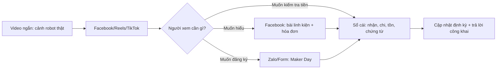

# R13 — Nội dung học sinh Việt Nam: CLB, Robotics, gây quỹ và niềm tin

**Ngày nghiên cứu:** 28/10/2026  
**Phạm vi:** nguồn công khai tiếng Việt/Việt Nam, truy cập ngày 28/10/2026. Đây là nghiên cứu định hướng nội dung, không phải khảo sát đại diện phụ huynh Sóc Sơn. Mọi số liệu nền tảng là số liệu quảng cáo/khảo sát do nguồn ghi rõ; không đồng nhất với số người dùng duy nhất.

## Kết luận nhanh

1. **Facebook** phù hợp lớp tin cậy rộng: phụ huynh, giáo viên, cựu học sinh, nhà tài trợ địa phương. **TikTok/Reels** phù hợp kéo người trẻ vào câu chuyện bằng cảnh robot, POV, build log; không nên dùng video ngắn làm nơi duy nhất để giải thích tiền.
2. **Zalo** phù hợp gửi thông tin thực dụng qua phụ huynh/giáo viên: lịch Maker Day, link sổ cái, xác nhận đăng ký. Không có nguồn đủ mạnh để kết luận riêng phụ huynh Sóc Sơn dùng nền tảng nào; dùng Facebook + Zalo để tiếp cận người lớn, TikTok để tiếp cận học sinh.
3. Nội dung CLB có sức thuyết phục khi cho thấy **người thật, việc thật, sản phẩm thật và đầu ra đo được**: linh kiện nào, giá nào, đã làm gì, ai hưởng lợi, cập nhật khi nào.
4. Sau các tranh luận sao kê, “minh bạch” phải gồm **tiền nhận + tiền chi + hóa đơn + trạng thái giao hàng**, không chỉ ảnh chuyển khoản. Công khai có chọn lọc, che tên/số tài khoản/nội dung riêng tư khi chưa có đồng ý.
5. Giọng phù hợp Robotics Sóc Sơn: “tụi mình/chúng mình” thân thiện nhưng câu chữ cụ thể, không “phông bạt”, không giật tít thành tích, không hứa vô địch.

## 1. Bảng nền tảng — nhóm khán giả — vai trò

| Kênh | Dữ liệu/quan sát có nguồn | Nhóm nên ưu tiên | Vai trò trong chiến dịch | Cách làm cho Robotics Sóc Sơn |
|---|---|---|---|---|
| **Facebook** | Decision Lab Connected Consumer Q4/2025 ghi Facebook được dùng bởi **94%** người tiêu dùng khảo sát; DataReportal Digital 2026 ghi Meta ước tính **79,0 triệu** tài khoản có thể tiếp cận bằng quảng cáo cuối 2025, nhưng cảnh báo đây không phải MAU. [DL, 2025](https://www.decisionlab.co/decision-lab-connected-consumer-q4-2025); [DR, 2025-11-08](https://datareportal.com/reports/digital-2026-vietnam) | Phụ huynh, giáo viên, cựu học sinh, doanh nghiệp địa phương; dùng như giả định cần đo bằng Insights, không phải số liệu riêng Sóc Sơn | Bài ghim, sổ cái, hóa đơn, album tiến độ, lời mời Maker Day | Bài dài vừa phải; ghim “mục tiêu–STK–sổ cái–cập nhật”; trả lời nghi ngờ công khai, bình tĩnh |
| **TikTok / Facebook Reels** | DataReportal ghi TikTok có **76,1 triệu người 18+** trong công cụ quảng cáo cuối 2025; ad reach không phải người dùng duy nhất. Decision Lab mô tả TikTok giữ thế mạnh với Gen Z và video dọc nhanh. [DR, 2025-11-08](https://datareportal.com/reports/digital-2026-vietnam); [DL, 2025](https://www.decisionlab.co/blog/vietnams-digital-dynamics-q4-2025) | Học sinh THCS/THPT, bạn bè, cựu thành viên; phụ huynh có thể xem nhưng không mặc định là người ra quyết định | Nhận biết: 0–3 giây có vật thể chuyển động; POV, “một ngày của”, storytime ngắn, lỗi–sửa–chạy thử | Cắt cảnh tay lắp robot, test lỗi, thành viên nói một câu; phụ đề rõ; CTA chuyển sang link Facebook/sổ cái, không nhét đủ thông tin ngân hàng vào video |
| **Zalo** | DataReportal dẫn số liệu VNG: **78,3 triệu MAU tại Việt Nam**, tương đương 91,4% người dùng Internet trong báo cáo; Decision Lab Q4/2025 ghi Zalo **89%** và cho biết Zalo tăng vai trò giao tiếp thực dụng, vào top 3 ứng dụng “must-have” của Gen Z. [DR, 2025-11-08](https://datareportal.com/reports/digital-2026-vietnam); [DL, 2025](https://www.decisionlab.co/decision-lab-connected-consumer-q4-2025) | Phụ huynh/giáo viên và nhóm cần thông tin xác nhận; đây là proxy toàn quốc, chưa phải khảo sát cha mẹ Sóc Sơn | Gửi link đăng ký Maker Day, lịch, thông báo hàng về; không biến thành kênh spam xin tiền | Tạo QR/link ngắn dẫn về trang chính thức; gửi bản cập nhật ngắn sau khi Facebook đã đăng; không gửi STK qua tài khoản cá nhân ngoài quy trình đã duyệt |
| **YouTube** | Decision Lab Q4/2025 ghi YouTube **87%** trong khảo sát Connected Consumer; [DL, 2025](https://www.decisionlab.co/decision-lab-connected-consumer-q4-2025) | Người muốn xem giải thích kỹ, giáo viên, phụ huynh cùng con | Video build log 2–5 phút, recap Maker Day, demo robot | Đặt link sổ cái và danh sách linh kiện trong mô tả; dùng làm kho bằng chứng, không cần đăng dày |

**Lưu ý phân khúc:** Decision Lab nói Facebook còn mạnh với Gen Y nhưng giảm hấp dẫn với Gen Z; Zalo tăng vai trò giao tiếp thực dụng ở Gen Z. Đây là tín hiệu toàn quốc, không chứng minh tỷ lệ ở Sóc Sơn. Sau 2 tuần, đo riêng: lượt xem 25–44, tin nhắn phụ huynh, click sổ cái, click Maker Day; không dùng follower làm đại diện niềm tin.



## 2. Mười hai ví dụ Việt Nam và điều rút ra

| # | Tài khoản/bài đăng (URL) | Dấu hiệu nội dung quan sát được | Bài học áp dụng; không suy diễn hiệu quả |
|---:|---|---|---|
| 1 | **Robots in A Nutshell (FTC #21300)** — [rian21300.org](https://rian21300.org/) (website, truy cập 28/10/2026) | Kể CLB bằng các phân ban, “mỗi mảnh ghép”, hoạt động cộng đồng, tài liệu mở và mục gây quỹ; trang nêu đội học sinh Chu Văn An, Hà Nội. Exa đọc được nội dung; Jina ngày 28/10 trả lỗi 500 nên phần này cần kiểm tra lại trước khi trích dẫn ngoài nhóm. | Dùng mô hình “đội không chỉ là robot”: cơ khí, code, truyền thông, cộng đồng. “Mỗi mảnh ghép” của Robotics Sóc Sơn có cơ sở, nhưng phải gắn với một món/việc cụ thể. |
| 2 | **HSGS RoboLads FTC #31113** — [hsgsrobolads.org](https://hsgsrobolads.org/) (truy cập 28/10/2026) | Giới thiệu rõ trường, mã đội, năm thành lập, lĩnh vực; chia hoạt động thành thiết kế/chế tạo, workshop/training, cộng đồng, thi đấu. | Mỗi bài nên có “đội là ai + đang làm gì + lợi ích cộng đồng”; tránh chỉ khoe giải. |
| 3 | **FTC Vietnam** — [ftc.io.vn](https://ftc.io.vn/index.html) (truy cập 28/10/2026) | Giải thích FTC cho lớp 7–12, robot, teamwork, gây quỹ, truyền thông và hoạt động cộng đồng; có lịch chương trình. | Khi nói với phụ huynh, giải thích tiền mua linh kiện gắn với kỹ năng và mùa giải; không dùng thuật ngữ FTC/BIOBUZZ mà không giải nghĩa. |
| 4 | **FTC Event Web — Vietnam Region** — [danh sách đội 2026](https://ftc-events.firstinspires.org/2026/region/VN) (truy cập 28/10/2026) | Trang FIRST liệt kê 43 đội; danh sách có Robotics Soc Son #39256, GreenAms, RoboLads, STEAM Gia Thieu và nhiều đội mới. | Có thể dùng trang FIRST làm xác nhận mã đội, nhưng không biến số “43” thành thành tích hay quy mô khán giả. |
| 5 | **GreenAms Robotics Team — video “The Green Family Reveal”** — [YouTube](https://www.youtube.com/watch?v=hiAvLO6rzIA) (13/04/2026) | Video 3:10 kể vấn đề đội mới thiếu kinh phí/mentor, sau đó giới thiệu mạng lưới Green Family, các đội thành viên và hoạt động STEAM. Mô tả video có số thành viên/sự kiện; đây là số do kênh tự công bố. | Công thức “vấn đề → nhóm cùng làm → bằng chứng hoạt động → lời cảm ơn” hợp với chiến dịch; dùng số liệu có link/nguồn, không tự phóng đại. |
| 6 | **STEAM for Vietnam — National Robotics Tournament** — [bài VEX IQ](https://steamforvietnam.org/blog/giai-dau-giao-huu-robotics-cap-quoc-gia) (25/09/2022; truy cập 28/10/2026) | Bài nêu 49 đội, 44 trường, 20 tỉnh, 500 khán giả trực tiếp, gần 15.000 lượt theo dõi trực tuyến; có hạng mục Social Media Award. | Robotics có thể kể cả thi đấu, hợp tác, kỹ năng truyền thông. Khi dùng số, ghi năm 2022; không dùng làm benchmark 2026. |
| 7 | **ORC — cộng đồng CLB STEM-Robotics** — [ORC community](https://www.orc.vn/cong-dong-clb-stem-robotics-orc/) (truy cập 28/10/2026) | Danh sách CLB theo địa phương/trường, có giáo viên hướng dẫn; nhấn hỗ trợ thành lập và vận hành CLB. | Gắn đội Sóc Sơn với trường, giáo viên/cố vấn và địa bàn; phụ huynh tin “ai chịu trách nhiệm” hơn khẩu hiệu chung. |
| 8 | **Báo Nhân Dân — CLB STEM trong trường học** — [YouTube](https://www.youtube.com/watch?v=-txDxDBMm6w) (truy cập 28/10/2026) | Video được Exa/YouTube định danh là phóng sự về cơ hội/thách thức CLB STEM; yt-dlp không tìm được phụ đề vi nên không trích lời. | Ghi rõ giới hạn nguồn; ưu tiên hình ảnh thao tác thật và lời học sinh ngắn, không gắn luận điểm chưa đọc được vào video. |
| 9 | **Robocon 2025 — K24 Robotics và LHUDs** — [YouTube/VTV](https://www.youtube.com/watch?v=lHuxKugZ_OE) (video; phụ đề vi tải được 28/10/2026) | Video thi đấu có lời dẫn giới thiệu hai đội, khu vực xuất phát, thời gian hiệu chỉnh và lệnh bắt đầu; cách kể giàu nhịp độ, thông tin ngắn. | V01 có thể mượn nhịp “chuẩn bị → hiệu chỉnh → bắt đầu”, nhưng không biến chiến dịch học sinh thành bình luận thể thao quá kịch. |
| 10 | **CLB Sao La / Đội Công tác xã hội Lê Hồng Phong** — [Mực Tím](https://muctim.tuoitre.vn/loat-hoat-dong-gay-quy-y-nghia-cua-teen-thpt-chuyen-le-hong-phong-101240309232153813.htm) (11/03/2024) | Hội chợ gồm thu gom bao nilon, bán hàng, trò chơi; workshop làm đồ thủ công; bài nêu đầu ra và số lượng thu gom theo hoạt động. | Gây quỹ có trải nghiệm cụ thể sẽ bớt cảm giác “xin tiền”: Robotics có thể cho xem lắp ráp/test và Maker Day; mỗi khoản phải gắn một đầu việc. |
| 11 | **Ams Baking Club — Cakes For Charity 2026** — [Báo Nhân Dân](https://nhandan.vn/hoc-sinh-truong-ams-tiep-noi-hanh-trinh-gay-quy-thien-nguyen-post953313.html) (05/04/2026) | Bán bánh tự làm, tạo không gian trải nghiệm, nêu toàn bộ tiền dùng cho thiện nguyện; bài ghi chương trình đã qua 10 mùa và dự kiến trao trực tiếp tại Ba Vì. | “Sản phẩm thật + quy trình + nơi nhận cuối” là mẫu kể tốt. Với Robotics: linh kiện thật + hóa đơn + robot chạy + mục tiêu giáo dục. |
| 12 | **Trường THPT Nguyễn Hữu Cầu — ngày hội kinh doanh gây quỹ** — [Tạp chí Giáo dục TP.HCM](https://giaoduc.edu.vn/hoc-sinh-mo-ngay-hoi-kinh-doanh-gay-quy-ung-ho-dong-bao-mien-trung/) (02/12/2025) | Hơn 100 gian hàng học sinh, video giải thích trước chương trình, giáo viên hướng dẫn kế hoạch, công bố số tiền và hiện vật sau chương trình. | Trước khi xin ủng hộ, giải thích bài toán; sau đó công bố kết quả. Có thể chuyển thành chuỗi M1–M5 thay vì một bài kêu gọi duy nhất. |
| 13 | **The Sterling Project — workshop Mây Đan Sắc** — [Báo Đại biểu Nhân dân qua Baomoi](https://baomoi.com/hoc-sinh-thpt-tai-ha-noi-to-chuc-workshop-may-dan-sac-gay-quy-cho-tre-em-kho-khan-c51289797.epi) (20/01/2025) | Nhóm học sinh Hà Nội gây quỹ bằng workshop thủ công, mô tả mục tiêu, địa điểm và nơi trao; có lời kể của học sinh ban tổ chức. | Lời học sinh ngôi thứ nhất tạo tin cậy, nhưng cần thêm chứng từ/đối soát nếu nhận chuyển khoản trực tiếp. |
| 14 | **Ams Baking Club — gian hàng Cake For Charity** — [Dân Việt](https://danviet.vn/hoc-sinh-ha-noi-ban-hang-gay-quy-thien-nguyen-thu-hut-hang-tram-tam-long-chung-tay-se-chia-d1412994.html) (25/03/2026) | Kể giá trị nhỏ của từng chiếc bánh khi cộng lại, sản phẩm do thành viên tự chuẩn bị, toàn bộ doanh thu dùng cho mục đích thiện nguyện. | Cách nói “mỗi mảnh ghép” hiệu quả khi lượng hóa đóng góp nhỏ; không tạo áp lực phải chuyển khoản lớn. |
| 15 | **Trend POV học đường 2026** — [“Học sinh kiếm GVCN đi dạy”](https://35express.org/trend-hoc-sinh-kiem-gvcn-di-day/) (30/06/2026) và [“POV: học sinh quên xóa bảng”](https://35express.org/trend-pov-hoc-sinh-quen-xoa-bang-tiet-truoc/) (06/10/2026) | Hai bài mô tả công thức POV: tình huống quen thuộc, phóng đại vừa đủ, phản ứng nhanh; cảnh báo không làm ảnh hưởng giáo viên/người thật. | Có thể làm “POV: robot không nhận cảm biến trước giờ test” hoặc “một ngày của ban cơ khí”; không bịa drama trường, không quay người không đồng ý. |
| 16 | **Trend danh sách TikTok** — [35Express TikTok trends](https://35express.org/tiktok-trends/) (27/10/2026) | Trang liệt kê trend/sound/POV tại thời điểm truy cập, gồm các sound và tình huống đời thường. Đây là nguồn theo dõi trend, không phải bằng chứng âm thanh sẽ viral hay phù hợp thương hiệu. | Kiểm tra sound trong thư viện thương mại/quyền sử dụng trước khi dựng; trend chỉ là lớp vỏ, thông tin đội và minh bạch mới là nội dung chính. |

**Không có kết luận “bài nào viral” từ danh sách trên.** Nguồn báo/website mô tả format và hoạt động; không phải mọi nguồn công bố reach, CTR hay số tiền do nội dung tạo ra.

## 3. Giọng điệu: nên và không nên

### Nên

- Dùng **“tụi mình/chúng mình”** khi kể trải nghiệm; dùng **“Robotics Sóc Sơn”** khi nêu cam kết, số liệu, trách nhiệm.
- Nói một câu có thể kiểm tra: “M1 cần 13.566.000 ₫; đã nhận X; còn Y; cập nhật vào ngày…”
- Kể cả thất bại: “Mùa trước 36/38; lần này sửa điểm tự hành và cơ khí.” Thất bại có số liệu cụ thể đáng tin hơn “comeback chấn động”.
- Dùng slang nhẹ, đúng ngữ cảnh: “build log”, “test”, “POV”, “một ngày của ban cơ khí”, “lỗi rồi sửa”. Giải thích thuật ngữ lần đầu.
- Gọi người ủng hộ là **bạn/anh/chị/nhà tài trợ**, cảm ơn cả khoản nhỏ; cho phép “Một người bạn” thay tên.
- Khi nói tiền: đặt **mục đích, hạn, cách kiểm tra, lịch cập nhật** cạnh nhau.
- Dùng video nhanh để kéo chú ý, rồi dẫn sang bài/sổ cái dài để kiểm chứng.

### Không nên

- “FOMO”/gây tội lỗi: “Không chuyển là robot không thể sống”, “chỉ còn X suất, chậm là có lỗi”.
- Slang quá đà hoặc dễ gây phản cảm với phụ huynh/nhà tài trợ: “flex”, “toang toàn tập”, “lụm tiền”, “xin vía”, “phông bạt”, chửi tục, viết tắt khó đọc.
- Gọi thành tích cũ là “vô địch” nếu chỉ Top/Á quân; hứa “chắc chắn đi Mỹ/vô địch”.
- Bắt trend drama người thật, quay mặt học sinh/giáo viên không đồng ý, gắn tên trường vào trò đùa tiêu cực.
- Đăng ảnh app ngân hàng nguyên bản có tên, số tài khoản người chuyển, số dư, mã giao dịch hoặc số điện thoại. Không dùng ảnh chỉnh sửa làm “bằng chứng”.
- Gọi ảnh chụp giao dịch là toàn bộ minh bạch. **Thu** chỉ là bước đầu; phải có **chi, hóa đơn, người duyệt, trạng thái giao hàng, tồn quỹ**.
- Trả lời nghi ngờ bằng “tin page đi”, xóa bình luận đúng câu hỏi, tranh luận với phụ huynh.
- Dùng số DataReportal như số người dùng duy nhất hoặc suy ra “phụ huynh Sóc Sơn chắc chắn ở Facebook/Zalo”.

## 4. Niềm tin, sao kê và MB Bank: cách làm an toàn

### Điều nguồn báo cho thấy

- MTTQ công bố 12.028 trang sao kê tiền ủng hộ bão Yagi, tổng 527,8 tỷ đồng theo Nhân Dân (12/09/2024), nhằm cho công chúng theo dõi dòng tiền: [Nhân Dân](https://nhandan.vn/mat-tran-to-quoc-viet-nam-cong-khai-sao-ke-tai-khoan-ung-ho-dong-bao-bi-anh-huong-boi-bao-so-3-post830642.html).
- VTV (18/09/2024) nhấn mạnh công khai sao kê chỉ là giai đoạn đầu; cần công khai tiền đi đâu, cho ai, mục đích gì. VTV cũng ghi người ủng hộ có quyền không tiết lộ danh tính: [VTV](https://vtv.vn/xa-hoi/cong-khai-sao-ke-tien-tu-thien-de-dam-bao-minh-bach-ngan-chan-loi-ich-ca-nhan-20240918013154225.htm).
- BBC (13/09/2024) ghi nhận rủi ro lộ dữ liệu cá nhân khi công bố tên/nội dung chuyển khoản; mục đích minh bạch không tự động cho phép công khai mọi dữ liệu: [BBC News Tiếng Việt](https://www.bbc.com/vietnamese/articles/c3vxv2yw99ko).
- Thanh Niên (13/09/2024) đưa tin cảnh báo website/fanpage giả mạo kêu gọi ủng hộ; người chuyển cần đối chiếu kênh chính thức và số tài khoản: [Thanh Niên](https://thanhnien.vn/gia-mao-mttq-keu-goi-ung-ho-dong-bao-thiet-hai-do-bao-yagi-185240913130241346.htm).

### Quy trình đề xuất cho Robotics Sóc Sơn

1. **Một nguồn chính thức:** C01, website `roboticssocson.com/support`, QR và MB Bank phải trùng tên/chủ tài khoản đã được đội/trường duyệt. Không nhận “STK phụ” trong inbox.
2. **Đối soát nội bộ:** hai học sinh/mentor đối chiếu giao dịch; ghi mã nội bộ, ngày, số tiền, mission; chỉ một người được quyền sửa sổ cái.
3. **Sổ cái công khai tối thiểu:** ngày, mã mission, số tiền, trạng thái “đã đối soát”; tên hiển thị theo lựa chọn “Tên thật/Một người bạn/Ẩn danh”. Không đăng số tài khoản người chuyển, số điện thoại, nội dung riêng tư.
4. **Chứng từ chi:** đăng hóa đơn/phiếu đặt hàng, che địa chỉ cá nhân, mã vận đơn nhạy cảm và thông tin thanh toán không cần thiết; giữ bản gốc cho nhà trường/nhà tài trợ kiểm tra.
5. **Đối chiếu tổng:** `tổng nhận – tổng chi = số dư`; báo chênh lệch hoặc hoàn tiền nếu mua thiếu/hủy đơn. Quỹ dự phòng phải có mục riêng, không nhập nhằng với tiền đã chi.
6. **Lịch:** cập nhật tối thiểu hàng tuần trong thời gian gọi quỹ; cập nhật ngay khi đặt hàng/hàng về; báo cáo tổng kết sau M5. Đây là chuẩn vận hành đề xuất, không phải khẳng định yêu cầu pháp lý riêng cho đội.
7. **Quyền riêng tư:** xin đồng ý trước khi vinh danh; người chuyển có thể chọn không công khai. Nếu có nghi ngờ giả mạo, ghim cảnh báo và chỉ dẫn về link chính thức.

## 5. Rewrite cụ thể

### C01 `#phat-dong` — thay **hai dòng đầu**

**Đang dùng:**

```text
BUILD THE NEXT ROBOT 🤖 Mỗi mảnh ghép, một bước tiến.

Robotics Sóc Sơn (THPT Sóc Sơn, Hà Nội) chính thức bước vào mùa FIRST Tech Challenge BIOBUZZ 2026–2027 với mã đội #39256.
```

**Đề xuất:**

```text
BUILD THE NEXT ROBOT 🤖 Mỗi mảnh ghép, một bước tiến — cùng xem tiền đi đâu.

Robotics Sóc Sơn (THPT Sóc Sơn, Hà Nội), FTC #39256, bắt đầu mùa BIOBUZZ 2026–2027 bằng 11 linh kiện cần thiết; đội sẽ cập nhật khoản nhận, khoản chi và hóa đơn tại roboticssocson.com/support.
```

**Lý do:** giữ tên chiến dịch và mã đội để nhận diện; đưa lời hứa kiểm chứng lên đầu, phù hợp bối cảnh công chúng quan tâm cả thu lẫn chi. Không đưa số tài khoản vào hai dòng đầu; đặt trong khối chuẩn sau mục tiêu và cách kiểm tra.

### C02 Mẫu 3 — nghi ngờ/hỏi tiền đi đâu

**Đang dùng:**

> Dạ câu hỏi rất đúng ạ. Toàn bộ khoản nhận và chi đều ghi trên sổ cái công khai: roboticssocson.com/support. Tiền chỉ dùng cho 11 linh kiện và quỹ dự phòng, tổng 33.975.000 ₫. Danh sách và giá từng món có trong bài ghim. Khi mua, tụi mình sẽ đăng hóa đơn (che thông tin cá nhân). Bạn cần thêm thông tin gì thì cứ nhắn page ạ.

**Đề xuất:**

> Dạ cảm ơn anh/chị đã hỏi — kiểm tra tiền là quyền của người ủng hộ ạ. Tụi mình cập nhật **tổng nhận, từng khoản chi, số dư và trạng thái mua hàng** tại [roboticssocson.com/support](https://roboticssocson.com/support); mỗi tuần đối soát một lần, và cập nhật hóa đơn/phiếu đặt hàng khi mua. Mục tiêu toàn chiến dịch là 33.975.000 ₫ cho 11 linh kiện + quỹ dự phòng; nếu số thực tế thay đổi, tụi mình sẽ ghi lý do và số mới ngay trên sổ. Tụi mình che tên, số tài khoản, số điện thoại của người chuyển nếu chưa có đồng ý công khai. Anh/chị muốn xem M1–M5 hay chứng từ khoản nào, nhắn page; tụi mình gửi đúng mục đó ạ.

**Sau câu trả lời:** không xóa bình luận; đối chiếu với người phụ trách tài chính trước khi nêu số; nếu chưa có chứng từ thì nói “đang đối soát/chưa mua”, không hứa đã đăng.

## Áp dụng cho Robotics Sóc Sơn

- **C01 `#phat-dong`, dòng 20–22:** thay bằng hai dòng rewrite ở trên; giữ phần thành tích 36/38 ngay sau đó, vì câu chuyện thất bại có số liệu giúp tránh khoe thành tích một chiều.
- **C01 `#phat-dong`, dòng 26–29:** thêm một dòng “Cập nhật mỗi Chủ nhật: tổng nhận / đã chi / còn lại / chứng từ” và link sổ cái; không chỉ nói “đồng nào vào, đồng nào ra”.
- **C02 Mẫu 3, dòng 26–30:** thay bằng mẫu mới; giữ nguyên quy tắc không xóa bình luận, nhưng thêm che dữ liệu người chuyển và trạng thái “đang đối soát”.
- **V01 `0–3s`, dòng 12:** đổi hook thành **“POV: còn 1 ngày test, robot chưa nhận cảm biến”**; cắt tay lắp/test thật. Dòng 13–20 giữ thành tích và 36/38, không dùng “comeback chắc thắng”.
- **V01 `37–45s`, dòng 18:** thêm màn hình nhỏ **“Sổ cái + hóa đơn: roboticssocson.com/support”** trước QR; QR/STK vẫn ở khung cuối, dễ đọc, không che bằng hiệu ứng.
- **V02/V04:** áp dụng format “lỗi → sửa → test lại → số liệu”; cuối video gắn ngày cập nhật sổ cái. Không dùng sound trend chưa kiểm tra quyền sử dụng.
- **P04 tiến độ quỹ:** hiển thị 4 ô cố định `Tổng nhận | Đã chi | Số dư | Chứng từ`; ghi ngày chốt số liệu và mã mission.
- **P07 cảm ơn:** hỏi trước việc công khai tên; cho lựa chọn “Một người bạn/Ẩn danh”. Không đăng ảnh chụp app ngân hàng nguyên bản.
- **Lịch đăng 02:** Facebook là bản đầy đủ; Reels/TikTok là bản 15–30 giây dẫn về sổ cái; Zalo dùng nhắc Maker Day/lịch và link chính thức, không gửi hàng loạt lời kêu gọi từ tài khoản cá nhân.
- **Maker Day 13/12:** quay “một ngày của ban cơ khí/truyền thông” và hoạt động có sản phẩm; bảng tại sự kiện in QR sổ cái + tên đội + người phụ trách, giúp phụ huynh kiểm tra offline.
- **Đo lường 2 tuần:** ghi riêng nguồn click (Facebook/TikTok/Zalo), số tin nhắn hỏi minh bạch, số click sổ cái, số đăng ký Maker Day, tỷ lệ xem đến giây 3/25. Đây là chỉ số vận hành nội bộ, không biến thành benchmark quốc gia.

## Nguồn

1. DataReportal, *Digital 2026: Vietnam*, 08/11/2025: <https://datareportal.com/reports/digital-2026-vietnam>.
2. Decision Lab, *Connected Consumer Q4 2025*: <https://www.decisionlab.co/decision-lab-connected-consumer-q4-2025>.
3. Decision Lab, *Vietnam’s digital dynamics: Experience-led competition takes shape*: <https://www.decisionlab.co/blog/vietnams-digital-dynamics-q4-2025>.
4. FIRST, *FTC Event Web — Vietnam Region 2026*: <https://ftc-events.firstinspires.org/2026/region/VN>.
5. FTC Vietnam: <https://ftc.io.vn/index.html>.
6. Robots in A Nutshell: <https://rian21300.org/>.
7. HSGS RoboLads: <https://hsgsrobolads.org/>.
8. GreenAms Robotics Team, *The Green Family Reveal | 2026 Line-up*, YouTube, 13/04/2026: <https://www.youtube.com/watch?v=hiAvLO6rzIA>.
9. STEAM for Vietnam, *Giải đấu Giao hữu Robotics cấp Quốc gia sử dụng VEX IQ*, 25/09/2022: <https://steamforvietnam.org/blog/giai-dau-giao-huu-robotics-cap-quoc-gia>.
10. ORC, *Cộng đồng CLB STEM–Robotics*: <https://www.orc.vn/cong-dong-clb-stem-robotics-orc/>.
11. Báo Nhân Dân, *Phóng Sự: Câu lạc bộ Stem trong trường học*, YouTube: <https://www.youtube.com/watch?v=-txDxDBMm6w>.
12. Ấn tượng VTV, *Trận chung kết Robocon 2025*, YouTube: <https://www.youtube.com/watch?v=lHuxKugZ_OE>.
13. Mực Tím, *Loạt hoạt động gây quỹ ý nghĩa của teen Trường THPT chuyên Lê Hồng Phong*, 11/03/2024: <https://muctim.tuoitre.vn/loat-hoat-dong-gay-quy-y-nghia-cua-teen-thpt-chuyen-le-hong-phong-101240309232153813.htm>.
14. Báo Nhân Dân, *Học sinh trường Ams tiếp nối hành trình gây quỹ thiện nguyện*, 05/04/2026: <https://nhandan.vn/hoc-sinh-truong-ams-tiep-noi-hanh-trinh-gay-quy-thien-nguyen-post953313.html>.
15. Tạp chí Giáo dục TP.HCM, *Học sinh mở ngày hội kinh doanh gây quỹ…*, 02/12/2025: <https://giaoduc.edu.vn/hoc-sinh-mo-ngay-hoi-kinh-doanh-gay-quy-ung-ho-dong-bao-mien-trung/>.
16. Báo Đại biểu Nhân dân qua Baomoi, *Workshop Mây Đan Sắc*, 20/01/2025: <https://baomoi.com/hoc-sinh-thpt-tai-ha-noi-to-chuc-workshop-may-dan-sac-gay-quy-cho-tre-em-kho-khan-c51289797.epi>.
17. Dân Việt, *Học sinh Hà Nội bán hàng gây quỹ thiện nguyện…*, 25/03/2026: <https://danviet.vn/hoc-sinh-ha-noi-ban-hang-gay-quy-thien-nguyen-thu-hut-hang-tram-tam-long-chung-tay-se-chia-d1412994.html>.
18. 35Express, *Trend “Học sinh kiếm GVCN đi dạy”*, 30/06/2026: <https://35express.org/trend-hoc-sinh-kiem-gvcn-di-day/>.
19. 35Express, *Trend “POV: Học sinh quên xóa bảng tiết trước”*, 06/10/2026: <https://35express.org/trend-pov-hoc-sinh-quen-xoa-bang-tiet-truoc/>.
20. 35Express, *TikTok trends*, truy cập 27/10/2026: <https://35express.org/tiktok-trends/>.
21. Nhân Dân, *MTTQ công khai sao kê tài khoản ủng hộ bão số 3*, 12/09/2024: <https://nhandan.vn/mat-tran-to-quoc-viet-nam-cong-khai-sao-ke-tai-khoan-ung-ho-dong-bao-bi-anh-huong-boi-bao-so-3-post830642.html>.
22. VTV, *Công khai sao kê tiền từ thiện để đảm bảo minh bạch…*, 18/09/2024: <https://vtv.vn/xa-hoi/cong-khai-sao-ke-tien-tu-thien-de-dam-bao-minh-bach-ngan-chan-loi-ich-ca-nhan-20240918013154225.htm>.
23. BBC News Tiếng Việt, *Mặt trận Tổ quốc công bố sao kê, có bất cập gì?*, 13/09/2024: <https://www.bbc.com/vietnamese/articles/c3vxv2yw99ko>.
24. Thanh Niên, *Giả mạo MTTQ kêu gọi ủng hộ đồng bào thiệt hại do bão Yagi*, 13/09/2024: <https://thanhnien.vn/gia-mao-mttq-keu-goi-ung-ho-dong-bao-thiet-hai-do-bao-yagi-185240913130241346.htm>.

**Giới hạn nguồn:** Facebook/Instagram/TikTok không được đọc trực tiếp trong nghiên cứu này; ví dụ lấy từ website chính thức, báo Việt Nam, YouTube và trang theo dõi trend công khai. YouTube video Báo Nhân Dân không có phụ đề `vi` khi tải bằng yt-dlp; không trích nội dung lời nói từ video đó. Trend 2026 biến đổi nhanh; kiểm tra lại âm thanh/quyền sử dụng ngay trước khi đăng.