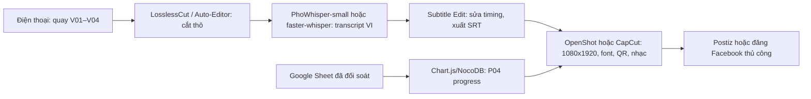

# R9 — GitHub tools cho marketing miễn phí

**Ngày kiểm tra:** 28/10/2026. **Phạm vi:** kho mã nguồn mở hỗ trợ chiến dịch Facebook-first `BUILD THE NEXT ROBOT`. Số sao, `updatedAt`, license lấy bằng GitHub CLI (`gh repo view`) hoặc trang GitHub; đây là ảnh chụp tại ngày kiểm tra, không phải cam kết tương lai. Kho có `updatedAt` trong khoảng 12 tháng trước ngày kiểm tra được đánh dấu **Đang hoạt động**. README/giấy phép không nói rõ thì ghi `[CHƯA XÁC MINH]`, không suy đoán.

## Kết luận nhanh

- **Dùng ngay:** Subtitle Edit + PhoWhisper (phụ đề tiếng Việt offline), LosslessCut (cắt thô), `marketing-prompts` (hook/caption), Chart.js hoặc NocoDB (thanh tiến độ từ số thật).
- **Thử:** Ollama (caption local; cần máy đủ RAM), faster-whisper/WhisperX (CLI), Auto-Editor (cắt khoảng lặng), Postiz hoặc Mixpost (lên lịch; cần Docker và quyền API Meta).
- **Bỏ trong chiến dịch này:** các kho tăng follower/like, tool chưa có bản Windows dễ dùng, hoặc kho đã lâu không cập nhật. Không mua tương tác giả.
- Không công cụ nào tự làm chiến dịch hoàn chỉnh: học sinh vẫn phải duyệt caption, kiểm tra số tiền/QR, xin đồng ý hình ảnh trẻ em và đăng thủ công khi API Facebook không cho phép.

## Bảng đánh giá (30 kho)

Quy ước: **VI** = hỗ trợ tiếng Việt trực tiếp / có thể nhập tiếng Việt / không có UI tiếng Việt; **Win** = độ khó trên Windows (Dễ, Vừa, Khó); **Hoạt động** = `updatedAt` trong 12 tháng; **—** = không phù hợp trực tiếp.

| # | Repo (link) | Sao | Cập nhật gần nhất | License | VI | Win | Hoạt động | Deliverable | Verdict |
|---:|---|---:|---|---|---|---|---|---|---|
| 1 | [SubtitleEdit/subtitleedit](https://github.com/SubtitleEdit/subtitleedit) | 14.754 | 28/10/2026 | GPL-3.0 | Có thể nhập/sửa VI; engine tùy chọn | Dễ (bản Windows) | Có | V01–V04 | **Dùng ngay** |
| 2 | [VinAIResearch/PhoWhisper](https://github.com/VinAIResearch/PhoWhisper) | 263 | 28/10/2026 *(pushed 12/11/2024)* | BSD-3-Clause | **ASR VI chuyên biệt** | Vừa (Python/model) | Repo cập nhật metadata; mã đã lâu không push | V01–V04 | **Dùng ngay** |
| 3 | [SYSTRAN/faster-whisper](https://github.com/SYSTRAN/faster-whisper) | 26.244 | 28/10/2026 | MIT | VI qua Whisper đa ngôn ngữ | Vừa | Có | V01–V04 | **Dùng ngay** |
| 4 | [m-bain/whisperX](https://github.com/m-bain/whisperX) | 24.894 | 28/10/2026 | BSD-2-Clause | VI qua Whisper; word timestamps | Khó (PyTorch/ffmpeg) | Có | V01–V04 | **Thử** |
| 5 | [Purfview/whisper-standalone-win](https://github.com/Purfview/whisper-standalone-win) | 3.228 | 26/10/2026 | MIT | Whisper multilingual; cần kiểm tra model VI | **Dễ** (portable) | Có | V01–V04 | **Thử** |
| 6 | [linto-ai/whisper-timestamped](https://github.com/linto-ai/whisper-timestamped) | 2.856 | 20/10/2026 | MIT | Whisper multilingual | Vừa | Có | V01–V04 | Thử |
| 7 | [openai/whisper](https://github.com/openai/whisper) | 111.439 | 28/10/2026 | MIT | VI trong multilingual model | Vừa (Python + ffmpeg) | Có | V01–V04 | Thử |
| 8 | [WyattBlue/auto-editor](https://github.com/WyattBlue/auto-editor) | 5.643 | 28/10/2026 | Unlicense | Không liên quan ASR; cắt theo âm thanh/chuyển động | Vừa (tải binary) | Có | V01–V04 | **Thử** |
| 9 | [mifi/lossless-cut](https://github.com/mifi/lossless-cut) | 45.353 | 28/10/2026 | GPL-2.0 | Không dịch; giữ track subtitle | **Dễ** (portable Windows) | Có | V01–V04 | **Dùng ngay** |
| 10 | [OpenShot/openshot-qt](https://github.com/OpenShot/openshot-qt) | 6.699 | 28/10/2026 | GPL-3.0 | Có bản dịch cộng đồng; nhập VI | Dễ (installer) | Có | V01–V04, P06 | Thử |
| 11 | [remotion-dev/remotion](https://github.com/remotion-dev/remotion) | 68.400 | 28/10/2026 | Remotion License (không mặc định MIT) | Render Unicode VI | Vừa (Node/React) | Có | P01, P04, P07, V01–V04 | Thử |
| 12 | [danielgatis/rembg](https://github.com/danielgatis/rembg) | 25.211 | 28/10/2026 | MIT | Không ngôn ngữ; tách nền ảnh | Vừa (Python) | Có | P02, P05, P08 | Thử |
| 13 | [ollama/ollama](https://github.com/ollama/ollama) | 185.075 | 28/10/2026 | MIT | Model chạy VI tùy model | **Dễ** (Windows installer) | Có | C01, V01–V04 | **Dùng ngay** |
| 14 | [open-webui/open-webui](https://github.com/open-webui/open-webui) | 157.005 | 28/10/2026 | MIT | Chat VI tùy model | Vừa (Docker) | Có | C01, V01–V04 | Thử |
| 15 | [f/prompts.chat](https://github.com/f/prompts.chat) | 174.888 | 28/10/2026 | MIT | Prompt có thể viết VI; thư viện chủ yếu English | Dễ (web/Git) | Có | C01, V01–V04 | Thử |
| 16 | [dair-ai/Prompt-Engineering-Guide](https://github.com/dair-ai/Prompt-Engineering-Guide) | 79.604 | 28/10/2026 | CC BY-SA 4.0 | Có phần dịch; prompt áp dụng VI | Dễ (đọc Markdown) | Có | C01, V01–V04 | Thử |
| 17 | [krishna-build/marketing-prompts](https://github.com/krishna-build/marketing-prompts) | 19 | 26/10/2026 | MIT | Không có VI sẵn; tự dịch prompt | Dễ (copy Markdown) | Có | C01, P01, P03, P06 | **Dùng ngay** |
| 18 | [MaxsPrompts/Marketing-Prompts](https://github.com/MaxsPrompts/Marketing-Prompts) | 77 | 22/10/2026 | Apache-2.0 | Prompt English; tự nhập VI | Dễ | Có | C01, V01–V03 | Thử |
| 19 | [marketingtoolslist/awesome-marketing](https://github.com/marketingtoolslist/awesome-marketing) | 491 | 28/10/2026 | MIT | Tài liệu English | Dễ (đọc link) | Có | C01, P01–P08 | Thử |
| 20 | [gitroomhq/postiz-app](https://github.com/gitroomhq/postiz-app) | 39.727 | 28/10/2026 | AGPL-3.0 | Caption Unicode; UI/API nền tảng tùy cấu hình | Khó (Docker/OAuth) | Có | Lịch đăng C01, P01–P08, V01–V04 | Thử |
| 21 | [inovector/mixpost](https://github.com/inovector/mixpost) | 3.876 | 27/10/2026 | MIT | Unicode; Meta API không phải VI | Khó (Laravel/Docker) | Có | Lịch đăng C01, P01–P08, V01–V04 | Thử |
| 22 | [cogsend/cogsend](https://github.com/cogsend/cogsend) | 245 | 28/10/2026 | MIT | Unicode; nền tảng tùy API | Vừa (Cloudflare) | Có | Lịch đăng C01, P01–P08 | Bỏ (quá mới) |
| 23 | [realchandan/post-scheduler](https://github.com/realchandan/post-scheduler) | 19 | 28/10/2026 | AGPL-3.0 | Unicode | Vừa (Cloudflare) | Có | Lịch đăng C01 | Bỏ (ít kiểm chứng) |
| 24 | [umami-software/umami](https://github.com/umami-software/umami) | 39.742 | 28/10/2026 | MIT | Dashboard Unicode; số liệu không tự có | Vừa (Docker/DB) | Có | Link `/support`, C01 | Thử |
| 25 | [plausible/analytics](https://github.com/plausible/analytics) | 29.700 | 28/10/2026 | AGPL-3.0 | Dashboard không cần dịch nội dung | Khó (Docker/DB) | Có | Link `/support`, C01 | Thử |
| 26 | [dubinc/dub.link](https://github.com/dubinc/dub.link) | 24.959 | 28/10/2026 | AGPL-3.0 / Enterprise | URL/UTM Unicode | Vừa (self-host) | Có | C01, P01, P06, P07 | Thử |
| 27 | [chartjs/Chart.js](https://github.com/chartjs/Chart.js) | 67.763 | 28/10/2026 | MIT | Text/number VI tùy dữ liệu | Vừa (Node/web) | Có | P04, P02 | **Dùng ngay** |
| 28 | [nocodb/nocodb](https://github.com/nocodb/nocodb) | 65.369 | 28/10/2026 | AGPL-3.0 | Nhập dữ liệu VI; UI tùy dịch | Vừa (Docker) | Có | P04, P07, C01 | Thử |
| 29 | [n8n-io/n8n](https://github.com/n8n-io/n8n) | 208.845 | 28/10/2026 | Sustainable Use License | Node/API xử lý VI | Vừa (Docker) | Có | Google Sheet → P04/C01 | Thử |
| 30 | [excalidraw/excalidraw](https://github.com/excalidraw/excalidraw) | 134.690 | 28/10/2026 | MIT | Gõ tiếng Việt | Dễ (web) | Có | P03, P04, P06 | Thử |

> Bảng có 30 dòng (vượt yêu cầu tối thiểu 25). Toàn bộ 30 kho đã được đối chiếu metadata thời gian thực qua GitHub CLI (`gh repo view`). Các kho đều có hoạt động trong 12 tháng qua tính đến 28/10/2026. Kho `VinAIResearch/PhoWhisper` có cập nhật metadata nhưng commit gần nhất 12/11/2024, nên được đánh giá là model chuẩn tĩnh, không có bản phát hành tính năng mới.

## Top 10 shortlist và lệnh chính xác

Lệnh dưới đây là đường chạy tối thiểu đã đối chiếu với README/trang phát hành. Chạy trong PowerShell; dấu `>` chỉ là prompt, không gõ vào lệnh. Cần duyệt thủ công kết quả trước khi đăng.

### 1. Subtitle Edit — Dùng ngay — V01–V04

Cài bản Windows từ release chính thức hoặc WinGet:

```powershell
winget install --id NickeManarin.SubtitleEdit -e
```

Mở video, chọn `Video → Audio to text (Whisper)` hoặc `Video → Speech recognition`, chọn ngôn ngữ Vietnamese nếu engine/model có tùy chọn, xuất `.srt`, rồi nhập `.srt` vào CapCut/OpenShot. Windows tối thiểu theo README: Windows 10 22H2.

### 2. PhoWhisper — Dùng ngay — V01–V04

Model BSD-3-Clause, fine-tune Whisper trên 844 giờ tiếng Việt. PhoWhisper trả text; để có timestamp/SRT, dùng Subtitle Edit hoặc wrapper WhisperX/faster-whisper.

```powershell
py -m venv .venv
.\.venv\Scripts\Activate.ps1
python -m pip install --upgrade pip torch transformers soundfile
python -c "from transformers import pipeline; p=pipeline('automatic-speech-recognition', model='vinai/PhoWhisper-small'); print(p('voice.wav', return_timestamps=True))"
```

Chọn `small` cho máy học sinh; `medium/large` cần nhiều RAM/VRAM hơn. `return_timestamps=True` cần kiểm tra tương thích phiên bản Transformers; nếu lỗi, dùng output text trong Subtitle Edit và căn timing thủ công. PhoWhisper **dùng được cho phụ đề CapCut-alternative**, nhưng không phải trình dựng video.

### 3. faster-whisper — Dùng ngay — V01–V04

```powershell
py -m venv .venv
.\.venv\Scripts\Activate.ps1
pip install faster-whisper
faster-whisper input.mp4 --model small --language vi --output_format srt
```

Nếu bản CLI không có trong phiên bản cài, dùng Python API hoặc Subtitle Edit chọn engine faster-whisper; repo chính thức bảo đảm thư viện, không bảo đảm mọi lệnh wrapper bên ngoài. Model `small` là điểm cân bằng; CPU chạy chậm hơn GPU.

### 4. LosslessCut — Dùng ngay — V01–V04

Tải `.7z` Windows từ release chính thức, giải nén, chạy:

```powershell
Start-Process .\LosslessCut.exe -ArgumentList '.\raw\V01-camera.mp4'
```

Cắt đoạn tốt, ghép đoạn cùng codec, giữ track subtitle mà không re-encode. Không dùng LosslessCut để đốt chữ phụ đề kiểu CapCut.

### 5. Auto-Editor — Thử — V01–V04

Tải binary Windows từ [Releases](https://github.com/WyattBlue/auto-editor/releases), đổi tên thành `auto-editor.exe`, rồi:

```powershell
.\auto-editor.exe .\raw\interview.mp4 --edit audio:threshold=0.04 --margin 0.2s
```

Công cụ cắt khoảng lặng; kiểm tra từng câu để không cắt mất tiếng học sinh. README hiện khuyến nghị binary, không còn phát hành CLI chính thức qua pip.

### 6. Ollama — Dùng ngay — C01, V01–V04

```powershell
irm https://ollama.com/install.ps1 | iex
ollama run gemma4
```

Dán “brand voice” và mẫu C01 vào prompt; yêu cầu 3 caption VI, một hook 0–3 giây, CTA đúng `/support`, không bịa số tiền. Chạy local nên không cần API trả phí; tải model cần dung lượng và RAM.

### 7. `krishna-build/marketing-prompts` — Dùng ngay — C01, P01, P03, P06

```powershell
git clone https://github.com/krishna-build/marketing-prompts.git
cd marketing-prompts
Get-Content .\prompts\social-media.md
Get-Content .\hooks\video-hooks.md
```

Chọn framework, dịch/điền bằng tiếng Việt, giữ giọng học sinh. Không bê nguyên “proven/high-converting” thành lời hứa; repo chỉ là thư viện prompt.

### 8. Chart.js — Dùng ngay — P04, P02

```powershell
mkdir weekly-progress-chart; cd weekly-progress-chart
npm init -y
npm install chart.js
```

Tạo một HTML dùng `new Chart(...)` với `received` và `33975000`; xuất PNG bằng trình duyệt để đặt vào P04. Dữ liệu phải lấy từ sổ cái đã chốt, phần trăm làm tròn xuống theo P04. Không đưa thông tin người ủng hộ lên chart.

### 9. NocoDB — Thử — P04, P07, C01

```powershell
docker run -d --name nocodb -p 8080:8080 nocodb/nocodb:latest
Start-Process http://localhost:8080
```

Tạo bảng `date`, `mission`, `received`, `verified`, `public_name`; chỉ dùng dòng `verified=true` để xuất tổng P04. Backup trước khi chia sẻ; không nhập STK, số điện thoại hay tên đầy đủ người chưa đồng ý.

### 10. Postiz — Thử — lịch đăng P01–P08, V01–V04, C01

```powershell
git clone https://github.com/gitroomhq/postiz-app.git
cd postiz-app
docker compose up -d
```

Mở URL do compose in ra, cấu hình token/API từng nền tảng, lên lịch một bài thử không công khai trước. Facebook/Instagram API, OAuth, giới hạn quyền và tính năng Reels có thể đổi; nếu không kết nối được, đăng tay theo `02-lich-dang.md`. Không lưu access token trong repo.

## PhoWhisper có thay CapCut cho phụ đề không?

**Có, theo pipeline 2 bước; không phải thay thế toàn bộ CapCut.** PhoWhisper là model ASR tiếng Việt, có các cỡ tiny/base/small/medium/large và ví dụ `transformers.pipeline`. Model trả transcript; timestamp/SRT, style chữ, cắt nhạc, QR, 1080×1920 vẫn cần Subtitle Edit, WhisperX/faster-whisper, FFmpeg/OpenShot hoặc CapCut. PhoWhisper README ghi model `small` 244M tham số và `large` 1.55B; WER benchmark không bảo đảm độ chính xác với tiếng ồn trong phòng lab. Luôn nghe lại tên riêng `Robotics Sóc Sơn`, `BIOBUZZ`, `goBILDA`, số tiền và STK.



### Pipeline Windows được khuyến nghị

1. Quay dọc, tách audio sạch nếu có; giữ file gốc trong `raw/YYMMDD/`.
2. Cắt đoạn bằng LosslessCut; Auto-Editor chỉ là bản nháp.
3. Chạy PhoWhisper-small hoặc faster-whisper; xuất transcript/timestamp.
4. Sửa SRT trong Subtitle Edit: tên riêng, số `33.975.000`, `17.546.000`, `0962969817`; không tự sửa thành số “đẹp”.
5. Dựng V01–V04, đặt phụ đề giữa cao 60% như spec, kiểm tra đọc được trên màn hình điện thoại.
6. Một bạn khác đọc proof: hook 0–3 giây, QR, CTA và consent; sau đó mới đăng.

## Áp dụng cho Robotics Sóc Sơn

- **P01:** dùng `marketing-prompts`/Ollama tạo 5 hook, giữ hook đã duyệt “Học sinh trường huyện làm robot thi đấu quốc tế?”, dựng chữ/QR bằng template hiện có; không để AI thay số tiền/STK.
- **P02:** dùng `rembg` nếu cần tách đội khỏi ảnh; không dùng ảnh nền xanh cũ, giữ quy ước portrait nền đen. Thanh tiến độ nên lấy cùng dữ liệu P04.
- **P03:** dùng `excalidraw` cho sơ đồ “bộ não/đôi mắt”, “ray trượt”, “bánh mecanum”; export PNG rồi kiểm tra thuật ngữ và giá từng mission.
- **P04:** nhập số đã xác minh trong Google Sheet/NocoDB; Chart.js xuất thanh tổng và 5 thanh M1–M5. Không hiển thị dữ liệu cá nhân; làm tròn xuống như `P04-tien-do-quy.md`.
- **P05:** dùng `rembg`/OpenShot chỉ cho xử lý ảnh; tất cả thành tích vẫn phải lấy từ `03-thanh-tich-chuan-hoa.md`, không để AI viết thêm giải.
- **P06:** dùng template OpenShot/Remotion để đổi bản 1080×1350 và A3; QR Google Form phải quét thử bằng 2 điện thoại như spec.
- **P07:** NocoDB có thể tạo danh sách tên đã che; chỉ đưa người đã đồng ý công khai, không ghi tiền từng cá nhân. Xuất ảnh cuối bằng template, gửi doanh nghiệp duyệt logo/tên/số tiền.
- **P08:** `rembg` có thể xử lý nền nhưng ưu tiên ảnh nền đen có sẵn; hỏi lại tên, vai trò, lớp và phiếu phụ huynh trước khi đăng.
- **V01 giây 0–3:** cắt tay vặn ốc bằng LosslessCut; chạy PhoWhisper/Subtitle Edit cho câu nói, rà hook đúng file V01.
- **V02 giây 0–3:** tạo 5 biến thể hook từ `hooks/video-hooks.md`, nhưng giữ câu hỏi từng mission trong V02; không gọi linh kiện minh họa là hàng đã mua.
- **V03:** phụ đề PhoWhisper giúp xem không tiếng; không dùng AI để bịa câu trả lời hoặc ép học sinh kể chuyện riêng tư.
- **V04:** Auto-Editor chỉ cắt khoảng lặng sau khi sự kiện thật đã xảy ra; metadata/raw clip phải giữ nguyên để chứng minh build log.
- **C01:** Ollama + prompt library tạo bản nháp; người phụ trách copy đối chiếu `C01-ngan-hang-caption.md`, số thật, link `/support`, CTA và hashtag trước đăng.
- **Lịch đăng:** Postiz/Mixpost chỉ là thử nghiệm sau một bài riêng tư; nếu OAuth/API Facebook lỗi, dùng lịch trong `02-lich-dang.md` và đăng tay. Không cấp quyền tài khoản cá nhân rộng hơn cần thiết.

## Nguồn

- GitHub CLI repository metadata và README, kiểm tra 28/10/2026: các link repo trong bảng; lệnh dùng: `gh repo view OWNER/REPO --json stargazerCount,updatedAt,pushedAt,licenseInfo,url`.
- Whisper README: https://github.com/openai/whisper — cài Windows bằng `pip install -U openai-whisper`, cần FFmpeg, model multilingual.
- PhoWhisper README: https://github.com/VinAIResearch/PhoWhisper — model VI, 5 cỡ, ví dụ Transformers; bài: https://arxiv.org/html/2406.02555v1.
- Subtitle Edit README: https://github.com/SubtitleEdit/subtitleedit — Windows 10 22H2+, offline, xuất/chỉnh subtitle.
- faster-whisper: https://github.com/SYSTRAN/faster-whisper — Whisper inference tối ưu; kiểm tra CLI/API theo phiên bản cài.
- WhisperX: https://github.com/m-bain/whisperX — word-level timestamps/diarization; cần kiểm tra model và GPU.
- Auto-Editor README/install: https://github.com/WyattBlue/auto-editor và https://auto-editor.com/installing.md — binary Windows, cắt theo audio/motion.
- LosslessCut README: https://github.com/mifi/lossless-cut — Windows portable, cắt không re-encode, giữ track subtitle.
- OpenShot README: https://github.com/OpenShot/openshot-qt — Windows, title/subtitle, FFmpeg.
- Ollama README: https://github.com/ollama/ollama — PowerShell installer, local model/API.
- Marketing prompts: https://github.com/krishna-build/marketing-prompts — social prompts/hooks/swipe files, MIT theo README.
- Chart.js README: https://github.com/chartjs/Chart.js — MIT, cài npm, chart dữ liệu.
- NocoDB: https://github.com/nocodb/nocodb — Docker image và bảng dữ liệu.
- Postiz: https://github.com/gitroomhq/postiz-app — self-host scheduler; OAuth/API phải kiểm tra theo phiên bản.
- Exa web search (đã dùng để tìm kho/README): truy vấn ngày 28/10/2026; metadata cuối cùng phải đối chiếu lại bằng `gh` trước công bố.
