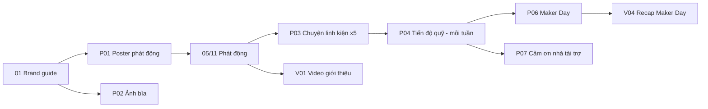

# Social Kit — BUILD THE NEXT ROBOT

Bộ đồ nghề đăng social cho chiến dịch FTC 2026–2027. Mỗi file là một ấn phẩm làm được ngay, gồm: kích thước, bố cục, chữ trên ảnh, ảnh lấy ở đâu, caption, ngày đăng.

**Số chốt dùng ở mọi ấn phẩm (không tự sửa):**

| | |
|---|---|
| Tổng cần gây quỹ | **33.975.000 ₫** |
| Mốc đợt 1 (trước 20/11/2026) | 17.546.000 ₫ (Control Hub + Viper Slide) |
| Mốc đợt 2 (trước 05/12/2026) | 33.975.000 ₫ |
| Tài khoản | TRAN TUE MINH · 0962969817 · MB Bank |
| QR | `../assets/placeholder.jpg` (thay bằng QR thật, giữ nguyên tên file) |
| Nội dung chuyển khoản | `BIOBUZZ M1 HOTEN SDT` (M1–M5 theo mission) |
| Mã đội | FTC #39256 |
| Fanpage | facebook.com/roboticssocson (860 follower) |
| Link đích | roboticssocson.com/support |

## Thứ tự làm

## Danh sách file

| File | Loại | Số ảnh/video | Hạn |
|---|---|:---:|---|
| [01-brand-guide.md](01-brand-guide.md) | Quy chuẩn màu, chữ, khung, ảnh | — | 30/10 |
| [02-lich-dang.md](02-lich-dang.md) | Lịch đăng 9 tuần (05/11 → 03/01) | — | 30/10 |
| [03-hook-va-cai-tien.md](03-hook-va-cai-tien.md) | **Hook, nguyên tắc cải tiến, A/B test, công cụ miễn phí** (đọc trước khi làm bất kỳ ấn phẩm nào) | — | 01/11 |
| [posters/P01-phat-dong.md](posters/P01-phat-dong.md) | Poster phát động | 1 | 03/11 |
| [posters/P02-anh-bia-avatar.md](posters/P02-anh-bia-avatar.md) | Ảnh bìa + khung avatar | 2 | 03/11 |
| [posters/P03-chuyen-linh-kien.md](posters/P03-chuyen-linh-kien.md) | Carousel 5 mission | 5 bộ | 08/11 → 01/12 |
| [posters/P04-tien-do-quy.md](posters/P04-tien-do-quy.md) | Thanh tiến độ quỹ (mẫu lặp) | 1 mẫu | 08/11 |
| [posters/P05-thanh-tich.md](posters/P05-thanh-tich.md) | Carousel "Đằng sau tấm huy chương" | 1 bộ | 08/11 |
| [posters/P06-maker-day.md](posters/P06-maker-day.md) | Poster Maker Day + bản in A3 | 2 | 17/11 |
| [posters/P07-cam-on.md](posters/P07-cam-on.md) | Mẫu cảm ơn nhà tài trợ & người ủng hộ | 2 mẫu | 15/11 |
| [posters/P08-thanh-vien.md](posters/P08-thanh-vien.md) | Chân dung thành viên | 1 mẫu | 10/11 |
| [videos/V01-gioi-thieu.md](videos/V01-gioi-thieu.md) | Reels giới thiệu chiến dịch 45s | 1 | 05/11 |
| [videos/V02-chuyen-linh-kien.md](videos/V02-chuyen-linh-kien.md) | Reels 30s mỗi mission | 5 | theo P03 |
| [videos/V03-hoc-sinh-lam-robot.md](videos/V03-hoc-sinh-lam-robot.md) | Phỏng vấn nhanh 3 câu | 3 | 15/11 → 06/12 |
| [videos/V04-build-log.md](videos/V04-build-log.md) | Nhật ký chế tạo, unboxing, recap Maker Day | 5+ | 29/11 → 03/01 |
| [captions/C01-ngan-hang-caption.md](captions/C01-ngan-hang-caption.md) | Caption dán sẵn cho từng bài | — | — |
| [captions/C02-tra-loi-binh-luan.md](captions/C02-tra-loi-binh-luan.md) | Mẫu trả lời bình luận & inbox | — | — |

Tổng: **khoảng 20 ảnh, 14 video ngắn**. Tất cả làm được bằng Canva và CapCut miễn phí.

## Quy tắc chung

1. **Mỗi bài xin tiền đều phải có:** số tiền cụ thể + QR + nội dung chuyển khoản. Không đăng câu chung chung kiểu "Hãy đồng hành cùng chúng mình!".
2. **Không phải bài nào cũng xin tiền.** Mỗi tuần đăng 3 bài: 1 bài câu chuyện, 1 bài linh kiện/tiến độ, 1 video. Chỉ 1–2 bài có QR.
3. **Không bịa số liệu.** Mọi con số lấy từ bảng trên hoặc từ [../03-thanh-tich-chuan-hoa.md](../03-thanh-tich-chuan-hoa.md).
4. **Ảnh học sinh dưới 16 tuổi:** chỉ đăng khi đã có phiếu đồng ý của phụ huynh ([../10-support-thanh-toan-phap-ly.md](../10-support-thanh-toan-phap-ly.md) §7).
5. **Đặt tên file xuất ra:** `YYMMDD_ma-an-pham_vN.png`, ví dụ `261105_P01_v2.png`. Lưu vào thư mục `exports/` trên Drive của CLB.
6. **Hook:** mở bằng chuyển động thật. Hình, chữ trên màn hình và lời nói cùng chở một ý. Hook hứa gì thì video phải trả đúng điều đó ([03-hook-va-cai-tien.md](03-hook-va-cai-tien.md)).
7. **Video:** xuất file gốc sạch, không watermark. Nhạc Meta Sound Collection cho Facebook, nhạc thương mại TikTok cho TikTok. Không chữ hay QR sát đáy màn hình.

Research nền: [R9 công cụ](../research/R9-github-marketing-repos.md) · [R10 hook](../research/R10-hook-research.md) · [R11 Reels & quy định](../research/R11-reels-craft-platform.md) · [R12 case gây quỹ](../research/R12-fundraising-content-cases.md) · [R13 nội dung Việt Nam](../research/R13-vietnam-student-content.md)
