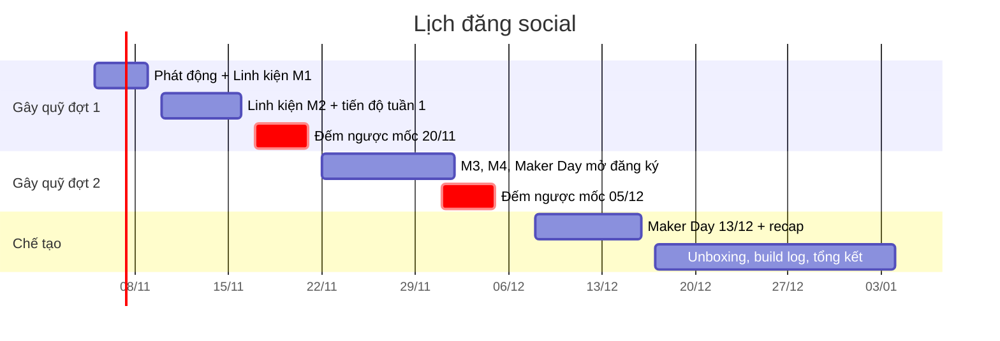

# 02 — Lịch đăng 9 tuần

Lịch cơ bản là 3 bài/tuần: **Thứ 3 và Thứ 5 lúc 19:30**, **Chủ nhật lúc 11:30**. Giờ đăng này là giả định nội bộ, chưa có dữ liệu chứng minh là giờ tốt nhất; sau 2–3 tuần, đọc Insights rồi điều chỉnh. Story đăng hằng ngày nếu có ảnh hậu trường (không bắt buộc). Lịch khớp với [../07-chuyen-linh-kien-noi-dung.md](../07-chuyen-linh-kien-noi-dung.md) §4. Nếu có sự kiện thật (hàng về, có nhà tài trợ mới), đổi bài để đăng kịp.

**Chia việc theo kênh** ([R13](../research/R13-vietnam-student-content.md) §1):
- **Facebook:** bản đầy đủ và sổ cái minh bạch.
- **Reels/TikTok:** bản 15–30 giây, dẫn người xem về sổ cái.
- **Zalo:** chỉ để nhắc lịch Maker Day và gửi link chính thức. Không gửi hàng loạt lời kêu gọi từ tài khoản cá nhân.

**Đăng video lên nhiều nền tảng** ([R11](../research/R11-reels-craft-platform.md) §2, §4):
- Xuất **một file gốc sạch** 1080×1920, không có watermark CapCut/TikTok.
- Upload riêng file đó lên từng nền tảng, **không** tải video từ TikTok về để đăng lại Facebook.
- Nhạc: bản Facebook dùng Meta Sound Collection; bản TikTok dùng Commercial Music Library hoặc âm thanh gốc. Không dùng nhạc CapCut mặc định, vì nhạc đó chỉ được dùng cho mục đích phi thương mại.
- Viết caption riêng cho từng nền tảng.
- Sau 24–48 giờ và sau 7 ngày, ghi số liệu vào [03-hook-va-cai-tien.md](03-hook-va-cai-tien.md) §5.

| Ngày | Giờ | Mã | Nội dung | Có QR? |
|---|---|---|---|:---:|
| **T5 05/11** | 19:30 | P01 + V01 | Phát động chiến dịch: poster + video 45s | ✅ |
| CN 08/11 | 11:30 | P05 | Đằng sau tấm huy chương (carousel thành tích) | — |
| T3 10/11 | 19:30 | P03-M1 + V02-M1 | Chuyện linh kiện #1: Bộ não & mắt (13.566.000 ₫) | ✅ |
| T5 12/11 | 19:30 | P08 | Chân dung thành viên #1 | — |
| CN 15/11 | 11:30 | P04 + V03-1 | Tiến độ quỹ tuần 1 + phỏng vấn nhanh #1 | ✅ |
| T3 17/11 | 19:30 | P03-M2 + V02-M2 | Chuyện linh kiện #2: Tháp nâng (7.202.500 ₫) | ✅ |
| T5 19/11 | 19:30 | P04 | **Đếm ngược:** "Còn [Y] ₫ đến mốc đặt hàng 20/11" (story T−72h đã đăng từ T3 17/11) | ✅ |
| CN 22/11 | 11:30 | P04 + P07 | **T+24h:** kết quả mốc đợt 1 + ảnh phiếu đặt hàng/biên nhận + cảm ơn. Chưa đủ tiền thì nói thẳng còn thiếu bao nhiêu và tính làm gì tiếp | — |
| T3 24/11 | 19:30 | P06 | Mở đăng ký Maker Day | — |
| T5 26/11 | 19:30 | P03-M3 + V02-M3 | Chuyện linh kiện #3: Thu phấn hoa & di chuyển (4.650.500 ₫) | ✅ |
| CN 29/11 | 11:30 | V04-1 | Build log #1: bàn làm việc, bản vẽ | — |
| T3 01/12 | 19:30 | P03-M4 + V02-M4 | Chuyện linh kiện #4: Pin & dụng cụ (5.556.000 ₫) | ✅ |
| T5 03/12 | 19:30 | P03-M5 + P04 | Linh kiện #5: Quỹ dự phòng + **đếm ngược mốc 05/12** (story T−72h từ T2 02/12, story T−24h tối 04/12, story T+24h ngày 06/12) | ✅ |
| CN 06/12 | 11:30 | P07 + V03-2 | Cảm ơn + phỏng vấn nhanh #2 | — |
| T3 08/12 | 19:30 | P06 (nhắc) | Maker Day còn bao nhiêu chỗ | — |
| T5 10/12 | 19:30 | V04-2 | Unboxing hàng từ Mỹ (nếu hàng đã về) | — |
| **CN 13/12** | cả ngày | Story | **Maker Day** — đăng story trực tiếp | — |
| T3 15/12 | 19:30 | V04-3 | Recap Maker Day | — |
| T5 17/12 | 19:30 | P08 | Chân dung thành viên #2 | — |
| CN 20/12 | 11:30 | V04-4 | Robot chạy những mét đầu tiên | — |
| T3 22/12 | 19:30 | P07 | Vinh danh nhà tài trợ | — |
| T5 24/12 | 19:30 | V03-3 | Phỏng vấn nhanh #3 | — |
| CN 27/12 | 11:30 | P04 | Báo cáo quỹ 4 ô: Tổng nhận / Đã chi / Số dư / Chứng từ, kèm ảnh sổ cái đã che dữ liệu cá nhân | — |
| T3 29/12 | 19:30 | V04-5 | Tự hành: robot tự chạy 30 giây | — |
| CN 03/01 | 11:30 | P07 | Tổng kết chặng 1 + cảm ơn | — |

**Bài có QR:** tối đa 2 bài/tuần, để tránh người xem thấy page chỉ đi xin tiền.

## Quảng cáo trả phí (tùy chọn)

Ngân sách quảng cáo là 600.000 ₫, theo [../07](../07-chuyen-linh-kien-noi-dung.md) §6. Fanpage mới có 860 follower nên chỉ boost **2 bài**:
1. **P06 Maker Day** (350.000 ₫, 4 ngày, bán kính 15 km quanh trường).
2. **V04 robot chạy lần đầu** (250.000 ₫, 3 ngày).

**Trước khi boost, kiểm tra đủ 4 điều** ([R11](../research/R11-reels-craft-platform.md) §4.3):
- Nhạc có license dùng được.
- Google Form và trang `/support` đã chạy.
- QR quét thử được trên 2 máy.
- Ads Manager không báo vi phạm chính sách.

Không boost bài xin chuyển khoản. Người lạ thấy quảng cáo xin chuyển khoản sẽ nghi ngờ. Bài được boost phải dẫn về trang minh bạch trước, rồi mới tới QR hoặc form đăng ký.
