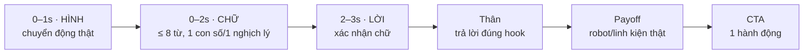

# 03 — Hook và cách cải tiến nội dung

File này tổng hợp R9–R13, rút ra những gì có nguồn để áp dụng ngay vào poster, video và caption. Mọi hook bên dưới chỉ dùng số liệu đã chốt trong [../03-thanh-tich-chuan-hoa.md](../03-thanh-tich-chuan-hoa.md), [../02-fact-sheet-mua-giai.md](../02-fact-sheet-mua-giai.md) và [../04-ngan-sach-delta.md](../04-ngan-sach-delta.md).

Research gốc: [R9 repo công cụ](../research/R9-github-marketing-repos.md) · [R10 hook](../research/R10-hook-research.md) · [R11 Reels & quy định nền tảng](../research/R11-reels-craft-platform.md) · [R12 case gây quỹ](../research/R12-fundraising-content-cases.md) · [R13 nội dung Việt Nam](../research/R13-vietnam-student-content.md).

## 1. Sáu nguyên tắc

| # | Nguyên tắc | Nguồn |
|---|---|---|
| 1 | **Mở bằng chuyển động thật, không mở bằng logo hay lời chào.** Giây đầu là robot chạy, tay đang lắp, hoặc ray trượt bật lên. | R10 §2.4 (Logan Smith `IPW-MF8Kp0I` 01:53), R10 §4.2 (FTC 11047 `HKu4uYuqVcA`) |
| 2 | **Hình, chữ và lời nói cùng chở một ý.** Hình gây chú ý, chữ trên màn hình nói ý chính (vì nhiều người xem tắt tiếng), lời nói xác nhận lại. Ba thứ này không được kể ba chuyện khác nhau. | R10 §2.5 (Natasha Pierre `uXq6vVPNc4Y` 00:34), Kallaway `xnOe8aA9Pmw` 13:30 |
| 3 | **Tạo khoảng trống tò mò, đừng hỏi câu chung chung.** Trong 1.238 video top được Ames Create phân tích, 28% mở bằng curiosity gap, chỉ 1% mở bằng câu hỏi trực tiếp. Hook dạng câu hỏi chỉ dùng khi câu hỏi có con số hoặc chi tiết cụ thể. | [Ames Create, cập nhật 10/2026](https://amescreate.com/video-hooks) |
| 4 | **Hook hứa gì thì video phải trả đúng điều đó.** Hứa "robot nghĩ bằng gì" thì phải cho thấy Control Hub và cảnh tự hành. Hook mà không trả lời được sẽ làm mất lòng tin, mà gây quỹ sống nhờ lòng tin. | R10 §2.4 (Logan Smith 05:45), R10 §6 |
| 5 | **Cụ thể hơn cảm xúc.** Nêu rõ "M1 cần 13.566.000 ₫, đã nhận X, còn Y đến 20/11". Đừng viết "hãy giúp ước mơ". Người ta dễ cho tiền hơn khi biết số tiền đi đâu, và dễ cho hơn nữa khi quỹ đã gần đạt mốc. | R12 §3 (Cryder & Loewenstein; Kuppuswamy & Bayus) |
| 6 | **Minh bạch là một phần của hook.** Sau vụ sao kê bão Yagi, người Việt quan tâm cả tiền vào lẫn tiền ra. Lời hứa "cùng xem tiền đi đâu" vì vậy cũng là lý do để người ta dừng lại xem. | R13 §4 |

## 2. Công thức hook cho chiến dịch này

Có bốn kiểu hook hợp với đội. Kiểu nào cũng dựa trên số thật:

| Kiểu | Khi nào dùng | Mẫu |
|---|---|---|
| **Tương phản số liệu** | Lúc phát động, khi kể chuyện làm lại sau mùa kém | "36/38 mùa trước. Mùa này làm lại từ linh kiện." |
| **Khoảng trống tò mò cụ thể** | Chuyện linh kiện | "30 giây không ai cầm tay cầm. Robot nghĩ bằng gì?" |
| **Ngắt mạch thị giác** | Tháp nâng, bánh Mecanum, unboxing | Ray trượt từ 45 cm bật lên 1,2 m, quay slow-mo 60fps |
| **Mốc thật** | Đếm ngược tiền | "Còn Y ₫ đến mốc đặt hàng 20/11", và nói rõ lý do: hàng từ Mỹ mất 14–21 ngày |

## 3. Ngân hàng hook đã kiểm chứng

Cột **Điều kiện** cho biết lúc nào mới được dùng câu đó. Câu nào ghi "chỉ khi đúng" thì chỉ dùng khi chuyện đã xảy ra thật. Không bịa tình huống.

### V01 — Phát động (05/11)

| Hook (chữ trên màn hình) | Hình 0–2s | Điều kiện |
|---|---|---|
| **"36/38 mùa trước. Mùa này làm lại."** | Tay siết bu-lông vào khung, nghe rõ tiếng "cạch" | Dùng được ngay. **Chọn câu này làm hook chính.** |
| "Học sinh trường huyện làm robot thi đấu quốc tế?" | Robot cũ chạy, cắt nhanh | Dùng được, làm phương án B để A/B test |
| "11 linh kiện. 33.975.000 ₫. Tiền đi đâu, xem ở đây." | Bày 11 món lên bàn, quay từ trên xuống | Dùng khi đã có đồ để bày |

### V02 — Chuyện linh kiện

| Mission | Hook chính | Hình 0–2s | Hook dự phòng |
|---|---|---|---|
| M1 · 10/11 | **"30 giây không ai cầm tay cầm. Robot nghĩ bằng gì?"** | Robot tự chạy, tay cầm đặt trên bàn | "Mùa trước: 8,6 điểm tự hành. Trung bình giải: 22,6." |
| M2 · 17/11 | **"Xuất phát 45 cm. Phải với tới 1,2 m."** | Ray trượt bật lên, slow-mo | "Còn Y ₫ đến mốc đặt hàng 20/11." |
| M3 · 26/11 | **"Robot đi ngang như cua."** | Quay từ trên xuống cảnh robot đi ngang | "4 bánh, 4 động cơ, đi được mọi hướng." |
| M4 · 01/12 | **"Hết pin giữa trận thì sao?"** | Đồng hồ đếm ngược, tay thay pin | "2 cục pin, 1 bộ dụng cụ, vài phút giữa hai trận." |
| M5 · 03/12 | **"3 triệu dự phòng để làm gì?"** | Ảnh sổ cái đã che thông tin cá nhân | "Robot gãy trước trận. Sửa bằng tiền nào?" |

### V03 — Phỏng vấn

Mở bằng câu trả lời **thật** hay nhất của buổi quay, dài 1,5–2 giây, rồi mới hiện câu hỏi. **Không** soạn sẵn câu trả lời gây sốc. Câu trả lời đó phải là lời bạn ấy đã nói và đồng ý cho đăng.

### V04 — Build log

| Video | Hook | Điều kiện |
|---|---|---|
| #2 Unboxing | Dao rạch băng keo, nhấc Control Hub lên sát ống kính. Chữ: **"Hàng từ Mỹ về rồi."** | Chỉ khi hàng thật đã về |
| #2 Unboxing | "Mua bằng tiền của [N] người ủng hộ." | N lấy từ sổ cái đã đối soát |
| #4 Chạy lần đầu | Bánh quay trên sàn, nghe rõ tiếng motor. Chữ: **"Những mét đầu tiên."** | Chỉ khi khung gầm chạy thật |
| #5 Tự hành | Đồng hồ 30 giây, không ai chạm tay cầm. Chữ: **"Mùa trước 8,6 điểm. Giờ thì sao?"** | Chỉ khi có điểm tự hành đo được |
| #3 Maker Day | Tiếng reo khi robot ghi điểm | Chỉ dùng hình có phiếu đồng ý |

### Bìa poster (dưới 8 từ)

| Poster | Chữ bìa |
|---|---|
| P01 | **11 LINH KIỆN ĐỂ ROBOT SÓC SƠN RA SÂN** |
| P03-M1 | **30 GIÂY TỰ HÀNH: ROBOT NGHĨ BẰNG GÌ?** |
| P04 | **CÒN [Y] ₫ ĐẾN MỐC [HẠN]** |
| P05 | **4 NĂM · 5 GIẢI · 1 LẦN 36/38** |
| P06 | **CAN YOU BEAT THE ROBOT?** |

### Dòng đầu caption (khoảng 120 ký tự, đọc được trước nút "Xem thêm")

| Caption | Dòng đầu |
|---|---|
| C01 #phat-dong | "Mùa trước tụi mình xếp 36/38. Mùa này làm lại từ 11 linh kiện, và tiền đi đâu ai cũng xem được." |
| C01 #huy-chuong | "Top 4 toàn quốc 2023, Á quân 2025, rồi 36/38 mùa vừa rồi. Tụi mình không giấu dòng cuối." |
| C01 #chuyen-linh-kien | "[Hook ảnh 1]. M[x] cần [số] ₫, đã nhận [X], còn [Y] đến mốc [hạn]." |
| C01 #tien-do | "CÒN [Y] ₫ ĐẾN MỐC [hạn]. Đã nhận [X] / 33.975.000 ₫, cập nhật [ngày giờ]." |

Hook bị loại khỏi bộ R10: các câu kể chuyện chưa xảy ra (cháy mạch, ngủ 4 tiếng, lời bố mẹ, "50 nhà hảo tâm", "18 ngày", "chính xác tuyệt đối"). Các câu này chỉ được dùng lại khi trở thành sự thật và người trong cuộc đồng ý.

## 4. Không bao giờ

- **Kể khổ** ("ước mơ nghèo khó"). Nói về năng lực: học sinh tự vẽ CAD, tự code, tự lắp.
- **Gấp gáp giả** ("robot sẽ bị giải tán"). Hạn chót phải có lý do thật: 20/11 vì hàng từ Mỹ mất 14–21 ngày.
- **Hứa kết quả thi** ("chắc chắn vô địch", "chắc chắn đi Mỹ").
- **Slang lố** ("flex", "toang", "lụm tiền", "xin vía") và FOMO gây tội lỗi.
- **Đăng ảnh app ngân hàng nguyên bản**, có tên người chuyển, số tài khoản hoặc số dư.
- **Nhạc CapCut mặc định** trên Page. **Watermark TikTok** trên bản đăng Facebook.

## 5. Đo lường và A/B với 860 follower

Meta định nghĩa **3-second video plays** là số lần video được phát ít nhất 3 giây, không tính lần xem lại trong cùng một lượt hiển thị ([Meta Help](https://www.facebook.com/business/help/743427195703387)). Đội tự tính **tỷ lệ giữ 3 giây = 3-second plays ÷ lượt hiển thị**. Chỉ dùng tỷ lệ này để so các video **của chính đội** với nhau, không đặt mục tiêu theo "chuẩn ngành", vì chưa có nguồn đáng tin.

**Cách A/B không tốn tiền:**
1. **Story bình chọn:** đăng 2 ảnh bìa hoặc 2 hook. Bản thắng dùng cho bài chính.
2. **V02:** M1 và M3 dùng hook tò mò; M2 và M4 dùng hook tương phản. Sau 48 giờ, so tỷ lệ giữ 3 giây và thời gian xem trung bình, rồi chọn kiểu thắng cho V04.
3. **Boost P06 hoặc V04:** chia 100.000 ₫ cho 2 bản hook, so chi phí cho mỗi 3-second play.

**Bảng ghi số mỗi bài** (sau 48 giờ và sau 7 ngày):

| Ngày | Mã | Hook | Hiển thị | 3s plays | Giữ 3s % | Xem TB (s) | Share | Lượt chuyển khoản có mã Mx | Đăng ký Maker Day |
|---|---|---|---:|---:|---:|---:|---:|---:|---:|
| | | | | | | | | | |

Lượt xem **không** chứng minh có người ủng hộ. Số người ủng hộ thật chỉ tính từ sổ cái, theo mã `BIOBUZZ Mx` trong nội dung chuyển khoản (R12 §4).

## 6. Công cụ miễn phí nên dùng (R9)

| Việc | Công cụ | Verdict |
|---|---|---|
| Phụ đề tiếng Việt offline | [Subtitle Edit](https://github.com/SubtitleEdit/subtitleedit) + [PhoWhisper](https://github.com/VinAIResearch/PhoWhisper) / [faster-whisper](https://github.com/SYSTRAN/faster-whisper), xuất SRT rồi nhập vào CapCut | Dùng ngay |
| Cắt clip thô không giảm chất lượng | [LosslessCut](https://github.com/mifi/lossless-cut) | Dùng ngay |
| Nháp hook/caption | [Ollama](https://github.com/ollama/ollama) + prompt từ [marketing-prompts](https://github.com/krishna-build/marketing-prompts) | Dùng ngay. **Người duyệt số tiền, STK và fact trước khi đăng.** |
| Thanh tiến độ từ số thật | [Chart.js](https://github.com/chartjs/Chart.js) đọc từ Google Sheet | Dùng ngay |
| Lên lịch tự động | Postiz / Mixpost | Bỏ qua. Cần Docker và quyền Meta API; đăng tay theo [02-lich-dang.md](02-lich-dang.md) |

Lệnh cài chi tiết: [R9 §Top 10](../research/R9-github-marketing-repos.md).
