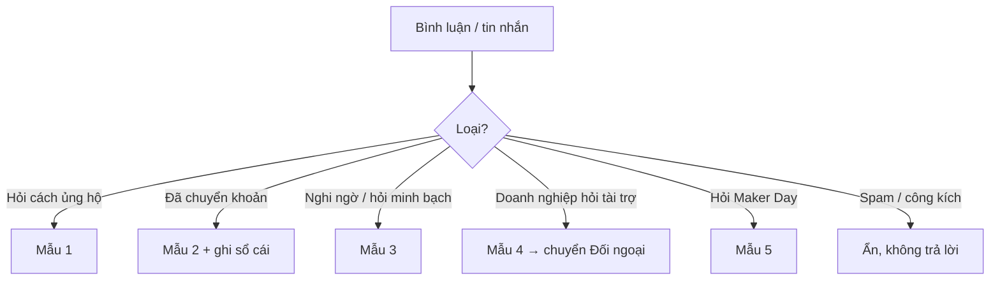

# C02 — Mẫu trả lời bình luận & tin nhắn

Trả lời trong **24 giờ** (mục tiêu là trong ngày). Luôn lịch sự, không cãi tay đôi. Câu nào liên quan tiền mà chưa chắc thì hỏi Trần Tuệ Minh trước rồi mới trả lời.

## Mẫu 1 — Hỏi cách ủng hộ

> Dạ cảm ơn bạn nhiều ạ 💙 Bạn chuyển khoản giúp mình vào MB Bank, STK 0962969817, chủ tài khoản TRAN TUE MINH, nội dung "BIOBUZZ + họ tên + SĐT" nhé. QR có ở ảnh cuối bài. Tụi mình sẽ cập nhật tên bạn lên sổ cái công khai trong 24h ạ.

## Mẫu 2 — Báo đã chuyển khoản

> Dạ tụi mình nhận được rồi ạ, cảm ơn bạn rất nhiều 🙏 Tụi mình sẽ ghi khoản này vào sổ cái công khai tại roboticssocson.com/support trong 24h. Bạn có muốn để tên công khai trong bài cảm ơn cuối tuần không ạ, hay để "Một người bạn"?

**Việc phải làm sau khi trả lời:** đối chiếu sao kê, ghi vào sổ cái, đánh dấu người này đồng ý hay không đồng ý công khai tên.

## Mẫu 3 — Nghi ngờ, hỏi tiền đi đâu

> Dạ cảm ơn anh/chị đã hỏi, người ủng hộ có quyền kiểm tra tiền đi đâu ạ. Tại roboticssocson.com/support, tụi mình cập nhật tổng tiền đã nhận, từng khoản chi, số dư và trạng thái mua hàng. Mỗi Chủ nhật tụi mình đối soát một lần, và đăng hóa đơn hoặc phiếu đặt hàng ngay khi mua. Mục tiêu cả chiến dịch là 33.975.000 ₫ cho 11 linh kiện và quỹ dự phòng. Nếu số thực tế thay đổi, tụi mình ghi rõ lý do và số mới trên sổ. Với người chưa đồng ý công khai, tụi mình che tên, số tài khoản và số điện thoại. Anh/chị muốn xem chứng từ của mission nào (M1 đến M5) thì nhắn page, tụi mình gửi đúng phần đó ạ.

**Không:** xóa bình luận nghi ngờ, trả lời gay gắt, hay hứa những điều chưa làm được. Khoản nào chưa có chứng từ thì nói "đang đối soát" hoặc "chưa mua". Đối chiếu số với người phụ trách tài chính trước khi trả lời ([R13](../../research/R13-vietnam-student-content.md) §4).

## Mẫu 4 — Doanh nghiệp hỏi tài trợ

> Dạ cảm ơn anh/chị đã quan tâm ạ. Robotics Sóc Sơn có 4 mức đồng hành (3, 5, 10, 25 triệu) và cũng nhận hỗ trợ bằng linh kiện. Anh/chị cho em xin email hoặc số điện thoại, em gửi hồ sơ 1 trang và hẹn trao đổi ạ.

**Việc phải làm:** ghi doanh nghiệp vào CRM ([../../11-crm-prospect.md](../../11-crm-prospect.md)), gửi one-pager ([../../09-sales-kit.md](../../09-sales-kit.md)). Nếu doanh nghiệp cần chứng từ kế toán thì báo Ban Giám hiệu ([../../10-support-thanh-toan-phap-ly.md](../../10-support-thanh-toan-phap-ly.md)).

## Mẫu 5 — Hỏi Maker Day

> Dạ Maker Day diễn ra Chủ nhật 13/12 tại THPT Sóc Sơn, dành cho các bạn lớp 3–9, có 2 ca (8:30–11:00 và 14:00–16:30). Vé 79.000 ₫ nếu đăng ký trước 28/11, sau đó 89.000 ₫, đã gồm kit thực hành, bánh sữa, giấy chứng nhận và sticker. Phụ huynh đăng ký giúp con tại: [link Google Form] ạ.

## Mẫu 6 — Hỏi "sao không xin trường / nhà nước?"

> Dạ trường vẫn đang hỗ trợ đội về phòng lab và thủ tục ạ. Riêng linh kiện chuẩn thi đấu phải mua từ Mỹ, nên tụi mình chủ động gây quỹ thêm. Tiền chỉ dùng cho đúng 11 linh kiện, công khai từng khoản ạ.

## Không bao giờ

- Hứa hẹn kết quả thi ("chắc chắn vô địch", "chắc chắn đi Mỹ").
- Nói số tiền đã nhận khác với sổ cái.
- Gửi số tài khoản nào khác ngoài **0962969817 MB Bank TRAN TUE MINH**. Nếu có người mạo danh đội để xin tiền, đăng cảnh báo ngay.
